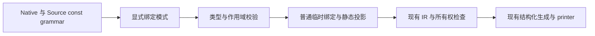
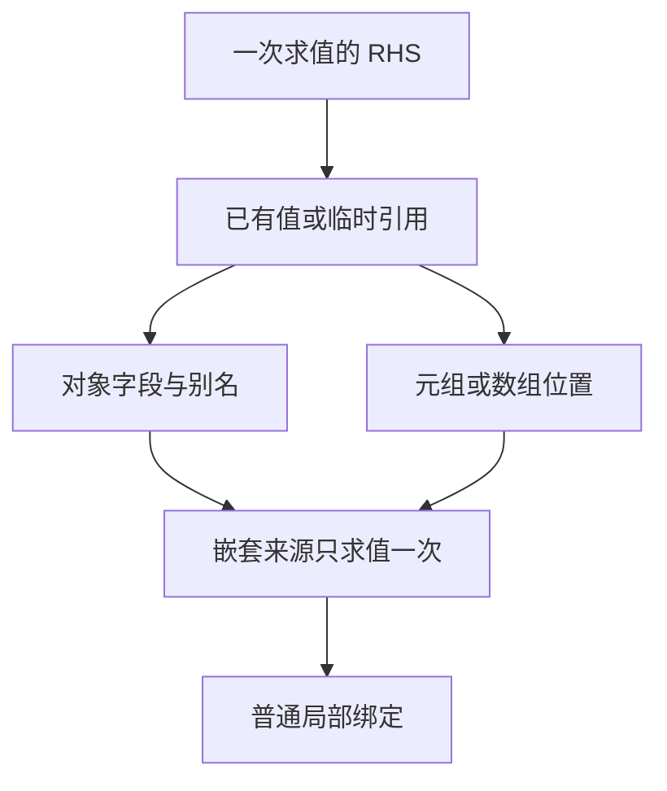

# 解构声明实现

## Intent：最终目标

支持 TypeScript 风格 const 解构，减少重复字段访问和无意义中间 const。解构只
作为编译期语法糖，复用普通字段投影、元组投影和数组索引，RHS 只求值一次，
不新增专用运行库、动态协议或数据载荷复制。实现后用于实际 ZX 代码精简。

用户原话已追加到 docs/user_request.jsonl：对象/元组等可解构类型、no cost、让代码更精简。

## Data：可用证据

现有 ast.Statement.destructure 只有 names 和 value；支持平坦完整元组槽位，必须
用 _ 丢弃。Native parser_statements 与 Source parser/body/grammar/constant 均如此。
普通对象、别名、嵌套、空位及数组目前没有完整实现。

Native analysis/statements 和 iteration/block、Source analyzer/statements/destructure
及 statements/scopes/destructure 分别处理块与 loop/lambda 作用域。现有 Scope 路径
已经使用 temporary + tuple_field，可复用一次求值和静态投影的成本模型。

已有 compiler frontend/types/style/lifetime、test 包 tuple-bindings 和 typed-try
覆盖旧契约。typed_try 依赖完整双槽建立错误/成功关联，不能为了普通语法糖放松。

## Edges：边界与限制

- 优先完成 const 的对象、属性别名、嵌套与数组/元组绑定；省略槽位与 _ 均可丢弃。
- 其他类型只复用已有成员/索引能力，不引入 JS 迭代器或动态属性运行库。
- 每层复合来源至多求值一次，保留属性/索引顺序、边界错误与资源所有权。
- 普通元组简写和直接 try 捕获需分别处理，保留捕获关联及错误处理要求。
- 模型要显式表达绑定模式，不能用业务值或奇怪占位字符串编码语义。
- rest/default 需沿已有不可变集合及可空契约核对，不能把 TS undefined 与 ZX null
  随意等同，也不能声称全部 TS 语法已经支持。
- 无用户要求不新增测试文件；更新确被新契约影响的既有检查，并通过生产代码消费
  解构进行自举验收，不能只让用户例子通过。

## Answer：交付与成功标准

1. 同步 Native/Source 语法模型、解析器、索引语法与 adapter，避免 seed/正式编译器分叉。
2. 同步普通块和 loop/lambda 作用域绑定，复用已有 IR；保留 try 捕获专门契约。
3. formatter/lint 能区分绑定模式和对象/数组值字面量，解构不能被强制当值纵向排版。
4. 选取真实重复取字段或元组投影代码改为解构，保持精简，不为使用新特性增加包装。
5. 运行受影响的既有检查、正式构建与两代一致；按实际生成变化验证固定输入性能。
6. 全部变更统一验收、提交并推送；完成后继续自举。
