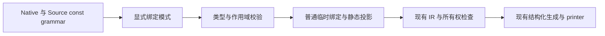
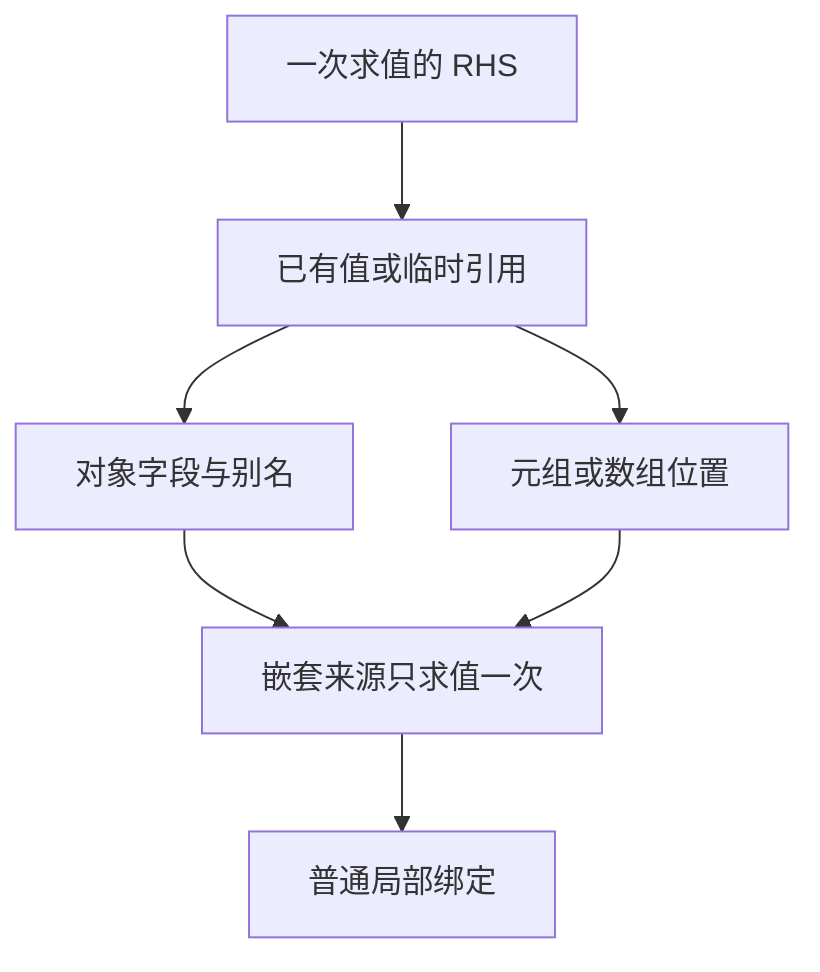

# 解构声明实现

## Intent：最终目标

支持 TypeScript 风格 const 解构，减少重复字段访问和无意义中间 const。解构只
作为编译期语法糖，复用普通字段投影、元组投影和数组索引，RHS 只求值一次，
不新增专用运行库、动态协议或数据载荷复制。实现后用于实际 ZX 代码精简。

用户原话已追加到 docs/user_request.jsonl：对象/元组等可解构类型、no cost、让代码更精简。

## Data：可用证据

现有 ast.Statement.destructure 只有 names 和 value；支持平坦完整元组槽位，必须
用 _ 丢弃。Native parser_statements 与 Source parser/body/grammar/constant 均如此。
普通对象、别名、嵌套、空位及数组目前没有完整实现。

Native analysis/statements 和 iteration/block、Source analyzer/statements/destructure
及 statements/scopes/destructure 分别处理块与 loop/lambda 作用域。现有 Scope 路径
已经使用 temporary + tuple_field，可复用一次求值和静态投影的成本模型。

已有 compiler frontend/types/style/lifetime、test 包 tuple-bindings 和 typed-try
覆盖旧契约。typed_try 依赖完整双槽建立错误/成功关联，不能为了普通语法糖放松。

## Edges：边界与限制

- 优先完成 const 的对象、属性别名、嵌套与数组/元组绑定；省略槽位与 _ 均可丢弃。
- 其他类型只复用已有成员/索引能力，不引入 JS 迭代器或动态属性运行库。
- 每层复合来源至多求值一次，保留属性/索引顺序、边界错误与资源所有权。
- 普通元组简写和直接 try 捕获需分别处理，保留捕获关联及错误处理要求。
- 模型要显式表达绑定模式，不能用业务值或奇怪占位字符串编码语义。
- rest/default 需沿已有不可变集合及可空契约核对，不能把 TS undefined 与 ZX null
  随意等同，也不能声称全部 TS 语法已经支持。
- 无用户要求不新增测试文件；更新确被新契约影响的既有检查，并通过生产代码消费
  解构进行自举验收，不能只让用户例子通过。

## Answer：交付与成功标准

1. 同步 Native/Source 语法模型、解析器、索引语法与 adapter，避免 seed/正式编译器分叉。
2. 同步普通块和 loop/lambda 作用域绑定，复用已有 IR；保留 try 捕获专门契约。
3. formatter/lint 能区分绑定模式和对象/数组值字面量，解构不能被强制当值纵向排版。
4. 选取真实重复取字段或元组投影代码改为解构，保持精简，不为使用新特性增加包装。
5. 运行受影响的既有检查、正式构建与两代一致；按实际生成变化验证固定输入性能。
6. 全部变更统一验收、提交并推送；完成后继续自举。

### 已实现的贯通路径

- ast.BindingPattern 显式保存 name/object/sequence；Source 绑定节点在既有 names 表
  增加 kind、key、head、count，不通过源码片段或特殊业务字符串编码模式。
- Native/Source grammar、Native AST adapter、indexed syntax view 和 Native analysis
  host 同步传递模式；索引视图按子段建立线性顺序表，避免逐子查找造成平方扫描。
- 对象/别名/嵌套经现有 field 规则；数组/字符串经现有 index 规则，字符串为 u8。
  已有纯引用与投影可直接复用，其他复合来源只保存一次，不新增运行时 IR 种类。
- 平坦普通元组允许省略尾部，IR 按完整元组补 null symbol；原完整路径保持不变。
  直接 capture 必须完整平坦，原 typed_try 检查未放松。
- formatter 将绑定对象与对象值区分，绑定可单行且按 90 列自然换行；非空对象值仍
  垂直。lint 递归校验实际绑定名，不对外部属性键强加本地变量命名。
- 当前范围为 const 对象、别名、嵌套、序列空位/丢弃与部分元组。rest/default、参数
  及赋值解构未实现，不声称完整 TypeScript 兼容。

### 实际代码精简

转移历史 append、AST binary context、pattern.project/flat/run 与 numeric 参数读取
已消费新语法。包括普通对象参数、嵌套别名、结构化调用返回值一次绑定，以及三个
连续数组位置由三条 const 合并为 `const [first, lower, upper] = in.values`。
没有为使用语法新增 slice、包装对象或多余转发函数。

### 验证与修正

- 首轮发现 pad 后符号变量与已有空 symbols 同名，已将初始向量明确命名 initial_symbols。
- Hole 在 Native AST adapter 中统一映射为 `_`，避免 Source 空位被错误读成逗号绑定。
- Native seed 38/38、Source 正式工具 20/20 步通过；两代 main 各 2507 文件、collections
  各 50 文件，仅 `.zxc-inputs` 身份标记不同。额外生产消费改动后已重新核对。
- 编译器 372 项、相关 tuple-bindings/typed-try/function/value/update/Task 共 758 项通过，
  总计 1130 项。既有普通部分元组拒绝断言按新契约改为接受，捕获缺槽拒绝仍保持。
- 未新增测试文件或浏览器检查，使用真实 Source 消费和既有检查验收。

固定输入继续为 readability-final/cache-closure/manifest.json，141 入口、2220 模块、
1982 函数文件、2268 个产物仅身份标记不同。四轮交替，完整保留首轮，后三轮中位：

| 指标     |       变更前 |       变更后 |
| -------- | -----------: | -----------: |
| CPU      |      5.34 秒 |      5.32 秒 |
| 墙钟     |      1.18 秒 |      1.17 秒 |
| 峰值 RSS | 495,583,232B | 491,749,376B |

固定累计 CPU 基线仍约 5.34 秒，不随本阶段重置。RSS 有历史窗口波动，不以微小
差值宣称稳定收益。新工具首轮 CPU 5.39 秒、墙钟 3.11 秒，infer 531ms、emit 417ms、
write 66ms；首次额外等待尚未归因，保留全部样本。报告位于 .zig-cache 下 destructure。

后续两处生产消费改写复用同一生成逻辑与既有等价证据，重新执行了 Source 自编译
及产物一致。最终关键字属性别名按现有 property 规则补齐，只放开键，不允许把
关键字作为无冒号绑定名；其增量验收在收口时补齐。

### 自我复核

语法糖没有新增运行时容器、解释器或动态分派，保持已有引用与不可变语义；临时
绑定对应手写 const 的成本模型，不能将“没有新增 IR 种类”单独当作性能证明。
本阶段同时核对实际生成产物、累计性能与真实 Source 消费。整个自举仍未完成，
专用 Native 存储、转换等剩余职责继续迁移。

### 最终收口

关键字属性别名增量验收：Native seed 38/38、Source 正式工具 20/20 步通过，
已有 frontend 14/14 步、313/313 项检查通过。最终两代 main 各 2507 文件、collections
各 50 文件，仅身份标记不同。313 项是前述 372 项的受影响子集，不重复累计计数；
本阶段仍报告 1130 项既有检查，另外注明最终前端复核。

关键字改动只沿现有 property 词法规则扩展键，冻结输入未使用此新增分支；后续
语义等价消费改写及该局部解析对齐复用已取得的性能证据，不重复无关计时。

检查本次 diff：绑定模式命名、空位、静态位置/字段类型、try 协议、作用域、formatter
和真实 Source 消费同步；没有新增测试文件、专用运行层或目标用例硬编码。应用指南
同步说明范围与不可变集合元组协议。全部变更一起提交推送，随后确认工作区干净。

### 精简目的的后续对齐

解构用于合并重复读取、消除只为取字段保留的中间绑定，并配合属性简写。只有一次
读取且成员访问已经清楚时继续保留成员表达式，不为展示语法增加包装或无意义别名。

本次对齐三处真实消费：growth/normalize/initialize 直接解构 initialize 的返回值，
并用 context、body 简写组装结果；ownership/needed 合并输入字段绑定；growth/callee
为重复使用的 source、context 建立一次绑定。保留原有算法、分支与调用求值顺序。

正式 Source 工具构建 21/21 步通过。固定输入仍为同一份 141 入口、2220 模块的
manifest，改写前后各 2268 个产物，仅 .zxc-inputs 身份标记不同。本次为等价写法
调整，复用既有性能证据，不重新进行性能计时。原始日志和产物在
.zig-cache/cold-build-analysis/destructure-consumption 下。

旧 partitions/native-default-p2-install 中的 lint 可执行文件早于解构支持，不能解析
本次绑定语法；其错误不作为当前源码 lint 结果。使用已支持绑定模式的 formatter、
当前正式 Source 自编译和既有前端检查验收，并复核本次 diff 的排版与行数。

最终既有前端检查 14/14 步、313/313 项通过，未新增测试用例。此项精简消费调整已
收口；所有权 helper 选择规则等剩余自举职责继续按原目标推进，未视为完整自举完成。
