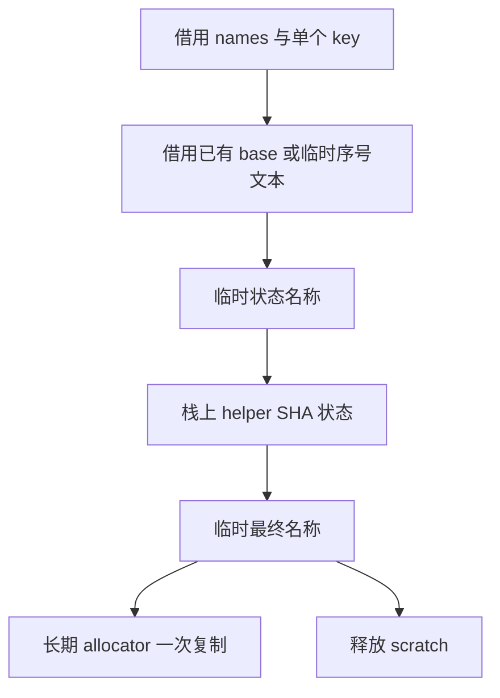

# 辅助函数复用状态命名

## Intent：最终目标

让 helper 命名的 RX 流程直接复用已有 ZX 类型状态命名，移除正式路径对 Native
state_plan.name 的最后一个调用，保持哈希字节与名称一致，并缩短中间文本生命周期。

## Data：可用证据

analysis/types/state/name.zx 已实现 base、分隔字节、key 的 SHA-256 及 value_ 前缀，
其 base 复用 types/abi/name.zx，支持已有名称和 zx_type_ 序号回退。Native outlined
此前仍在进入 Source 命名前长期分配 base/state_name，这些文本只用于后续哈希。

全仓 state_plan.name 的其他调用均位于 seed 实现或正式路径提前返回后的分支。
正式类型定义、共享状态及导出名称已经消费 Source 命名逻辑，本次统一最后一个
正式消费者，不另写一套命名算法。

## Edges：边界与限制

- Native 只借用 type_names、单个 32 字节 key、资格数据并初始化通用 SHA 状态；
  不构造所有 key 的描述符数组，不复制底层名称或 key。
- 中间 base/state_name、分片描述符、digest、hex 和组装结果属于命名 scratch，
  最终名称复制一次至长期 allocator；不改变类型句柄准备与后续执行顺序。
- Source 状态名称复用现有 sha256Parts，helper 资格部分保持逐字节流式更新。
- Native 联合声明列表的查重仍未迁移。将每次查重改成复制名称列表会增加分配，
  不采用该捷径；需要调整真实声明存储后再迁移查重与外层流程。
- 不新增测试；当前性能证据限定 arm64，固定累计基线不重置。

## Answer：交付与成功标准

正式 helper 名称的 base、状态名称、资格哈希及前缀全部来自既有或本阶段 RX/ZX。
两代及阶段前后函数产物一致，既有相关检查通过，单阶段与固定基线无累计退化。
提交推送全部变更，确认工作区干净且无未推送提交；不宣称声明状态与完整流程已自举。

## 执行记录

已接通已有状态命名与真实 helper 消费者。Seed 构建通过 39/39 步，正式 Source
工具构建通过 21/21 步。阶段对照交替八轮，排除首轮的 CPU 中位数为 5.33 →
5.33 秒，wall 为 1.15 → 1.15 秒，峰值 RSS 为 495681536 → 495124480 字节。
相同冻结 manifest 的 2268 个文件均仅输入标识不同，不把小幅 RSS 差异解释为
稳定收益。固定 anchor 同批 CPU 为 5.35 → 5.32 秒，wall 为 1.18 → 1.15 秒，
峰值 RSS 为 495075328 → 493895680 字节，未见累计 CPU/耗时退化。

性能测量先于其他构建执行；冻结输入仍为 141 个入口、2220 个模块，累计 anchor
SHA256 保持 `8f1e7cee1eadb3ea0f6f7150bab951c55672ce294e4fbe7c50d5858723bdd92d`。
相对该旧 anchor 的类型文件与清单哈希仍仅有上一阶段已验证的标准 SHA-256 接口
增量；本阶段没有继续扩大产物差异。两代生成 main 2704 个文件、collections
50 个文件、growth 137 个文件均仅输入标识不同。编译器 372/372 项通过，所有权
相关六组检查通过 350/350 步、1124/1124 项，合计 1496 项。未新增测试用例。

本地证据在 `.zig-cache/cold-build-analysis/ownership-state-name/`：native.log、
production.log、final-runtime-comparison.json、cumulative-runtime-comparison.json，
构建产物与日志均不提交。
两代及行为证据为 final-fixedpoint-result.json、final-compiler-tests.log、
final-related-tests.log。标准库能力本轮未改动，复用上一阶段的资源及引用检查，
没有重复执行无关标准库回归。

### 自我复核

本次复用既有类型状态命名，没有新增另一套格式化或哈希算法，也没有为接入
Source 构造全量 key 视图。原 Native 状态名称方法仍供 seed 使用；正式路径的
相关类型生成早已由 Source 提前返回，本次消除其最后一个正式 helper 消费点。
仅将中间文本转入短期存储，不能据此宣称全部 AST 状态或所有权流程完成自举。

### 后续声明状态迁移边界

只读审计确认写入仅来自 tasks/worker、sorting/root 的常量占位及按位置替换、
tasks/allocator 的常量追加和 ownership/helper 的函数追加。线性函数名查重不需
新索引。Source 可统一现有 Constant/Function 列并通过 executeState 保留增长容量；
占位先插入再递归、更新原 slot 以及 Lower 浅拷贝共享同一状态头必须保留。

通用 node/import_rows 已能导入 declaration_rows，不需要新增专用桥。尚需贯通
Lower.declarations 与 modules.functionPrepared 的有序 range/分段输出，并直接复用
全局 field_columns；否则 Source 列先恢复 AoS、再存入 nodes.declarations 会重复
存储参数。此项仍未实现，不将审计结论计为迁移成果。
