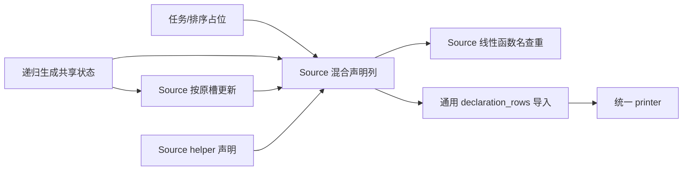
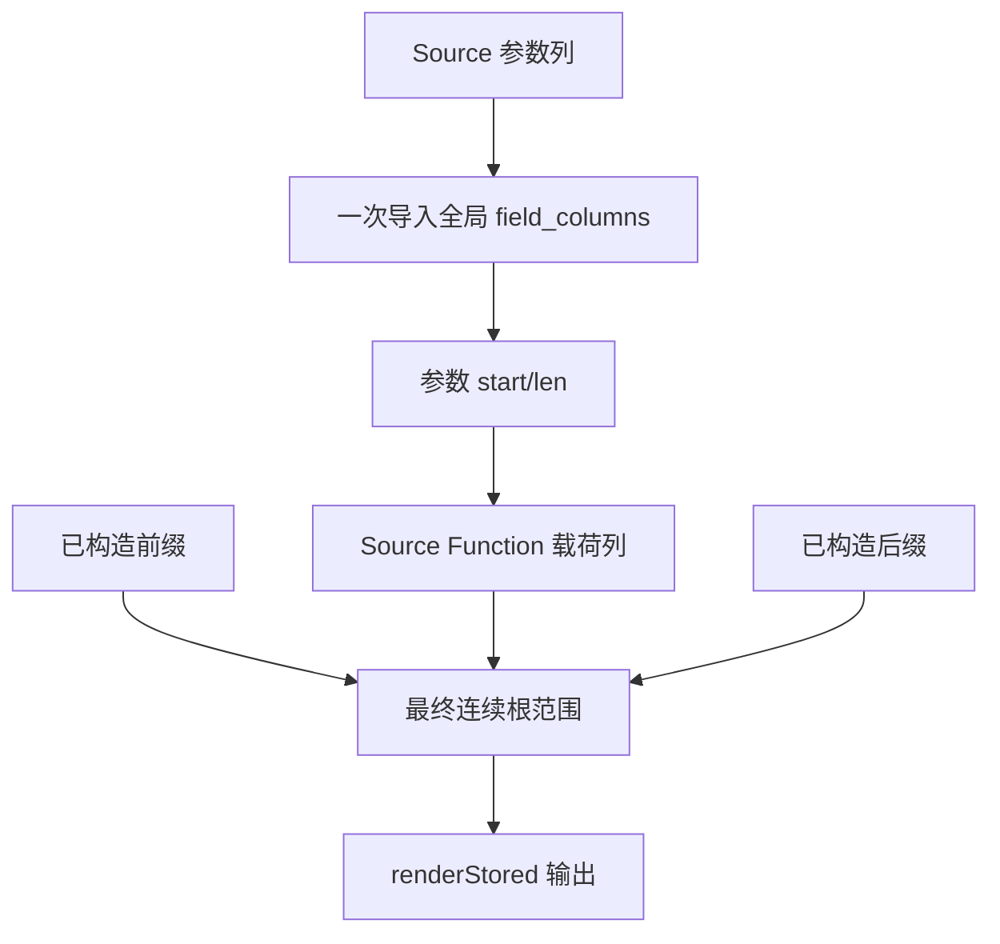

# 辅助声明状态自举

## Intent：最终目标

将辅助声明的顺序、常量占位、按原位置更新及函数名称查重迁入 Source 声明列，
并直接生成最终存储范围。保留递归生成共享状态与原有顺序，避免参数记录往返复制。

## Data：可用证据

写入来自 tasks/worker、sorting/root、tasks/allocator 与 ownership/helper。前两者
先占位，再递归生成并替换原位置；Lower 浅拷贝共享同一列表指针。原查重仅扫描
函数名，常量不参与匹配。最终 Lower.declarations 与 modules.functionPrepared
分别在前缀、辅助声明、后缀之间保持已有次序。

已有 Constant/Function 模型、executeState、push/with 和 import_rows 可表达这些
规则。当前 AoS 函数导入器会先分配参数记录、随后再次存入 field_columns；本次
将参数一次导入全局字段列，声明仅持有范围，后续直接导入 declaration_rows。

## Edges：边界与限制

- Source table 以 tags/offsets 表达全局顺序，Constant/Function 各有载荷列；函数
  名称在函数列中按追加顺序扫描，不增加哈希索引或重复的 helper_names 状态。
- Native facade 仅保存 Source 的带容量状态、转换 ABI 描述符及写入最终存储。
  所有递归 Lower 使用同一 facade 指针，不保存各自状态快照。
- 常量追加与替换保留完整 name/type/value/exported；allocator 常量不额外去重。
- 先构造全部后缀，再按前缀/Source 辅助列/后缀写入连续根范围，避免后缀构造中
  的 namespace 声明插入根范围。公开成员尾部只构造 import/field，不插入声明。
- 名称文本继续借用长期 allocator 或静态常量，临时源列不逃逸；字段记录与最终
  声明列由最终 allocator 持有。旧 AoS 导入器移除，seed 仍使用旧数据表示。
- AST 存储、任务/排序函数体生成及外层流程尚有 Native 过渡实现，不宣称完整自举。
- 不新增测试；按实际触及的所有权、任务、排序与公开输出范围运行已有检查，
  记录阶段及固定累计基线的 CPU、wall、RSS 与产物对照。

## Answer：交付与成功标准

正式声明的追加、占位替换与查重来自 ZX，最终输出不再还原辅助声明 AoS 或重存
参数。两代及前后产物对齐，既有相关检查通过，无累计性能退化。收口全部变更，
提交推送后确认干净且无未推送提交；保留未迁移职责清单与自我复核。

## 执行记录

已接通 Source table、共享状态 facade、全局参数导入与连续根输出。Seed 构建通过
39/39 步，Source 正式工具构建通过 21/21 步。

### 实现及生成代码复核

查重使用标量 loop：在名称相等或到达末尾时退出。实际生成函数无 create、dupe、
Reserve/Allocate 调用，可在空 FixedBufferAllocator 下运行。常量追加与替换没有
对象装箱或 dupe；追加按列复用带容量状态及增长前沿，替换使用既有 with 单值
返回语义。executeState 保存状态头，查询仅借用函数名称列，未创建名称快照。

字段导入复用原有 import_fields，保留 Shape 所用的拥有文本入口，并增加借用
模式及存储范围返回；没有用借用接口替换短期文本的拥有化复制。旧 Function
AoS 导入器删除。只读复核确认递归 Lower 共用 facade 指针，替换通过逻辑行的
offset 找到原常量载荷，最终声明复制不再触发 namespace 子声明存储。

### 性能证据

冻结输入为 141 个入口、2220 个模块。每组交替八轮，排除首轮取中位数；测量
先于其他构建与行为检查隔离执行。阶段前后 2268 个文件均仅输入标识不同。

| 对照                 | CPU 秒      | wall 秒     | 峰值 RSS 字节         |
| -------------------- | ----------- | ----------- | --------------------- |
| 阶段前 → 本阶段      | 5.31 → 5.33 | 1.15 → 1.15 | 495894528 → 492978176 |
| 固定 anchor → 本阶段 | 5.36 → 5.33 | 1.18 → 1.14 | 494239744 → 494764032 |

阶段 CPU 变化处于既定容差内，同批固定基线未见累计 CPU/耗时退化；RSS 小幅
波动不作为稳定收益或持续增长证据。anchor SHA256 保持
`8f1e7cee1eadb3ea0f6f7150bab951c55672ce294e4fbe7c50d5858723bdd92d`。
相对旧 anchor 的差异仍仅为上一阶段已核对的 SHA-256 标准接口 ABI 增量与清单
哈希，本阶段不新增生成形态差异。上述计时仅覆盖当前 arm64 生成器。

本地证据在 `.zig-cache/cold-build-analysis/auxiliary-declarations/`：native.log、
production.log、final-runtime-comparison.json、cumulative-runtime-comparison.json，
构建产物和日志不提交。两代生成 main 2704 个文件、collections 50 个文件、
growth 152 个文件均仅输入标识不同。编译器 372/372 项通过，所有权六组、任务、
库入口及 RX 并行检查通过 609/609 步、1346/1346 项，合计 1718 项通过。
未新增测试用例。日志为 final-fixedpoint-result.json、final-compiler-tests.log、
final-related-tests.log；没有为已有绿色证据重复构建或计时。

### 自我复核与剩余职责

这次迁移覆盖了完整辅助声明表的写入、替换、查重及最终消费，没有新增维护
重复名称的平行状态，也没有用 Native AST 查询回调隐藏查重规则。Native facade
仍承担带容量状态的宿主持有与 ABI 借用，最终 AST Storage/Rows 仍是过渡物理
存储。任务和排序的函数体构造、普通声明前后缀及整体 Lower 编排仍需继续迁移。
因此只能确认辅助声明规则和状态模型已迁入 Source，不能声称整个 AST 或生成器
已经完成自举。
