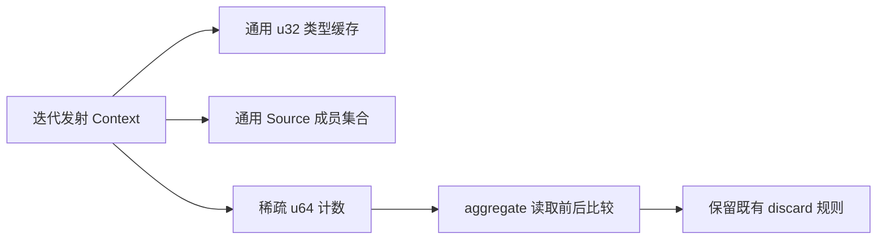

# 迭代上下文成员与计数状态自举

## Intent：最终目标

迁移 iteration_value.Context 的类型缓存、符号集合和读取计数，复用现有 Source
容器与托管状态，保留计数、宽度、声明顺序及局部生命周期，继续完成整体自举。

## Data：可用证据

起点 0ebad15f，工作区干净。types 只有 TypeId→ExpressionId 的 get/put；symbols
只有插入、查询、删除；reads 只有自身 cache 命中时加一及 aggregate 两次读取比较。
Context 局部创建，只经指针使用，无整体复制和共享状态继承需求。

## Edges：边界与限制

- 类型缓存只改变桥的键类型参数，底层 u32 映射算法及桶顺序不改。
- 符号集合复用 members，保留 Scope 只删除自身新增成员的边界。
- 计数保持 u64 存储和宿主 usize 上界，不缩窄为 u32，也不构建全 IR 稠密数组。
- argument 快径和 Lower.cache 命中不计数，计数跨临时 cache 移除保留至 Context 结束。
- 新项先准备值列，再插入索引，最后发布状态，防止 OOM 留下半完成桶。
- 普通已存在计数原地递增，查询零分配；不新增测试，不重置累计性能基线。

## Answer：交付格式与成功标准

三个原生状态字段接入通用 Source 实现，Native 保留类型/资源边界，不制造专用
算法回调。阶段、产物、行为与成本验收后统一提交全部变更并推送。

## 实现与边界复核

expression_map.Map(Key) 是生成接口的 comptime 类型桥，限定 enum(u32) 键，继续使用
同一套 Source 映射及 ExpressionId 值；类型缓存使用 TypeId，表达式缓存使用 ExprId，
没有互相强制转换或复制实现。原 cache.zig 已移入该统一桥，全部使用处已对齐。
类型声明追加后再记录缓存的原顺序保持，类型布局构造本身仍待迁移。

Context.symbols 直接复用 members；Context 无整体复制，因此不新增 inherit。
Scope 继续追踪自身新增符号，并在结束时只删除这些成员。迭代参数注册的先后和
作用域边界未改变。

通用 counter 复用 Index 定位及 u64 数值列。已有键只查询、检查上界、原位加一；
新键先准备值列，再插入索引，最后发布完整状态，保留 OOM 下旧逻辑状态完整。
它保持稀疏哈希索引，不按表达式总量创建稠密计数数组；没有 counter 删除操作，
临时缓存移除不会清除已有计数。

counter 复用 Index 的探测与负载策略，没有复制上一阶段映射算法。它没有迭代
消费者，因此不保留 Native 仅为桶顺序所需的覆盖前扩容行为；这改变常数成本，
由本轮实际对照验收。Native 仅传宿主 usize 上界，Source 在加一前校验；溢出
返回空结果，由桥保持原有不可继续的溢出边界，未静默拓宽宿主语义。

生成体审查确认已有计数写入的 reserve(false) 受 exclusive 原位快径保护；托管
executeState 保留该状态，无 descriptor.create 或隐式整列复制。get 只读视图使用
零字节分配器。公开 executeIn 的装箱不在 Native 实际调用路径内。

## 阶段与产物验收

Native 初始引导构建 Source 工具 38/38 步骤通过，再构建下一代工具 20/20 通过。
两代分别核对：

- main：159 入口、2371 模块、2428 文件，仅 .zxc-inputs 工具身份不同。
- collections：10 入口、23 模块、47 文件，仅 .zxc-inputs 工具身份不同。
- 编译器 22/22 构建步骤、372/372 现有检查通过。
- 三个新增 Source 文件格式和 lint 检查通过，未新增测试。

原始命令、日志、工具摘要及逐文件对照统一保存在被忽略的
.zig-cache/cold-build-analysis/iteration-state，阶段结果为 fixedpoint-result.json。

## 性能与固定累计边界

同冻结 141 入口 manifest，resident 关闭，每轮新输出及生成缓存，前后工具交替
四轮。首轮保留，中位取后续三轮；比较在其他构建前单独进行。旧工具为 0ebad15f
阶段 production-bootstrap，新工具为本阶段 production-bootstrap，全部 2268 文件
仅工具身份标记不同。

| 指标          | 修改前       | 修改后       | 变化 |
| ------------- | ------------ | ------------ | ---- |
| CPU 中位      | 5.30 秒      | 5.30 秒      | 持平 |
| 墙钟中位      | 1.17 秒      | 1.17 秒      | 持平 |
| 峰值 RSS 中位 | 496,615,424B | 496,615,424B | 持平 |

旧 RSS 四轮为 484.0/497.9/496.6/492.7MB，新为 498.1/498.4/485.8/496.6MB。
单轮存在波动，不据此宣称提速或额外内存收益。CPU 仍低于固定约 5.34 秒比较
基线，没有把上一阶段重设为新的累计起点。

新工具首轮墙钟 3.09 秒、CPU 5.36 秒，内部 infer/emit/write 为 532/416/67ms；
后续墙钟 1.16～1.17 秒。首次额外等待尚未归因，保留原始样本，不把温态中位
报告为首次启动。正式成本证据为 runtime-comparison.json。

## 自我复核与剩余职责

本轮迁移三个实际状态字段，未把 Context 的发射分派、类型布局生成、transfer
列表或 argument 状态一起宣称完成。Native 剩余类型与资源适配依然单独标明；
Source 算法及模型不是新的专用 Native 回调。计数触发位置、Scope 清理、宿主
位宽及 OOM 发布顺序都已通过实际源码和生成体复核，完整自举仍需继续推进。

最终相关回归 355/355 构建步骤、636/636 直接 Zig 检查通过，另执行目标内 Node
行为检查；与编译器合计 1008 项现有 Zig 检查。完整日志见 related-tests.log。
最终三份 Source 格式/lint 再核对通过，没有增加测试用例或无关验证。
