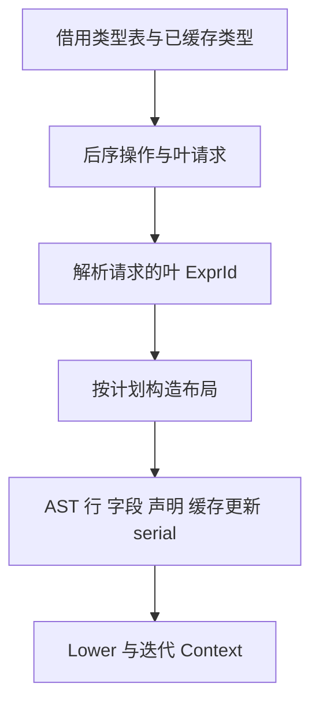

# 迭代状态类型布局自举

## Intent：最终目标

将迭代上下文类型的缓存截断、深度优先遍历、布局构造、声明和新名称分配迁入
RX/ZX。保留原有按需生成、后序命名及类型表示，不提前展开整个类型表。

## Data：可用证据

原实现位于 `packages/genz/src/zx/iteration_value/types.zig`。可空类型不缓存，
对象、元组及缓冲列表在子类型完成后分配名称并缓存；非缓冲列表及标量等通过
当前 `Lower.typeExpr` 按需解析。该叶解析不调用 fresh，也不追加局部类型声明。

上一阶段提交为 dcc5d3c6。同一固定输入的 CPU 约 5.30 秒，固定累计比较基线仍
约 5.34 秒。工作区生命周期优化后的固定生成器峰值比较值为 495,239,168B。

## Edges：边界与限制

- 缓存命中必须截断子遍历；可空包装不得按 TypeId 合并。
- 子节点按原始字段/元组顺序处理，聚合类型后序声明，空对象和空元组仍声明。
- 缓冲列表字段顺序为 owner、items、owned；owner 指向 std.ArrayList(元素类型)。
- 只借用类型表列及上下文缓存列，不复制完整 IR，不制造稠密镜像。
- 原生懒类型解析与 AST 物理存储导入仍是过渡依赖，本阶段不宣称完整自举闭包。
- 先实现再优化，出现成本退化时定位并修复，不能撤回迁移冒充完成。

## Answer：交付与成功标准

完成源码迁移后集中运行受影响的已有检查、两代产物一致及固定输入性能比较。
检查缓存共享、重复可空包装、后序声明和分配失败边界。验证记录在收口时补齐。

### 实施决策

- 类型分类统一来自 Source operation；原生根请求分类为 Native 后零分配直达
  `Lower.typeExpr`，不为标量或非缓冲列表构造遍历计划。
- 后序计划仅保存操作、TypeId、子引用和请求叶；临时表缓存已规划的聚合类型，
  初始上下文缓存始终只读。可空包装每次生成，不进入临时或上下文缓存。
- 遍历栈及结果栈使用物理初始化长度加逻辑边界，避免清空后丢失可复用容量。
- AST 发射复用已有 header、identifier、field、call、binding 和 fresh 原语；
  额外行只覆盖此次所需的类型节点，通过统一 printer 输出。
- Source 输出文本及字段在导入时取得 Lower 所有权，临时工作区结束后不留借用。
- 常量声明输出不提供变量列；统一导入器允许常量行独立导入，若实际出现变量
  标签但缺少变量列则返回 InvalidAst。

### 已取得的验证证据

- Native seed 构建 38/38 步、Source 正式构建 20/20 步通过。
- 两代 main 输出各 2456 个文件、collections 各 47 个文件，仅 `.zxc-inputs`
  身份标记不同。说明本阶段产物稳定，不表示整体自举依赖闭包已经完成。
- 固定输入 141 入口、2220 模块、1982 函数文件；全部 2268 个产物仅身份标记
  不同。比较工具分别为 iteration-state 与 iteration-types 的正式编译器。

| 指标          |       迁移前 |       迁移后 |        变化 |
| ------------- | -----------: | -----------: | ----------: |
| CPU 中位      |      5.26 秒 |      5.30 秒 |    +0.04 秒 |
| 墙钟中位      |      1.15 秒 |      1.17 秒 |    +0.02 秒 |
| 峰值 RSS 中位 | 483,524,608B | 489,357,312B | +5,832,704B |

四轮交替执行并保留首轮，表中使用后三轮中位。CPU 仍低于固定约 5.34 秒比较
基线，不重置累计基线。旧 RSS 四轮为 489.6/476.4/483.5/485.4MB，新为
491.5/493.2/489.0/489.4MB；不据这组波动宣称内存优化。新的首轮 CPU 5.40 秒、
墙钟 3.08 秒，infer 546ms、emit 418ms、write 59ms。首次额外等待仍未归因，
保留样本，不用温态中位代表首次运行。

原始结果保存在 `.zig-cache/cold-build-analysis/iteration-types/` 的
`runtime-comparison.json`、`fixedpoint-result.json` 和对应日志，按忽略规则不提交。

### 自我复核与未完成边界

缓存命中停止遍历，Optional 无缓存，聚合按子节点完成顺序声明；临时计划缓存
复用先前步骤引用。Source 字段及声明复制的是必要的目标 AST 数据，类型表和
原始 IR 仅借用。计划列和栈保存标量 ID，不复制用户数据载荷。

生成闭包审计未发现 Walk/EmitState 整体堆装箱或逐次缓存整表复制。已有通用
Statements 表仍有空表和绑定后的描述符装箱；这是可见的元数据成本，不能称为
完全无分配。当前完整对比在累计容差内，保留该证据供后续统一状态表示优化，
不为了消除一个描述符另造并行 AST 模型。

叶类型在自定义 AST 构造前批量按需解析；表达式内部 ID 的分配顺序可以变化，
但不改变 fresh 或局部声明顺序，产物一致验证了当前覆盖。错误时整个 Lower
中止；发布不是事务式回滚，缓存及 AST 在失败后不继续消费，与原 Lower 的
失败边界一致。

原生叶类型解析、AST 物理存储及导入、Lower 调用编排仍是过渡边界；本阶段只
完成迭代自定义布局的规则、遍历计划和声明构造迁移，完整自举仍需继续收口。

### 最终验收

工具链 Zig 0.17.0，ReleaseSmall，构建并发 12，generated-partitions=2，
ZXC_RESIDENT_GENERATOR=0。固定性能输入继续复用
`.zig-cache/recent-alignment/readability-final/cache-closure/manifest.json`，不更新基线。

- 编译器回归 22/22 步、372/372 项通过。
- function-analysis、value-return、function-updates、zx-tasks 既有回归
  355/355 步、636/636 项通过，包括更新错误顺序、别名、快照及分配失败检查。
- 21 个新增 RX/ZX 文件通过格式检查与 lint，单文件均低于 240 行。
- seed 提取前后已核对实现一致；未新增测试或浏览器检查。
- 全部改动统一验收后提交，不遗留局部未提交变更。
