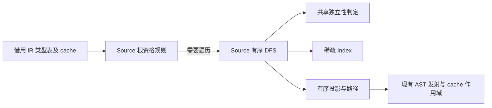
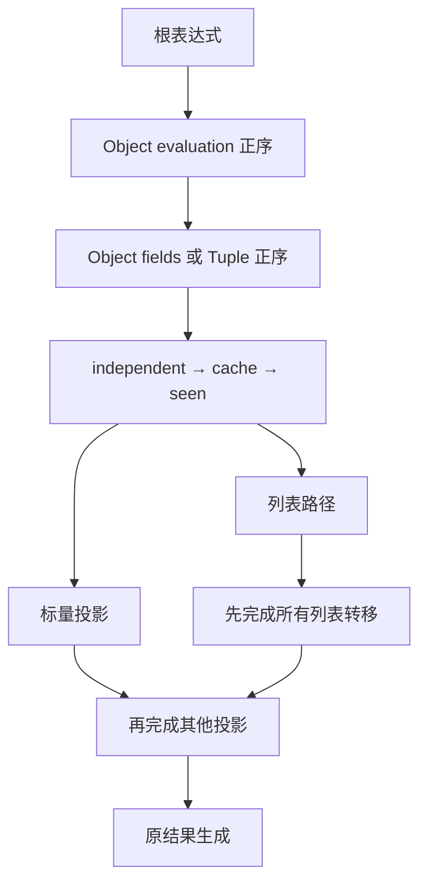

# 迭代结果分析与投影规划自举

## Intent：最终目标

统一 Native 与 Source 重复的结果资格判定，迁移完整的有序投影及列表路径规划。
不改变缓存命中、遍历顺序、短路、投影求值和缓冲所有权转移的语义与成本边界。

## Data：可用证据

基线提交 c16b636a。Native result.zig 含 eligible/candidate/visit/collectPath；
Source consumer/candidate.zx 有另一份资格规则。后者创建全 IR 长度 seen，
independent 使用 children/map/concat 逆序遍历；Native 使用稀疏 seen 和正序递归。
固定输入 CPU 长期基线约 5.34 秒，上阶段终版约 5.33 秒。

## Edges：边界与限制

- 顺序固定为 independent、cache、seen、登记 seen、primitive/projection。
- candidate 允许非 string/void 的直接标量投影；eligible 拒绝 primitive 根及 capture。
- primitive 穿透 Optional，List 不是 primitive；Kind 和 scalar 语义使用现有枚举及常量。
- Object 先 evaluation 后 fields，Tuple 正序；DAG 首访决定投影顺序。
- 列表路径仅接受 reference/field/tuple_field，输出根到叶索引。
- Native 仍负责真实投影 AST 发射、临时 cache 安装/恢复、两轮缓冲消费和结果生成。
- conversion 与 buffer.create 是共享类型/fresh 时序的互递归链，留待整体迁移。
- 所有输出为编号、路径和描述符，不复制用户载荷，不新增 Native 语义回调。

## Answer：交付与成功标准

RX 显式表达根规则、提前返回、遍历及发布。ZX 实现原子规则与集合算法。
共享 candidate 复用同一份规划规则；稀疏 seen 不再初始化全 IR 位图。
独立性遍历用按逻辑深度复用的父帧模拟递归，仅分支节点压帧，保留正序短路。
集中运行现有检查、两代产物对照和固定输入性能验收，再统一提交推送。

## 自我复核

此阶段是结果分析职责自举，不能据此宣称完整迭代结果发射已经迁移。
显式帧依然有编译期临时分配成本，需要实测；栈缓冲溢出后的父 arena 实际释放
边界也不等同于局部 deinit。全部性能结论必须使用终版实际数据。

## 验收证据

证据目录 `.zig-cache/cold-build-analysis/iteration-result/` 的日志与 JSON 均本地忽略。

- Native 首代构建 38/38，Source 生产构建 20/20。
- 编译器现有检查 372/372，函数分析、返回、更新及任务回归 636/636，
  共 1,008 项通过；没有新增测试用例。
- 两代主模块各 2,541 文件，集合模块各 50 文件，逐文件 SHA-256 仅
  `.zxc-inputs` 身份记录不同。
- 21 个 Source 文件格式化；旧 CLI 可解析的 16 文件 lint 通过，5 个含新对象
  解构的文件使用 Native 解析器格式化，并通过本次实际两代源码编译。
- 新增 ZX 均低于 180 行，最长 145 行；本次 diff 没有超过 90 列的 Source 行。
- 固定输入共 141 入口、2,220 模块、1,982 函数文件；前后各 2,268 文件，
  除 `.zxc-inputs` 外逐文件一致。

固定输入在相同工具链、resident=0、没有并发构建的条件下四组交替测量。
首次样本保留，以下为后面三组中位数；完整记录见 runtime-comparison.json。

| 指标     |    上阶段终版 |    本阶段终版 |     变化 |
| -------- | ------------: | ------------: | -------: |
| CPU      |        5.34 s |        5.32 s |  -0.02 s |
| 墙钟     |        1.17 s |        1.17 s |   0.00 s |
| 峰值 RSS | 493,486,080 B | 497,565,696 B |    +0.8% |
| 工具大小 |   6,036,288 B |   6,032,704 B | -3,584 B |

相对未重置的长期 CPU 基线约 5.34 秒，累计差异约 -0.02 秒。当前证据未显示
累计性能退化，不将单次小幅 CPU 下降宣称为稳定加速；RSS 变化处于既有采样
波动范围，不宣称内存改善。这是固定输入生成器路径，不代表完整冷构建成本。

## 交接边界

规划入口及 candidate 共用同一套 Source 根规则、正序遍历、稀疏 seen 和路径
算法。Native 消费层借用 plan 的编号/路径切片，在消费及 cache 清理完成后才
销毁 scratch；不将这些切片存入持久 AST。原 buffer 转移去重顺序和两轮投影
消费未改动，仍需继续迁移，不能把此阶段当成整体结果发射职责已自举。
