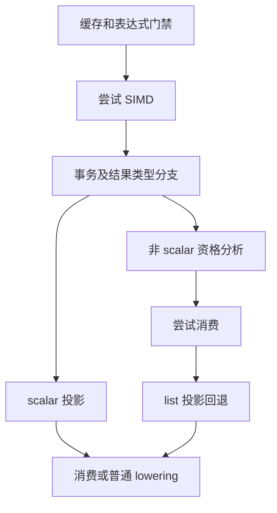
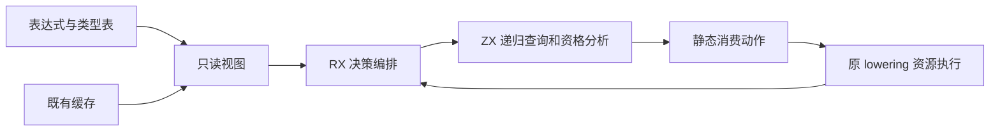

# 迭代结果消费决策自举

## Intent：最终目标

将 iteration consumer 的入口决策、投影与独立性判断迁入 RX/ZX，保留原有 SIMD、
事务、结果资格和消费回退顺序，不改变生成结果和累计性能。

## Data：可用证据

起点 `2b49e48b`，工作区干净。`iteration_consumer.zig` 仍定义这些规则；Source
已有 consumer projection、independent 和 iteration result 分析。

## Edges：边界与限制

- 原生 independent 直接递归，Source 当前使用动态遍历栈；先对齐为无堆分配的递归。
- 先排除缓存和非 iteration，再尝试 SIMD；SIMD 未命中后才检查 transaction。
- 非 scalar 分支保留 capture/cache 限制，先 eligible 再尝试 consume，失败后才做
  list/projection 回退；scalar consume 不传 layout，保留原默认值。
- 只读事实和缓存借用，不复制表；保留既有临时 arena 和 BufferFirstAllocator 边界。
- 本轮不迁移 projection read 的 AST 生成、SIMD emitter 或 iteration lowering。
- 不新增测试，使用现有相关行为、两代生成与固定性能基线集中验收。

## Answer：交付与成功标准

RX 显式表达消费分支和已有分析连接，ZX 承担纯决策与遍历；正式入口不再手写
消费资格规则。全部变更统一提交推送，工作区干净。验收结果在实现后补齐。

## 执行与自我复核

### 实现与语义复核

- `decision/build.rx` 连接入口门禁与后续策略；`policy.rx` 显式区分 scalar 投影
  与 aggregate 结果分析；`fallback.rx` 只在列表类型下执行投影判断。
- ZX 的 gate/branch 负责纯资格计算。既有 result/analyze 继续提供 eligible 分析，
  不引入新的编译器专用原生查询。
- 原生层按返回动作执行既有 SIMD/consume，并在失败后续传阶段；每次重新借用
  当前缓存，避免首次 consume 修改缓存后仍使用旧快照。
- Eligible consume 返回 null 后，保留 List+projection 以及第二次 consume；即使
  第一次失败已经消耗 fresh 名称，也不合并尝试。scalar 分支仍省略 layout，使用 false。
- independent 移除 parents/next 动态栈，改为普通递归。使用既有 consumer.child，
  保持 Object evaluation→fields、Index target→index 和 Conditional condition→yes→no。
  不加去重、不增加纯度判断，保留短路、重复 DAG 访问和 Call 只检查 argument 的契约。

### 生成产物复核

检查第一代实际 growth 产物：independent 闭包六个模块，projection 七个模块，
均无 create/alloc/dupe/reserve/renew。递归仅在栈上构造 table 指针、id、symbol，
不复制表达式列。decision 按值返回 Action enum，没有装箱；eligible 仍使用既有
result planner 的临时 arena/BufferFirstAllocator 和输出 header 协议。

### 构建与稳定性

- Native 引导构建 39/39，Source 正式构建 21/21。
- 两代分别生成 main 2,702、collections 64、growth 356 个文件，除 `.zxc-inputs`
  外逐文件一致。main 少两个文件对应移除的动态栈 step/advance。
- 编译器检查 23/23 步骤、372/372 通过。
- 首批相关目标有两项失败：ReleaseSmall WASM 汇编没有 DWARF `.file/.loc`，
  原 SIMD 检查器却要求 program.zig 来源；RX 并行 runner 在并发负载下等待响应超时。
- 保留真实汇编确认只有 `.file "root"`，数值检查已通过。检查器改为从公开
  `zxc_execute` 入口遍历汇编函数及直接调用，继续检查 SIMD multiply 和 scalar
  目标无 vector 算术；不依赖调试信息，不修改生产编译器。
- SIMD 独立复核 26/26 步骤，378 项行为检查通过；RX 并行独立复核 104/104
  步骤、7/7 检查通过。相关目标合并收口 831/831 步骤成功，执行的 891/891 检查通过，其余有效结果复用缓存；首批通过的 2,067 项检查保留证据，不重复累加计数。

### 性能

沿用原 readability manifest，141 entries、2,220 modules、零复用，每轮 2,268
个输出文件。各八轮交替顺序，剔除首轮；计时期间未并行运行其他构建或回归。

| 对照                | CPU 中位数    | 墙钟中位数    | 峰值 RSS 中位数             | 配对 CPU 差中位数 |
| ------------------- | ------------- | ------------- | --------------------------- | ----------------- |
| 本阶段前 → 后       | 5.31 → 5.32 s | 1.13 → 1.14 s | 492,421,120 → 494,485,504 B | +0.01 s           |
| 固定累计基线 → 当前 | 5.36 → 5.31 s | 1.18 → 1.14 s | 493,453,312 → 492,339,200 B | −0.05 s           |

固定基线 SHA-256：
`8f1e7cee1eadb3ea0f6f7150bab951c55672ce294e4fbe7c50d5858723bdd92d`。
本阶段输出仅输入指纹不同；累计对照只有此前已验收的 Sha256State 接口和清单差异。
没有累计性能退化；单次 RSS 波动不代表明确收益或退化。

原始构建、生成对照、性能与行为报告保存在忽略目录
`.zig-cache/cold-build-analysis/consumer-decision/`。

### 自我批判与保留边界

本轮完成的是 consumer 决策、projection 与 independent 判断；read 的 AST 组装、
SIMD 发射、iteration lowering 和原生 Lower 状态承载仍未迁移。原生物理执行循环
仍是过渡适配；不能将局部 Source 决策等同于完整 iteration 或整个编译器已经自举。
最终仍需迁移剩余语义/状态，审计正式入口传递依赖并完成阶段自编译。
