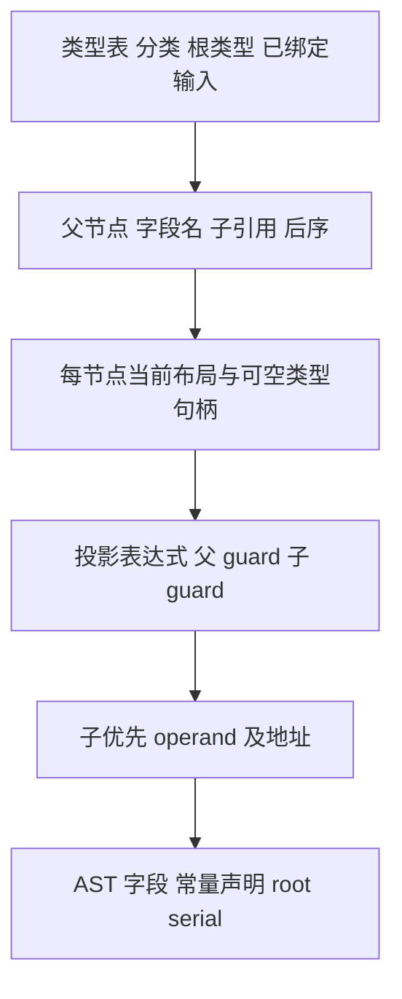

# 迭代聚合参数借用自举

## Intent：最终目标

将迭代参数借用转换的类型遍历、可空 guard、聚合构造与绑定规则迁入 RX/ZX。
保持原来只读借用和同步调用生命周期，不复制数组载荷，不新增专用原生回调。

## Data：可用证据

原实现在 `packages/genz/src/zx/iteration_value/borrow.zig`，调用来自 invocation。
调用方先绑定输入一次，借用结果用于随后的同步调用。Optional 只在子类型被原
iteration_layout.represented 判定接纳时展开；buffered list 不能扩大该范围。

上一阶段提交 9744dcca，固定输入 CPU 约 5.30 秒；累计 CPU 比较基线仍约 5.34 秒。

## Edges：边界与限制

- 按类型出现次数展开，不能按 TypeId 合并有不同来源值或 guard 的借用对象。
- 子 guard 为父 guard 与当前值非空的短路 AND。guard 为假时，不能读取可空载荷，
  聚合 operand initializer 保持 condition ? aggregate : undefined。
- 对象字段和元组元素保持原顺序，子聚合先绑定、父聚合后绑定，Optional 不消耗 fresh。
- 懒类型及布局句柄可以预备，因为不消耗 fresh、不追加局部声明；使用当前 Lower
  表示，不固定到 ABI。AST 内部 ID 可以变化，最终 printer 产物须一致。
- 类型表、布局分类数组只借用；临时计划只保存描述符和标量引用。
- 原生懒类型解析、AST 存储导入和调用入口适配仍为过渡边界，不宣称整体自举完成。

## Answer：交付与成功标准

完成借用职责迁移，核对可空 guard、声明命名顺序和无数据载荷复制。集中执行
受影响的既有回归、两代产物一致及固定输入性能比较，收口全部变更后提交推送。

### 实现与审计

- Source operation 复用已有 layout/query 的 Represented 分类，根 Value 用零容量
  FBA 执行分类后直返，保留原先最前面的 layoutExpr，不创建计划或发射表。
- 计划记录预序父子关系、字段名称和后序顺序。相同类型的两个字段分别建节点，
  绝不缓存有不同来源值的借用结果。遍历栈使用物理长度加逻辑 depth 复用。
- 原生仅按计划预备当前表示的布局/类型句柄；取完这些句柄后才确定 expression_base。
- Source 投影阶段只构造 AST；运行时读取仍在累计 guard 的短路和聚合 initializer
  的 yes 分支内。构造阶段按后序绑定 operand，Optional 本身不绑定。
- 复用 AST context，并补齐通用 object 和 optional_unwrap 结构化原语；无源码片段、
  完整语句模板或专用编译器原生回调。
- 对象输出字段名称仅来自类型表，经 bytes.fromText identity 传递，寿命与旧实现
  相同，直接借用。元组数字名称只进入 field 表达式，由 rows.append 深复制；fresh
  名称也在表达式和语句导入时复制，没有 scratch 文本逃逸。
- 原生 AST 存储适配及懒类型解析仍保留；全量自举的依赖闭包尚未完成。

### 已取得的证据

Zig 0.17.0，ReleaseSmall，构建并发 12，generated-partitions=2，resident generator
关闭。Native seed 38/38 步、Source 正式工具 20/20 步通过。两代 main 各 2481 文件、
collections 各 47 文件，仅 `.zxc-inputs` 身份标记不同，不等于完整依赖闭包证明。

固定性能输入继续为
`.zig-cache/recent-alignment/readability-final/cache-closure/manifest.json`：
141 入口、2220 模块、1982 函数文件，2268 个产物仅身份标记不同。

| 指标          |       迁移前 |       迁移后 |         变化 |
| ------------- | -----------: | -----------: | -----------: |
| CPU 中位      |      5.32 秒 |      5.31 秒 |     -0.01 秒 |
| 墙钟中位      |      1.18 秒 |      1.16 秒 |     -0.02 秒 |
| 峰值 RSS 中位 | 496,189,440B | 483,868,672B | -12,320,768B |

四轮交替执行，全部保留，表中使用后三轮中位。固定累计 CPU 基线仍约 5.34 秒，
不随本提交重置。旧 RSS 四轮为 494.1/494.1/499.5/496.2MB，新为
490.6/489.1/483.7/483.9MB。历史同一工具也有 RSS 窗口波动，不将本次差值直接
认定为稳定的算法内存收益。新的首轮 CPU 5.37 秒、墙钟 3.03 秒，infer 533ms、
emit 416ms、write 64ms；首次额外等待仍未归因，保留原始样本。

报告与日志位于 `.zig-cache/cold-build-analysis/iteration-borrow/`，不提交临时文件。

### 自我复核

本阶段将递归树改为显式计划与两遍 AST 构造，增加了临时标量元数据，不将其
表述为完全无分配。数组/对象用户载荷未复制，guard 没有提前执行，命名和声明
顺序由后序数组保持；主产物及冻结输入一致性覆盖生成形态。OOM 时整个 Lower
中止，不承诺失败后继续消费部分 AST，也未新增事务回滚机制。

通用 Statements 表既有的描述符装箱仍可能存在，不能只凭源码不可变就宣称
所有中间状态都无成本；本阶段以实际累计性能和生成形态验收，避免制造并行 AST
模型来消除局部描述符。全局自举仍需迁移转换、缓冲、转移及其他 Native 职责。

生成代码的名称寿命审计还沿实际 callValue 与公共 executeIn 转换核对：读取
TypeTable 名称、fromText、plan.names、emitter.fields.name 均保留原字节指针；
公共输出转换只复制 Field 和切片描述符，不把名字节复制到 scratch。因此直接
借用不是只依据 Source 写法作出的假定。数字名称与 fresh 名称仍走拥有文本的导入。

### 最终验收

- 编译器 22/22 步、372/372 项检查通过。
- function-analysis、value-return、function-updates、zx-tasks 既有回归
  355/355 步、636/636 项检查通过，未新增测试或浏览器检查。
- 本次 24 个 RX/ZX 文件的格式与 lint 已通过，后续没有修改这些源码，复用证据。
- seed 提取前后实现已核对一致。正式工具验证时的文件尺寸为
  5,809,968→5,929,840B，新增 119,872B；这是代码及元数据文件尺寸，不是运行时 RSS。
- 通过两代一致、冻结输入一致和生成代码数据流审计；此证据不替代整体自举闭包验收。
- 统一验收全部未提交内容后一并提交推送，确认工作区干净且无未推送提交。
