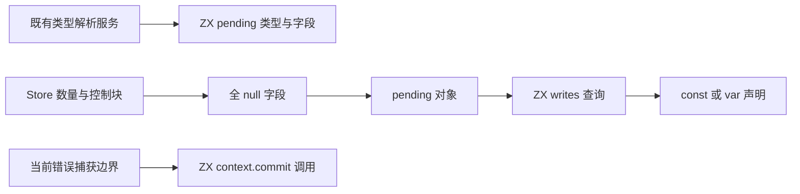
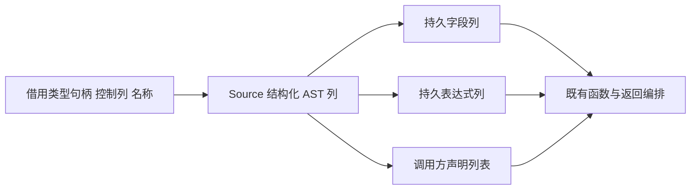

# Store 事务静态发射自举

## Intent：最终目标

将 pending 类型、pending 初始对象与声明可变性、commit 调用和 transaction
模式判断迁入 ZX；保留整体函数/返回编排，完成这组事务静态发射职责。

## Data：可用证据

store.declaration 先按 Store 顺序解析类型，再构造可空字段与导出 pending 类型。
Lower.function 在事务中初始化全部字段为 null，并按已有 writes 查询选择 const
或 var。Lower.commit 构造 context.commit(pending)，保留当前 capture。

类型解析可能首次创建共享类型 AST，仍需原通用 types.get 服务。Native 仅按原
Store 类型顺序准备句柄，Source 不另行推断或复制类型表；该依赖不算完整自举。

## Edges：边界与限制

- pending 字段顺序、类型、全 null 初值、可变性与导出名称保持一致。
- 类型句柄按原顺序解析，句柄本身是新元数据；不复制 Store 数据或控制表。
- Source 初始化明确调用已迁移的 writes 查询，不在 Native 重复判断声明种类。
- commit 复用结构化 call/fallible 原语，文本只来自常量与稳定 capture 名称。
- 不迁移完整 function/result 流程，不把类型缓存和 AST 持久容器算作已完成。
- 不新增用例，复用既有 Store、错误、生成与自编译检查，并核对受影响和累计性能。

## Answer：交付格式与成功标准

验收完整生成产物、阶段自编译、现有行为及成本后，一并提交推送全部变更并
确认干净。整体 Store 状态、类型服务和其余编译器自有逻辑继续迁移。

## 执行记录

### 规则、发射与拥有关系

transaction/policy 供 Lower.transaction 和 Store 访问规则共同调用；初始化 RX
明确连接 policy、非事务 null 短路、全 null 字段、pending 对象、writes 与绑定。
pending 类型和 commit 是内聚的结构化发射函数。原算法移至 transaction_seed，
正式路径不执行 seed；完整 function/result 流程仍保留既有编排。

pending 类型的 Native 适配器只顺序调用既有 typeExpr、准备新句柄数组，再交给
Source。现在全部类型句柄先完成、Optional/Struct 节点后发射，故内部 AST 编号
不与 seed 逐节点相同。类型资源不求值 Store 内容、不消耗 fresh；类型请求顺序、
字段顺序和可见声明保持。此内部构造顺序变化须以真实产物对照验收，不能声称
所有内部节点或编译器分配失败时刻完全相同。

pending 初始对象保留两份显式类型标识符、全 null、writes 后选择 const/var。
commit 保留当前 capture；原 commit 不读取 allocator，新路径不需要新增
uses_allocator。AST 参数在导入时取得持久拥有关系；文本只来自稳定输入或
静态常量。bytes.fromText 直接返回文本，不在 scratch 中复制字符。

通用 import_constants 新增 appendBorrowingText；原 append 仍固定走 owning
分支。借用的导出名称直接追溯到 Input.name，其 owner 是 Lower；新生成的
store_N 字段名仍在 scratch 结束前复制到持久字段列。Store 字段前缀、pending、
context、commit 名称集中于 store/const，槽位命名由共享 slot_name 复用。

实际生成目录 final-build/local-cache/o/c8049f960f3f9c14db9bbbf1380c1db6/main：
ffeb46… 的 policy 无分配；ceb34f… 第 22 行在初始化前返回 None，facade 只在
非空结果时装箱；null_fields 的 fields.append 使用 f29345… 四列 reserve(true)，
保留增长 frontier，未见逐项复制整列。

### 自编译与生成证据

34 个相关 RX/ZX 文件通过 fmt/lint，Native diff 通过 zig fmt。引导与正式构建
各 21/21，两个工具 SHA-256 均为
eb5c7aace8d18105f05c456a70d52daf9e0ee0cd4638f6ea74c84ccc054452da。
本体由上阶段 Source 正式工具生成引导版，再由引导版生成正式版；正式运行
启用 generated_analysis。

当前完整 main/collections/growth 在上阶段与本阶段下分别生成 2987/65/357
文件，只有 .zxc-inputs 不同；引导与正式版连元数据也相同。memo 四类分别为
10535/2979/2458/0、67/45/27/27、1126/311/266/0，逐键逐内容一致。没有修改
缓存身份/失效规则，不重复此前已有效的编辑恢复检查。

冻结 141 入口三版交替 8 轮、排除首轮，期间没有并行构建：

| 指标     |      上阶段 |      本阶段 | 同一固定累计基线工具 |
| -------- | ----------: | ----------: | -------------------: |
| CPU      |      5.28 s |      5.28 s |               5.34 s |
| 墙钟     |      1.12 s |      1.11 s |               1.16 s |
| 最大 RSS | 489291776 B | 481558528 B |          497008640 B |

CPU 单阶段不变、累计 −0.06 s；墙钟单阶段 −0.01 s、累计 −0.05 s。RSS 不作为
稳定收益。冻结 2268 文件仅 .zxc-inputs 不同，memo 8248/2419/1945/0 共 12612
条完全一致。本轮未重新测完整冷构建，也不以这些数字更新其历史峰值。

### 既有行为与受影响路径

test-rx-store-runtime、test-stores、test-module-generation、test-typed-try-runtime、
test-loop-columns 共通过 173/173 步、452/452 受管用例。子进程/脚本另行报告的
数量不混入此总数；没有新增用例。

配对仍使用已有 dual/compile.zig 的实际构建响应。基准仅把相同 genz 副本中的
transaction 四项操作选择为原 Native seed，其他 Source 分析、生成模块、工具链
和配置保持相同。公共 Store 访问路径在两边都复用当前 Source policy，整个阶段
的累计影响另由前述固定输入对照覆盖，不把两种比较混为同一个基线。

正式 harness 的 generated/generated_analysis 均为 true。九种原有 Store 模式，
前后交替 8 轮、排除首轮；每轮 70 个文件全部逐字节相同，最终产物实际包含
13 个 pending 声明与 13 个直接 context.commit 调用点，pure_readonly 为零对照。

| 九进程一批                  | Native transaction | Source transaction |        差值 |
| --------------------------- | -----------------: | -----------------: | ----------: |
| CPU 合计中位数              |         0.072369 s |         0.072775 s | +0.000406 s |
| 墙钟合计中位数              |         0.058492 s |         0.059042 s | +0.000550 s |
| 批内最大单进程 RSS 的中位数 |         15122432 B |         15253504 B |   +131072 B |

CPU 来自 RUSAGE_CHILDREN，包含 time 包装及其子进程；墙钟以 perf_counter
包含启动开销。RSS 为批内单进程最大值，不是进程树峰值。微小差值不作为
稳定退化或收益；结合固定累计基线、实际生成体和字节一致，本阶段验收通过。
这些场景不代表所有规模，也不免除后续累计增长监控。

### 证据与自我复核

忽略目录 .zig-cache/cold-build-analysis/ownership-research/store-transaction 保存
bootstrap.log、production.log、fixedpoint.json、production-fixedpoint.json、
memo-results.json、final-runtime-comparison.json、regressions.log；driver.rsp、
before-driver.rsp、driver-identity.json、cloned-genz 保留配对构建身份；
store-comparison-highres.json、store-highres 及其日志保存全部输出与计量。

已完成 Source 事务判定及静态 AST 发射；Native 只承担现有类型服务的顺序调用、
借用输入与拥有型/借用型列发布。此适配和通用持久状态仍是过渡依赖，不能据此
宣称完整 Store 类型、函数/返回编排或整个编译器已经自举。类型句柄预解析改变
了内部节点构造顺序，真实 Store 字节对照和行为回归支持可见等价，未声称内部
分配失败时刻逐项相同。生命周期分析与冷编译峰值问题继续独立核对。
