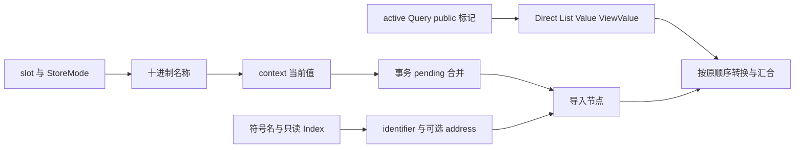

# Store 读取与符号引用自举

## Intent：最终目标

将 StoreGet 与 Reference 的名称、AST 和表示转换判定迁入 ZX，保留 Store 事务
读取顺序、符号状态索引查询、used/uses_context 更新、输入视图转换和文本生命周期。
两条路径各为原子读取构造，不增加只转发单个原子调用的 RX。

## Data：可用证据

- 原规则在 Lower.regular 的 store_get/reference 分支，cache 命中在两者之前。
- Store 先构造 context→field→dereference；事务模式随后构造 pending→field，
  最后合并 pending ?? current。不能按二元左右操作数重排已有节点顺序。
- Store 仅对直接 List 返回借用表示；Optional<List> 不走此分支。普通聚合执行
  bind→value conversion→finish。
- Reference 先 identifier、按 stack 成员资格加 address；active 且不在 state 成员
  集合中时执行 conversion→finish，不增加 represented guard，也不先 bind。
- 现有 core/integer/index/get、state Query、StoreMode 和 printer/text/integer
  已覆盖所需能力；名称前缀与标记使用职责内 const，context 名复用既有声明。
- 上阶段工具保存在 `ownership-research/regular-call/production/bin/zxc-bootstrap`；
  固定累计性能基线仍为 inbound-conversion。

## Edges：边界与限制

- stack/state 的 Index 描述符只读借用，Source 使用现有 get 查询，不复制集合。
- symbol name 延续原 self.names 借用；Source 不能深复制名称并留下 scratch 引用。
- Store 新格式化的名称需提升一次，两个 field_name 共享同一份稳定字节；
  context/pending 的常量文本必须从实际生成体证明生命周期稳定。
- Native 保留 used/uses_context 存储更新、AST 存储、list.borrowed、conversion、
  bind/finish 的现有适配；本阶段不宣称完整 Lower 或 Store 适配器已自举。
- 不改变共享 Store 生命周期，不新增持久化、动态检查或专用运行库。
- 不新增用例，复用相关既有 Store、引用、值表示与循环回归。

## Answer：交付格式与成功标准

集中验收格式/lint、引导与正式构建、相关既有回归、文本所有权生成证据、完整代码
与 memo 对照、合法编辑恢复的增量等于干净生成、生成器性能与固定基线累计变化。
完成后收口全部未提交变更，英文规范提交并推送，确认工作区干净且无未推送提交。

### 执行记录

实现与相关验收完成：4 个 ZX 文件的 fmt/lint 8 项通过；引导构建 39/39、正式
构建 21/21；既有 7 组目标回归 318/318 步、569/569 受管用例及 15 组外部回归
86 个用例通过。没有新增测试用例。

生成文本证明：context/pending 指向静态字面量，Reference name 借用输入，Store
名称持久提升一次；临时描述符在 arena 释放前导入，不遗留临时文本视图。

同一完整 manifest 三套生成产物分别 2885/64/356 个代码文件逐个相同；memo 四类
映射逐键逐内容相同。9 份既有样例的合法编辑与恢复，增量产物等于干净生成，
恢复后等于原始产物；对应 memo 也逐键一致。

最终冻结输入四版交替八轮、排除首轮，Store/Reference 自举版 CPU 5.28 s、墙钟
1.11 s、最大 RSS 491225088 B。上阶段为 5.27 s、1.12 s、489488384 B；固定累计
基线为 5.35 s、1.17 s、495108096 B。CPU 单阶段 +0.01 s，累计 −0.07 s；墙钟
单阶段 −0.01 s，累计 −0.06 s。RSS 样本波动较大，单阶段中位数 +1736704 B，
累计 −3883008 B，不能据此宣称稳定节省内存。冻结输入的 2268 个文件仅元数据
.zxc-inputs 不同，四类 memo 共 12612 条内容完全相同。

同阶段冷编译研究与聚合清理实验见《冷编译内存归因与错误清理优化》；该优化
收益不足，已删除实验实现，不改变本阶段自举结果。当前正式源码等于已验证的
Store/Reference 自举版，不以实验版回归替代交付版回归。

证据：忽略目录 .zig-cache/cold-build-analysis/ownership-research/access 下的
source-validation.json、regressions.log、final-runtime-comparison.json、各 complete /
selection / memo 对照，以及 cleanup-runtime-comparison.json 的 access 样本。
原生适配与存储仍为过渡边界，本阶段不代表完整 Lower 或整个自举已经完成。
