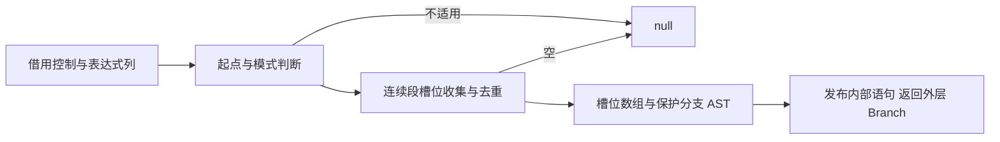
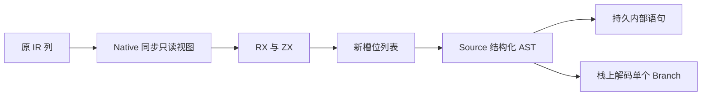

# Store 读取准备自举

## Intent：最终目标

将 Store begin 的完整准备职责迁入 RX/ZX：识别 orchestration 中连续读取与
事务调用、按首次出现顺序去重槽位、发射 hasMethod 保护的 begin 调用。

## Data：可用证据

原 begin.statement 只读取控制表、表达式表及被调函数 StoreMode，不递归调用
Lower.expr；无 Store、非 orchestration、不适用语句或重复读取起点均返回 null。
扫描在第一个调用停止，只收集 transaction 调用的映射；其他表达式/语句结束段。

上一阶段已有普通槽位数组与 begin AST 发射，迁为 Store 共享职责后复用。
现有通用 selected-row importer 可将内部语句发布、末尾 Branch 解码为返回值，
避免把外层 Branch 提前写入持久语句表造成重复存储。

## Edges：边界与限制

- 不扫描整个控制表，不越过当前 block，不改变分段与首次出现顺序。
- 不用新集合算法替换原线性查重，不复制已有控制/表达式/模式列。
- RX 显式表达 candidate、收集、空结果短路与发射；Native 仅适配输入和结果。
- 不适用路径返回 null，不能初始化大批 AST 空列或产生堆分配。
- 槽位数组与调用静态编为普通 Zig，保持 hasMethod、comptime 与 capture。
- 原算法留作初始 seed；不新增用例，复用现有 Store harness 和回归。

## Answer：交付格式与成功标准

成功标准是正式 begin 规则与发射来自 RX/ZX，完整产物与原行为一致，自编译、
已有 Store 运行回归、针对 Store 及固定累计基线性能通过。全部变更一并提交
推送并确认干净。Store 声明、持久状态和其余编译器算法继续按整体目标迁移。

## 执行记录

### 实现与边界

build.rx 显式连接 candidate、null 短路、collect、空列表短路和 emit。新模块
借用最小控制/表达式列与函数 StoreMode，复用 core/function_table/complete 中
已有枚举，没有新建模式字符串或转换整张表。原 begin 原生算法移至 begin_seed，
旧 adapter seed 的 begin_adapter 也明确引用此 seed。

上一阶段的 mapping_array/invoke_begin 移至 Store begin 共享职责，adapter 通过
相对路径复用；共同的 context/begin/meta/hasMethod 名称集中在 store/const。
没有复制一份相同 AST 发射，也没有把 Store 声明或持久状态称为已迁移。

Source 发射保留内部 Expression 语句和外层 Branch。Native 通用 selected importer
仅发布内部语句，再用 initBuffer 的单元素栈数组解码外层 Branch；返回的是
Statement 值，不引用该栈数组，也不提前向全局表重复追加外层 Branch。
表达式的文本和嵌套参数在 scratch 退出前拥有型导入。

实际 main/original 生成体：a9162d… 第 13～23 行在 candidate 不适用或收集为空时
直接 null；candidate 的三个文件闭包无分配，collect 空列表也不申请数据缓冲。
3adb96… 第 84 行重复 slot 返回原列表，第 93 行新 slot 使用 reserve(true)，
collect 不额外裁剪增长 frontier。代码位于
final-build/local-cache/o/1ccdd49ef899e94b165f4b07e3f4a7ea/main。

### 自编译与生成

24 个 Store RX/ZX 文件通过 fmt/lint；Native diff 通过 zig fmt。引导与正式构建
各 21/21，工具 SHA-256 均为
2f7924f732c61e17c8872f692d7fb9d770734c8a950de46bf48978312e779f23。
工具本体由上阶段 Source 正式工具生成引导版，再由引导版生成正式版，运行时
走 generated_analysis 的 Source 实现。

完整 main/collections/growth 在上阶段与新工具下分别生成 2972/65/357 文件，
只有 .zxc-inputs 不同；引导与正式版连元数据也完全相同。缓存规则未修改，
不为此重做此前已有效的编辑恢复检查。

memo 四类分别为 10500/2972/2451/0、67/45/27/27、1126/311/266/0，逐键逐内容
一致。冻结 141 入口三版交替 8 轮，排除首轮，期间没有并行构建：

| 指标     |      上阶段 |      本阶段 | 同一固定累计基线工具 |
| -------- | ----------: | ----------: | -------------------: |
| CPU      |      5.27 s |      5.28 s |               5.33 s |
| 墙钟     |      1.11 s |      1.11 s |               1.15 s |
| 最大 RSS | 492224512 B | 473956352 B |          495222784 B |

CPU 单阶段 +0.01 s、累计 −0.05 s；墙钟单阶段不变、累计 −0.04 s。RSS 波动
不作为稳定收益。冻结 2268 文件仅 .zxc-inputs 不同，memo 8248/2419/1945/0
共 12612 条完全一致；不据此更新完整冷构建的历史峰值。

### 既有行为回归

test-rx-store-runtime、test-stores、test-module-generation、test-typed-try-runtime、
test-loop-columns 集中通过 173/173 步、452/452 受管用例。另有子进程/脚本
结果，不混入受管总数；没有新增用例。正式运行路径包含嵌套 Store、置换映射、
事务/请求边界、错误返回与循环列，完整结果保存在 regressions.log。

### 受影响 Store 路径对照

复用已有 dual/compile.zig 的实际构建响应，基准只将相同 genz 副本中的 begin
选择改为原 Native seed；上阶段 Source adapter、其他 Source 分析、生成模块、
工具链和配置都保持相同。正式 harness 的 generated/generated_analysis 为 true。

沿用 isolation、union、nested、nested_deep 和五种原有 memory 模式，前后交替
8 轮，排除首轮；未新增输入用例。每轮各有 70 个文件，全部逐字节一致；最终
产物合计包含 40 个直接 context.begin 调用点，确实覆盖本次迁移。

| 九进程一批                  | Native begin | Source begin |        差值 |
| --------------------------- | -----------: | -----------: | ----------: |
| CPU 合计中位数              |   0.072349 s |   0.071300 s | −0.001049 s |
| 墙钟合计中位数              |   0.058589 s |   0.058173 s | −0.000416 s |
| 批内最大单进程 RSS 的中位数 |   15007744 B |   15106048 B |    +98304 B |

CPU 使用 RUSAGE_CHILDREN 差值，包含 time 包装与其子进程；墙钟用 perf_counter
计入启动开销。RSS 为一批内单进程最大值，不是并发树峰值。此规模下差异很小，
不承诺提速或内存收益；结合固定累计基线与生成体成本证据，未观察到实际退化。

### 证据与自我复核

忽略目录 .zig-cache/cold-build-analysis/ownership-research/store-begin 保存
bootstrap.log、production.log、fixedpoint.json、production-fixedpoint.json、
memo-results.json、final-runtime-comparison.json、regressions.log。
driver.rsp、before-driver.rsp、driver-identity.json 和 cloned-genz 保留配对身份；
store-comparison-highres.json、store-highres 及日志保存高精度计量和全部产物。

Source 规则与 RX 流程已替代本职责的 Native 扫描和发射，原算法仅为显式 seed。
Native 保留最小借用视图、选中行导入及结果解码，没有算法操作码或执行计划。
这仍依赖原生通用 AST 持久容器与导入；Store pending 声明、共享状态机制、其余
编译器算法及完整生命周期分析不因此完成。现有场景不穷尽所有合法 IR，代码
审查以已验证的 IR 表与 block 范围为前提。未重做或宣称修复最新冷构建峰值。
