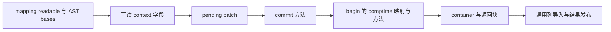
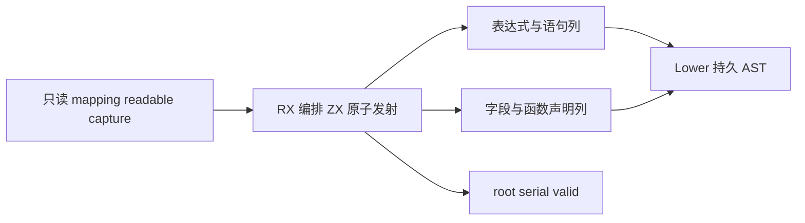

# Store 调用上下文适配自举

## Intent：最终目标

将 Store 跨调用 context adapter 的完整 AST 发射迁入 RX/ZX，由 RX 编排可读
context 字段、pending patch、commit、begin 映射方法和最终 container/返回块。
不把 begin.statement 的控制流扫描或 Store 持久状态实现纳入本阶段完成声明。

## Data：可用证据

正式路径由 regular_call/root.zig 调用 store.adapter。该发射过程不递归调用
Lower.expr，不依赖表达式 cache/used/member Map，输入仅为 mapping、readable、
父级 Store 数量、pending 类型名、capture、serial 与 AST bases。

现有结构化 AST 支持字段、函数、container、comptime、for、assignment 和错误
捕获。复用已有 context builder 与列导入能力，必要的通用构造原语在 ast 下补齐，
不引入 LowerBridge、操作码解释器或额外执行计划。

## Edges：边界与限制

- context 仅按 callee slot 顺序选择 readable 字段。
- patch 先按当前 Store 全部初始化 null，再依 mapping 顺序覆盖；重复目标最后
  一次覆盖胜出，未被选中字段仍保留 null。
- begin 的 selected 副本和 slot 索引映射属于生成 Zig 的 comptime 路径。
- 保留 hasMethod 分支、capture 错误边界、serial 命名顺序及 uses_context。
- Native 仅借用输入、导入结构化列和发布结果；初始 seed 保留原实现。
- 先核对生成形态，集中跑已有 Store/错误/生成检查；不新增用例。
- 验收真实 Store 输入的受影响生成路径，并保留固定累计基线；有退化先保留
  迁移再定位，不撤回到原生实现来过门禁。

## Answer：交付格式与成功标准

成功标准是正式路径不再执行旧 adapter 规则，完整生成结果和行为符合原契约，
相关自编译与回归通过、受影响及累计性能符合要求；最后统一提交推送并确认
干净。通用持久状态与剩余原生编译器算法仍按整体自举目标继续迁移。

## 执行记录

### 实现与生成体

build.rx 真实编排 initialize→context→patch→commit→begin→finish；ZX 负责字段
筛选、patch 覆盖和各个内聚 AST 构造。原完整 adapter 移至 adapter_seed.zig，
只用于初始 seed；正式 adapter.zig 只借用输入、导入列并发布 serial/root。
begin.statement 的原生控制流扫描及其独立调用路径保留，不在本阶段完成范围。

复用原 ast/declarations/function 的 Input/Columns 契约和已有 context 原语。
增加函数列追加、字段列初始化/追加、error_union/container 与 comptime 原语。
for_loop 的 capture_reference 为可选属性，缺省 false，现有调用保持原语义；
本 adapter 显式 true。接线中曾误覆盖声明原语的旧契约，导致 Constant/Columns
导入失败；已恢复旧文件，仅以新追加原语复用它，最终 diff 不修改原契约。

Native 同步借用 mapping/readable/capture。Source 新建 AST 列在临时 arena 中
构造，owning importer 在 arena 结束前发布文本和嵌套数组；不持有临时切片，
不复制输入映射或既有业务数据。这里保留 AST 暂存与发布所需的分配，不能将
整个发射器描述为零分配。输出仍是普通静态 Zig，应用生成代码完全相同。

实际生成体核对了三个成本点：

- patch 的 fields.value[slot] 只做边界检查和单槽赋值，保留源 slice，没有 reserve
  或整列复制。
- context 的 names/types/values 初始为单元素 plain 列，首次追加取得新的独占
  缓冲；之后按 header/frontier 复用增长容量，循环没有重复裁剪。
- fields.append 的四列均走 reserve(true)，未见逐项复制整列的二次方路径。

对应生成文件位于 final-build/local-cache/o/eb275cdfb9cb6a0ab36bc03dbe98b2f6/
main/original：0f39b93e… 为 patch（596～600 行）、f610c17d… 为 context
（174～239 行）、f29345c1… 为 fields.append。这里只据具体生成路径说明
复杂度和存储复用，不把它外推为所有源码与规模均无开销。

### 自编译与完整生成对照

25 个 Source 文件通过 fmt/lint，Native diff 通过 zig fmt。引导与正式构建各
21/21，工具 SHA-256 均为
5024b645dfe598142dcd9390196ab925bf271d7b48e904f4b07cdaae129048e7。
本体先由上阶段 Source 正式工具构建引导版，再由引导版构建正式版；正式运行
genz_options 的 generated_analysis 为 true。

最终复核补上 serial 从 u64 回写宿主 usize 的显式 @intCast，与现有适配器约定
一致；当前 64 位平台重建通过 21/21，产物仍为同一 SHA-256，因而复用已经
完成的同一二进制验证，不重复计时和回归。portable-build.log 保存此检查。

上阶段与本阶段对当前完整 main/collections/growth 输入分别生成 2964/65/357
文件，只有 .zxc-inputs 元数据不同；引导与正式版连元数据也完全相同。memo 为
10493/2966/2445/0、67/45/27/27、1126/311/266/0，逐键逐内容相同。缓存身份、
失效与分析事实未修改，不重复此前有效的合法编辑/恢复实验。

冻结 141 入口三版交替 8 轮，排除首轮；期间没有并行构建：

| 指标     |      上阶段 |      本阶段 | 同一固定累计基线工具 |
| -------- | ----------: | ----------: | -------------------: |
| CPU      |      5.27 s |      5.27 s |               5.32 s |
| 墙钟     |      1.11 s |      1.11 s |               1.15 s |
| 最大 RSS | 488570880 B | 489324544 B |          492519424 B |

CPU 单阶段不变、累计 −0.05 s；墙钟单阶段不变、累计 −0.04 s。RSS 微小变化
不作为收益或稳定退化。冻结 2268 文件仅 .zxc-inputs 不同，12612 条 memo
8248/2419/1945/0 完全一致。此项只是整体生成路径，不替代下面的 Store 对照。

### 既有 Store 行为与受影响路径

已有 test-rx-store-runtime、test-stores、test-module-generation、
test-typed-try-runtime、test-loop-columns 共通过 173/173 构建步骤、452/452
受管用例，另有脚本/子进程报告，不混入受管总数。没有新增用例。

最初尝试直接用 bootstrap manifest 编译 nested_deep.rx；现有入口把同目录
left.store.rx 作为普通模块注册而拒绝。该入口约束不代表 CLI 或既有 Store
harness 不支持 Store；未为 benchmark 改编译器，改用现有 dual/compile.zig。

配对工具使用这份既有 harness 的实际构建响应。基准仅将相同 genz 源码副本的
adapter 选择改为原 Native seed，其他 Source 分析、生成模块、工具链、优化和
配置均保持相同；正式版使用新 Source adapter。保存响应、选择器副本和二进制
SHA，避免将不同历史编译器的差异当作本函数成本。

九种原有模式：isolation、union、nested、nested_deep、memory、memory_borrowed、
memory_readonly、memory_failure、memory_pure_readonly。九种模式合计实际生成
26 个 StoreContext 声明；pure_readonly 为零声明对照。
正式 harness 的 generated/generated_analysis 均为 true。

前后交替 8 轮，每轮各生成 70 个文件，全部逐字节一致。第一次计时只显示两位
小数，每个进程都是 0.00 s，不能证明无开销；保留该报告后，用相同 workload
改为 RUSAGE_CHILDREN 差值和 perf_counter 高精度计时，排除首轮：

| 九进程一批                  | Native adapter | Source adapter |        差值 |
| --------------------------- | -------------: | -------------: | ----------: |
| CPU 合计中位数              |     0.071130 s |     0.071312 s | +0.000182 s |
| 墙钟合计中位数              |     0.057091 s |     0.057565 s | +0.000474 s |
| 批内最大单进程 RSS 的中位数 |     14991360 B |     15007744 B |    +16384 B |

CPU 包含 time 包装进程及其子进程，墙钟包含启动开销；RSS 是批内单进程最大值，
不是并发树峰值。微小差值处于启动与测量波动范围，不能将其说成稳定收益，也
不能据此保证更大项目任意规模；结合整体固定基线未增长、代码一致和生成体
线性路径，当前证据支持接受本阶段。没有重复完整冷构建或更新其历史峰值。

### 证据与自我复核

忽略目录 .zig-cache/cold-build-analysis/ownership-research/store-adapter 保存
bootstrap.log（最初接线失败）、source-trial.log、bootstrap-fixed.log、production.log、
fixedpoint.json、production-fixedpoint.json、memo-results.json、
final-runtime-comparison.json、regressions.log。driver.rsp、before-driver.rsp、
driver-identity.json 和 cloned-genz 保留配对构建身份；store-comparison-rounded.json
保留精度不足的计时，store-comparison-highres.json 与 store-highres 保存有效
对照、全部产物及日志。失败的 manifest 尝试也保留，没有将诊断副本或日志提交。

本阶段的 adapter 发射规则、流程、映射及方法组装已由 RX/ZX 执行，产物与既有
运行行为支持其等价性；不以新增 RX 入口数量作为完成证据。通用 AST 的原生
持久容器、列导入、Store 声明和 begin.statement 扫描仍是过渡依赖。capture
保持旧实现的边界，现有用例未穷尽所有 Store 与错误捕获组合，不宣称形式证明。
完整所有权生命周期、最新冷构建峰值与整体自举继续独立推进。
