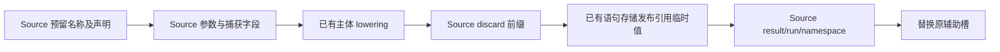
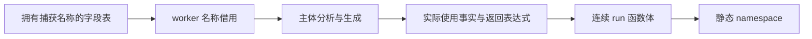

# 任务工作容器自举

## Intent：最终目标

迁移 Task worker 的完整构造：声明预留、参数和捕获命名、未使用参数处理、run
方法、错误联合返回、namespace 和辅助声明替换。保留嵌套任务及借用行为。

## Data：可用证据

起点 `ccaf74c7`。`zx/tasks/worker.zig` 先预留辅助声明，隔离 worker 的 Lower
状态，再准备参数、降低主体、处理 discard/reference_storage/result，最后替换
预留槽。现有 Source 字段、函数、namespace 和 AST 导入能力可复用。

## Edges：边界与限制

- Native 保留 Lower 状态隔离和既有 task.body lowering，不新增专用回调桥。
- 预留槽早于主体 lowering；嵌套任务可以追加其他槽，最后只替换原索引。
- 捕获字段拥有动态名称文本，worker.names 借该持久文本，不保留 scratch 地址。
- 返回类型先物化，随后全局连续发布 discard→reference_storage→result；函数体
  范围不包含主体 lowering 产生的其他子语句，且不重复复制 reference_storage。
- 保留 allocator/io/process/捕获的参数及 discard 顺序，不新增用例。

## Answer：交付格式与成功标准

前后产物/memo、自编译不动点、既有任务回归及固定累计性能验收后提交推送。
明确剩余原生状态与 lowering 边界，不称整体 Task 或整个编译器已完成自举。

## 实现与阶段证据

Source 分别提供 reserve、prepare、discard 和 finish 构造；finish 的 RX 连接
返回类型、run 方法和 namespace 发布。阶段之间保留原有主体 lowering 和引用
临时值的通用存储操作，没有增加 Native 编译器规则回调或 Source 操作码重放。

Source 生成捕获名后，拥有型字段导入保存文本，worker.names 从持久 field.get
借用。参数范围在主体前保存；所有可能追加其他 AST 的类型服务在连续函数体
发布前完成，body_first 之后仅追加 discard、引用临时值和 result。namespace
最后取得当前声明基址，替换进入主体前保存的辅助槽，允许递归生成嵌套任务。

通用 Source context/discard 原语被任务和前导复用；原前导 wrapper 行为保持，
不修改全局 Context 状态模型。所有字面名称集中于 const.zx 或复用原常量。

引导和正式 P16 ReleaseSmall 构建均 21/21；二进制 SHA-256 相同：
`7fa9f1405c84ac11fb8acd4c3f5269c9a7724bc7698fc743ed7f473f239c0ab2`。
当前源码 main / collections / growth 的 3089 / 65 / 357 文件，旧版对引导版
仅 `.zxc-inputs` 不同，引导对正式版全部一致。三组 memo 分别为
10774/3051/2530/0、67/45/27/27、1126/311/266/0，逐键逐内容一致。

### 固定输入性能与累计变化

同一 141 入口冻结输入、固定基线二进制和缓存边界。三版交替八轮，各次新输出
与生成缓存，排除首轮；其他构建结束后独立计时，中位数如下：

| 指标     | 固定累计基线 |    上一阶段 |      本阶段 |
| -------- | -----------: | ----------: | ----------: |
| CPU      |       5.34 s |      5.30 s |      5.31 s |
| 耗时     |       1.17 s |      1.14 s |      1.13 s |
| 最大 RSS |  495321088 B | 481263616 B | 490389504 B |

CPU 单阶段 +0.01 s、累计 −0.03 s；耗时单阶段 −0.01 s、累计 −0.04 s。
容差不按提交重置，继续观察趋势；RSS 波动不作为稳定内存收益。冻结输入
2268 文件仅 `.zxc-inputs` 不同，12612 条 memo 全部一致。

### 行为回归与受影响生成路径

合并执行 test-zx-await-runtime、test-zx-parallel-runtime、test-zx-task-lifecycle，
91/91 步、44/44 个用例通过，覆盖嵌套、捕获、错误、void/列表、取消、scope
退出、提前返回、启动失败和 join。正式生成工具确认 generated_analysis=true。

复用 compile-zx-await-runtime 的八个既有场景做隔离对照；基线副本只把 Task
worker 选择器切回原始 seed，其他 Source 模块和配置不变。每组 16 文件，八组
前后全部逐字节一致。并行和生命周期用例用于运行回归，未将它们冒充逐字节对照。

交替八组、排除首组，高精度计量中位数如下：

| 指标         |     原实现 | Source 实现 |        差值 |
| ------------ | ---------: | ----------: | ----------: |
| 八次调用 CPU | 0.021342 s |  0.021178 s | −0.000164 s |
| 八次调用耗时 | 0.028138 s |  0.028577 s | +0.000439 s |
| 最大 RSS     |  7421952 B |   7454720 B |    +32768 B |

CPU 使用高精度子进程资源累计差并包含 time 包装器，耗时包含启动，RSS 为最大
子进程而非进程树。微小差异不证明稳定收益或显著退化，没有构建并行干扰。

尚未找到能实际触发 Task worker process=true 的既有运行 fixture；普通
test-process-context 不含 Task，不算该分支覆盖。process 参数复用已验证的
标准字段构造、名称和类型路径，Source/native 精确 diff 核对了 gate、参数顺序
和捕获字段起点，但没有宣称它已有完整运行验证。本轮不违背“不新增用例”的约束。

证据位于忽略目录 `.zig-cache/cold-build-analysis/ownership-research/task-worker`：
bootstrap.log、production.log、fixedpoint.json、production-fixedpoint.json、
memo-results.json、regressions.log、generated-path.json、driver-identity.json、
affected-comparison.json、final-runtime-comparison.json 及各轮输出和响应文件。

### 自我复核与剩余边界

Worker 的声明、参数、命名、discard、错误联合、run 和 namespace 构造均由
Source 提供，Native 不重放构造规则。捕获名称有持久 owner，预留声明身份跨
嵌套 lowering 保持，引用临时值只发布一次；生成应用代码一致，没有增加输入复制。

Lower 状态克隆、worker 主体 lowering、引用临时值存储和 Task 父级调度仍有原生
依赖。process=true 的运行覆盖尚缺，完整目标仍需继续迁移和验收。阶段自编译
不动点及已有用例通过不代替最终传递依赖审计和约定的三代自编译。
