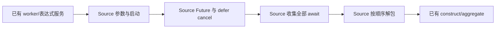
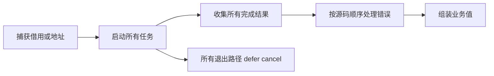

# 任务生命周期发射自举

## Intent：最终目标

将 Task 父级 start、Future 绑定/清理、await/cancel 及 parallel 汇合的 AST
构造迁入 RX/ZX。保留错误顺序、全部任务收尾、捕获借用和命名顺序。

## Data：可用证据

起点 `1fbd9edd`。worker 和同步 allocator 已迁 Source，父级仍用 Native 构造
调用与语句。start 在 worker lowering 前标记使用事实；parallel 先启动全部、
再不 try 地 await 全部、最后按源码顺序解包；bind 总保留 defer cancel。

## Edges：边界与限制

- Native 保留现有 worker/表达式/construct/aggregate 服务及 Lower 状态，不新增
  规则回调或 Source 执行计划；Source 只产生结构化 AST。
- async 不 fallible，concurrent 使用当前 capture；栈捕获取地址，普通捕获传引用。
- bind 的 discard_error cancel 位于 defer_scope，直接 cancel async 的显式及
  defer 两次取消都保留。内层仅入全局表一次，外层材料化交还原调用者。
- parallel await 不提前抛错，所有 await 完成后才按原 capture/try 顺序处理错误。
- 不新增用例；现有 process=true Task 运行覆盖仍缺，不用普通 Process 取代。

## Answer：交付格式与成功标准

产物/memo、自编译不动点、既有 ZX/RX Task 回归和固定累计性能验收通过后统一
提交推送；列明剩余原生状态和服务边界，不宣称整个编译器已自举。

## 执行与验收

Source 负责捕获参数 AST、async/concurrent 调用、Future 绑定及 defer cancel、
await/cancel 调用、全部 await 的绑定、顺序解包和结果对象/Unit。start/build.rx
连接参数构造与启动调用；parallel/build.rx 连接顺序解包与结果组装。函数内的
集合遍历保留 ZX，未加入解释执行计划或专用回调。

补齐通用 AST 材料化对 discard_error/defer_scope 的支持。bind 内层清理按选中
行入全局表，外层变量和 defer 交还原 body；嵌套非文本 payload 在 scratch 释放
前取得持久存储，名称文本借用持久名称、Program 或静态常量。start 仍在 worker
服务之前标记使用事实，worker 参数名与 fresh 序列保持。

Native 暂时保留 Lower 状态、IR 事实读取、used/能力标记、worker/表达式 lowering、
construct/aggregate 服务及这些服务间的宿主调度。root_seed.zig 与上阶段 root
逐字节一致，仅用于初始引导和隔离对照。以上边界仍属后续自举工作，不能以
本轮 AST 迁移宣称 Task 的整个传递依赖或完整编译器已自举。

- 新增/修改的 18 个 RX/ZX 文件通过 fmt --check 与 lint；Zig 文件通过 zig fmt。
- 上阶段正式工具引导、再由新工具生成正式工具，均为 P16 ReleaseSmall、12 核，
  两轮各 21/21 步，执行文件 SHA-256 均为
  f345a0c79352fd695e0473d41b39e8dfdcfe4925557a17cc2d926fa1e31d4748。
- 当前输入 main/collections/growth 的 3118/65/357 个文件，上阶段与本轮生成
  仅 .zxc-inputs 不同；本轮两阶段完整产物逐字节一致。
- 既有 test-zx-await-runtime、test-zx-parallel-runtime、test-zx-task-lifecycle、
  test-rx-parallel-runtime 联合通过 182/182 步、147/147 个用例，包含聚合借用
  Task 捕获与嵌套捕获，不包含独立的 RX 库归档/重发布回归。
- 只读独立源码复核未发现阻断问题；它不是实际运行证据。Task process=true
  仍缺少既有运行样例，不新增用例，也不把通用 Process 覆盖当作该路径覆盖。

### 性能与产物收口

所有构建终止后计时。当前生成模块、配置和输入保持相同，仅在忽略目录的
genz 副本中将 Task parent 的 generated 开关改为 false，使用未改动的 seed
作为直接路径对照；worker 和其他 Source 能力继续启用。四个既有驱动覆盖
8 await、8 parallel、8 lifecycle 和 22 RX source 模式，共 46 次调用。交替八轮、
排除首轮，每轮 92 个产物逐字节一致，没有新建用例。

| 46 次调用合计中位数 | seed parent | Source parent |
| ------------------- | ----------: | ------------: |
| CPU                 |  0.184372 s |    0.183906 s |
| 墙钟                |  0.194264 s |    0.195934 s |
| 最大子进程 RSS      |  12664832 B |    12730368 B |

CPU 使用高精度子进程资源差，包含 time 包装；墙钟包含进程启动，RSS 是样例子
进程中的最大值，不是并发树，也不是编译这些驱动的峰值。微小差异不作为确定
提速或内存收益，只证明本轮没有观察到超出容差的直接路径退化。

冻结输入沿用 141 个入口和固定 baseline，不重置容差。工具本体均由各阶段的
Source 自编译产生，运行使用 Source 分析/生成后端，禁用 resident generator；
八轮交替、排除首轮：

| 指标       | 固定累计基线 |      上阶段 |      本阶段 |
| ---------- | -----------: | ----------: | ----------: |
| CPU        |       5.35 s |      5.29 s |      5.31 s |
| 墙钟       |       1.17 s |      1.13 s |      1.13 s |
| 生成器 RSS |  494665728 B | 483393536 B | 488882176 B |

CPU 单阶段 +0.02 s、相对固定基线累计 −0.04 s；墙钟单阶段不变、累计 −0.04 s。
此前阶段同场景也处于约 5.3 s CPU 附近，继续监控连续增长，不能把每阶段容差
当作新预算。RSS 采样有波动，不以本表宣称冷构建峰值改善。本阶段没有重测
完整冷构建，也没有解决剩余冷构建约 2 GB 的问题。

固定基线执行文件 SHA-256 仍为
8f1e7cee1eadb3ea0f6f7150bab951c55672ce294e4fbe7c50d5858723bdd92d。
上阶段为 7fa9f1405c84ac11fb8acd4c3f5269c9a7724bc7698fc743ed7f473f239c0ab2。
冻结 2268 文件仅 .zxc-inputs 不同；memo 的四类映射逐键逐内容一致，计数为：
main 10840/3066/2545/0，collections 67/45/27/27，growth 1126/311/266/0，
冻结输入 8248/2419/1945/0。记录非空映射，避免将未执行的空结果作为一致证据。

自我复核：本轮完整交付 Task 父级 AST 发射迁移，实际生成程序保持不变；Native
仍有明确的状态与 lowering 服务，完整自举尚未完成。process=true、跨平台和
完整 NLL 不在本轮已有运行证据覆盖内。研究记录中的外层类型规范化原型没有
收益，未纳入实现，不将论文或局部探针替代验收。

证据在忽略目录 .zig-cache/cold-build-analysis/ownership-research/task-lifecycle：
bootstrap.log、production.log、regressions.log、fixedpoint.json、
production-fixedpoint.json、driver-identity.json、affected-comparison.json、
final-runtime-comparison.json、memo-results.json 及各轮日志和生成产物。
