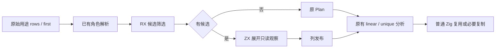
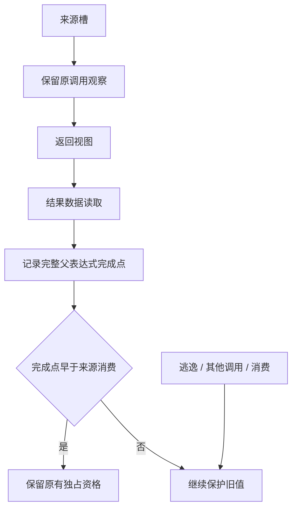

# 借用观察完成点与来源复用

## Intent：最终目标

在正式 RX/ZX 生成器中，结束已经完成的只读返回借用对来源复用的限制，减少普通
数据读取后的复制。保留不可变语义、活视图、读取与错误顺序、未知调用及循环边界。
这是一项正式用途分析精化，不将局部结果当成完整 NLL 或全部自举已完成。

## Data：可用证据

上一阶段 `dafc1d55` 已处理仅 Length / 弃值的结果；普通 Index 仍使返回借用被视为
持续消费。固定输入上一轮 CPU 5.27 s，固定累计基线 5.33 s；阶段正式工具为
`ownership-research/metadata-loans/production/bin/zxc-bootstrap`，基线不随提交重置。
详细论文与前期成本证据见[研究记录](../2026-11-07/所有权分析论文与小范围验证.md)。

现有 Sites 已将符号、字段和绑定的用途传递到完整结果根，且现有 return_only /
borrow_only 事实能证明 callee 不在返回之外保留参数、没有输入写入。利用这些事实，
将真实只读结果观察归一化到来源槽范围；不重建另一份借用求解器。

审查发现两个必须覆盖的反例：

- `view[values.reverse()[0].length - 1]`：目标引用先求值，真正读取发生在索引操作数
  计算之后，不能用目标引用的开始时间宣称观察已经完成。
- 在含最终 return 的分支内更新并读旧 view：将观察 region 清零，可能因祖先
  `returns` 标记反而被旧 apart 判为排他，不能靠清 region 实现保守处理。

## Edges：边界与限制

1. 仅接受已证明 return_only、完整槽表且全部 written=false 的 callee；来源范围
   必须映射到已知 held 槽，且确实有返回保留依赖。
2. 完整结果用途必须全为已解析 observe；结果再次传给其他 Call 仍拒绝传播，
   不将普通 observe 当成未知 Native、Store 或 Task 的不逃逸证明。
3. 保留原调用观察，再复制结果观察；来源 lo/hi/delta 保持不变，读取子对象不升级
   子列表所有权。结果链经过另一借用调用时仍保守，暂不做递归传播。
4. 归一化观察获得真实边数之外的唯一边号；Plan 保存 edge_count 作为判别边界。
   这些观察仅接受 `finish[parent 或 top] <= time[consumer.top]`，禁用 apart /
   分支排他。重叠表达式可能多复制，不能过早放行。
5. 原来的仅元数据调用观察也使用完成时序：callee 自身可能读取参数，必须等
   全部调用操作数及调用完成；不能仅根据返回值未读取 buffer 忽略该读取。
6. 无候选直接返回原 Plan；仅有候选时重建 first / sites。旧 seed 保持等价初始
   引导实现；正式规则在 RX/ZX，不新增专用原生语义桥、动态层或数据复制兜底。

## Answer：交付与成功标准

RX 在 walk / resolve_roles 后显式连接候选、展开、列发布，交给原 classify 使用。
新事实进入持久 Plan，缓存程序身份版本升级 v16。

验收先运行实际生成程序：普通读取结束后与 direct 对照分配相同，活 view 仍保存
旧数据；索引内更新、返回分支及调用操作数内更新均保持独立预期结果。再集中运行
受影响回归、相同工具链的阶段自编译与固定输入累计性能对照。所有变更统一提交推送。

首轮引导构建 **39/39** 步骤通过；实际程序检查 **37/37** 构建步骤、**8/8** 原生
检查通过。普通 Index 读取结束后的 view 路径与 direct 均为 **1 次 / 80 B**，
实际输出逐项一致；旧活 view、索引内 reverse、含 return 的分支、调用参数内 reverse
均保留独立预期。独立具体存储枚举继续通过 416,710 次。

复现目标为 `packages/test` 的 `test-loan-lifetime-prototype`；本轮原始记录位于
`.zig-cache/cold-build-analysis/ownership-research/read-loans-tests.log`。
受影响完整回归、正式阶段自编译和性能收口结果如下。

正式自举构建 21/21 步骤成功；main、collections、growth 的引导与正式输出分别为
2,711、64、356 文件，仅 `.zxc-inputs` 的工具身份不同。此结果同时核对 Source 与
seed 归一化、完成时间和禁用排他的行为接线；不替代安全用例和最终依赖闭包审计。

十个受影响目标集中验收 **313/313 构建步骤、853/853 检查通过**，包含 native
value boundary、function updates、field facts、aggregate loop、Store、Task、缓存
所有权与两组 loan 试验。没有检查失败，也没有重启已确认仍运行的构建。
原始记录为 `ownership-research/read-loans-regressions.log`。

`read_view.zig` 的普通与 State 实现均在完成数据读取后 constCast 再 reverse，
没有 reverse 所需的新 buffer；分配与 direct 逐项相同。收益不是只根据执行时间
或 LLVM 死代码消除推测而来。

停止其他构建后，对同一冻结输入（141 入口、2,220 模块）执行八轮交替采样，
舍弃各工具首轮；三个工具使用独立的新输出及缓存目录，固定基线身份保持不变：

| 工具                    | CPU    | 墙钟   | 峰值 RSS      |
| ----------------------- | ------ | ------ | ------------- |
| 固定 inbound-conversion | 5.35 s | 1.16 s | 495,173,632 B |
| 上一阶段元数据借用精化  | 5.27 s | 1.13 s | 486,031,360 B |
| 当前普通数据观察精化    | 5.26 s | 1.12 s | 485,638,144 B |

CPU 阶段 -0.01 s、累计 -0.09 s，墙钟阶段 -0.01 s、累计 -0.04 s。
RSS 阶段约 -0.39 MB、累计约 -9.54 MB；微小采样差异不作为收益宣称。
冻结输出 2,268 文件仅 `.zxc-inputs` 不同，生成代码逐字相同。功能收益由实际 view
程序与分配计数提供，该冻结输入用于确认分析成本与累计趋势。

原始记录位于 `ownership-research/read-loans/` 的
`final-runtime-comparison.json`、`final-fixedpoint-result.json`；构建与回归日志
均在同一忽略缓存目录内，不纳入 Git。

自我审查：新增完成点保护覆盖索引操作数、返回分支及调用操作数的重叠反例；
无候选路径复用 Plan，Source 与 seed 结果自编译一致。仍未证明完整 CFG、循环、
再借用调用链及前端权限恢复；新观察禁用分支排他，部分安全场景仍会保守复制。
本轮没有重新测量完整冷构建，不能将生成器约 486 MB 的峰值外推为 LLVM 的
GB 级峰值已修复，也不能将本阶段用途精化称为完整所有权重构或自举完成。
