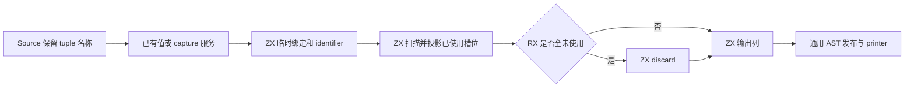
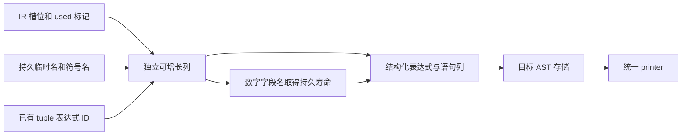

# 元组解构构造自举

## Intent：最终目标

将元组解构语句的临时绑定、按槽位投影、跳过未使用符号和全未使用时的 discard
规则及完整 AST 组装迁入 RX/ZX。保持值只执行一次、槽位顺序、capture 行为和
结构化 Zig 输出，使用独立的列表状态保留增长前沿。

## Data：可用证据

起点 5ece3874，工作区干净。statements.lower 的 destructure 分支仍直接 fresh、
lower 值并组装全部语句。capture.lowerValue 已有独立 Source 规则，值求解和
Lower 状态仍为 Native 过渡服务。本阶段不重复迁移这些服务或改动语言语义。
已有 header、fresh、十进制文本打印及通用 AST 导入原语可以复用。

## Edges：边界与限制

- 先保留 tuple fresh 序号，再 lowering 原值/capture；不能到值求解后才起名。
- 按完整槽位顺序扫描，空槽和未使用符号跳过，但索引不能按已使用数量重编号。
- 临时常量先于投影；没有任何已使用绑定时仍执行原值并 discard 临时值。
- 相同临时常量的 identifier 是纯 AST 引用，可共享一份节点；打印仍在每个
  原位置读取同一绑定，不减少源值执行或跳过错误。预计 Zig 字节输出不变。
- Native 仅保留值/capture 服务、序号状态和物理发布。Source 生成的数字字段
  名在释放 scratch 前取得持久文本存储；临时名称与符号名沿用原持久寿命。
- 循环直接携带独立表达式、语句列，完成后才打包公开 DTO，不依赖强制 inline、
  新运行库、宽表 boxing 放宽或专用解释计划；保持现有不可变与所有权规则。
- 不新增测试用例；复用 tuple-bindings、typed-try 和解构运行时等现有路径。
  AST 分配与表示有变化，测受影响生成路径及固定累计基线，不重做无关冷构建。

## Answer：交付格式与成功标准

贯通后集中核对非空产物、自编译、实际消费的既有行为、memo 和累计性能。
验收所有未提交内容后英文提交推送，确认工作区干净且无未推送提交。完成的是
解构 AST 组装，不以此宣称控制流驱动、值/capture 服务或整个编译器已经自举。

## 执行与验收

9 个 RX/ZX 文件通过 fmt --check 和 lint，共 18 项检查；Native 通过仓库 spacer
格式检查。引导与正式两轮构建各 21/21 步，二进制 SHA-256 均为
2b099d3fa10746e0af516c5bb89ec10d92ff27bfbae9cc0cc91cdb6e87da68ab。

同一当前 main/collections/growth 分别生成 3189/65/357 个非空文件，上阶段与
本轮除 .zxc-inputs 外完全一致，本轮两阶段的完整产物逐字节一致。没有仅以
执行成功或空输出集合判断相同。

实际生成闭包审计确认，project_items 将所有增长列的 items/storage 直接传入
下一轮；field_target/name 走 reserve(true)，没有 State 装箱。constant 四列
保留已有 header；初始化字面量第一次增长允许复制一个初值，此后不重建 plain。
header 原语的 weaken 保留 header，未发现逐槽重复复制旧前缀的路径。

字段文本发布时逐项复制到 Lower allocator，再由通用 importer 复制平面列；
其他名字引用原有持久内存。这里复制的是本次新构造的数字文本及必要 AST
描述符，不复制输入 tuple、symbols、names 或 used 的底层数据。释放 scratch
后没有其列指针逃逸到持久 AST。

- 既有 test-tuple-bindings 与 test-typed-try-runtime 通过 81/81 步、43/43 个
  用例，覆盖槽位顺序、混合类型、部分丢弃、typed capture 与错误路径。
- CLI test-runtime 显式 P16，通过 59/59 步、30/30 个用例，包含不可变集合的
  元组返回消费和聚合值/解构。没有新增用例。
- 没有找到专门覆盖“所有槽位均未使用”的既有运行时 fixture；该组合沿 Source
  分流、生成的常量/identifier/discard 和材料化路径逐项核对，不将部分丢弃用例
  说成覆盖全部未使用组合。独立的纯 identifier 共享不改变值的执行次数或槽位。

### 性能、产物与 memo

全部构建终止后，复用既有 typed-try 编译工具的精确配置；忽略副本仅令解构
构造选择未改动的 Native seed，其他 Source 服务、生成模块及选项相同。
13 份现有源码（3 份 tuple-bindings、10 份 typed-try）八轮交替并排除首轮；
每轮 26 个生成文件均非空并逐字节相同：

| 指标（13 次生成合计）     | 原始 Native 解构 | Source AST 构造 |
| ------------------------- | ---------------: | --------------: |
| CPU（高精度子进程资源差） |       0.034567 s |      0.034634 s |
| 墙钟（含进程启动）        |       0.045551 s |      0.045676 s |
| 最大单次子进程 RSS        |        7700480 B |       7766016 B |

CPU 与墙钟差均小于 0.0002 s，无可辨别的时间退化；这个小样本不证明所有
规模都更快。长期增长成本还沿上文实际循环数据传递核对，不用短样例代替。

固定 141 入口的冻结输入继续使用同一基线工具，不重置基线；三版交替八轮并
排除首轮：

| 指标 | 固定累计基线 |      上阶段 |      本阶段 |
| ---- | -----------: | ----------: | ----------: |
| CPU  |       5.34 s |      5.32 s |      5.32 s |
| 墙钟 |       1.16 s |      1.13 s |      1.13 s |
| RSS  |  492503040 B | 491487232 B | 490930176 B |

CPU 单阶段不变、累计 −0.02 s；墙钟单阶段不变、累计 −0.03 s。前两阶段各
+0.01 s 的微升本轮没有继续扩大，保持同一固定基线与趋势记录，不重复领取
容差。RSS 波动较大，不将小差值说成稳定收益或完整冷构建的峰值改善。

冻结输入 2268 个文件只 .zxc-inputs 不同。memo 的四类记录逐键逐内容一致：
main 为 10975/3104/2582/0，collections 为 67/45/27/27，growth 为
1126/311/266/0，冻结输入为 8248/2419/1945/0。没有修改缓存与失效规则，不
为等价 AST 构造机械重复编辑恢复、无关分析回归或完整冷构建。

证据位于忽略目录 ownership-research/destructure-statements：bootstrap.log、
production.log、regressions.log、cli-runtime.log、source-checks.json、fixedpoint.json、
production-fixedpoint.json、driver-scope.json、affected-comparison.json、
final-runtime-comparison.json、memo-results.json，以及原始实现的隔离编译日志。

### 自我复核

本阶段完整迁移元组解构的 AST 构造和槽位消费规则。Native 仍承担语句驱动、
值/capture 求解、序号状态及物理材料化，这些是尚未完成的传递依赖，不能以
两轮二进制相同宣称整个语句职责或编译器已经自举。

RX 显式连接初始化、槽位投影与全未使用分支，ZX 保留内聚扫描和结构化构造。
没有添加 Source opcode 计划、运行库、动态闭包或专用语义桥，也未回撤迁移来
满足性能。数字字段名的持久化仍有一次必要的跨 owner 复制，未来若用普通
语言资源能力消除它，需要独立成本和寿命证明；本轮不声称所有描述符或新构造
文本已经零复制。
