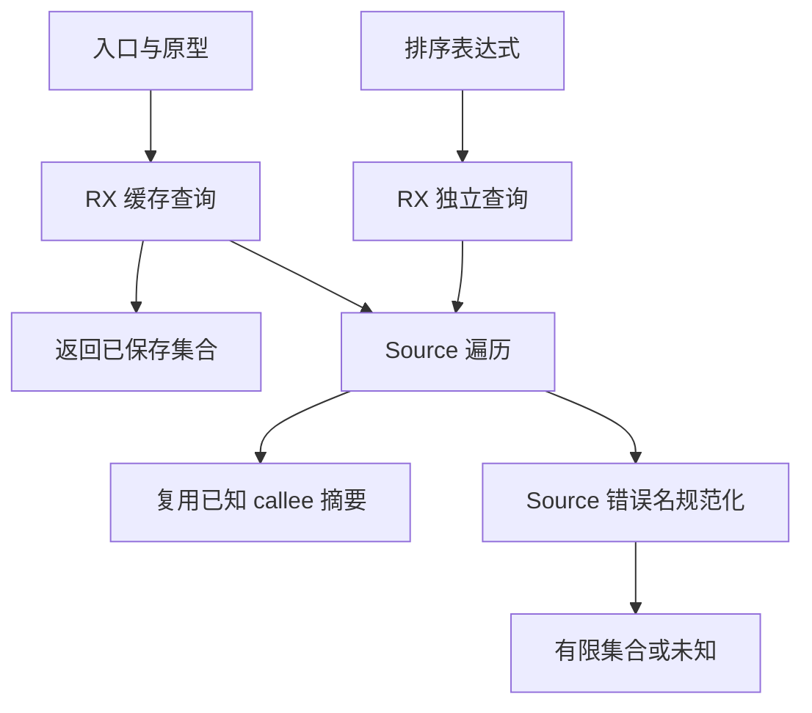
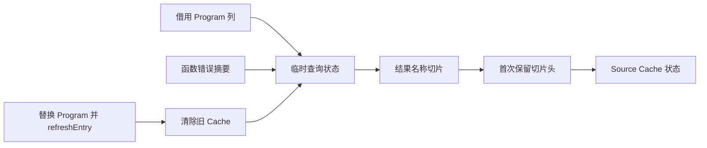

# 入口与排序错误查询自举

## Intent：最终目标

将生成器入口、函数原型及排序回调仍调用的原生错误查询迁入 RX/ZX，复用已有函数
错误摘要，维持有限集合、未知集合与实际生成代码的原有行为及累计性能。

## Data：可用证据

上一阶段已迁移函数自身错误收集及 SCC 合并，但 Lower.function、Lower.prototype
和排序生成仍调用 core 原生 programWith/expressionWith。Source 遍历具备同类规则，
尚缺已知 callee 摘要输入。

原有入口查询还会对同一 Lower 的不变 Program 重复遍历。Lower 的 Program 在
functions/emit、modules、contracts 三处替换，均调用 refreshEntry；缓存必须在此
失效，不能按函数 ID 或单个列地址猜测等价。Task 和排序 worker 仅复制同一 Program。

## Edges：边界与限制

- Source 先处理 Native 错误契约，再使用已知 Source callee 摘要；null 仍表示未知，
  空数组仍表示有限空集合；不把未知误当成空集合。
- 缓存状态与命中分支在 Source 定义。宿主仅传递借用描述符、在首次产生结果时
  复制结果的字符串切片头到既有结果存活范围；不复制 IR 列及字符串内容。
- 排序表达式查询与入口缓存分开，不能复用整个入口的错误集合。
- Program 替换时清除缓存；不自动复用不同输入、契约或 Store 能力的结果。
- 继续保留初始 seed 及 core 其他调用者的原生实现，不能声称整个错误分析已自举。

## Answer：交付与成功标准

交付 Source 已知摘要消费与 RX 查询缓存、生成器真实接线、现有回归及新旧产物/
缓存记录对照；受影响生成路径沿用固定性能基线验收。功能与兼容性已通过下述验证，最终性能验收见后文。

### 首轮验证与性能定位

引导 39/39、正式构建 21/21 通过，十个受影响目标 317/317 构建步骤、616/616
测试通过。新旧工具与两阶段工具的 main、collections、growth 代码一致，仅工具
身份元数据不同；非空缓存记录也一致。未新增仓库测试用例。

第一轮冻结输入中位数：固定基线 CPU 5.34 s；阶段前 5.24 s，阶段后 5.27 s。
虽然累计仍低于固定基线，阶段 +0.03 s 超过参考容差，因此没有提交收口。

生成体显示公共 executeIn 会为返回记录分配包装，即使缓存已经命中也如此。改用
既有 executeValue 与通用 columns.invoke 借用适配，直接在栈上传递结果头；仍由
Source RX 决定命中与 fresh，未把缓存规则移回原生。

忽略目录中的独立计量对未知、有限空集合、有限非空集合三种缓存执行零字节
FixedBufferAllocator，结果与传入缓存一致，fresh=false，累计请求均为 0 B。
这证明命中路径不分配，不将其扩展为冷分析也零分配的声明。值 ABI 与函数摘要复用的最终行为回归已通过；性能数据分版本保留。

### 消除完整函数的重复查询

仅消除 ABI 包装后的复测仍为 5.25→5.28 s CPU，说明不能把全部增量归因于包装。
进一步核对真实生产者：functions.emit 与 modules.selectFunction 已把某个完整函数
的 symbols、expressions、body、types、stores、contracts 投影给 Lower。此时已有
SCC 闭合的函数错误集，重新遍历相同函数是重复工作。

新增 Source cache/function 选择已知行：缺少 known 表返回“未缓存”，null 行返回
“已缓存 unknown”，非 null 空行仍为有限空集合。只在上述两个精确投影点、且
refreshEntry 已清旧缓存后调用；不把 self_function ID 当作任意 Program 的等价证明。
契约谓词替换仍清缓存，不预装函数行；普通入口与独立表达式继续按原规则查询。

选择函数摘要也通过值 ABI 与零字节分配器调用，不复制摘要名称内容或切片数组。
四轮预检（舍弃首轮）CPU 中位数为约 5.24→5.20 s；该数字只用于决定继续收口，
最终数据仍以隔离的完整对照为准。

### 最终功能证据

最终代码引导构建 39/39、正式构建 21/21 通过；十个相关目标仍为 317/317 构建步骤、
616/616 测试通过。39 个 Source 文件的格式与 lint 共 78 项检查通过。

当前 main、collections、growth 输入的新旧工具及两阶段输出分别为 2789、64、356
个文件，全部代码逐字一致，仅 `.zxc-inputs` 身份元数据不同。三个输入组的四类
缓存表合计 17,078 条记录，其键与值全部一致。

所有结果仍以实际输入覆盖为界：没有据这些结果宣称穷尽任意 IR；完整函数复用
依赖两个生产者的精确投影及错误摘要存活范围，不是对函数 ID 的无条件缓存。

原始日志和脚本保存在忽略目录
`.zig-cache/cold-build-analysis/ownership-research/error-queries/`。不同候选的性能
报告分别保留为 boxed、value、known 记录，不把已经用过的目录当作新的冷缓存。

### 最终性能与增量验收

继续使用冻结的 141 入口、2220 模块输入及同一个固定基线可执行文件，SHA-256 为
`8f1e7cee1eadb3ea0f6f7150bab951c55672ce294e4fbe7c50d5858723bdd92d`。
停止其他构建后，八轮交替运行，分别舍弃首轮，中位数如下：

| 路径     | CPU    | 墙钟   | 峰值 RSS      |
| -------- | ------ | ------ | ------------- |
| 固定基线 | 5.35 s | 1.17 s | 490,356,736 B |
| 本阶段前 | 5.26 s | 1.12 s | 478,642,176 B |
| 最终实现 | 5.24 s | 1.12 s | 485,064,704 B |

阶段 CPU -0.02 s、墙钟持平；相对固定基线累计 CPU -0.11 s、墙钟 -0.05 s。
首组 RSS 增加约 6.4 MB，因此另做十二轮前后交替独立检查、各舍弃首轮：CPU
5.26→5.23 s，墙钟同为 1.12 s，RSS 485,949,440→486,817,792 B。未复现较大的
内存增量，保留全部样本继续看趋势；不将小差异当作确定的内存收益或退化结论。
本轮没有重新测量 LLVM 冷构建的 GB 峰值。

冻结输入 2268 个输出文件的代码一致，仅身份元数据不同；12,612 条缓存记录的
键和值一致。十四个既有借用样例 CPU 为 25.531→25.654 ms，墙钟为
10.244→10.198 ms，短时间差异不作为确定收益宣称。

初始、合法语义编辑、恢复三种状态的增量与干净输出、新旧输出均为相同 45 个代码
文件；恢复后实际 fixture 缓存四类表记录为 `[17,15,14,14]` 且一致。诊断脚本更换
输出前缀后曾未替换 fixture 缓存路径，已修正并重新比较实际 fixture 目录，未把
重复检查冻结缓存的结果作为 fixture 证据。

### 自我复核与剩余依赖

功能、缓存命中控制与已知行选择均来自 RX/ZX；两次性能优化保留迁移，没有改回
原生查询。未引入专用运行库、文件名特判或改变错误集合来通过验收。

原生适配仍承载 Lower 的持有边界、IR 列借用与 Program 替换通知。完整自举要求
这些边界继续收口；core 的前端错误查询调用者及初始 seed 仍保留原生路径。
本阶段不等于完整错误分析、所有权检查或整个编译器已经自举完成。
