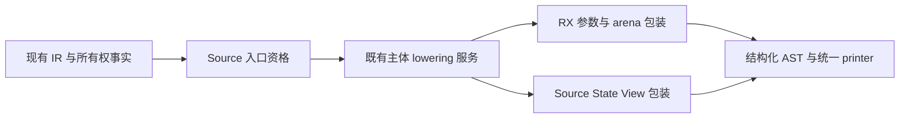

# 公开入口路由与包装自举

## Intent：最终目标

将 execute/executeIn/executeValue/executeState 的公开入口规则、转发资格及包装
AST 迁入 RX/ZX，保持 allocator、Task、State/View 和错误联合的既有公开契约。

## Data：可用证据

起点 ea249a3d，工作区干净。entry、entry_values、entry_state 仍用 Native 拼装
公开入口。State 转发资格可直接复用 Source ownership/needed；参数、调用、
返回、错误联合及声明常量已有结构化 AST 原语。

## Edges：边界与限制

- Task 仅发布 arena execute；普通入口 executeIn 加 execute 包装，后者直接返回
  原错误联合值，不新增 try/catch。
- State 别名转发成功后仍生成 executeValue；复杂 State 主体加 View 包装后停止。
- 转发同时检查 argument/result 的 normalize、renew、needsClip，精确类型、
  callee value/Store、根 Store/contracts、input0 或 void-unit；不扩大资格。
- 保留 enter/restore、public_value_output 的错误退出恢复，State View 的输入转换、
  调用与绑定、输出转换、reference_storage 顺序及 error set/inferred/inlined。
- Lower 状态、function/request/type/conversion/aggregate 服务及物理适配暂保留，
  不将它们包装成新的 Source 专用语义桥或执行计划，不宣称完整传递依赖已迁移。
- 不新增用例；已有行为、自编译、完整产物/memo和固定累计性能共同验收。

## Answer：交付格式与成功标准

完成完整职责后统一验收全部变更、英文提交并推送；记录 CPU/耗时相对上阶段及
固定基线的差异，不把 arena/IR 静态推测称为内存收益。

## 执行与验收

Source base/policy 决定普通/Task、值/聚合和 State 资格；hasStateEntry 与
hasAllocatorEntry 复用同一 Source 规则，保留 type_only/value gate，不依照 State
转发函数的返回布尔值猜测入口是否存在。Source forward 保留原 represented_output
前置条件、全部结构/所有权检查及短路顺序；直接复用 ownership/needed。

arena/build.rx 将参数改造连接到调用/返回构造。Source State prepare/call/finish
分别负责参数与引用、调用、错误联合与返回 AST。Native 保留 Lower 入口调度、
State enter/restore、主体/类型/转换/aggregate 服务、参数列物理适配及 body 段
材料化。三个 seed 移到同职责目录，只调整相对 import；不算最终自举边界。

### 转发临时列表的成本错误

第一次引导和正式构建均成功，但完整产物对照发现 203 个公开包装丢失 State
别名，改成额外函数。没有将构建成功作为迁移完成证据，也未接受这一生成变化。
Native 临时探针逐项对照原判定：source=null、seed=callee，而 flags=0/0、
needsClip=false/false、input reference=0。实际生成代码显示，两项 sites 列表
被降为 allocator.dupe；查询却使用零容量 allocator。ReleaseSmall 下的
catch unreachable 不能证明无分配，错误结果也不能作为合法拒绝。

改为按 argument、result 顺序短路调用同一原子 allowed 谓词，复用现有静态调用
能力，消除临时集合，保持原固定两项检查的语义及成本模型。没有增加专用桥、
复制数据、削减转发能力或撤回 Source 迁移。删除全部探针后重新引导及正式构建。

实际生成的 forward 调用闭包含 9 个函数，无直接分配调用；四个原生叶子只是
integer.widen/widenByte/andBits/bitMask，核对实现均不分配。保守错误集仍含
OutOfMemory，不能仅看错误集断言会分配或不分配。闭包证据结合真实零容量查询
与完整非空产物对照，确认原有 203 个别名恢复；未新增用例。

核对脚本更换目录前缀时曾产生空集合报告，已作废；命令、读取与 memo 路径统一
后加入非空与文件集合相等断言，再执行完整对照。没有把空集合一致作为验收。

### 功能与自编译

- 13 个 RX/ZX 文件通过 fmt --check 与 lint，ZX 最大文件 138 行。
- 上阶段正式工具引导、再由新工具生成正式工具，两轮 P16 ReleaseSmall、12 核，
  均通过 21/21 步；执行文件 SHA-256 均为
  ebbd5b3fc51c7396fec497957a0c3dc7d4a6b3f7b7404043638365c3e6bf8784。
- main/collections/growth 的 3147/65/357 个非空文件集合，上阶段与本轮仅
  .zxc-inputs 不同；本轮两阶段完整产物逐字节一致。
- 既有 test-predicate-allocation、test-loan-lifetime-prototype、test-value-return、
  test-zx-await-runtime 联合通过 225/225 步、142/142 个受管用例；包括值接口、
  Source/Library、对象/tuple/optional 逃逸、失败清理及 Task。predicate 的外部
  Node 驱动另有 24 组执行结果，按实际日志单列，不混入受管用例数。
- lifetime 用例输出 direct/view 各 1 次、80 B 分配等诊断。Zig 摘要该步骤为
  success，全部目标退出码为零；日志中诊断旁的 failed command 字样不是一次
  未解决的测试失败。它也不是完整 NLL 已完成的证据。

8 份既有 await 生成产物另做公开声明核对：均存在 execute，均不存在 executeIn。
这一结论来自真实产物，不只是观察路由布尔值，也没有新增测试用例。

### 性能与 memo 收口

全部构建终止后，以相同冻结 141 个入口、Zig 0.17.0、Source 分析/生成后端、
关闭 resident generator，交替八轮并排除首轮。工具本体均使用相应阶段的
Source 自编译工具，固定累计基线保持不变。

| 指标       | 固定累计基线 |      上阶段 |      本阶段 |
| ---------- | -----------: | ----------: | ----------: |
| CPU        |       5.35 s |      5.31 s |      5.32 s |
| 墙钟       |       1.17 s |      1.13 s |      1.14 s |
| 生成器 RSS |  495403008 B | 484589568 B | 484212736 B |

CPU 与墙钟单阶段各 +0.01 s、相对固定基线累计各 −0.03 s。这一级差异接近
计时分辨率，不当作确定的退化或提速；继续观察近期小幅增长，不能按阶段重置
0.1 s 容差。RSS 微小变化不作为冷构建内存收益，本阶段没有重测完整冷构建。

固定基线 SHA-256 仍为
8f1e7cee1eadb3ea0f6f7150bab951c55672ce294e4fbe7c50d5858723bdd92d；
上阶段为 f345a0c79352fd695e0473d41b39e8dfdcfe4925557a17cc2d926fa1e31d4748。
冻结 2268 文件只有 .zxc-inputs 不同。四类 memo 逐键逐内容一致，非空计数为
main 10875/3080/2558/0、collections 67/45/27/27、growth 1126/311/266/0，
冻结输入 8248/2419/1945/0。

自我复核：查询中的临时集合是本轮可避免的成本错误，源码表面等价和构建成功
不足以排除它；后续查询迁移继续检查实际闭包的分配与固定容量契约。验收脚本
本身也须检查非空与集合边界，不能机械信任摘要。本轮规则和包装 AST 已迁移，
但 Native Lower、State 生命周期和转换适配仍待后续迁移；完整自举、完整 NLL
和剩余冷构建约 2 GB 峰值均未因此完成。

证据位于忽略目录 .zig-cache/cold-build-analysis/ownership-research/public-entry：
bootstrap.log、production.log、regressions.log、fixedpoint.json、
production-fixedpoint.json、query-closure.json、task-entry-shape.json、
final-runtime-comparison.json、memo-results.json，以及各轮完整产物与日志。
probe-build.log/probe-run.log 记录定位证据；正式源码中已无探针。
