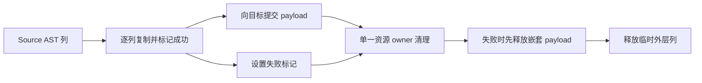
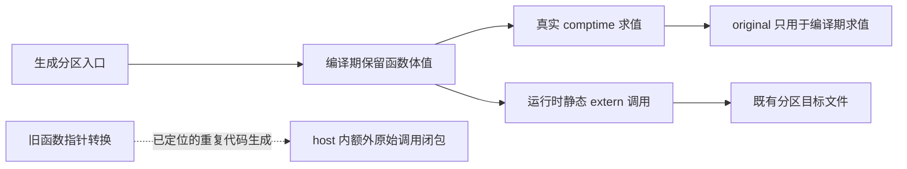
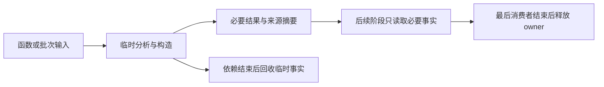

# 冷编译内存归因与错误清理优化

## Intent：最终目标

降低冷编译峰值内存，同时控制 CPU 与耗时。所有权分析是候选手段，不能用完整
NLL、接受更多程序、累计申请减少或生成器 RSS 替代真实冷构建的峰值收益。

## Data：可用证据

### 临时 arena 试验：累计申请不是整轮泄漏

Source analyzer 在目标 allocator 上创建临时 zx.Arena，发布持久 IR 后才 deinit。
隔离探针在 child 边界记录申请/释放，并在每次 free 前后读取已确认是 std Arena
的父级 used_list/end_index。1992 次真实分析累计申请 1631578008 B，请求释放
同量，父级在这些 free 中回收 0 B；单体最大 12051338 B。

这只证明本体末尾的 free 未回收，不能证明整轮泄漏。实际生成器主要走 RX mixed
的 resolved 路径，Ahead 外层 arena 按批 reset，串行 scratch 也按模块 reset。

尝试独立可复用工作区：先覆盖 Project/standalone，再接入实际 resolved 串行与
每个 worker。发布结果的列、契约、常量和文本拥有关系及非重入条件已核对。

- 第一组八轮排除首轮：access 版 CPU 5.27 s、耗时 1.12 s、RSS 491503616 B；
  Project/standalone 版 5.28 s、1.12 s、490389504 B，无确定收益。
- resolved 版四轮排除首轮：CPU 5.26→5.27 s、耗时 1.11→1.10 s、
  RSS 490553344→497762304 B，也未取得内存收益。
- 两个 pool 会同时保留容量。该优化尝试已全部删除，自举迁移保留；没有修改正式
  所有权判定或引入 workspace API。不能凭调用 deinit 或更换 owner 声称内存已修复。

### bridge 修复前冷构建的真实峰值

根目录默认 P2、ReleaseSmall、并发为本机 12 核；新建且初始不存在的 local/global
编译缓存，stage0 为空，复用已校验 Zig archive 和 OS 缓存。51/51 步成功。

- time：131.88 s 墙钟、212.46 s user、7.88 s sys；采样器共 132.03 s。
- time 最大 RSS 2667315200 B；0.2 s 进程树采样峰值 2596306944 B。
- 采样最大单进程 2576711680 B，响应文件确认是 zxc_host 的 Zig build-lib；
  构建摘要该步骤 34 s、MaxRSS 2G。生成器约 490 MB 是另一个进程。
- 包含观察开销，不能与历史不同输入或部分缓存命中的数字直接相减。

### LLVM 与错误清理展开

复用峰值进程完整响应文件，仅在新缓存隔离编译 host 并导出未优化 IR。
3 s 栈采样捕获 LLVM ModuleInliner/CGSCC/Function 优化路径；仅代表该窗口。
诊断编译 34.91 s、RSS 2922364928 B；IR 导出改变成本，不能与普通构建直接相减。

原始 IR 189122469 B，23465 个函数；函数体合计 4293763 行、454135 个基本块。
两份 node.import_rows.appendRows 各 26745 行、4523 块；最大标准库函数 TLS
Client.init 为 97117 行。import_rows 的临时列及 payload 清理在多个 try 错误出口
重复 inline 展开，是通用成本候选，不按用户案例或 Source 名称特判。

## Edges：边界与限制

- 聚合临时资源清理，保留 AST 校验、复制、借用及错误行为。
- copied 位只标记整列复制成功；当前失败列由原 copy 原语清理部分元素。
- 失败先释放已复制嵌套 payload，再释放外层列；成功仅释放临时外层列。
- borrow_text 语义保持；copy_payloads=false 在 comptime 排除清理，不增加借用
  成功路径的清理分支，不增加应用运行库或动态层。
- 不新增用例，复用既有分配失败、生成器、Store、引用与缓存检查。
- IR 变小不是内存收益证明，必须比较同输入 host 编译的实际峰值和耗时。
- 完整 NLL、前端权限恢复、快照 delta 未实现；其价值仍需单独成本证据。

## Answer：交付格式与成功标准

在代码、memo、编辑恢复与失败清理一致前提下，减少 host 的 IR 和峰值；记录
生成器阶段及固定累计基线成本。验收后收口全部变更，英文提交并推送，确认干净。

### 执行记录

聚合清理候选通过引导 39/39、正式构建 21/21，以及 333/333 步、592/592 个
受管用例和 15 组外部回归的 86 个用例。完整产物、memo 和合法编辑恢复一致。
这些检查证明候选的行为，没有证明性能收益。

同输入诊断 IR：189122469→185652631 B，函数体减少 106266 行，基本块减少
18325 个。两份 importer 各 26745→3212 行、4523→525 块。包含 IR 导出的编译
RSS 2922364928→2884517888 B；该数字仅与相同诊断配置比较。

普通 host 编译使用同一响应文件、工具链和生成输入，每次新建 local/global
编译缓存，不导出 IR、不采样，交替顺序共三对。以下为中位数：

| 指标           |       原实现 | 聚合清理候选 |                    差值 |
| -------------- | -----------: | -----------: | ----------------------: |
| 墙钟           |      34.41 s |      34.54 s |                 +0.13 s |
| user + sys     |      36.11 s |      36.23 s |                 +0.12 s |
| 单进程最大 RSS | 2907439104 B | 2886270976 B | −21168128 B（约 0.73%） |

三对中一次候选更快、两次更慢，不能将微小差值归因成确定的稳定退化，也不能
声称内存大幅改善。依据当前“不出现累计性能退化”的约束与 skill，收益不足以
支撑接受这项取舍，已删除聚合清理实现，保留原实现和诊断证据。该撤销仅针对
优化实验，不撤销 Store/Reference 自举。以后有新证据再考虑，不重复同样计时。

冻结生成器输入的四版八轮对照、排除首轮，原阶段→Store/Reference 自举的 CPU
5.27→5.28 s、墙钟 1.12→1.11 s、RSS 489488384→491225088 B。固定累计基线
5.35 s、1.17 s、495108096 B。清理候选为 5.28 s、1.12 s、487424000 B。
三者内存样本均有较大波动，不能把生成器几 MB 变化当作冷编译数 GB 的解答。
冻结输入 2268 个文件仅 .zxc-inputs 不同；12612 条 memo 记录逐键逐内容一致。
证据位于忽略目录 .zig-cache/cold-build-analysis/ownership-research/access：
analyzer-probe*.log/json、workspace-_.log/json、resolved-trial-runtime_.log/json；
cold-root/command.json、metrics.json、samples.jsonl、response-1.txt、build.log；
cold-root/host-profile 与 host-cleanup-profile 保存同输入命令、IR、栈采样与计量。

### 编译器与 LLVM 研究：论点、适用范围和取舍

按用户要求检索一手论文和作者/机构版本。以下十篇与先前的十三篇所有权研究
分别记录；经典工作提供已验证的设计基础，近期探索提供假设。会议论文、预印本
和 Student Forum 明确区分，不将“较新”等同于“已在生产验证”。未移植论文中的
百分比收益，也不把代码大小等同于编译器峰值内存。

| 研究与出处                                                                                                                                                                                                                                          | 可借鉴的论点                                                          | 对应 zxc 证据与选择                                                                           | 成本及限制                                                                                       |
| --------------------------------------------------------------------------------------------------------------------------------------------------------------------------------------------------------------------------------------------------- | --------------------------------------------------------------------- | --------------------------------------------------------------------------------------------- | ------------------------------------------------------------------------------------------------ |
| [LLVM: A Compilation Framework for Lifelong Program Analysis & Transformation](https://llvm.org/pubs/2004-01-30-CGO-LLVM.pdf)，Lattner、Adve，CGO 2004                                                                                              | IR 应显式保留数据流、类型和控制流信息；研究同时考察表示成本及分析成本 | 在 Source IR 层追踪构造、复制与借用，再核对生成 LLVM；不靠修改表面语法猜测收益                | 基础架构论文，不直接解释当前 0.17 工具链峰值                                                     |
| [ThinLTO: Scalable and Incremental LTO](https://storage.googleapis.com/gweb-research2023-media/pubtools/4743.pdf)，Johnson、Amini、Li，CGO 2017                                                                                                     | 全局摘要与局部按需导入分开，限制同时装入的完整 IR，并保留跨模块优化   | host 是最大进程，后续可研究生成单元的实际依赖闭包与按成本分区；已有 P2 不是所有单元均衡的证据 | zxc 当前路径不能直接视为 ThinLTO；分区可能重复分析、失去内联机会，并行还会叠加 RSS，先做单元归因 |
| [Function Merging by Sequence Alignment](https://issl-uk.com/publications/cgo19.pdf)，Rocha 等，CGO 2019                                                                                                                                            | 合并相似函数能减小产物，但搜索和变换存在编译成本                      | importer 错误清理重复是真实候选，先在源头统一资源职责，避免让 LLVM 处理大量展开               | 论文目标是代码大小；其编译开销反而说明不能为减 IR 无条件加入复杂合并 pass                        |
| [HyFM: Function Merging for Free](https://zwang4.github.io/publications/lctes21.pdf)，Rocha 等，LCTES 2021                                                                                                                                          | 将比较约束到基本块，分层判断收益，并在生成合并体之前提前退出          | 对自举规则的成本检查应早于展开；清理实验说明减少 IR 仍须测量端到端                            | 不移植全函数二次方匹配；论文自己的内存数字不代表 zxc 可获得同样收益                              |
| [F3M: Fast Focused Function Merging](https://www.pure.ed.ac.uk/ws/portalfiles/portal/260329465/F3M_STIRLING_DOA05112021_AFV.pdf)，Stirling 等，CGO 2022                                                                                             | 用摘要和哈希缩小有价值的候选集合，避免穷举全部函数对                  | 先按展开后 IR、调用关系筛选少量热点，再做对照；无需全仓库增加昂贵分析                         | 摘要会漏选；目前只借鉴候选缩减原则，不引入函数合并体系                                           |
| [MLGO: a Machine Learning Guided Compiler Optimizations Framework](https://arxiv.org/pdf/2101.04808)，Trofin 等，2021 预印本，LLVM 工程实现                                                                                                         | 内联决策需要衡量程序特征与最终目标，局部内联与总体大小的关系复杂      | 现有 inlined.zx 以输入/输出顶层字段数筛选，可能漏掉短头部包装的昂贵构造；应测量构造及展开成本 | 论文主要优化二进制大小，不能据此保证速度或 RSS；zxc 无需引入 ML 训练和推理框架                   |
| [MLGOPerf: An ML Guided Inliner to Optimize Performance](https://arxiv.org/abs/2207.08389)，Ashouri 等，2022 预印本，短版 CASES 2022                                                                                                                | 为大小调优与为运行性能调优的内联目标不同                              | 限制强制内联后同时测量编译器构建及编译器执行；也要保留已有应用行为检查                        | 不能用更小目标文件替代生成程序性能，不能将论文样本增益外推到 zxc                                 |
| [MLIR: Scaling Compiler Infrastructure for Domain Specific Computation](https://research.google/pubs/mlir-scaling-compiler-infrastructure-for-domain-specific-computation/)，Lattner 等，CGO 2021；[早期作者版本](https://arxiv.org/pdf/2002.11054) | 在适当抽象层保留结构，再分层降低，便于语言相关分析和变换              | 在 zxc 已有结构化表达式和 AST 上改进构造/借用表示，避免先展开后要求 LLVM 重建语义             | 不是建议为此整体迁移 MLIR；新 IR 层自身也会占内存，必须有净收益                                  |
| [ACPO: AI-Enabled Compiler Framework](https://arxiv.org/abs/2312.09982)，Ashouri 等，2023 预印本；[CASES 2024 Work-in-Progress](https://web.eng.fiu.edu/gaquan/Papers/ESWEEK24Papers/CPS-Proceedings/pdfs/CASES/563700a019/563700a019.pdf)          | 内联、循环展开的收益是具体目标和上下文下的决策，需用实际测量反馈      | 给候选记录构建成本、执行成本及大小；先用确定、可审计的规则开展小试验                          | 不引入 Python/模型依赖，不把作者 O3 基准收益作为本项目证据                                       |
| [Formal Performance and Compile Time Guarantees for Compiler Optimization Heuristics](https://arxiv.org/pdf/2608.20137)，Shyamsunder，2026，FMCAD Student Forum / 3 页预印本                                                                        | 不只证明语义正确，也约束优化搜索的收敛时间与模型内成本                | 给拟议的内联成本检查设置有界工作量，禁止无界递归重算或用收益抵销无限分析成本                  | 初步研究，内存不是其主要证明对象；模型界限不等于真实 LLVM 性能保证                               |

LLVM [New Pass Manager 官方文档](https://llvm.org/docs/NewPassManager.html) 是工程
资料而非论文：分析缓存避免重算，但必须有正确的失效/清理边界；按 IR 单元组织
连续 pass 有利于局部性。对 zxc 的启示是按模块/阶段保留必要事实、及时回收已失效
事实，避免以“缓存更多”或“每次重算全部”作为默认方案。当前峰值在后端，不能
把它未经测量地改写成前端缓存问题。

### 从论文到可证伪的小范围实验

| 优先级         | 假设与现有证据                                                                                                                                                      | 最小实验                                                                                              | 同时验收的代价                                                                                                             |
| -------------- | ------------------------------------------------------------------------------------------------------------------------------------------------------------------- | ----------------------------------------------------------------------------------------------------- | -------------------------------------------------------------------------------------------------------------------------- |
| 1：内联决策    | genz/analysis/inline/expression/copy.zx 对应函数含 15251 行 IR；输入表已经借用，但五个 pub inline helper 在未优化 IR 中均已展开。输出 Result 仅两字段不代表构造便宜 | 在已保存输入副本上，用通用构造/展开成本限制自动强制内联，保持普通静态调用；先不修改全局阈值和语言语义 | host 新缓存最大 RSS、墙钟、CPU；正式编译器执行固定输入；既有行为与自编译。若出现显著调用成本增长，重新评估，不能全局禁内联 |
| 2：描述符构造  | traversal/resume 12494 行，静态出现 35 份 2064 B 和 15 份 2056 B memcpy；enter 9583 行，多分支各自构造宽 Work                                                       | 先确认优化后的存储与实测频次，再研究构造到最终目标、按需借用只读字段；保留所有权和错误顺序            | 静态 memcpy 不代表每次执行都复制，更不证明复制底层数组；减少表示复制不能增加堆分配或破坏零成本                             |
| 3：单元驻留    | host 编译约 2.67 GB，生成器约 0.49 GB；已分区不保证 host 轻量                                                                                                       | 核对 host 与分区实际承担的函数/IR，优先按已有职责和依赖边界切分                                       | 目标并发下总进程树 RSS、重复分析/链接成本与运行时优化损失；不能只报告单进程下降                                            |
| 暂缓：工作区池 | 真实路径已试验，池同时保留容量且没有收益                                                                                                                            | 无新证据不重做；保留按批/模块已有 reset                                                               | 累计申请不能替代峰值，不能为“释放得更早”的直觉重构所有权                                                                   |

选择标准是多目标比较：在正确性、zero runtime、zero copy 和自举边界相同的前提下，
优先保留内存下降且耗时/CPU 不升的方案；若存在实质取舍，列明可比基线、绝对值、
比例、波动、累计变化及对生成程序的影响。用户尚未给出可牺牲性能换内存的额度，
按用户后续“0.1s 内都可以接受（累积超过一定阈值除外）”及当前 AGENTS.md，
CPU 与耗时均核对固定基线下 0.1 s 内的差异，同时监控累计增长；不能每阶段
重新领取容差。历史 0.02 s CPU 差异是此前一次验收的尺度，不覆盖后续明确修正。

当时选择优先验证内联构造成本，不据此认定所有权无关或内联是全部根因。下文
已完成内联成本修正及 bridge 重复生成修复。仍有标准库 TLS 等大函数，单个
Source 热点无法解释所有峰值。剩余冷编译内存与完整 NLL 均未完成，不能以论文
整理或 IR 缩小宣称完成。

### 内联构造成本小试验

假设：现有 192 条表达式预算漏计 Object 展开后的字段装配。保持预算值不变，
用“表达式数 + Object 字段总数”作有界估计；先检查余量再相加，避免整数溢出。
在原有 bounded 扫描中累积，不递归调用图、不分配状态、不增加分析缓存。只影响
自动强制 inline 的选择，普通静态函数仍允许 Zig/LLVM 按自身成本决定内联。

先核对生成形态与受影响数量，再比较 host 后端和生成器运行成本。阈值只是既有
预算的延续，不是论文给出的普适常数；若无法减少真实热点，或成本取舍不满足
约束，则记录并删除这个优化实验，保留已完成自举。

小试验已命中 11 个唯一模块（含分区副本共 26 文件），包括 append/transform、
match、scope、iteration，以及少量重建宽 Context 的 AST helper。同一输入的新旧
生成代码，除 .zxc-inputs / .zxc-files 元数据外，仅 inline 修饰不同。

三对普通 host 编译使用同一生成输入、响应参数与新 local/global 缓存，顺序为
before→after、after→before、before→after，不导出 IR、不采样。中位数：

| 指标           |       原规则 | 字段加权规则 |                   差值 |
| -------------- | -----------: | -----------: | ---------------------: |
| 墙钟           |      34.44 s |      33.90 s |    −0.54 s（约 1.57%） |
| user + sys     |      36.10 s |      35.51 s |    −0.59 s（约 1.63%） |
| 单进程最大 RSS | 2893398016 B | 2889793536 B | −3604480 B（约 0.12%） |

三对墙钟分别 −0.26/−0.54/−0.26 s，CPU 分别 −0.28/−0.59/−0.20 s；内存
分别约 −0.82/−8.42/−7.83 MB。时间改善方向一致，内存收益很小且有波动。这是
有实际编译耗时收益的通用成本修正，不把它宣称为数 GB 内存问题的解决方案。

单独诊断导出 IR 为 184940536 B；expression/copy 的 callValue 从 15251 行降至
4449 行、alloca 从 1568 降至 349，证明确实截断了预期的强制展开。此对照与历史
IR 的政策函数体略有差别；真实收益仍以上述无诊断参数配对编译为准。

冻结生成器三版交替八轮、排除首轮：上阶段 5.27 s CPU / 1.12 s 墙钟 /
489390080 B RSS；候选 5.28 s / 1.12 s / 483885056 B；固定基线 5.34 s /
1.16 s / 492584960 B。单阶段 CPU +0.01 s、累计 −0.06 s；墙钟单阶段不变、
累计 −0.04 s。RSS 不作为稳定收益承诺。生成差异仍需按 inline 修饰核查，不能
要求本次有意改变的代码字节完全相同。

最终验收：引导构建 39/39、正式构建 21/21；五组既有目标回归
(test-function-analysis、test-module-generation、test-value-return、test-loop-columns、
test-compound-references) 共 281/281 步、317/317 受管用例全部通过。未新增用例。

引导版与正式版在同一完整 main / collections / growth 输入上分别生成
2885 / 64 / 356 个文件，除 .zxc-inputs 外逐字节相同。九份既有样例的合法编辑、
恢复，在新旧工具下产物相同，各阶段增量等于干净生成；memo 四类各 9 条一致。
完整 growth 的 memo 为 1124/310/265/0，逐键逐内容一致；不把这项仅保留最后
cache 的检查宣称为 main / collections 的 memo 检查。

正式版冻结输入八轮、排除首轮：上阶段 CPU 5.28 s、墙钟 1.12 s、RSS
490209280 B；正式版 5.28 s、1.13 s、485949440 B；固定累计基线 5.34 s、
1.17 s、496664576 B。CPU 单阶段无变化、累计 −0.06 s；墙钟单阶段 +0.01 s、
累计 −0.04 s。冻结输入 2268 文件仅八个函数的 inline 修饰与两项元数据变化，
规范化修饰后代码完全相同；memo 8248/2419/1945/0 共 12612 条逐键一致。

生成器缓存 frame 和 GenerationCache 均使用执行文件 digest，规则变化会改变
工具身份；不是依赖人工升级版本串使缓存失效。本轮仍复用了合法编辑与恢复
对照，不只验证无修改缓存命中。

自我复核：这个有界启发式不是真实 IR 上界；被调函数、目标类型大小和后端
优化仍会影响成本。当前验证支持保留它的后端时间收益，没有证明全冷构建峰值
下降或所有应用的运行速度提升，也没有完成 NLL 或全部自举。下一步继续针对
实际峰值进程定位，同时保留性能与内存的联合验收，不扩大内联禁用范围。
证据位于 .zig-cache/cold-build-analysis/ownership-research/inline-cost：shape.json、
host-metrics.json、repeated-metrics.json、repeated-summary.json、ir-stats.json、
runtime-comparison.json、final-runtime-comparison.json、fixedpoint.json、memo-results.json、
final-frozen-shape.json、cleanup-edits-comparison.json 与对应命令、日志。没有新增
用例、运行库或额外分析缓存。

### 分区编译期回退的函数指针转换

继续沿真实峰值进程核对分区边界，发现 partition/bridge 的 Forward 和 forwarder
将 comptime 函数体值强制转换为 ?*const F。运行时虽然只调用 extern 分区入口，
转换仍使 original 实现进入 host 的运行时代码生成，重复承担整个调用闭包。
original/root 还用于真实编译期求值，不能为省内存整体删除。

最小方案：comptime implementation 保留 anytype 函数体值，只在 @inComptime()
分支直接 invoke；null 在同一编译期分支报原有错误。外部 C ABI、参数借用、
返回槽和错误编解码不变，不增加运行时分支、分配或转换。公开 importComptime
本来要求 fn 类型，原函数指针输入已不受支持，未收窄既有契约。

先在忽略目录副本验证：同一 host 输入和参数，诊断 IR 从 184940536 B 降为
90238799 B；函数数 23475→19782，函数体行数 4250065→2045548；原始
expression/copy 的 callValue 不再生成。诊断编译 30.70 s、CPU 32.31 s、
最大 RSS 2311454720 B。IR 导出影响成本，普通编译配对结果见下，不能把
诊断数字当作全冷构建收益。

验收顺序：无诊断参数的同输入普通 host 三对；完整根构建新 local/global 缓存
前后各一次（同 12 核、模式、archive 和 stage0 边界），记录进程树及最大进程；
再执行受影响的既有分区、comptime、ABI、生成行为检查与实际生成器性能对照。
必须保留编译期功能，不以更少 IR 替代可运行结果，不新增测试用例。

普通 host 三对编译中位数（无 IR 导出/采样，各自新 local/global 缓存）：

| 指标           | 函数指针回退 | 函数体值回退 |                      差值 |
| -------------- | -----------: | -----------: | ------------------------: |
| 墙钟           |      34.48 s |      30.92 s |      −3.56 s（约 10.32%） |
| user + sys     |      36.10 s |      32.58 s |       −3.52 s（约 9.75%） |
| 单进程最大 RSS | 2884960256 B | 2313814016 B | −571146240 B（约 19.80%） |

三对峰值内存均显著下降，候选为 2.30～2.34 GB；时间方向也一致。第一对原版
墙钟 38.85 s，比后两对约 34.4 s 慢，故保留每轮数据与交替顺序，不用异常较慢
的单轮夸大收益。完整冷构建对照和既有行为验收已完成，结果如下。

完整根构建对照：两边 local/global 编译缓存均从不存在的目录开始；同一 Source、
工具链、ReleaseSmall、P2、空 stage0、12 核和已校验 archive，只改变 bridge 中
函数的编译期表示。都通过 51/51 步，保留 0.2 s 进程树观察配置；OS 和下载缓存
不清空。以下是一次完整构建配对，不将它描述为多轮中位数：

| 指标                    |         原版 |       修复版 |                      差值 |
| ----------------------- | -----------: | -----------: | ------------------------: |
| 墙钟                    |     133.19 s |     129.74 s |                   −3.45 s |
| user + sys              |     219.74 s |     216.03 s |                   −3.71 s |
| time 最大单进程 RSS     | 2640920576 B | 2075033600 B | −565886976 B（约 21.43%） |
| 采样进程树 RSS 合计峰值 | 2644164608 B | 2247294976 B | −396869632 B（约 15.01%） |

两版最大单进程都是 zxc_host。原版进程树峰值也在 host；修复版进程树峰值迁至
前面的并行阶段，说明不能以只降低 host 单体峰值代表整个构建同比例下降。
进程树数据是 RSS 的采样合计，不是 PSS 或物理内存精确计量；包含共享页重复
统计，也可能漏掉采样间尖峰。单体普通编译三对和整体一次配对相互支持，未证明
未来所有输入或平台均有同样收益。

正式 16 分区生成器构建通过 21/21。修改前后同输入完整 main / collections /
growth 产物分别 2885 / 64 / 356 文件，除 .zxc-inputs 外全部逐字节相同；三组
memo 10400/2925/2404/0、65/44/26/26、1124/310/265/0 逐键逐内容一致。
九份既有样例在初始、合法编辑、恢复三个状态下，新旧输出相同，增量等于干净
生成；四类 memo 各 9 条一致。

使用修复版正式工具，CLI 的 test-runtime / test-stores / test-native-runtime
显式启用 P2 分区，67/67 步、36/36 用例通过，覆盖生成程序、不可变集合、错误
返回、显式 native 调用和共享 Store。另外确认正式编译路径确实执行了编译期回退：lower 调用 state_plan.represented，
经 state_value/analysis.zig 的 Source-enabled 路径进入 queries.zig:36 的
`const table = comptime build()`；build 在第 49 行调用 generated_state_query 的
executeValue。实际生成的该入口调用 ceee3bb…call，而这个函数是引用 zxc_comptime
原函数的 importComptime stub。因此完整 host 编译确实执行了状态查询真值表的
编译期回退，不是仅凭 DSL/RX Schema 泛型存在或普通 runtime 用例推断覆盖。
没有删除 original 支持，也没有新增用例或替代检查。null 的编译期错误路径仍按
精确 diff 和类型规则核对，未宣称枚举覆盖桥接器所有参数组合。

正式生成器三版交替八轮、排除首轮：上阶段 CPU 5.27 s、墙钟 1.12 s、RSS
490422272 B；修复版 5.26 s、1.12 s、482508800 B；固定累计基线仍是原先
inbound-conversion 的同一工具，5.34 s、1.17 s、496173056 B。CPU 单阶段
−0.01 s、累计 −0.08 s；墙钟单阶段不变、累计 −0.05 s。冻结输入 2268 文件
仅 .zxc-inputs 不同，memo 8248/2419/1945/0 共 12612 条完全一致。生成器 RSS
样本波动较大，不将其中几 MB 差异当作本阶段稳定收益。

自我复核：本阶段修复的是一次编译期函数值到指针的过早转换所导致的重复运行时
代码生成；完整所有权生命周期分析未因此完成，cold 峰值也仍有约 2 GB。
收益来自省去无需生成的实现，不以新增运行时调用、数据复制、动态调度、缩减
语言能力或撤销自举换内存。Source 算法和生成产物行为保持；编译期函数保留
函数体值，运行时继续使用既有静态分区 ABI。可接受此阶段并继续自举与剩余
峰值归因，不对已获得证据的相同输入重复构建。

证据：忽略目录 .zig-cache/cold-build-analysis/ownership-research/partition-reference
中的 ir/stats.json、host-metrics.json、host-summary.json、cold-summary.json；
cold-before / cold-after 各自保存命令、bridge SHA-256、响应文件、构建日志和
进程采样；production.log、runtime-regressions.log、fixedpoint.json、memo-results.json、
cleanup-edits-comparison.json、final-runtime-comparison.json 保存功能与性能验收。

### 补充研究：内存与性能共同约束

本轮沿用本文件 IDEA 结构：Intent 是降低实际冷构建峰值；Data 包括一手研究、
已保存的配对测量和生成 IR；Edges 是安全、HTTPS、zero runtime、zero copy 与
累计性能要求；Answer 是有边界的归因和下一项可证伪实验。没有为文档修改重复
运行构建，也没有把既有 bridge 收益称为本轮新实现。

此前十篇编译器研究继续有效。本轮补充以下工程报告与官方说明，分别标明证据
性质；它们不是新增的顶会论文，也不把其中的 LLVM 数字直接移植到 zxc。

| 一手资料                                                                                                                                                                        | 论点及边界                                                                                                   | 对 zxc 的具体约束                                                                                                                                                        |
| ------------------------------------------------------------------------------------------------------------------------------------------------------------------------------- | ------------------------------------------------------------------------------------------------------------ | ------------------------------------------------------------------------------------------------------------------------------------------------------------------------ |
| [Faster Compilation in LLVM 20 and Beyond](https://llvm.org/devmtg/2025-04/slides/technical_talk/engelke_faster.pdf)，Alexis Engelke，EuroLLVM 2025 工程报告，第 4 页           | bump 分配降低频繁申请成本、改善局部性，同时可能提高 max RSS；并无单向最优解                                  | 不整体换掉 arena；按 owner、scratch、持久结果的真实寿命检查复用和回收。既有独立 workspace 无收益，缺少新证据时不重做                                                     |
| [Lifetime Safety in Clang](https://llvm.org/devmtg/2025-10/slides/technical_talks/saxena.pdf)，Utkarsh Saxena，LLVM Developers’ Meeting 2025 工程报告，第 16～20、26、35～36 页 | 用 loan、origin、活跃性组合判断失效，跨调用依赖契约；报告同时展示分析的编译成本及生成代码上的极端情况        | NLL 候选先限于函数内活跃性，调用边界复用现有来源摘要；不在每个调用点重扫传递调用图，不用全量逐点别名矩阵换更少复制。此资料不证明 NLL 能降低 zxc 后端峰值                 |
| [Using the New Pass Manager](https://llvm.org/docs/NewPassManager.html)，LLVM 官方工程文档                                                                                      | 内层 pass 触发外层分析可能造成平方级重复；连续按同一 IR 单元处理有利于局部性；删除 IR 时必须清理对应分析缓存 | 临时事实按已完成的函数/批次回收，跨调用只保留必要摘要；缓存失效要与依赖身份绑定，不能为了内存盲目清空后反复重算                                                          |
| [Performance Tips for Frontend Authors](https://llvm.org/docs/Frontend/PerformanceTips.html)，LLVM 官方工程文档                                                                 | 避免不必要的 aggregate 值装配和整值读写；返回多寄存器值、sret 等存在合理例外                                 | 检查宽 Context/Work 的实际生成方式，优先借用及最终位置构造；不是禁止 ZX 对象或把每个静态 memcpy 判为底层深拷贝。zxc 经 Zig 降低，须核对实际 IR，不能直接套 LLVM API 建议 |

ThinLTO 的 CGO 2017 论文仍是“全局摘要、局部按需处理”的直接科学依据。但
zxc 当前不是 ThinLTO，增加分区可能带来重复实例化、链接及跨单元调用成本。
因此先排除重复实现，再考虑同时驻留规模；分区数量不是内存改善的充分证据。

把峰值近似理解为某个时刻同时存活的数据、编译 IR、分析结果和分配器保留容量，
比只统计累计申请更接近本问题。这个分解用于定位，不是精确相加模型：共享页、
分配器内部空间、文件映射和进程采样误差都可能影响 RSS。

#### bridge 修复后的剩余归因

本轮只扫描已有 partition-reference/ir/unoptimized.ll，不重新编译。该文件是
bridge 修复时保存的诊断输入，不是最新 HEAD 的完整冷构建测量。

共 19782 个函数。crypto.tls.Client.init 为最大单函数，包含定义及闭合行共
97119 行；两个 appendRows 实例各 26747 行，zx.iteration.lowerMode 为
13656 行。与此前正文统计相差两行的部分来自是否计入函数定义和闭合行，不能
视为代码增长。报告存于忽略目录 partition-reference/ir/remaining-shape.json。

TLS 的真实依赖链是 packages/cli/src/package/install 的 resolve/replay，经
package/store.zig 和 store/download.zig 的 std.http.Client，进入标准库
Connection.Tls.create 与 Client.init。它是必要 HTTPS 下载功能，不能删除。
它的单函数约占该文件字节数 5.36%，这个静态比例不等于峰值内存比例，也没有
包含整个 TLS 依赖闭包，不能据此宣称它是剩余约 2 GB 的主因。

当时提出的下一项实验是对同一 host 输入的忽略副本做 TLS 子图归因：仅诊断副本
使用标准库已有的 http_disable_tls，保留正式源码的 HTTPS；核对消失的完整
依赖闭包、同参数下的普通编译时间和 RSS。只比较开关造成的差异，不能把诊断
副本当作可交付编译器。若收益很小就否定此优先级，不继续围绕单个大函数猜测。
若收益明显，才评估维持 HTTPS 的独立静态编译单元，另验收 ABI、并发总 RSS、
完整构建和下载行为；先读清实际依赖，不直接实施拆分。

appendRows 清理重组曾只获得约 0.73% RSS 改善且有耗时增长，已有证据不足以
支持重做；小标量规则的内联调优也不能作为数 GB 内存问题的直接解决方案。
该次研究整理没有实施上述 TLS 实验。后续执行结果见下节，剩余峰值优化仍未完成。

#### 验收取舍

分别记录冷构建时间、冷构建 CPU、最大单进程 RSS、并发树 RSS，以及工具构建
完成后的执行 CPU/耗时。编译器构建更省内存但生成器更慢，或者某个分区变小而
进程树更大，都必须作为取舍报告，不能只选有利数字。

优先接受内存下降且性能不退化的方案。若有实质冲突，先给出可比输入、绝对差值、
比例、交替轮次波动和固定基线累计变化；目前没有授权为内存无限牺牲性能。
0.1 s 内容差按用户最新要求应用，同时警惕连续增长，不能每阶段重置基线。

自我复核：资料支持的是优化方法和成本风险，真正的收益仍来自本项目测量。
已有 bridge 修复证明能同时改善时间和内存；它不证明所有 arena 设计正确，也不
证明所有权分析可以省略。完整 NLL 与剩余冷构建峰值继续分别验收，避免把语言
能力完善、生成器执行内存与后端编译内存混作一个已经解决的问题。

### TLS 子图归因与保持 HTTPS 的静态拆分试验

沿上一节可证伪假设实际执行，不重复此前 arena 或清理展开实验。实验基于
8963de30，Zig 0.17.0、ReleaseSmall、P16、上阶段正式 Source 自编译工具，
CLI 构建通过 34/34。保存真实 zxc_host 响应文件，在同一 CLI 源码副本中仅改变
std_options.http_disable_tls；每轮使用初始不存在的 local/global 缓存，不导出 IR。
正式源码不改变 TLS 设置，关闭 TLS 的副本不作为产品或功能优化交付。

三对普通 host 编译顺序为 enabled→disabled、disabled→enabled、enabled→disabled：

| 指标           |     保留 TLS | 诊断关闭 TLS |               中位数差值 |
| -------------- | -----------: | -----------: | -----------------------: |
| 墙钟           |      31.73 s |      27.32 s |                  −4.41 s |
| user + sys     |      33.44 s |      29.07 s |                  −4.37 s |
| 最大单进程 RSS | 2344501248 B | 2164883456 B | −179617792 B（约 7.66%） |

三对 RSS 差分别为 −198656000、−179617792、−155664384 B；墙钟分别为
−4.01、−4.45、−4.05 s，方向一致。它表明 TLS 子图有实际成本，但占剩余峰值
的一部分；关闭后仍有约 2.16 GB。此处测的是独立 host 编译，不是完整冷构建；
P16 与此前 P2、源码及 stage0 边界不同，不能拿 2.34 GB 与历史 2.08 GB 直接
比较来宣称性能或内存退化。

随后在另一份忽略目录副本验证保留 HTTPS 的普通静态编译单元方案：下载函数
实现不变，复用既有 partition/bridge 的借用参数和闭合错误集编码，host 只调用
同步 C 入口；独立下载库保留 TLS。没有修改正式构建或给应用增加运行库。

一次初步编译结果：

| 单元                     |    墙钟 | user + sys |         最大 RSS |
| ------------------------ | ------: | ---------: | ---------------: |
| 下载静态库（保留 HTTPS） |  4.30 s |     4.62 s |      509362176 B |
| 拆分后的 host            | 27.46 s |    29.15 s |     2236891136 B |
| 串行合计                 | 31.76 s |    33.77 s | 不将两个峰值相加 |

host 比上述原版中位数少 107610112 B，约 4.59%；同时新增一个约 509 MB 的
编译进程。串行时间几乎相同、CPU +0.33 s，但拆分只有一次试验，不能把与三轮
中位数的差视为稳定退化或收益；若并行还需测整个进程树。此原型只编译了两个
静态库，未完成链接和 HTTPS 行为回归，因此不属于可交付实现。

决定：保留已有自举，正式下载与 TLS 路径不动；当前证据不足以接受静态拆分，
不以移除 HTTPS、只看 host RSS 或额外桥接复杂度换取有限内存改善。优先继续
消除自有重复生成与改善生成表示，再有新证据才继续本候选。此决定不等于 TLS
不可优化，也不把它保留为已确认的主要内存根因。

证据位于忽略目录 .zig-cache/cold-build-analysis/ownership-research/tls-attribution：
baseline.log、original.rsp、snapshot.json、measure.py、host-metrics.json、
host-summary.json、各轮 args.rsp/build.log 与 source 副本；split-metrics.json、
split-fixed-progress.log 及 split-source 保留拆分试验。第一次拆分因模块根目录
不能访问父级 archive.zig 失败，调整诊断入口的模块根后通过，两次日志都保留。
未将诊断代码、TLS 开关、源代码副本或日志纳入提交。

自我复核：这个实验将文献中的“限制同时装入的 IR”落实为本项目的可证伪对照，
同时揭示拆分可能增加的总编译工作；没有将论文论点或删除功能等同于工程收益。
没有新增用例、改动所有权检查或宣称最新完整冷构建峰值已经降低。

### AST 列视图名义类型重复：新的小范围实验

沿用本文 IDEA：目标是降低后端真实峰值及编译工作；证据是现有 IR、类型归因和
隔离原型；边界是保留列校验、复制/借用及错误语义；成功需要减少实际实例，并
通过内存、CPU、耗时和行为联合验收。这个实验没有改动正式实现，也不算自举
功能交付；研究记录随本轮全部变更统一收口，不单独提交未验收的迁移代码。

本轮重新查阅 ThinLTO、F3M 原论文和 LLVM 2025 分配成本报告。研究支持减少
重复生成、限制同时驻留规模、衡量优化自身成本；不支持从 IR 行数推算 RSS。
F3M 的第 IV-C 节还给出代码更小却增加后续生成成本的反例，因此不能只验收
局部表示大小，必须核对整条受影响的编译路径。

另外核对 LLVM 的 [D31364 原始评审](https://reviews.llvm.org/D31364)：该改动
通过短期构造模块和保存符号表解除完整 Module/LLVMContext 的长期持有。它
支持“必要摘要与临时完整表示分离”的工程方向，但作者在后续评论明确撤下了
早先的性能数字，原因是波动过大、轮次不足。本项目不引用其初始时间改善作为
可靠收益依据；论文、工程报告、评审记录和本项目测量保持区分。

旧 bridge 诊断 IR 中有 31 个 appendRows 实例，共 196938 行、6485423 B。
两组实例分别各有 26747 行和 13539 行；归一化函数编号后，每组只在两个 alloca
的视图类型名上相差 `.2` 后缀，其他指令相同。这证明存在重复 IR，但 LLVM
布局相同并不自动证明 Zig 类型身份和通用校验可以直接合并。

最小原型只把外层列描述符转换为匿名结构类型：保留字段名称、顺序、实际字段
类型及 copy_payloads/borrow_text 模式，不补空列、不改 enum 表示、不复制底层
payload，也不引入新的缓存或运行库。独立 comptime 探针确认简单同字段结构可
统一；随后用冻结 host 输入核对真实泛型实例，避免把探针结论外推到全项目。

原型使用 8963de30 的 genz 副本；该版本 import_rows.zig 与本轮 HEAD 完全相同。
沿用已保存的 TLS host 输入及现有模块参数，两侧除了 importer 原型外相同，
HTTPS 保持开启。部分外围依赖仍来自当前 checkout，故这是同输入局部对照，
不是重新测量 8963de30 或最新 HEAD 的完整冷构建。

| 同输入诊断指标          |     原版 | 匿名外层视图原型 |
| ----------------------- | -------: | ---------------: |
| appendRows 实例         |       39 |               39 |
| appendRows 函数行数合计 |   219371 |           219371 |
| 新增 normalizer 实例    |        0 |               39 |
| 整份未优化 IR 字节数    | 92655281 |         92909575 |
| 整份未优化 IR 函数数    |    21843 |            21996 |

新的 39 个实例不能与旧诊断的 31 个直接比较来判断增长；只比较本表两侧。
原型没有减少目标实例，反而增加包装与相关实例，因而否定这个具体实现，不纳入
正式源码，也不重复多轮计时。普通试编译两侧均成功，候选单轮 RSS/CPU 更高；
原版首次命令曾因工作目录错误失败并留下部分缓存，加之只有一对，故不将其
计时用于冷构建性能结论。诊断 IR 导出成本也不与普通编译成本混比。

类型归因保存在 types.log；它表明仅抹去外层名义类型不足以消除实际实例键的
差异。后续若研究规范 schema，必须先证明字段类型、目标类型和编译期上下文的
身份差异，不能根据相同类型显示名称或 LLVM 布局直接指针转换、放宽校验。
没有这个新证明就不扩展重构。所有权/NLL 及剩余约 2 GB 的冷构建峰值仍未解决。

证据位于忽略目录 ownership-research/column-specialization：scope.json、
duplicate-ir.json、type_probe.zig、ir-summary.json、两侧 args.rsp/ir.rsp、
build.log/ir.log/unoptimized.ll，以及 candidate/types.log。探针预期以 compile
log 退出，不能记为产品构建失败。原型和源快照均未加入正式源码或提交。

### 补充研究：表示成本与性能、内存的联合取舍

本轮核对 [Towards Removing Undef Values from LLVM IR](https://web.ist.utl.pt/nuno.lopes/pubs/byte-type-pldi26.pdf)
（Lobo 等，PLDI 2026，DOI 10.1145/3808250）。这是正式会议论文，不能与此前
2025 LLVM 开发者会议报告或硕士论文混为同一证据等级。其第 5 节同时评估运行
性能、产物大小、编译时间、峰值内存和 IR 指令数；新表示需要配套优化，否则
语义更准确也可能增加编译与执行成本。对 zxc 的有效启示是联合评估表示变化，
而非引入论文的 byte 类型或假定原始内存访问可以消除数据复制。本文不移植
论文的收益数字，也不修改 Zig/LLVM 的内存模型或指针来源规则。

重新核对 [ThinLTO 原论文](https://storage.googleapis.com/gweb-research2023-media/pubtools/4743.pdf)
第 1、3、5 节：全局摘要与局部完整 IR 分离，按需导入；并行度会改变总内存
和时间。它支持先界定工作集与依赖闭包，再决定分区，而不是增加分区数就能
降低整个构建峰值。论文的内存统计口径还扣除了共享映射，本项目现有 macOS
RSS 与进程树 RSS 合计不能直接和其图表比较。

[LLVM New Pass Manager 官方文档](https://llvm.org/docs/NewPassManager.html)
说明按函数等 IR 单元连续组织多个 pass 可改善局部性；分析缓存需正确失效。
这属于工程文档，不能列作另一篇论文。zxc 通过 Zig 使用 LLVM，当前没有直接
控制该 pass 管线的接口；不能把修改后端管线当成本次最小方案。可以迁移的
原则是让临时事实在所属模块/阶段结束后释放，只发布后续真正依赖的结果。

另查 [MLIR 静态内存规划的 2026 GSoC 工程记录](https://blog.llvm.org/posts/2026-08-24-gsoc-2026-static-memory-planner/)：
以已知分配大小、对齐及生存区间复用 arena 槽位，并用正反向别名分析保护
释放。它不是顶会论文，且处理生成程序的静态缓冲，不能直接用于解释当前 host
后端峰值。可借鉴的是先证明全部别名的最后使用和释放边界，再复用存储；
“视图不再使用”与“其源 arena 可以整体回收”仍是两个不同的命题。动态大小、
跨分支返回与并行访问需要保守处理，不以丢弃所有权安全检查换取峰值下降。

当前已验证的前端 arena 工作区、TLS 静态拆分和外层匿名类型规范化实验不再
重复。它们分别暴露了容量共存、额外编译单元成本和未消除实例键差异的问题。
下一项表示优化必须先给出实际重复实例及其类型/调用来源证明，再进行一次
隔离原型；若实例数或 IR 工作量没有减少，就停止该原型的多轮计时。

#### 成本取舍的判断方法

内存与性能是多目标优化，不要求每项候选在所有指标都严格下降，但也不能用
“权衡”掩盖退化。对同一输入、工具链、模式、分区和缓存边界，记录：

| 观察对象     | 必须同时记录                                      | 用途                             |
| ------------ | ------------------------------------------------- | -------------------------------- |
| 最大后端单元 | 峰值 RSS、CPU、墙钟、IR/实例数量                  | 判断是否减少实际后端工作         |
| 整个构建     | 进程树 RSS 曲线及峰值、总 CPU、墙钟               | 识别并行叠加、峰值迁移和重复编译 |
| 正式生成器   | 固定输入下 CPU、墙钟、RSS、完整产物与 memo        | 防止构建省内存却让编译器执行退化 |
| 生成程序     | 受影响的既有行为检查；调用/分配形态变化时测其成本 | 保持 zero runtime 和零成本抽象   |

优先保留同时减少工作量与峰值的方案。若明显节省内存而时间略增，只能在用户
已给定的累计容差内判断；单阶段、固定基线累计与趋势同时保留，不能每次更新
基线消除增长。当前按后续明确要求核对 CPU/耗时 0.1 s 内差异，不将该额度按
阶段累加，也不从研究论文推导新的可牺牲性能预算。

小于测量波动的差异标记为未确定；不能因为一次较慢就判定退化，也不能因为
一次较快就宣称收益。确有成本变化才补充相关路径的配对轮次；语义等价写法、
文档或格式调整不重新计时。诊断 IR 导出、采样和普通构建各自比较，不能混合。

本轮没有新的优化实现或新的冷构建收益。已有 2.64→2.08 GB 是此前 bridge
修复、P2、指定输入的一次完整冷构建配对，不代表当前 HEAD 的最新峰值。
完整所有权/NLL 与剩余峰值问题仍未完成，后续依照可证伪假设继续推进。

#### 泛型实例键归因：找到五个真实类型差异

复用上述冻结输入，在忽略目录中直接引用真实的 generated_template_emit 和
generated_state_conversion_emit 的 Output；两者分别来自 main 与 growth ABI。
通过 view.Joined 构造它们实际传入 importer 的类型，逐字段执行 Zig 类型 `==`，
而不是比较类型显示名或 LLVM 布局。未执行生成函数，也未构建新的产品。

结果：两份完整视图不等，外层 Normalized 后仍不等。54 个列中只有五个列的
字段类型不同：binary_operator、builtin_name、tags、unary_operator、primitive。
它们都是不同生成 ABI 模块里的枚举切片：显示名相同，但枚举的名义类型不同。
因此已有“外层匿名结构”原型无法共享实例，是缺少叶子类型统一，并非证据表明
任何 schema 规范化都无效。这个诊断解释重复实例，不量化其峰值内存贡献。

可证伪的后续最小原型：只在已有通用 AST 导入边界，用目标列 schema 规范化
视图的叶子类型；先按既有 compatible 规则证明布局、枚举名称/值映射和可空
结构，再借用原列，不复制底层 payload。不做原始字节通道、不跳过未知列和
长度/offset 校验，也不改生成程序的类型身份语义。先证明 importer 实例减少；
若没有减少，就停止，不启动重复的冷构建计时。只有后端和生成器成本联合验收
通过后，才考虑进入正式源码。隔离原型与成本检查见下文，不将诊断作为优化交付。

诊断位于忽略目录 column-specialization/identity：args.rsp、types.log、summary.json。
探针按 @compileLog 的设计以非零退出，不能计为产品构建失败；忽略副本中的
探针已移除，正式 importer 未改。此处的 54 列与五个差异均为去重后的单对计数，
日志中的两个触发点不能重复累计为 108 列、十个差异。

#### 目标 schema 规范化的隔离原型

原型只修改忽略目录中的 importer；逐文件核对原版快照与候选副本的 Zig/ZX/RX
源码，唯一差异为 node/import_rows.zig。两边生成输入、HTTPS、外围模块和编译
参数相同。目标 schema 提供叶子列类型，已有 compatible 校验验证原列表示后，
只转换切片描述符；底层 payload 的原有复制/借用和错误处理不变。未进入正式源码。

直接编译期类型比较确认：按目标 schema 规范化后，上述 A/B 两种真实视图类型
相等，原型解决了已定位的五个枚举名义身份差异。随后复用同一诊断配置导出 IR：

| 指标                    |     原版 | 目标 schema 原型 |
| ----------------------- | -------: | ---------------: |
| appendRows 实例         |       39 |               37 |
| appendRows 函数体行数   |   219371 |           179085 |
| 新增规范化 wrapper 实例 |        0 |               39 |
| wrapper 函数体行数      |        0 |            11765 |
| 整份未优化 IR 字节数    | 92655281 |         91592355 |
| 整份未优化 IR 函数数    |    21843 |            21653 |

实例键假设成立，但只消除两个 importer 实例；规范化 wrapper 自身也有成本。
IR 总量净少 1062926 B，约 1.15%，不能据此推算峰值少多少。后续普通 host
编译采用三对交替顺序、每次新 local/global 缓存，不导出 IR、不采样，单独记录
RSS、CPU 与墙钟。它是冻结输入的 host 对照，不是最新 HEAD 的完整冷构建。

证据位于 column-specialization/schema-identity/types.log、schema-importer.zig、
schema-ir/args.rsp、build.log、unoptimized.ll、summary.json，以及 schema-host
中的逐轮参数、日志；父目录保存 measure_schema.py。两个编译期 @compileLog 探针均已
从忽略副本移除；计时使用不含探针的原型，不把诊断退出或诊断开销当产品表现。

普通 host 编译三对全部成功；以下为每侧中位数，不含 IR 导出或采样：

| 指标           |         原版 | 目标 schema 原型 |            两侧中位数差 |
| -------------- | -----------: | ---------------: | ----------------------: |
| 墙钟           |      31.22 s |          31.31 s |                 +0.09 s |
| user + sys     |      32.93 s |          33.02 s |                 +0.09 s |
| 单进程最大 RSS | 2370142208 B |     2351644672 B | −18497536 B（约 0.78%） |

逐对 RSS 差为 −13615104、−24297472、−18497536 B；墙钟增量为
+0.20、+0.06、+0.16 s，CPU 增量为 +0.23、+0.09、+0.16 s。逐对差的
时间中位数都是 +0.16 s，与“两侧中位数之差”不是同一个统计量，两者同时
保留，不能挑选其中 +0.09 s 来宣称性能验收通过。三对方向一致，但小规模
试验仍不支持把这些差值解释为所有输入上的精确固定代价。

决定：该候选不纳入正式实现。它用额外的 schema 规范化和 wrapper 换取有限
后端内存改善，尚不能证明满足累计性能约束；无需为被拒绝候选再执行正式
生成器、全冷构建或行为回归。诊断原型保留在忽略的 schema-importer.zig，
忽略副本已恢复，正式 importer 始终未改。自举迁移保留，未撤销既有功能。

自我复核：这个实验取得了真实的新证据——五个枚举的名义类型差异及两个
可共享实例，但不意味着需要立即引入通用规范化层。剩余峰值应继续按实际
后端调用闭包和 IR 工作集筛选；不能重复同一个匿名类型或 arena 池原型，
也不能把这次小收益包装成解决 GB 级内存占用。当前记录仍采用既有 IDEA
目标、证据、边界与交付标准；本轮没有新的可交付生产优化或最新 HEAD
完整冷构建的峰值数字。

### 研究收口：按实际工作集安排下一项优化

继续沿用本文件的 IDEA：Intent 是降低冷构建峰值并保持累计性能；Data 是
论文、冻结响应文件和真实 IR；Edges 是现有静态链接、安全与所有权契约；
Answer 是可复核的候选及明确停止条件，不把研究记录当作优化完成。

#### 新核对的一手研究及适用边界

- [GoFree: Reducing Garbage Collection via Compiler-Inserted Freeing](https://homes.cs.washington.edu/~mernst/pubs/explicit-free-cgo2025.pdf)，
  CGO 2025，第 1～2、5～7 页：复用已有逃逸图，增加完整性与寿命判断，维持
  原有分析的二次复杂度，避免为更精确的指针信息升级到三次复杂度。对 zxc 的
  启发是复用已有来源事实，先局部证明最后使用点；信息不完整时保守保留。
  不能照搬其 GC、tcfree 或把复杂性转给运行时的部分，也不能由论文中程序的
  堆改善推导 zxc 后端的冷编译峰值改善。尚未据此修改所有权分析。
- [IRHash: Efficient Multi-Language Compiler Caching by IR-Level Hashing](https://www.usenix.org/conference/atc25/presentation/landsberg)，
  USENIX ATC 2025：其公开摘要直接比较较晚但更准确的 IR 缓存与更早的缓存
  查询，强调命中收益必须超过查询开销。对 zxc，应把缓存命中率、到达查询前
  的工作和查询成本一起计算。它是增量路径的依据，不是首次空缓存构建的峰值
  解决方案。本轮核对公开摘要；论文 PDF 获取失败，不引用未读正文的结论。
- 重新核对 [ThinLTO 原论文](https://storage.googleapis.com/gweb-research2023-media/pubtools/4743.pdf)
  第 1～4、7 页：紧凑摘要与按需导入降低完整 IR 的同时驻留，但导入阈值也影响
  内联及程序性能。因此迁移的是工作集控制思路，不是直接给当前 Zig 构建打开
  一个 ThinLTO 开关，也不能只增加分区数就宣布收益。

[EuroLLVM 2025 工程报告](https://llvm.org/devmtg/2025-04/slides/technical_talk/engelke_faster.pdf)
第 4、8 页同时给出反例：bump 分配可能提高峰值 RSS；压缩数据表示也可能增加
分支失误。它是工程证据而非新增顶会论文，支持联合测量，不支持所有结构一律
换 arena 或压缩表示。[LLVM New Pass Manager 文档](https://llvm.org/docs/NewPassManager.html)
进一步说明局部 pass 重做全局分析会出现平方级成本；清缓存与保留缓存也需按
依赖失效和真实寿命决策。

#### 先优化哪一层

此前完整冷构建的最大进程已由响应文件定位为 zxc_host 的 Zig 编译，生成器
约 0.49 GB 是另一进程。因此首先区分三条路径，分别验收：

| 路径         | 优先候选                                 | 必须证明的收益                                                  |
| ------------ | ---------------------------------------- | --------------------------------------------------------------- |
| 首次冷构建   | host 中必要 IR 的同时驻留及重复实例化    | 普通后端编译与整棵进程树峰值下降，CPU、墙钟及生成器执行成本合格 |
| 生成器分析   | 临时事实、活跃视图、分支快照的寿命       | 实际保留容量或复制减少，不能只统计累计 free 调用                |
| 热构建与增量 | 稳定产物、依赖失效和昂贵工作前的缓存查询 | 查询成本低于跳过的工作，编辑与恢复结果等于干净构建              |

不以语言所有权完善代替第一条路径的峰值验收。也不因为一个优化减少生成器
复制，就断言它会减少编译生成器本身时 LLVM 的工作集。

#### 后端工作集候选的最小验证边界

源码核对发现 packages/compiler/build/parser.zig 的 shared 只对 main 接入
分区对象；checks、ordered、collections、growth 仍直接创建生成 root 模块。
packages/cli/build/binary.zig 将 host 作为独立 Zig 编译单元，因此需要先确认
这些 root 的实际可执行依赖是否仍落在 host，不能用 import 数量猜测大小。

下一项候选限于 growth：先用冻结 host 响应文件中的模块路径和生成文件摘要
匹配同一份 IR 中的实际函数定义，扣除与 main 的重复身份；存在可观的真实
工作集后，才在忽略目录尝试复用已有静态 bridge 分离它。不增加运行库，不改
应用 API，不把更多代码机械切成独立单元。

本轮已完成静态核对，没有重新构建：column-specialization/before/args.rsp
第 2028～2203 行直接引用 growth 的 consumer、conversion、ownership 等
入口，第 2260 行将 generated14 绑定到 growth/root.zig。同目录冻结 IR 中，
匹配 growth 源码 hash 的实际定义为 327 个、173607 行、7769345 B，涉及
281 个候选 hash 中的 271 个。因此这条路径确有可执行代码，而不只是类型导入。

独立复核采用保守集合：枚举 main 全目录，包括 original 编译期回退源码，
发现与 growth 重叠 137 个 hash；排除后仍匹配 154 个定义、87087 行、
3899510 B。只枚举 main 顶层会得到更大的候选量，本报告不用该口径。上述
数值是静态源码身份匹配，不是 growth 独占工作集、可移动闭包大小或 RSS
贡献；共享 helper、comptime 求值和 bridge 后的残留成本还需检查。

计数按每份 LLVM define 的函数名匹配 zxc_module_<hash>，累计从定义头到
闭合行的字节与行数。冻结 IR 的 SHA-256 为
19018e762d8ef55673b3c1dede1aa23f84012be7ad51e329608451ac0dca0768；
输入路径、两组集合和计数保存于忽略目录
.zig-cache/cold-build-analysis/ownership-research/column-specialization/growth-attribution.json。
它只支持安排一次局部边界实验，不支持预报节省多少 GB。

原型的第一停止条件是 host 实际定义/IR 工作集没有减少；遇到这一条件不再做
多轮计时。通过后，先做同输入普通 host 编译的交替对照，再联合验收独立单元、
完整构建及生成器执行。必须检查共享泛型和标准库是否重复编译、额外 ABI 调用
是否影响执行，以及并行进程叠加后整树峰值是否反而增加。单进程最大 RSS 的
下降不能替代整树峰值，IR 字节下降也不能替代 RSS 测量。

#### 接受与停止规则

优先接受同时减少实际工作量、时间与内存的改动。存在取舍时，保留全部配对
轮次、绝对差值及固定基线累计差；按已有 CPU/墙钟 0.1 s 累计容差判断，不给
每个阶段重新分配额度，不额外假定可以牺牲多少性能。小于波动的差异标记为
未确定；内存收益不足而时间成本明确时停止该优化候选，保留自举功能。

自我复核：现有论文已超过十篇，本次不以增加数量代替归因。新研究没有证明
完整 NLL 能解决约 2 GB 的后端峰值，也没有产生新的生产优化或最新 HEAD
冷构建数据。只有实际候选通过上述联合验收，才能报告内存问题取得新改善。

### growth 静态边界隔离实验：host 变小但总 CPU 尚不合格

本轮执行上一节的可证伪实验，继续使用本文件 IDEA：验证真实工作集能否减少，
并检查减少 host 峰值的代价。仅在忽略目录 growth-boundary 创建生成副本、
结构化生成工具与测量脚本，正式构建和 RX/ZX 自举代码均未修改。

#### 实现与隔离边界

复制冻结 growth 生成树，保留完整原版源码与原有 Input、Output、shape 元数据。
公开入口改用已有同步静态 bridge，其参数借用、错误码与返回协议保持原机制；
原始函数体由新对象编译。根据 host IR 的真实外部符号需求，仅导出 27 个入口，
不为未调用的其余入口生成目标代码。全程静态链接，没有动态加载或应用运行库。

包装模块与 exports 模块均通过 genz.Builder 的 import、field、TypeOf、call、
constant、comptime_scope 节点生成，再调用统一 printer；未用字符串片段构造
完整 Zig 语句。诊断生成工具最初因缺少 Source printer 的分区对象而链接失败，
随后只对该离线工具使用现存 Native printer，生成结构化的相同桥接表达。
计量中的 host 继续使用冻结的 Source printer 与分析配置，没有关闭自举实现。

host 使用 column-specialization/before/ir.rsp 的同一输入、工具链与配置，仅
替换 growth 树路径并加入 bridge 依赖。新对象依赖从实际模块图裁剪，保留相同
ABI、standard、string 和 bridge；普通编译不导出 IR、不采样，每次使用新的
local/global 缓存。诊断构建和工具自身构建不计入产品性能样本。

#### 第一门：实际 IR 工作集确实减少

| 指标                           | 冻结原版 host | 隔离后 host |
| ------------------------------ | ------------: | ----------: |
| 未优化 IR 字节数               |      92655281 |    84587090 |
| 函数定义数                     |         21843 |       21401 |
| 匹配 growth 源码 hash 的定义数 |           327 |          17 |
| 上述定义的字节数               |       7769345 |      206501 |
| 上述定义的行数                 |        173607 |        5261 |

host IR 总量减少约 8.71%，残留定义仍可能与 main 共享身份。这个结果证明静态
编译边界确实移出代码，不证明整体编译工作量或内存按同一比例下降。

#### 第二门：同时计算 host 与新对象成本

普通 host 编译做三对交替顺序，全部成功。下表为各侧中位数，内存是单进程
最大 RSS，不是整树峰值，也不是最新 HEAD 的完整冷构建结果。

| 指标       |    原版 host |  隔离后 host |      新对象 |
| ---------- | -----------: | -----------: | ----------: |
| 墙钟       |      31.28 s |      28.72 s |      2.39 s |
| user + sys |      32.98 s |      30.44 s |      2.84 s |
| 最大 RSS   | 2368258048 B | 2244902912 B | 365281280 B |

新对象的第一组三轮错误继承了 host 的 compiler-rt/UBSan 打包与 libc 选项，
当时中位 CPU 为 3.77 s。复核现有 partitionObjects 的真实参数后，去除这些
宿主专属选项，另用三个新缓存只补测新对象；host 六轮证据继续复用。上表与
下列判断均采用修正后的对象样本。两批采样先后进行，因此不是完整流水线的
逐对冷构建，不把它们包装成端到端加速或并发整树 RSS 证据。

修正后，新对象 CPU 为 2.85、2.84、2.84 s；host 对照每对节省的 CPU 为
2.33、2.54、2.45 s。二者合计仍多消耗 0.52、0.30、0.39 s CPU，均超过
现有 0.1 s 累计容差。合计 CPU 的两侧中位数之差约 +0.30 s，按轮次组合的
差值中位数约 +0.39 s；两者统计对象不同，不能择较小值解释为通过。

host 单进程 RSS 三对减少 129564672、145833984、123355136 B，约为该
进程的 5%～6%。串行相加的墙钟差约为 0.00、−0.16、−0.05 s；它不表示
实际并行构建的墙钟。新对象与其他编译进程重叠时，整树峰值仍可能迁移。

#### 决定、证据与自我复核

本候选不进入正式实现：减少 host 的约 123 MB 中位峰值，尚不足以抵销已观察
到的新增编译 CPU 成本。正式构建保持原样，自举迁移保留。既然当前候选已未
通过局部成本门，就不为它继续做全冷构建、正式生成器计时或完整行为回归，
也不声称它已具备可交付的 ABI、错误或性能验证。

该实验支持 ThinLTO 思路中的一个具体限制：分离局部 IR 能减少一个编译单元
的工作集，但额外前端处理、共享实现重复生成及静态边界本身仍有成本。当前
仅测得这些成本的合计，未把 CPU 增量强行分摊给其中某一原因。不直接引入更
复杂的分区策略，也不重复此相同边界的多轮计时。

所有证据位于忽略目录
.zig-cache/cold-build-analysis/ownership-research/growth-boundary：
generate.zig、plan.json、generated 保存结构化生成器和隔离树；host-ir.rsp、
host.ll、ir-summary.json 保存 IR 对照；object-partition.rsp 保存修正后的
新单元参数；measure.py、ordinary/metrics.json 与各轮 args.rsp/build.log
保存普通对照。ordinary/object-partition-metrics.json 与
ordinary/corrected-summary.json 保存补测及修正判断，旧样本保留不覆盖。

本轮取得的是可复核的否定证据：growth 静态边界不是在当前累计性能要求下
可直接采用的方案。没有新的生产内存收益，剩余峰值与完整所有权分析仍未完成。
