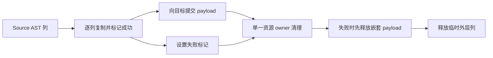
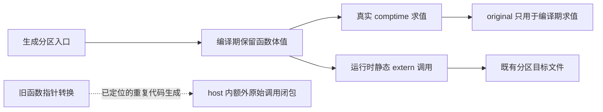

# 冷编译内存归因与错误清理优化

## Intent：最终目标

降低冷编译峰值内存，同时控制 CPU 与耗时。所有权分析是候选手段，不能用完整
NLL、接受更多程序、累计申请减少或生成器 RSS 替代真实冷构建的峰值收益。

## Data：可用证据

### 临时 arena 试验：累计申请不是整轮泄漏

Source analyzer 在目标 allocator 上创建临时 zx.Arena，发布持久 IR 后才 deinit。
隔离探针在 child 边界记录申请/释放，并在每次 free 前后读取已确认是 std Arena
的父级 used_list/end_index。1992 次真实分析累计申请 1631578008 B，请求释放
同量，父级在这些 free 中回收 0 B；单体最大 12051338 B。

这只证明本体末尾的 free 未回收，不能证明整轮泄漏。实际生成器主要走 RX mixed
的 resolved 路径，Ahead 外层 arena 按批 reset，串行 scratch 也按模块 reset。

尝试独立可复用工作区：先覆盖 Project/standalone，再接入实际 resolved 串行与
每个 worker。发布结果的列、契约、常量和文本拥有关系及非重入条件已核对。

- 第一组八轮排除首轮：access 版 CPU 5.27 s、耗时 1.12 s、RSS 491503616 B；
  Project/standalone 版 5.28 s、1.12 s、490389504 B，无确定收益。
- resolved 版四轮排除首轮：CPU 5.26→5.27 s、耗时 1.11→1.10 s、
  RSS 490553344→497762304 B，也未取得内存收益。
- 两个 pool 会同时保留容量。该优化尝试已全部删除，自举迁移保留；没有修改正式
  所有权判定或引入 workspace API。不能凭调用 deinit 或更换 owner 声称内存已修复。

### 当前冷构建的真实峰值

根目录默认 P2、ReleaseSmall、并发为本机 12 核；新建且初始不存在的 local/global
编译缓存，stage0 为空，复用已校验 Zig archive 和 OS 缓存。51/51 步成功。

- time：131.88 s 墙钟、212.46 s user、7.88 s sys；采样器共 132.03 s。
- time 最大 RSS 2667315200 B；0.2 s 进程树采样峰值 2596306944 B。
- 采样最大单进程 2576711680 B，响应文件确认是 zxc_host 的 Zig build-lib；
  构建摘要该步骤 34 s、MaxRSS 2G。生成器约 490 MB 是另一个进程。
- 包含观察开销，不能与历史不同输入或部分缓存命中的数字直接相减。

### LLVM 与错误清理展开

复用峰值进程完整响应文件，仅在新缓存隔离编译 host 并导出未优化 IR。
3 s 栈采样捕获 LLVM ModuleInliner/CGSCC/Function 优化路径；仅代表该窗口。
诊断编译 34.91 s、RSS 2922364928 B；IR 导出改变成本，不能与普通构建直接相减。

原始 IR 189122469 B，23465 个函数；函数体合计 4293763 行、454135 个基本块。
两份 node.import_rows.appendRows 各 26745 行、4523 块；最大标准库函数 TLS
Client.init 为 97117 行。import_rows 的临时列及 payload 清理在多个 try 错误出口
重复 inline 展开，是通用成本候选，不按用户案例或 Source 名称特判。

## Edges：边界与限制

- 聚合临时资源清理，保留 AST 校验、复制、借用及错误行为。
- copied 位只标记整列复制成功；当前失败列由原 copy 原语清理部分元素。
- 失败先释放已复制嵌套 payload，再释放外层列；成功仅释放临时外层列。
- borrow_text 语义保持；copy_payloads=false 在 comptime 排除清理，不增加借用
  成功路径的清理分支，不增加应用运行库或动态层。
- 不新增用例，复用既有分配失败、生成器、Store、引用与缓存检查。
- IR 变小不是内存收益证明，必须比较同输入 host 编译的实际峰值和耗时。
- 完整 NLL、前端权限恢复、快照 delta 未实现；其价值仍需单独成本证据。

## Answer：交付格式与成功标准

在代码、memo、编辑恢复与失败清理一致前提下，减少 host 的 IR 和峰值；记录
生成器阶段及固定累计基线成本。验收后收口全部变更，英文提交并推送，确认干净。

### 执行记录

聚合清理候选通过引导 39/39、正式构建 21/21，以及 333/333 步、592/592 个
受管用例和 15 组外部回归的 86 个用例。完整产物、memo 和合法编辑恢复一致。
这些检查证明候选的行为，没有证明性能收益。

同输入诊断 IR：189122469→185652631 B，函数体减少 106266 行，基本块减少
18325 个。两份 importer 各 26745→3212 行、4523→525 块。包含 IR 导出的编译
RSS 2922364928→2884517888 B；该数字仅与相同诊断配置比较。

普通 host 编译使用同一响应文件、工具链和生成输入，每次新建 local/global
编译缓存，不导出 IR、不采样，交替顺序共三对。以下为中位数：

| 指标           |       原实现 | 聚合清理候选 |                    差值 |
| -------------- | -----------: | -----------: | ----------------------: |
| 墙钟           |      34.41 s |      34.54 s |                 +0.13 s |
| user + sys     |      36.11 s |      36.23 s |                 +0.12 s |
| 单进程最大 RSS | 2907439104 B | 2886270976 B | −21168128 B（约 0.73%） |

三对中一次候选更快、两次更慢，不能将微小差值归因成确定的稳定退化，也不能
声称内存大幅改善。依据当前“不出现累计性能退化”的约束与 skill，收益不足以
支撑接受这项取舍，已删除聚合清理实现，保留原实现和诊断证据。该撤销仅针对
优化实验，不撤销 Store/Reference 自举。以后有新证据再考虑，不重复同样计时。

冻结生成器输入的四版八轮对照、排除首轮，原阶段→Store/Reference 自举的 CPU
5.27→5.28 s、墙钟 1.12→1.11 s、RSS 489488384→491225088 B。固定累计基线
5.35 s、1.17 s、495108096 B。清理候选为 5.28 s、1.12 s、487424000 B。
三者内存样本均有较大波动，不能把生成器几 MB 变化当作冷编译数 GB 的解答。
冻结输入 2268 个文件仅 .zxc-inputs 不同；12612 条 memo 记录逐键逐内容一致。
证据位于忽略目录 .zig-cache/cold-build-analysis/ownership-research/access：
analyzer-probe*.log/json、workspace-_.log/json、resolved-trial-runtime_.log/json；
cold-root/command.json、metrics.json、samples.jsonl、response-1.txt、build.log；
cold-root/host-profile 与 host-cleanup-profile 保存同输入命令、IR、栈采样与计量。

### 编译器与 LLVM 研究：论点、适用范围和取舍

按用户要求检索一手论文和作者/机构版本。以下十篇与先前的十三篇所有权研究
分别记录；经典工作提供已验证的设计基础，近期探索提供假设。会议论文、预印本
和 Student Forum 明确区分，不将“较新”等同于“已在生产验证”。未移植论文中的
百分比收益，也不把代码大小等同于编译器峰值内存。

| 研究与出处                                                                                                                                                                                                                                          | 可借鉴的论点                                                          | 对应 zxc 证据与选择                                                                           | 成本及限制                                                                                       |
| --------------------------------------------------------------------------------------------------------------------------------------------------------------------------------------------------------------------------------------------------- | --------------------------------------------------------------------- | --------------------------------------------------------------------------------------------- | ------------------------------------------------------------------------------------------------ |
| [LLVM: A Compilation Framework for Lifelong Program Analysis & Transformation](https://llvm.org/pubs/2004-01-30-CGO-LLVM.pdf)，Lattner、Adve，CGO 2004                                                                                              | IR 应显式保留数据流、类型和控制流信息；研究同时考察表示成本及分析成本 | 在 Source IR 层追踪构造、复制与借用，再核对生成 LLVM；不靠修改表面语法猜测收益                | 基础架构论文，不直接解释当前 0.17 工具链峰值                                                     |
| [ThinLTO: Scalable and Incremental LTO](https://storage.googleapis.com/gweb-research2023-media/pubtools/4743.pdf)，Johnson、Amini、Li，CGO 2017                                                                                                     | 全局摘要与局部按需导入分开，限制同时装入的完整 IR，并保留跨模块优化   | host 是最大进程，后续可研究生成单元的实际依赖闭包与按成本分区；已有 P2 不是所有单元均衡的证据 | zxc 当前路径不能直接视为 ThinLTO；分区可能重复分析、失去内联机会，并行还会叠加 RSS，先做单元归因 |
| [Function Merging by Sequence Alignment](https://issl-uk.com/publications/cgo19.pdf)，Rocha 等，CGO 2019                                                                                                                                            | 合并相似函数能减小产物，但搜索和变换存在编译成本                      | importer 错误清理重复是真实候选，先在源头统一资源职责，避免让 LLVM 处理大量展开               | 论文目标是代码大小；其编译开销反而说明不能为减 IR 无条件加入复杂合并 pass                        |
| [HyFM: Function Merging for Free](https://zwang4.github.io/publications/lctes21.pdf)，Rocha 等，LCTES 2021                                                                                                                                          | 将比较约束到基本块，分层判断收益，并在生成合并体之前提前退出          | 对自举规则的成本检查应早于展开；清理实验说明减少 IR 仍须测量端到端                            | 不移植全函数二次方匹配；论文自己的内存数字不代表 zxc 可获得同样收益                              |
| [F3M: Fast Focused Function Merging](https://www.pure.ed.ac.uk/ws/portalfiles/portal/260329465/F3M_STIRLING_DOA05112021_AFV.pdf)，Stirling 等，CGO 2022                                                                                             | 用摘要和哈希缩小有价值的候选集合，避免穷举全部函数对                  | 先按展开后 IR、调用关系筛选少量热点，再做对照；无需全仓库增加昂贵分析                         | 摘要会漏选；目前只借鉴候选缩减原则，不引入函数合并体系                                           |
| [MLGO: a Machine Learning Guided Compiler Optimizations Framework](https://arxiv.org/pdf/2101.04808)，Trofin 等，2021 预印本，LLVM 工程实现                                                                                                         | 内联决策需要衡量程序特征与最终目标，局部内联与总体大小的关系复杂      | 现有 inlined.zx 以输入/输出顶层字段数筛选，可能漏掉短头部包装的昂贵构造；应测量构造及展开成本 | 论文主要优化二进制大小，不能据此保证速度或 RSS；zxc 无需引入 ML 训练和推理框架                   |
| [MLGOPerf: An ML Guided Inliner to Optimize Performance](https://arxiv.org/abs/2207.08389)，Ashouri 等，2022 预印本，短版 CASES 2022                                                                                                                | 为大小调优与为运行性能调优的内联目标不同                              | 限制强制内联后同时测量编译器构建及编译器执行；也要保留已有应用行为检查                        | 不能用更小目标文件替代生成程序性能，不能将论文样本增益外推到 zxc                                 |
| [MLIR: Scaling Compiler Infrastructure for Domain Specific Computation](https://research.google/pubs/mlir-scaling-compiler-infrastructure-for-domain-specific-computation/)，Lattner 等，CGO 2021；[早期作者版本](https://arxiv.org/pdf/2002.11054) | 在适当抽象层保留结构，再分层降低，便于语言相关分析和变换              | 在 zxc 已有结构化表达式和 AST 上改进构造/借用表示，避免先展开后要求 LLVM 重建语义             | 不是建议为此整体迁移 MLIR；新 IR 层自身也会占内存，必须有净收益                                  |
| [ACPO: AI-Enabled Compiler Framework](https://arxiv.org/abs/2312.09982)，Ashouri 等，2023 预印本；[CASES 2024 Work-in-Progress](https://web.eng.fiu.edu/gaquan/Papers/ESWEEK24Papers/CPS-Proceedings/pdfs/CASES/563700a019/563700a019.pdf)          | 内联、循环展开的收益是具体目标和上下文下的决策，需用实际测量反馈      | 给候选记录构建成本、执行成本及大小；先用确定、可审计的规则开展小试验                          | 不引入 Python/模型依赖，不把作者 O3 基准收益作为本项目证据                                       |
| [Formal Performance and Compile Time Guarantees for Compiler Optimization Heuristics](https://arxiv.org/pdf/2608.20137)，Shyamsunder，2026，FMCAD Student Forum / 3 页预印本                                                                        | 不只证明语义正确，也约束优化搜索的收敛时间与模型内成本                | 给拟议的内联成本检查设置有界工作量，禁止无界递归重算或用收益抵销无限分析成本                  | 初步研究，内存不是其主要证明对象；模型界限不等于真实 LLVM 性能保证                               |

LLVM [New Pass Manager 官方文档](https://llvm.org/docs/NewPassManager.html) 是工程
资料而非论文：分析缓存避免重算，但必须有正确的失效/清理边界；按 IR 单元组织
连续 pass 有利于局部性。对 zxc 的启示是按模块/阶段保留必要事实、及时回收已失效
事实，避免以“缓存更多”或“每次重算全部”作为默认方案。当前峰值在后端，不能
把它未经测量地改写成前端缓存问题。

### 从论文到可证伪的小范围实验

| 优先级         | 假设与现有证据                                                                                                                                                      | 最小实验                                                                                              | 同时验收的代价                                                                                                             |
| -------------- | ------------------------------------------------------------------------------------------------------------------------------------------------------------------- | ----------------------------------------------------------------------------------------------------- | -------------------------------------------------------------------------------------------------------------------------- |
| 1：内联决策    | genz/analysis/inline/expression/copy.zx 对应函数含 15251 行 IR；输入表已经借用，但五个 pub inline helper 在未优化 IR 中均已展开。输出 Result 仅两字段不代表构造便宜 | 在已保存输入副本上，用通用构造/展开成本限制自动强制内联，保持普通静态调用；先不修改全局阈值和语言语义 | host 新缓存最大 RSS、墙钟、CPU；正式编译器执行固定输入；既有行为与自编译。若出现显著调用成本增长，重新评估，不能全局禁内联 |
| 2：描述符构造  | traversal/resume 12494 行，静态出现 35 份 2064 B 和 15 份 2056 B memcpy；enter 9583 行，多分支各自构造宽 Work                                                       | 先确认优化后的存储与实测频次，再研究构造到最终目标、按需借用只读字段；保留所有权和错误顺序            | 静态 memcpy 不代表每次执行都复制，更不证明复制底层数组；减少表示复制不能增加堆分配或破坏零成本                             |
| 3：单元驻留    | host 编译约 2.67 GB，生成器约 0.49 GB；已分区不保证 host 轻量                                                                                                       | 核对 host 与分区实际承担的函数/IR，优先按已有职责和依赖边界切分                                       | 目标并发下总进程树 RSS、重复分析/链接成本与运行时优化损失；不能只报告单进程下降                                            |
| 暂缓：工作区池 | 真实路径已试验，池同时保留容量且没有收益                                                                                                                            | 无新证据不重做；保留按批/模块已有 reset                                                               | 累计申请不能替代峰值，不能为“释放得更早”的直觉重构所有权                                                                   |

选择标准是多目标比较：在正确性、zero runtime、zero copy 和自举边界相同的前提下，
优先保留内存下降且耗时/CPU 不升的方案；若存在实质取舍，列明可比基线、绝对值、
比例、波动、累计变化及对生成程序的影响。用户尚未给出可牺牲性能换内存的额度，
不能自行放宽已有 0.02 s CPU / 0.1 s 耗时容差，更不能每阶段重新领取容差。

这份研究的结论是优先验证内联构造成本，不是“所有权无关”或“内联必然是全部
根因”。仍有标准库 TLS 等大函数，单个 Source 热点无法解释所有峰值。冷编译内存
问题尚未解决；完整 NLL 也未完成，两者都不以这份论文整理或 IR 缩小宣称完成。

### 内联构造成本小试验

假设：现有 192 条表达式预算漏计 Object 展开后的字段装配。保持预算值不变，
用“表达式数 + Object 字段总数”作有界估计；先检查余量再相加，避免整数溢出。
在原有 bounded 扫描中累积，不递归调用图、不分配状态、不增加分析缓存。只影响
自动强制 inline 的选择，普通静态函数仍允许 Zig/LLVM 按自身成本决定内联。

先核对生成形态与受影响数量，再比较 host 后端和生成器运行成本。阈值只是既有
预算的延续，不是论文给出的普适常数；若无法减少真实热点，或成本取舍不满足
约束，则记录并删除这个优化实验，保留已完成自举。

小试验已命中 11 个唯一模块（含分区副本共 26 文件），包括 append/transform、
match、scope、iteration，以及少量重建宽 Context 的 AST helper。同一输入的新旧
生成代码，除 .zxc-inputs / .zxc-files 元数据外，仅 inline 修饰不同。

三对普通 host 编译使用同一生成输入、响应参数与新 local/global 缓存，顺序为
before→after、after→before、before→after，不导出 IR、不采样。中位数：

| 指标           |       原规则 | 字段加权规则 |                   差值 |
| -------------- | -----------: | -----------: | ---------------------: |
| 墙钟           |      34.44 s |      33.90 s |    −0.54 s（约 1.57%） |
| user + sys     |      36.10 s |      35.51 s |    −0.59 s（约 1.63%） |
| 单进程最大 RSS | 2893398016 B | 2889793536 B | −3604480 B（约 0.12%） |

三对墙钟分别 −0.26/−0.54/−0.26 s，CPU 分别 −0.28/−0.59/−0.20 s；内存
分别约 −0.82/−8.42/−7.83 MB。时间改善方向一致，内存收益很小且有波动。这是
有实际编译耗时收益的通用成本修正，不把它宣称为数 GB 内存问题的解决方案。

单独诊断导出 IR 为 184940536 B；expression/copy 的 callValue 从 15251 行降至
4449 行、alloca 从 1568 降至 349，证明确实截断了预期的强制展开。此对照与历史
IR 的政策函数体略有差别；真实收益仍以上述无诊断参数配对编译为准。

冻结生成器三版交替八轮、排除首轮：上阶段 5.27 s CPU / 1.12 s 墙钟 /
489390080 B RSS；候选 5.28 s / 1.12 s / 483885056 B；固定基线 5.34 s /
1.16 s / 492584960 B。单阶段 CPU +0.01 s、累计 −0.06 s；墙钟单阶段不变、
累计 −0.04 s。RSS 不作为稳定收益承诺。生成差异仍需按 inline 修饰核查，不能
要求本次有意改变的代码字节完全相同。

最终验收：引导构建 39/39、正式构建 21/21；五组既有目标回归
(test-function-analysis、test-module-generation、test-value-return、test-loop-columns、
test-compound-references) 共 281/281 步、317/317 受管用例全部通过。未新增用例。

引导版与正式版在同一完整 main / collections / growth 输入上分别生成
2885 / 64 / 356 个文件，除 .zxc-inputs 外逐字节相同。九份既有样例的合法编辑、
恢复，在新旧工具下产物相同，各阶段增量等于干净生成；memo 四类各 9 条一致。
完整 growth 的 memo 为 1124/310/265/0，逐键逐内容一致；不把这项仅保留最后
cache 的检查宣称为 main / collections 的 memo 检查。

正式版冻结输入八轮、排除首轮：上阶段 CPU 5.28 s、墙钟 1.12 s、RSS
490209280 B；正式版 5.28 s、1.13 s、485949440 B；固定累计基线 5.34 s、
1.17 s、496664576 B。CPU 单阶段无变化、累计 −0.06 s；墙钟单阶段 +0.01 s、
累计 −0.04 s。冻结输入 2268 文件仅八个函数的 inline 修饰与两项元数据变化，
规范化修饰后代码完全相同；memo 8248/2419/1945/0 共 12612 条逐键一致。

生成器缓存 frame 和 GenerationCache 均使用执行文件 digest，规则变化会改变
工具身份；不是依赖人工升级版本串使缓存失效。本轮仍复用了合法编辑与恢复
对照，不只验证无修改缓存命中。

自我复核：这个有界启发式不是真实 IR 上界；被调函数、目标类型大小和后端
优化仍会影响成本。当前验证支持保留它的后端时间收益，没有证明全冷构建峰值
下降或所有应用的运行速度提升，也没有完成 NLL 或全部自举。下一步继续针对
实际峰值进程定位，同时保留性能与内存的联合验收，不扩大内联禁用范围。
证据位于 .zig-cache/cold-build-analysis/ownership-research/inline-cost：shape.json、
host-metrics.json、repeated-metrics.json、repeated-summary.json、ir-stats.json、
runtime-comparison.json、final-runtime-comparison.json、fixedpoint.json、memo-results.json、
final-frozen-shape.json、cleanup-edits-comparison.json 与对应命令、日志。没有新增
用例、运行库或额外分析缓存。

### 分区编译期回退的函数指针转换

继续沿真实峰值进程核对分区边界，发现 partition/bridge 的 Forward 和 forwarder
将 comptime 函数体值强制转换为 ?*const F。运行时虽然只调用 extern 分区入口，
转换仍使 original 实现进入 host 的运行时代码生成，重复承担整个调用闭包。
original/root 还用于真实编译期求值，不能为省内存整体删除。

最小方案：comptime implementation 保留 anytype 函数体值，只在 @inComptime()
分支直接 invoke；null 在同一编译期分支报原有错误。外部 C ABI、参数借用、
返回槽和错误编解码不变，不增加运行时分支、分配或转换。公开 importComptime
本来要求 fn 类型，原函数指针输入已不受支持，未收窄既有契约。

先在忽略目录副本验证：同一 host 输入和参数，诊断 IR 从 184940536 B 降为
90238799 B；函数数 23475→19782，函数体行数 4250065→2045548；原始
expression/copy 的 callValue 不再生成。诊断编译 30.70 s、CPU 32.31 s、
最大 RSS 2311454720 B。IR 导出影响成本，普通编译配对结果见下，不能把
诊断数字当作全冷构建收益。

验收顺序：无诊断参数的同输入普通 host 三对；完整根构建新 local/global 缓存
前后各一次（同 12 核、模式、archive 和 stage0 边界），记录进程树及最大进程；
再执行受影响的既有分区、comptime、ABI、生成行为检查与实际生成器性能对照。
必须保留编译期功能，不以更少 IR 替代可运行结果，不新增测试用例。

普通 host 三对编译中位数（无 IR 导出/采样，各自新 local/global 缓存）：

| 指标           | 函数指针回退 | 函数体值回退 |                      差值 |
| -------------- | -----------: | -----------: | ------------------------: |
| 墙钟           |      34.48 s |      30.92 s |      −3.56 s（约 10.32%） |
| user + sys     |      36.10 s |      32.58 s |       −3.52 s（约 9.75%） |
| 单进程最大 RSS | 2884960256 B | 2313814016 B | −571146240 B（约 19.80%） |

三对峰值内存均显著下降，候选为 2.30～2.34 GB；时间方向也一致。第一对原版
墙钟 38.85 s，比后两对约 34.4 s 慢，故保留每轮数据与交替顺序，不用异常较慢
的单轮夸大收益。完整冷构建对照和既有行为验收已完成，结果如下。

完整根构建对照：两边 local/global 编译缓存均从不存在的目录开始；同一 Source、
工具链、ReleaseSmall、P2、空 stage0、12 核和已校验 archive，只改变 bridge 中
函数的编译期表示。都通过 51/51 步，保留 0.2 s 进程树观察配置；OS 和下载缓存
不清空。以下是一次完整构建配对，不将它描述为多轮中位数：

| 指标                    |         原版 |       修复版 |                      差值 |
| ----------------------- | -----------: | -----------: | ------------------------: |
| 墙钟                    |     133.19 s |     129.74 s |                   −3.45 s |
| user + sys              |     219.74 s |     216.03 s |                   −3.71 s |
| time 最大单进程 RSS     | 2640920576 B | 2075033600 B | −565886976 B（约 21.43%） |
| 采样进程树 RSS 合计峰值 | 2644164608 B | 2247294976 B | −396869632 B（约 15.01%） |

两版最大单进程都是 zxc_host。原版进程树峰值也在 host；修复版进程树峰值迁至
前面的并行阶段，说明不能以只降低 host 单体峰值代表整个构建同比例下降。
进程树数据是 RSS 的采样合计，不是 PSS 或物理内存精确计量；包含共享页重复
统计，也可能漏掉采样间尖峰。单体普通编译三对和整体一次配对相互支持，未证明
未来所有输入或平台均有同样收益。

正式 16 分区生成器构建通过 21/21。修改前后同输入完整 main / collections /
growth 产物分别 2885 / 64 / 356 文件，除 .zxc-inputs 外全部逐字节相同；三组
memo 10400/2925/2404/0、65/44/26/26、1124/310/265/0 逐键逐内容一致。
九份既有样例在初始、合法编辑、恢复三个状态下，新旧输出相同，增量等于干净
生成；四类 memo 各 9 条一致。

使用修复版正式工具，CLI 的 test-runtime / test-stores / test-native-runtime
显式启用 P2 分区，67/67 步、36/36 用例通过，覆盖生成程序、不可变集合、错误
返回、显式 native 调用和共享 Store。另外确认正式编译路径确实执行了编译期回退：lower 调用 state_plan.represented，
经 state_value/analysis.zig 的 Source-enabled 路径进入 queries.zig:36 的
`const table = comptime build()`；build 在第 49 行调用 generated_state_query 的
executeValue。实际生成的该入口调用 ceee3bb…call，而这个函数是引用 zxc_comptime
原函数的 importComptime stub。因此完整 host 编译确实执行了状态查询真值表的
编译期回退，不是仅凭 DSL/RX Schema 泛型存在或普通 runtime 用例推断覆盖。
没有删除 original 支持，也没有新增用例或替代检查。null 的编译期错误路径仍按
精确 diff 和类型规则核对，未宣称枚举覆盖桥接器所有参数组合。

正式生成器三版交替八轮、排除首轮：上阶段 CPU 5.27 s、墙钟 1.12 s、RSS
490422272 B；修复版 5.26 s、1.12 s、482508800 B；固定累计基线仍是原先
inbound-conversion 的同一工具，5.34 s、1.17 s、496173056 B。CPU 单阶段
−0.01 s、累计 −0.08 s；墙钟单阶段不变、累计 −0.05 s。冻结输入 2268 文件
仅 .zxc-inputs 不同，memo 8248/2419/1945/0 共 12612 条完全一致。生成器 RSS
样本波动较大，不将其中几 MB 差异当作本阶段稳定收益。

自我复核：本阶段修复的是一次编译期函数值到指针的过早转换所导致的重复运行时
代码生成；完整所有权生命周期分析未因此完成，cold 峰值也仍有约 2 GB。
收益来自省去无需生成的实现，不以新增运行时调用、数据复制、动态调度、缩减
语言能力或撤销自举换内存。Source 算法和生成产物行为保持；编译期函数保留
函数体值，运行时继续使用既有静态分区 ABI。可接受此阶段并继续自举与剩余
峰值归因，不对已获得证据的相同输入重复构建。

证据：忽略目录 .zig-cache/cold-build-analysis/ownership-research/partition-reference
中的 ir/stats.json、host-metrics.json、host-summary.json、cold-summary.json；
cold-before / cold-after 各自保存命令、bridge SHA-256、响应文件、构建日志和
进程采样；production.log、runtime-regressions.log、fixedpoint.json、memo-results.json、
cleanup-edits-comparison.json、final-runtime-comparison.json 保存功能与性能验收。
