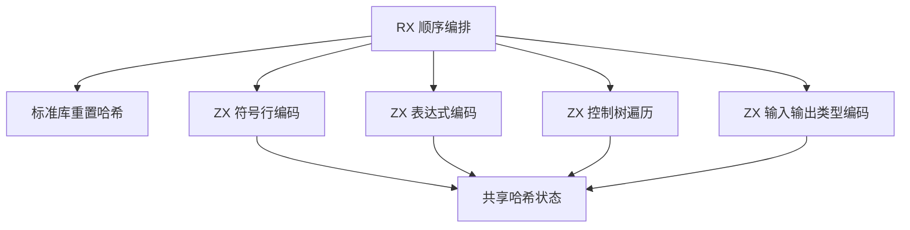

# 函数内容所有权缓存身份自举

## Intent：最终目标

将函数内容摘要的符号、表达式与控制树编码规则迁入 RX/ZX，保留现有缓存协议、
求值顺序及零分配成本。该阶段不等于所有权分析器完整自举。

## Data：可用证据

原实现位于 `genz/src/zx/uniqueness/identity.zig`。顶层顺序为符号表、表达式表、
控制块、输入类型、输出类型，没有额外域前缀。源码 Span 不参与摘要。
表达式视图按列切片编码，每列自带长度，末尾再编码视图长度；控制流集合则按行
编码。union 使用原生标签文本，enum 使用八字节小端序号。可空值先写一个存在
字节，浮点数保留原始位模式。完整性核对覆盖 36 个表达式种类、8 个语句种类。

## Edges：边界与限制

- 复用既有标准库哈希及浮点位转换，不新增专用原生语义接口。

- RX 表达初始化、符号、表达式、控制树和签名的实际顺序；递归控制树属于 ZX
  内聚算法，不为文件行数机械拆分递归过程。
- 原生适配器仅借用现有列描述符，保留 seed 路径与并行分发的过渡依赖。
- 零字节分配器验证完整调用闭包；缓存键和内容必须与旧实现一致。
- 性能只比较实际受影响的生成路径，沿用固定基线，不重置累计容差。

## Answer：交付与成功标准

交付 Source 编码器、最小适配接线和协议/成本证据。通过现有回归、自编译产物、
非空缓存记录对照、格式与 lint 后，统一提交推送。功能、兼容性与受影响路径性能验证已通过。

### 实施与功能验证

- `bootstrap-stage` 首次引导 39/39 步、由新引导工具构建正式工具 21/21 步通过。
- 七个受影响的既有回归目标通过：253/253 步、509/509 测试。未新增测试用例。

- 当前 main、collections、growth 输入由旧工具、新引导工具、正式工具生成：分别
  2774、64、356 个文件；仅工具身份清单 `.zxc-inputs` 不同，代码逐文件一致。
- 当前三个输入组缓存记录分别为 `[9996, 2850, 2337, 0]`、`[65, 44, 26, 26]`、
  `[1124, 310, 265, 0]`；合计 17,043 条记录，四类表的键及值哈希全部一致。
- 复用既有 Task、枚举与原生引用样例；对应非空缓存记录逐项一致。
- 36 个 Source 文件的格式与 lint 共 72 项检查通过，全部低于 240 行。
- 原生适配器为每次执行提供零字节 FixedBufferAllocator；上述实际生成均通过，
  不只是检查静态分配调用数。仅栈上组装借用头，没有复制 IR 列的数据。

### 自我复核与未完成项

协议静态复核覆盖全部变体，动态证据仍以实际输入覆盖为界，不能声称穷尽所有 IR。
此阶段只迁移函数内容编码；跨函数并行分发、组合摘要、适配器和初始 seed 的原生
实现仍存在。不将缓存兼容、零分配或阶段固定点表述为完整编译器自举完成。

原始日志与对照脚本保存在忽略目录
`.zig-cache/cold-build-analysis/ownership-research/content-identity/`，不纳入提交。

### 性能与增量证据

冻结输入继续使用 141 个入口、2220 个模块；固定基线可执行文件不重置，SHA-256 为
`8f1e7cee1eadb3ea0f6f7150bab951c55672ce294e4fbe7c50d5858723bdd92d`。
八轮交替运行，舍弃各工具首轮，记录中位数：

| 路径     | CPU    | 墙钟   | 峰值 RSS      |
| -------- | ------ | ------ | ------------- |
| 固定基线 | 5.31 s | 1.16 s | 494,174,208 B |
| 本阶段前 | 5.24 s | 1.12 s | 479,559,680 B |
| 本阶段后 | 5.23 s | 1.12 s | 486,342,656 B |

本阶段 CPU -0.01 s、墙钟持平；相对固定基线累计 CPU -0.08 s、墙钟 -0.04 s。
首组 RSS 中位数增加约 6.8 MB，不能直接忽略。因此另做十二轮前后交替、各丢弃首轮
的独立检查：前后 CPU 同为 5.24 s，墙钟 1.13→1.12 s，RSS 为
488,259,584→487,686,144 B。两组证据保留，尚未观察到稳定的内存增长，也不将
这点差异宣称为确定的内存收益；本轮没有重测整个 LLVM 冷构建的 GB 峰值。

冻结输入的 2268 个输出文件仅 `.zxc-inputs` 不同；12,612 条非空缓存记录的键和值
一致。十四个既有借用样例的微测 CPU 为 24.292→24.531 ms，墙钟为
9.890→9.779 ms，未出现可辨的总路径退化。

借用辅助函数按初始、合法语义修改、恢复三种状态执行；每种状态新旧工具与增量/
干净生成的 45 个代码文件均一致，恢复后的四类缓存记录也一致。
