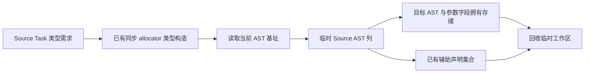

# 函数前导构造自举

## Intent：最终目标

迁移普通函数完整前导构造：运行时安全、公开 arena 的 allocator 准备、Task
allocator 初始化及未使用参数的 discard。保持实际应用语句顺序和资源行为。

## Data：可用证据

起点 `fd82da6d`。Lower.function 在主体和前置条件完成后，根据实际使用事实生成
前导。Task 分支强制使用 IO，构造 child/io/mutex 三字段，并发布辅助 allocator
类型。现有 Source AST context 支持这些结构；discard 尚需本职责的 payload 列。

## Edges：边界与限制

- 本阶段以完整前导为边界；主体 lowering、前置条件和后续语句拼接仍为过渡。
- 同步 allocator 类型生成仍复用既有 allocator.lower，而非新增专用桥。它会写
  全局 statement/field/表达式表；Source 基址必须在该调用完成后读取。
- 仅在 Source 谓词确认 exported、uses_allocator 和 tasks 时准备该类型，避免
  额外生成未使用实现。前置准备可改变内部编号，不得改变应用执行顺序或 fresh。
- 保持 zero runtime、zero copy，不增加执行器或生成模板，不新增测试用例。

## Answer：交付格式与成功标准

同输入前后产物和 memo、自编译不动点、既有 Task/Store/IO 回归及固定累计
性能对照通过后统一提交推送。明确保留的类型服务和原生状态依赖。

## 实现与阶段证据

`analysis/functions/prelude/build.rx` 依次连接安全设置、resource 子模块、unused
和结果发布。resource.rx 显式表达 arena / Task / discard 分支；Task 对象的三个
字段、变量、allocator 绑定及辅助声明均由 Source 构造。Source 的 Task 需求谓词
只决定既有类型服务是否需要调用，不产生执行计划或操作码。

适配层在类型构造后读取基址，导入最小表达式/形式列、字段、语句和辅助常量，
然后发布 uses_io。Task 强制使用 IO 先于 unused 判断；未使用参数按 context、
IO、Process、in 的原顺序处理。辅助常量用单槽本地缓冲导入，避免额外临时堆数组。
语句、字段和嵌套参数描述符在 scratch 释放前取得目标存储，名称借自静态常量。

引导、正式 P16 ReleaseSmall 构建均 21/21。两版二进制 SHA-256 相同：
`ad6ab0ba1dc9fd5102fe29e18da9fa2e4b4dd50c40c973629397146b8e23d8d0`。
当前源码 main / collections / growth 的 3026 / 65 / 357 文件，新旧工具仅
`.zxc-inputs` 不同，引导对正式版全部相同。三组 memo 分别为
10503/3006/2485/0、67/45/27/27、1126/311/266/0，逐键逐内容一致。

### 固定输入性能

沿用同一 141 入口冻结输入、固定基线工具和缓存边界。三版交替八轮，各次使用
新输出及生成缓存，排除首轮；计时在其他构建结束后进行，中位数如下：

| 指标     | 固定累计基线 |    上一阶段 |      本阶段 |
| -------- | -----------: | ----------: | ----------: |
| CPU      |       5.32 s |      5.29 s |      5.28 s |
| 耗时     |       1.16 s |      1.12 s |      1.12 s |
| 最大 RSS |  492470272 B | 491651072 B | 479952896 B |

CPU 单阶段 −0.01 s、累计 −0.04 s；耗时单阶段不变、累计 −0.04 s。
继续沿固定基线观察趋势，不将每阶段容差累加。RSS 有波动，不声称稳定内存收益。
冻结输入 2268 文件仅 `.zxc-inputs` 不同，12612 条 memo 全部一致。

### 行为回归与实际生成路径

既有 test-zx-await-runtime、test-function-analysis-runtime、test-rx-store-io、
test-process-context 合并执行，124/124 步、142/142 个用例通过。包括实际线程
中的 await、公开 execute 的 allocator/IO、独立/共享函数、Store 请求和 Process
上下文。未使用参数的 Zig 编译检查有效，但不将这些场景称为所有标志组合穷举。

复用 compile-zx-await-runtime 的 scalar、capture、direct、nested、optional、
void、capture_error、list，以及 compile-rx-store-io 的 write、service、readonly。
两个正式工具配置均确认 generated_analysis=true；基线副本只将 prelude/build.zig
切回原实现，其余生成模块与工具链一致。每组十一调用、45 文件，八组全部逐字节
一致。八个 await 产物各有一处 task_allocator 变量及安全设置，实际执行了目标
生成职责。八组交替、排除首组，高精度计量的中位数如下：

| 指标           |     原实现 | Source 实现 |        差值 |
| -------------- | ---------: | ----------: | ----------: |
| 十一次调用 CPU | 0.042282 s |  0.042503 s | +0.000221 s |
| 十一次调用耗时 | 0.049243 s |  0.050195 s | +0.000952 s |
| 最大 RSS       | 26361856 B |  26640384 B |   +278528 B |

CPU 使用子进程累计资源的高精度差值并包含 time 包装器；耗时包含进程启动，
RSS 为最大子进程而非进程树。微小差值不证明稳定收益或明显退化，不能外推为
完整冷构建的内存变化。

证据保存在忽略目录 `.zig-cache/cold-build-analysis/ownership-research/function-prelude`：
bootstrap.log、production.log、fixedpoint.json、production-fixedpoint.json、
memo-results.json、regressions.log、generated-path.json、driver-identity.json、
affected-comparison.json、final-runtime-comparison.json 及每轮输出和响应文件。

### 自我复核与剩余边界

前导的真实分支由 RX 表达，没有借 Source 生成操作码让 Native 重放。ZX 保留
字段构造和静态参数遍历；发布的都是普通 Zig AST，应用执行代码未改变。
Task 类型准备改变内部 AST 建立次序，全部基址在其后取得，未改变应用语句次序。

同步 allocator 类型及内部操作、函数体 lowering、前置条件、事务和主体列表
组装仍有原生依赖，需要后续继续迁移。未以这些过渡依赖或本轮不动点宣称完整
自举完成；最终仍需传递依赖审计与约定的三代自编译。
