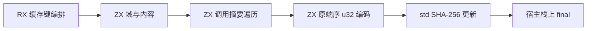
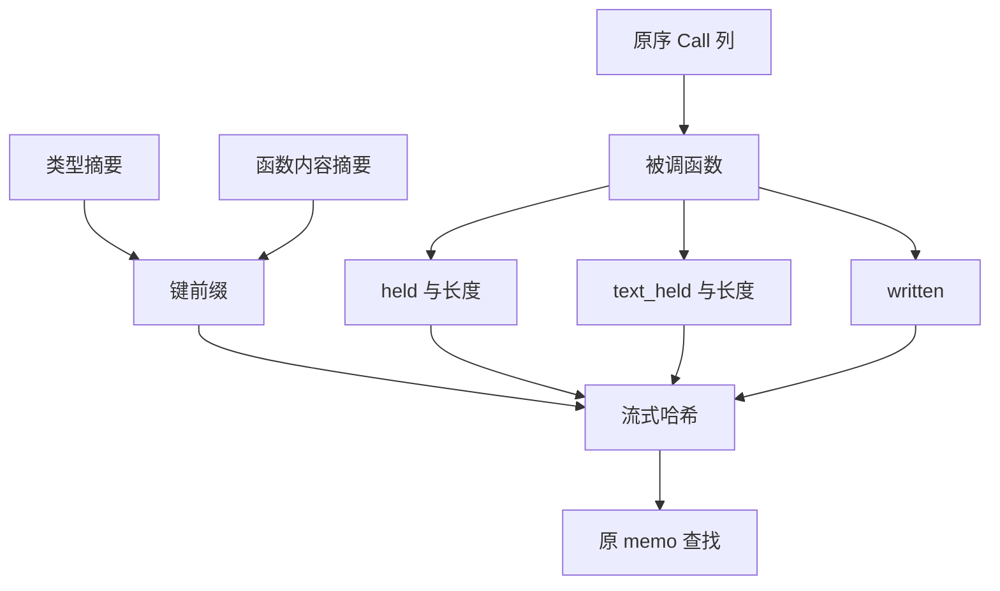

# 函数流缓存身份自举

## Intent：最终目标

将函数流缓存身份的域分隔、内容引用、调用依赖扫描及摘要编码迁入 RX/ZX。
保持旧键字节、调用出现顺序、重复调用及无关表达式处理不变，不增加堆分配。
本阶段不等同于整个缓存状态、并行调度及所有权分析全部自举。

## Data：可用证据

原 `flow.Remembered.key` 在 Zig 中依次更新域、类型摘要、函数内容摘要，然后按
表达式原序扫描 Call。每次 Call 更新 held 长度、held 字节、text_held 长度、
text_held 字节与 written 字节。长度为宿主端序 u32；重复 Call 不去重。

原生仅在 layered 路径、启用持久 memo 时计算该键。循环调用图的 settle 路径不
使用此键，因此仅测冷生成不足以证明已命中迁移路径，需核对既有缓存回归。

现有 std:crypto 提供借用 SHA-256 状态和无分配 update；core 的 SHA-256 在部分
x86 目标采用加速实现，不能把它的 opaque 状态交给固定使用 Zig 标准实现的接口。
将通用实现原样移动至 std 的独立 sha256_backend 静态模块，core 与标准接口
均引用该模块，不让 std 依赖编译器。编译工具的分区对象及应用构建显式连接该普通
静态依赖，不复制实现，也不增加运行时分派。宿主借用类型统一为标准包导出的
Sha256，仓库内唯一旧宿主构造点同步调整。arm64 路径仍为 Zig 标准实现，x86
原有加速实现完整保留。本机不能运行 x86 程序，额外做已有资源检查的交叉编译。

固定累计基线继续沿用 inbound-conversion 工具，上一阶段为 a447ce26 的 read-loans
正式工具。缓存身份规则应保持逐字一致，无需改变 flow 域版本。

## Edges：边界与限制

- RX 显式连接 seed 与 callee 摘要扫描；ZX 保留内聚遍历、原生端序整数编码。
- 不构造动态分片或完整键缓冲，调用入口使用容量为零的分配器验证无堆分配。
- 宿主只借用表达式列、bool 字节行、摘要及栈上哈希状态，最后调用通用哈希 final。
- bool 行以现有 0/1 表示借用，不改变内存布局、外层行或数据所有权。
- seed 保留原 Zig 规则供初始引导；正式规则使用生成入口。
- 状态持久化、Flow 的调度与手写 ABI 适配仍为过渡依赖，不能宣称完整职责闭包已迁完。

## Answer：交付与成功标准

验收现有缓存所有权与增量路径、标准 crypto 和借用行为；进行引导与正式阶段
自编译、固定输入产物比较及 CPU/RSS 累计对照。未获得的证据不预先写为通过。

首轮容量为零的分配器发现 RX 重组输入对象会分配。两步实际上操作同一借用资源，
不需要重建输入；改为顺序借用原输入，后续正式生成通过零分配门禁。

通用 SHA 后端的文件 SHA-256 为
`51ce66d4c9d4135dc7d17537d5d76dc53d2380f24ef1266b6cd7d77f5ee2d415`，
与提交 a447ce26 中 core 原实现逐字一致。标准包、core、分区对象和应用构建共享
静态模块；测试中的五处手工标准模块与一条裸 Zig 命令同步连接。库打包沿既有
native_modules / dependencies 资源链保留该模块。注入标准后端时拒绝已有同名
Native 模块，不能误用未知布局的状态。

已通过的证据：

- Native 引导 39/39、正式构建 21/21；main / collections / growth 自编译分别
  2,720 / 64 / 356 文件，仅 `.zxc-inputs` 不同。
- 缓存所有权、函数摘要、持久缓存、生成缓存及 loan 相关目标共 136/136 构建步骤、
  207/207 原生检查通过；已有 Node 检查也全部成功。
- 四项既有标准分配失败检查在主机通过，同一检查在 x86_64 SHA/AVX2 目标完成
  交叉编译。本机不能执行 x86 产物，不将其称为 x86 性能实测。
- 既有 encoding/crypto 的 324 条输入通过真实 CLI 构建并执行，完整值一致。
  进程 JSON 协议允许有效 UTF-8 字节数组表示为字符串，比较时仅对预期 byte[]
  字段还原为 UTF-8 字节，没有改变夹具或忽略哈希字段。

对应原始记录在忽略目录 `ownership-research/flow-key/`：
`bootstrap-final.log`、`production-final.log`、`regressions-final.log`、
`final-shared-fixedpoint-result.json`、`native-allocation-final.log`、
`x86_64-macos-allocation-final.log`、`standard-values-result.json`。
标准/IO 构建入口的补充回归、最终固定基线采样与 flow memo 比较尚待收口。

标准/IO 补充回归最终 **1,152/1,152 构建步骤、19,741/19,741 检查通过**，覆盖
`test-standard-runtime`、`test-rx-io`、`test-rx-store-io`、`test-child-process`、
`test-process-context`、`test-child-input`。只读审查发现的手工模块入口均已补齐，
原始记录为 `standard-io-regressions.log`。最后新增的 CLI 同名后端拒绝规则另做
CLI 生成缓存检查收口；不因此重复运行未变化的生成器与所有标准用例。

## 最终成本与缓存身份核对

停止全部构建后，同一冻结输入（141 入口、2,220 模块）八轮交替、舍弃首轮：

| 工具                    | CPU    | 墙钟   | 峰值 RSS      |
| ----------------------- | ------ | ------ | ------------- |
| 固定 inbound-conversion | 5.34 s | 1.17 s | 495,353,856 B |
| 上阶段 read-loans       | 5.29 s | 1.14 s | 485,834,752 B |
| 当前 flow-key           | 5.26 s | 1.13 s | 475,742,208 B |

CPU 阶段 -0.03 s、累计 -0.08 s；墙钟阶段 -0.01 s、累计 -0.04 s。
RSS 本轮采样阶段约 -10.09 MB、累计约 -19.61 MB，不据此推断完整冷构建的 GB
峰值已解决。冻结产物 2,268 文件仅 `.zxc-inputs` 不同。

重要覆盖边界：冻结集持久 memo 的 flowed 记录为零，其流分析走保守路径；所以
上表用于累计成本与未受影响路径的门禁，不能证明新键规则已实际执行或更快。
没有将两份空表相等报告为键正确性证据。

另以既有 lifetimes 目录的十四份有效 ZX 输入作为真实分层路径，分别用旧、新正式
工具八轮交替冷生成并舍弃首轮。CPU 中位数为 **24.692 → 25.846 ms**，墙钟为
**10.022 → 10.043 ms**，CPU 增量约 1.154 ms，在用户接受的累计成本边界内；
该小样本不能外推复杂大型调用图的成本。

解析持久 memo 的真实二进制协议，核对非空的 **14 个 flowed 键及其完整值逐项
一致**；两边四类记录数均为 17 / 15 / 14 / 14。该输入的 46 个输出文件也仅工具
身份元数据不同。验证显式要求 flowed_count > 0，不接受空表作为通过。

在缓存目录内复制既有夹具，将 borrow 从返回输入改为返回空数组，再恢复；这会
改变 callee 的 held 依赖。initial / changed / restored 三阶段、旧新两个工具的
增量输出均与独立冷生成一致，且两工具代码产物一致；恢复后的非空 flowed 表仍
逐项一致。没有修改仓库夹具、改变生产分支或加入针对输入的特殊规则。

对应证据为 `final-runtime-comparison.json`、`fixtures-cost.json`、
`fixtures-memo-comparison.json`、`fixtures-output-comparison.json`、
`edits-comparison.json`、`edits-memo-comparison.json`。CLI 最后改动收口目标
`test-generation-runtime` 为 26/26 构建步骤成功，Node 三项生成缓存检查成功；
六份新增 Source 的最新 CLI fmt / lint 全部通过。最终 RX 排版仅移除相邻 Call
之间一行空白，不重复执行语义与性能不变的构建。

自我审查：规则迁移、零分配、真实非空缓存键、依赖事实改变及恢复、静态后端接线
都有独立证据。SHA 算法原样迁移，x86 完成交叉编译但未执行；大端字节序有显式
分支，当前主机没有大端运行证据。Flow 调度、memo 持久化状态和 ABI 适配仍有
手写 Zig，前端 NLL 与完整自举均未完成；不把本阶段当成它们的完成证明。
