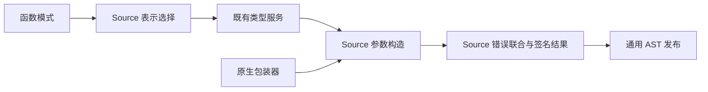
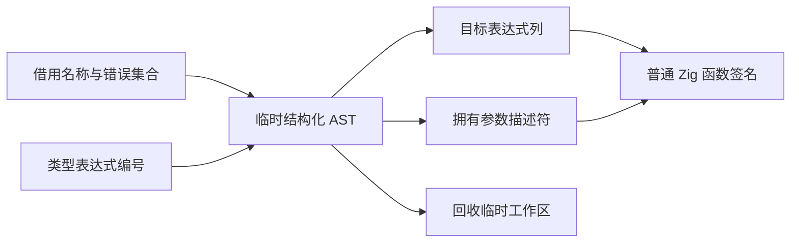

# 函数签名构造自举

## Intent：最终目标

迁移普通函数及值返回函数的完整签名构造，复用原生包装器已经迁移的参数与
错误联合逻辑。保留公开入口 arena、内部 allocator、Store context、IO/Process
顺序、输出表示选择、错误集合和强制内联标记。

## Data：可用证据

起点为 `28f77086`。Lower.prototypeWithErrors 是实际函数发射及分区声明使用的
签名入口；public_value_output 优先使用 view 表示，普通 value_output 仅改变
输出为 layout 表示。external.prototype 使用同类参数构造但始终采用 allocator。
现有结构化 AST context 已支持 pointer、primitive、字段和 error_union。

## Edges：边界与限制

- 保留类型表达式服务，Source 决定表示模式，适配层按模式调用既有服务。
- 不迁移本轮无关的函数体调度、state mode 进入/恢复及模块选择。
- modules.signatureType 仍为兼容路径的过渡实现；常规 Source 分组可用时不会
  必然执行它，不用正式分区构建冒充该分支验收。
- 类型句柄提前物化仅允许改变内部 AST 编号，不改变类型、错误或应用求值顺序。
- 不新增用例，复用现有 ABI、value/public view、Store 和实际分区生成验收。

## Answer：交付格式与成功标准

同输入前后生成与 memo 一致、既有受影响回归、自编译不动点、固定累计基线与
上一阶段性能对照通过后收口全部变更并提交推送。记录过渡依赖，不宣称整体自举完成。

## 实现与验证

`analysis/functions/signature/build.rx` 连接参数构造和返回类型构造。resource
负责公开 arena 指针或内部 allocator，parameters 按原顺序附加输入、Store
context、IO 和 Process。模式选择是独立纯函数，public view 优先于 value layout；
适配器仅按模式调用原有类型表达式服务，未复制类型表。

原生包装器复用同一模块，仍单独决定自身名称和有限/未知/空错误集合。共享名称
常量与字段 helper 移至签名职责目录，未保留重复定义或新的原生编译器规则桥。
目标字段描述符拥有存储，名称和错误文本继续借用持久来源；Source 临时 arena
在发布 AST 后释放。pointer 与 anytype primitive 的列显式导入。

引导、正式 P16 ReleaseSmall 构建均 21/21；两版二进制 SHA-256 相同：
`c495cf248b150fc3e5b19d8ff739dd3a9e42afa713e1dc99e9d08eb2b32a7a1e`。
当前源码 main / collections / growth 的 3011 / 65 / 357 文件，旧版对引导版
仅 `.zxc-inputs` 不同，引导对正式版全部相同。memo 分别为 10447/2995/2474/0、
67/45/27/27、1126/311/266/0，逐键逐内容一致。

既有 test-value-return、test-function-analysis-runtime、test-rx-store-io、
test-process-context、test-typed-try-native-abi 合并执行，219/219 步及
243/243 个用例通过。覆盖值返回、共享函数、Store context、IO/Process 和错误集
ABI。冻结生成产物实际包含 100 个 executeValue、141 个 executeIn、141 个 execute
入口，前后代码一致；不把 fixture 中 executeIn 的通过单独当作 public view 证明。

### 固定输入性能与累计变化

沿用相同的 141 入口冻结输入、固定基线二进制和缓存边界。三版交替八轮，排除
首轮，正式编译器在其他构建结束后计时，中位数如下：

| 指标     | 固定累计基线 |    上一阶段 |      本阶段 |
| -------- | -----------: | ----------: | ----------: |
| CPU      |       5.33 s |      5.27 s |      5.29 s |
| 耗时     |       1.16 s |      1.11 s |      1.12 s |
| 最大 RSS |  493699072 B | 490323968 B | 488357888 B |

CPU 单阶段 +0.02 s、累计 −0.04 s；耗时单阶段 +0.01 s、累计 −0.04 s。
增量没有重置预算，继续监控增长趋势；RSS 具有波动，本轮不声称内存收益。
冻结输入 2268 文件仅 `.zxc-inputs` 不同，12612 条 memo 全部一致。

### 受影响的值返回生成路径

复用 compile-value-return 的全部十四个既有场景：direct、wrapped、chained、
conditional、fallible、enumeration、references、escaping、escape_optional、
escape_list、escape_tuple、escape_nested、native_scalar、borrowed_objects。
每个场景同时生成 source/library 及其 ABI，共 56 文件；八组逐字节一致。

基线副本仅把普通 signature/build.zig 选择器切回本轮保存的 seed，其他 Source
模块、共享签名构造、工具链和配置保持相同。正式配置 generated_analysis=true。
交替八组、排除首组，十四次调用合计的中位数如下：

| 指标     |     原实现 | Source 实现 |        差值 |
| -------- | ---------: | ----------: | ----------: |
| CPU      | 0.277777 s |  0.277602 s | −0.000175 s |
| 耗时     | 0.292231 s |  0.291628 s | −0.000603 s |
| 最大 RSS | 10862592 B |  10747904 B |   −114688 B |

CPU 取高精度子进程资源累计差，包含 time 包装器；耗时包含启动，RSS 是子进程
最大值而非进程树。微小差值只说明没有观察到显著退化，不宣称稳定性能收益。

证据位于忽略目录 `.zig-cache/cold-build-analysis/ownership-research/function-signature`：
bootstrap.log、production.log、fixedpoint.json、production-fixedpoint.json、
memo-results.json、regressions.log、driver-identity.json、affected-comparison.json、
final-runtime-comparison.json，以及每轮输出、命令和响应文件。

### 自我复核与剩余边界

迁移包含完整签名参数规则、表示选择和返回错误联合，原生适配层只保留已有类型
服务调用和 AST 发布。未通过全局禁内联、额外应用复制、动态运行库或模板生成
取得验证结果。签名与原生包装器真实共享构造，没有复制第二套同样规则。

Lower 的函数体编排、valueMode 的进入/恢复、modules.signatureType 的兼容转换、
类型与 AST 存储仍需继续迁移。本轮不动点仅证明本阶段输入下的生成一致，不能
替代最终自举的传递依赖审计及 seed→stage1→stage2→stage3 验收。
