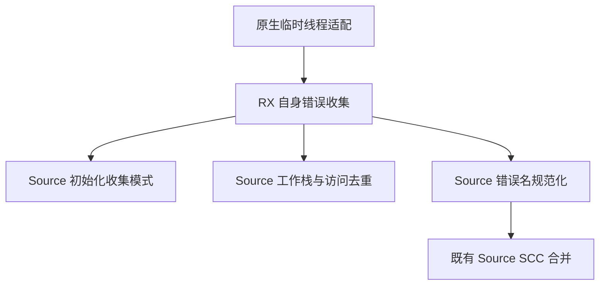
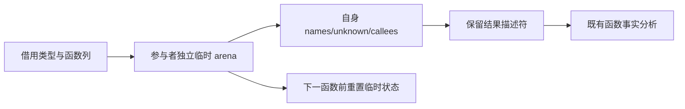

# 函数自身错误收集自举

## Intent：最终目标

将正式生成器仍从原生 core 调用的函数自身错误收集规则迁入 RX/ZX；保留按核心数
分发、调用图去重、未知错误标记及确定的错误名集合，不以串行化换取迁移。

## Data：可用证据

`function_analysis/generated.zig` 已用 Source 合并 SCC，但此前函数自身的错误和
callee 仍由 `zx.error_effects.functionBodies` 收集。现有 Source error_effects
遍历可复用，但遇 unknown 提前停止、返回 null、递归进入 callee；这三点不能
直接用于自身错误摘要，需要明确的收集模式。

摘要模块的动态并行遍历尚不能用 RX 静态 Parallel 等价表达，保留过渡依赖；本轮
不增加隐藏运行库，也不添加编译器专用“通用接口”绕过该能力缺口。

## Edges：边界与限制

- collect 模式遇 unknown 继续遍历，保留自身错误名及直接 source callee。
- 普通模式保持原有递归推导与 unknown 短路；Source 函数仍在首笔调用时去重。
- StoreSet、Parallel 的操作数与后续语句继续收集，显式保留 unknown。
- 只借用原有 IR 列；并行队列与线程生命周期暂由既有原生适配器承担。
- 每名参与者复用独立临时 arena，结果仅保留名称描述符和 callee 列；临时状态不
  随全部函数积累。类型、错误名来源与输出存活边界必须复核。
- 先实现并测量，若成本退化则保留迁移并优化，不能回退原生实现冒充完成。

## Answer：交付与成功标准

Source RX 负责初始化、遍历、结果规范化，ZX 承担原子遍历规则。以既有错误效果
回归、完整输出及摘要对照、自编译与固定性能基线验收；已完成下述验证。

### 原型计量与修正

第一版已经正确生成，但出现 CPU/RSS 增长。独立计量复用真实生成入口及原生摘要
作为行为对照；只在忽略目录构造规模输入，不新增仓库测试用例。

首版的 32/128/512 节点累计请求为 74,880 / 953,296 / 14,297,184 B，2048 节点耗尽
128 MiB 固定缓冲区。不能用任务成功或总时长容差掩盖这项平方增长。

实际差异有三处：逐节点先构造 children 数组；反复追加重复错误名；访问集合放在
来源数组的记录内部，且探测循环把只读 slots 携带到循环状态中。生成体显示访问
标记被降为 plain/shared，更新时复制整张已增长的表。仅移动主表集合或只改 with
都不足以修复，未将这些中间尝试当作完成阶段提交。

最终复用已有语言能力：子节点按游标访问，错误名即时去重；所有来源使用不重叠的
表达式编号区间，将访问集合及调用集合直接放在遍历状态中。探测循环只携带位置，
只读数组通过词法作用域访问，避免留下不必要的数组续用依赖。标记表仍为 Source
开放寻址集合，使用既有标准整数哈希，不引入原生专用 seen 桥。

| 节点数 | 主表达式累计请求 | 契约表达式累计请求 |
| ------ | ---------------- | ------------------ |
| 32     | 13,704 B         | 14,392 B           |
| 128    | 52,184 B         | 52,872 B           |
| 512    | 205,928 B        | 206,616 B          |
| 2048   | 820,536 B        | 821,224 B          |

两条路径恢复近似线性增长，错误名、unknown、callee 数量均与原生对照一致。这是
累计请求字节，不是峰值 RSS，也不是对所有图形的一般复杂度证明。

主表、契约与被调用函数分配独立编号区间，不依赖指针数值或路径名推断相等。
共享同一表达式表的多份契约可能多走一次，但访问及调用去重、最终错误名集合仍
保持语义；这项精确度与成本边界不能以本次小规模结果代替完整回归。

### 当前验证状态

引导构建 39/39、正式构建 21/21 已通过。八个相关目标 262/262 构建步骤、
549/549 测试通过；36 个 Source 文件的格式与 lint 共 72 项检查通过。原始证据位于忽略目录
`.zig-cache/cold-build-analysis/ownership-research/error-sources/`。

### 兼容性与固定点

当前 main、collections、growth 输入由旧工具、新引导工具和正式工具分别生成，
文件数为 2783、64、356；代码逐文件一致，仅 `.zxc-inputs` 工具身份元数据不同。
当前三个输入组 17,076 条非空缓存记录的四类表键和值全部一致。

冻结输入 141 入口、2220 模块的 2268 个文件也仅身份元数据不同；12,612 条缓存
记录一致。Task、枚举、原生引用的既有样例以及十四个借用样例继续通过非空缓存
对照。合法修改借用函数并恢复后，三种状态的增量与干净生成、新旧生成均为相同
45 个代码文件；恢复后的缓存记录一致。

### 性能验收

固定基线仍为 inbound-conversion，其 SHA-256 为
`8f1e7cee1eadb3ea0f6f7150bab951c55672ce294e4fbe7c50d5858723bdd92d`。
停止构建后，八轮交替执行，分别丢弃首轮，以中位数记录：

| 路径     | CPU    | 墙钟   | 峰值 RSS      |
| -------- | ------ | ------ | ------------- |
| 固定基线 | 5.34 s | 1.16 s | 494,764,032 B |
| 本阶段前 | 5.22 s | 1.12 s | 486,899,712 B |
| 本阶段后 | 5.24 s | 1.11 s | 486,719,488 B |

阶段 CPU +0.02 s、墙钟 -0.01 s；相对固定基线累计 CPU -0.10 s、墙钟 -0.05 s。
CPU 增量处于用户接受的参考容差内，保留原始样本以便继续观察累计趋势；不能给
后续阶段重复领取同一预算。RSS 基本持平，不将微小差异宣称为内存收益。
此前首版 560～620 MB 的内存增长已不再出现在最终采样中；本轮仍没有重新测量
LLVM 整机冷构建的 GB 峰值，不能宣称该问题已经解决。

十四个既有借用样例的生成 CPU 中位数为 30.192→30.027 ms，墙钟为
11.084→10.620 ms；短时间差异仅用于观察，不作为确定收益宣称。

### 自我复核与剩余依赖

本阶段完成正式生成器自身错误收集的 Source 算法接入，保留既有纯度与错误集合
行为，未用串行化、源文件特判或新的专用运行库换取通过。Source 临时状态会分配，
输入 IR 列只借用；不将它描述成“所有分析零分配”。

工作项分发、宿主列描述符适配、结果存活范围转换仍为原生过渡依赖。core 的其他
原生错误分析调用者和初始 seed 尚未全部迁移；完整自举、完整 NLL 与所有权状态机
重构也未完成。规模试验不覆盖任意恶意共享 DAG，也不替代完整安全证明。
