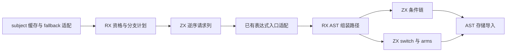

# 匹配分支计划与 AST 组装自举

## Intent：最终目标

将 match 的分支求值顺序、标签优化路径和条件链/switch AST 组装迁入 RX/ZX，
保持 subject 缓存作用域、分支惰性、表达式构造顺序、fresh 序号与累计性能标准。

## Data：可用证据

- 原实现为 `packages/genz/src/zx/match.zig`：先绑定 subject，再构造 fallback，
  随后判定常量标签资格并逆序处理分支。
- switch 路径最后一臂仍使用等值条件连接 fallback，前面的臂才使用字面量标签；
  构造全部分支后再读取缓存 subject。不能机械地把最后一臂变成无条件结果。
- 非 switch 路径逆序构造条件链，保留首个匹配分支的运行时优先级。
- 条件节点本身不调用 expr、不更新缓存、不消耗 fresh，因此可以在递归求值
  完成后批量构造，内部 AST 编号可变化，输出代码与行为必须一致。
- 上阶段正式生成器保存在 `ownership-research/selection/production/bin/zxc-bootstrap`；
  固定累计基线仍为 `inbound-conversion/production-bootstrap/bin/zxc-bootstrap`。

## Edges：边界与限制

- Source 计划输出显式的 Expression、Value、Equality、Literal 请求及参数；
  Native 适配器执行已有 expr/value/equality/literal 入口，不决定请求顺序。
- fallback 的求值模式适配、subject 绑定、缓存保存/恢复及最终 block 仍在原生层；
  本阶段不宣称 match 完整自举。这些过渡边界仍需移除。
- 请求计划只在编译器生成阶段消费，不进入应用产物，不增加应用解释器、动态
  调度层或专用运行库。全部生成程序仍是静态链接的普通 Zig。
- 每个分支保留 condition→result 的构造顺序；常量路径最后再读 subject。
  body 包装在全部构造后进行，保持 fresh 序号。
- 计划与临时结果放在一次 match 的 scratch，节点和 selection arms 导入长期
  AST 存储后才能释放；不得留下临时 slice。
- 同一输入必须比较全部代码与 memo，并检查新增数组是否原地更新，防止 O(n²)。

## Answer：交付格式与成功标准

完成格式、lint、seed/正式构建、受影响既有行为回归、全部生成代码及 memo 对照、
增量与干净生成验证；隔离记录阶段与固定累计基线的 CPU、耗时、RSS。
验收后收口全部变更，英文规范提交并推送，确认工作区干净且无未推送提交。

### 执行与自我复核

实现与验收完成：

- plan.rx 复用 Source 标签资格，再由 requests 生成逆序请求；每臂先 condition
  后 result，常量路径在全部分支请求后追加 subject 读取。Native 不再决定臂顺序。
- emit.rx 显式选择条件链或 selection；最后一臂仍是 conditional fallback，
  其他 arms 恢复源码顺序。新增通用 selection-arms 列导入器只做存储与文本拥有。
- 缓存作用域、fallback 优先、subject 一次绑定、零臂 discard 与最终 block 顺序
  保持原样。延后组装只调整 AST 编号，不消耗 fresh，也不改变缓存读取次数。
- 实际生成闭包中，requests 的请求列、chain 的七列和 selection 的三列均以
  frontier=true reserve 增长；未发现逐项复制整表。selection 固定节点列的 dupe
  只有一至两项，不是随臂数增长的重复复制。
- 两个 value facade 只剥 `.items`，计划与临时结果仍在本次 allocator 中；
  Native 消费计划后，先复制 arms 列、导入节点，再释放 scratch。节点只保留
  编号与全局范围，没有保留临时 values 切片。
- 8 个新 RX/ZX 文件通过 16 项格式与 lint；Zig 格式和 diff 空白检查通过。
- seed 引导构建 39/39 步、正式构建 21/21 步通过。
- 复用 function-analysis、switch-scalars、switch-nested、switch-evaluation-order、
  match-modules、object-reduce-effects、null-inequality、rx-floating 八组既有回归。
  206/206 步、框架摘要 152/152 项通过；外部执行两组 18 项、十八组 756 项，
  共 13644 次通过。这是多路线执行次数，不视为去重后的用例数。
- 当前 main、collections、growth 三组生成文件分别 2859、64、356 个；迁移前、
  引导版、正式版仅 `.zxc-inputs` 不同，所有代码一致。三组四类 memo 键和值
  逐项相同；冻结输入 12612 项 memo 同样一致。
- 复用九个既有样例的忽略目录副本，覆盖常量、动态、负数、枚举、浮点/字符串、
  稀疏 switch、嵌套 match 与条件表达式。标签 −1 改为 −2 再恢复，三阶段各
  30 个代码文件，前后相同且增量等于干净生成；四类 memo 各 9 项一致。

### 性能与累计变化

构建、回归结束后，同一冻结输入、工具链和配置下隔离测量。8 轮交替运行，
排除首轮取中位数：

| 指标     | 固定累计基线 | 本阶段前    | 本阶段后    |
| -------- | ------------ | ----------- | ----------- |
| CPU      | 5.31 s       | 5.24 s      | 5.25 s      |
| 耗时     | 1.15 s       | 1.11 s      | 1.11 s      |
| 峰值 RSS | 494567424 B  | 490668032 B | 476135424 B |

本阶段 CPU +0.01 s，耗时不变；相对固定基线 CPU −0.06 s、耗时 −0.04 s。
RSS 本组较低，未做分配归因，不将约 14.5 MB 差异作为确定收益。新增计划和结果
是编译期临时数组，不是应用数据复制；生成闭包确认其增长方式保留预期线性成本。

近期微小 CPU 增量保留在累计记录中，不以每阶段容差累加新预算，也不重置基线；
固定基线的剩余优势较早阶段缩小，后续继续关注生成适配和临时数据成本。

冻结输入 2268 个文件仅 `.zxc-inputs` 不同，代码和 memo 一致。测量覆盖正式
生成器，不代表完整冷构建或 LLVM 后端峰值已经改善。

### 自我批判与剩余职责

- Native 请求执行适配仍是编译器专用过渡依赖，最终须随递归 expr/value 状态
  迁入 Source；当前只说明分支计划和 AST 组装归属，不宣称 match 完整自举。
- 延迟节点组装依赖条件节点没有 fresh、缓存或求值副作用；未来若构造器加入
  此类行为，必须重新核对该假设，不能直接沿用本次等价结论。
- 原生 subject 缓存管理、fallback 模式适配及 aggregate.finish 仍待迁移。
  最终完成仍需传递依赖审计与 stage 1→2→3，不由本次产物一致替代。

脚本、日志和报告位于忽略目录
`.zig-cache/cold-build-analysis/ownership-research/match/`：
`source-validation.json`、`bootstrap.log`、`production.log`、`regressions.log`、
三份 growth-proof、`known-shared-fixedpoint-result.json`、
`current-manifest-memo-comparison.json`、`memo-comparison.json`、
`selection-edits-comparison.json`、`selection-memo-comparison.json` 与
`final-runtime-comparison.json`。
