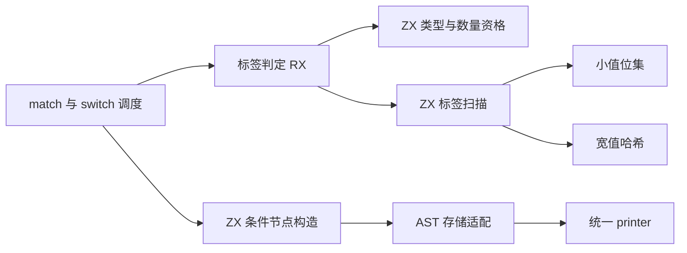
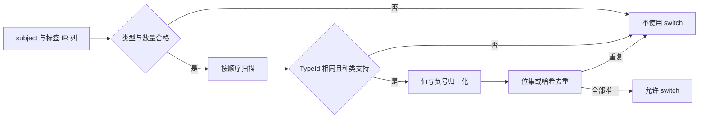

# 匹配标签判定与条件节点自举

## Intent：最终目标

将 match/switch 的常量标签资格、去重规则和条件节点构造迁入 RX/ZX，保留标签
类型一致性、负零归一化、正负数区分与惰性条件语义，维持固定累计性能标准。

## Data：可用证据

- `zx/selection.zig` 为 match 和语句 switch 提供 labels 判定；原算法使用 256 位
  小整数位集与宽值/负数哈希集合，标签少于两个、类型不适用或重复时返回 false。
- 标签允许整数、负整数、布尔、枚举和错误；subject 排除 void、string、f32、f64，
  允许枚举、错误集合和其他标量。每个标签必须与 subject 的 TypeId 相同。
- 负整数值为零时按非负键处理；正负相同幅值在非零时是两个不同的键。
- 原始条件表达式与 match 条件链使用相同的条件 AST，分支仍由 Zig 惰性选择。
- 上阶段正式生成器保存在 `ownership-research/operators/production/bin/zxc-bootstrap`；
  固定累计基线仍为 `inbound-conversion/production-bootstrap/bin/zxc-bootstrap`。

## Edges：边界与限制

- 本阶段不迁移完整 match 递归调度、subject 缓存保存/恢复和分支递归 expr；这些
  仍是必须迁移的自有流程，不能将本阶段描述成 match 完整自举。
- RX 显式连接资格判定、状态初始化与扫描；ZX 承担内聚的位集和开放寻址算法。
- 保留“小值位集＋宽值哈希”，不改成两两扫描。哈希槽保存 IR 编号而非完整键，
  冲突时读取不可变 IR；同幅值不同符号最多增加一次固有碰撞，比较完整 value/negative。
- 小整数集合四个 u64 字由临时分配器持有；大集合按半满阈值扩容。具体哈希桶布局
  可不同，资格语义和预期线性成本必须对齐，需检查生成代码中的隐藏数组复制。
- 条件节点构造是单项原子职责，使用已有表达式类型与统一 AST 导入，不增加运行库。
- Native 暂留输入借用、临时内存和节点存储，seed 保留原算法用于引导。

## Answer：交付格式与成功标准

完成格式、lint、seed/正式构建、相关既有回归、全部生成代码与 memo 对照、增量与
干净生成验证。对实际受影响路径隔离计量 CPU、耗时和 RSS，记录阶段及累计趋势。
验收后统一提交推送全部变更，确认工作区干净且无未推送提交。

### 执行与自我复核

实现与验收完成：

- 正式 labels 与 constantLabels 统一调用 RX；subject 缺失、标签不足、类型不适用
  时先返回，之后才初始化位集并扫描。完整 value/negative 比较保留负零和正负语义。
- 宽键槽保存 `u64(IRid)+1`，零为空；冲突时读取原 IR，不复制大整数键。半满
  扩容保留空槽，重哈希按新容量计算位置，输入 IR 在整个查询期间保持只读。
- 已核对真实 bootstrap 生成体：mark、grow 和 dense visit 都直接写一个槽，
  没有逐插入复制大表或位集。grow 的 reserve 只在初始化新槽数组时发生；
  `mark-storage-proof.zig.txt` 与 `grow-storage-proof.zig.txt` 保存原始证据。
- conditional 保持 condition→yes→no 的 AST 构造顺序；实际分支仍由相同 Zig
  条件节点惰性求值，输出 payload 没有悬垂的 scratch 切片。
- 12 个新 RX/ZX 文件通过 24 项格式与 lint；Zig 格式、diff 空白检查通过。
- seed 引导构建 39/39 步、正式构建 21/21 步通过。
- 复用 function-analysis、switch-scalars、switch-nested、switch-evaluation-order、
  match-modules、object-reduce-effects、null-inequality、rx-floating 八组既有回归。
  构建 206/206 步、框架摘要 152/152 项通过；外部日志另有两组 18 项和十八组
  756 项成功执行，共 13644 次。它们是多路线执行次数，不作为去重后的用例数。
- 当前 main、collections、growth 三组生成文件为 2849、64、356 个；迁移前、
  引导版、正式版仅 `.zxc-inputs` 不同，全部代码一致。三组四类 memo 的键与值
  逐项一致；冻结输入 12612 项 memo 也相同。
- 忽略目录复制九个既有样例，涵盖负整数 switch、稀疏标签扩容、枚举、动态标签、
  浮点与字符串拒绝优化、嵌套 match 和条件表达式。将一个标签 −1 改为 −2 再恢复，
  三阶段各 30 个代码文件，前后相同且增量等于干净生成；四类 memo 各 9 项相同。

### 无效编辑与验证边界

首次诊断把 `case -1` 改为 `case -0`，与既有 `case 0` 重复。前后生成器均在
前端拒绝，消息为 `duplicate switch case`；记录在 `negative-zero-rejection.json`。
这没有进入标签优化，不能当作 Source 去重函数对负零的动态证明。

随后使用有效的 −2 修改完成增量验证，没有放宽前端重复标签校验。负零的底层
去重规则由源码逐项对照与静态审查支持；生产测试目录未新增用例。

### 性能与累计变化

构建与回归结束后，以同一冻结输入、工具链和配置隔离计量。8 轮交替运行，
排除首轮取中位数：

| 指标     | 固定累计基线 | 本阶段前    | 本阶段后    |
| -------- | ------------ | ----------- | ----------- |
| CPU      | 5.33 s       | 5.24 s      | 5.22 s      |
| 耗时     | 1.16 s       | 1.11 s      | 1.11 s      |
| 峰值 RSS | 490962944 B  | 478461952 B | 489963520 B |

首组 CPU −0.02 s，耗时不变；相对固定基线 CPU −0.11 s、耗时 −0.05 s。
RSS 首组差约 11.5 MB，因此追加 12 轮交替复测，排除首轮后为 CPU 5.23→5.24 s、
耗时 1.11→1.12 s、RSS 491192320→492011520 B，内存差约 0.8 MB。

两组微小 CPU 差异方向不同，不能直接归因为优化收益或稳定退化；差异在约
0.02 s 内。RSS 未复现首组的大幅变化，也不宣称确定收益。保留完整样本，
不重置固定基线，继续跟踪累计变化与增长趋势。

冻结输入 2268 个文件仅 `.zxc-inputs` 不同，代码和 memo 一致。测量覆盖正式
生成器，不是完整冷构建或 LLVM 后端峰值的新测量。

### 自我批判与剩余职责

- 本阶段完成标签规则和条件节点，完整 match 递归调度、subject 缓存管理与
  selection AST 组装仍在原生层。没有把两项迁移宣称为整个 match 已自举。
- 哈希桶布局与旧实现不同，原地写和扩容证明排除了明显 O(n²) 复制；预期线性
  复杂度仍依赖哈希分布，不将有限回归作为所有输入的性能证明。
- 最终整体自举仍需原生传递依赖审计与 stage 1→2→3 验收，产物相同不能替代它。

脚本、日志和报告位于忽略目录
`.zig-cache/cold-build-analysis/ownership-research/selection/`：
`source-validation.json`、`bootstrap.log`、`production.log`、`regressions.log`、
两份 storage-proof、`known-shared-fixedpoint-result.json`、
`current-manifest-memo-comparison.json`、`memo-comparison.json`、
`selection-edits-comparison.json`、`selection-memo-comparison.json`、
`negative-zero-rejection.json`、`final-runtime-comparison.json` 与
`rss-focused-comparison.json`。
