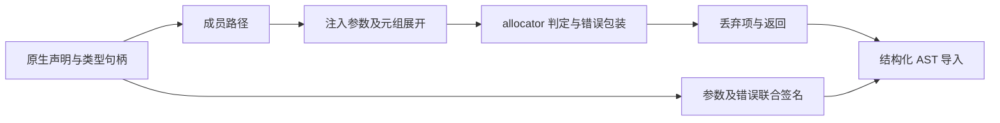
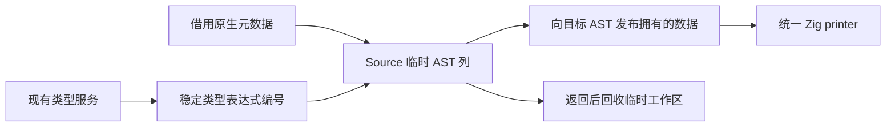

# 原生函数包装器自举

## Intent：最终目标

将原生函数包装器的成员路径、参数展开、调用、返回与签名构造迁入 RX/ZX。
保持原实现的求值顺序、错误集合、捕获、参数顺序和静态链接成本模型。

## Data：可用证据

迁移起点为 `37971a0e`。`genz/src/zx/external.zig` 负责完整包装器构造；
普通函数生成和模块签名均消费它。已有 AST context、字段构造、调用错误包装、
函数命名和 allocator 判定可复用。上一阶段的正式生成器与固定累计基线保留。

## Edges：边界与限制

- 类型句柄仍由现有 typeExpr 服务提供，原生适配器及 AST 存储仍是过渡依赖。
- 不递归执行 Lower.expr，不增加专用运行库、模板、解释器或动态调度。
- Source 局部 AST 使用全局编号加基址；不复制既有 AST 前缀来复用查询。
- 参数名和错误集合的生命周期须覆盖最终 AST；临时数字字段名需要拥有存储。
- 不新增测试用例，复用既有原生调用、编译期、ABI 和实际生成回归。

## Answer：交付格式与成功标准

RX 显式连接成员解析、参数组装、调用和结果构造；ZX 保留内聚的集合遍历。
签名作为独立 AST 构造职责提供，供包装器与模块声明共同使用。

验收包括当前源码的前后生成产物及 memo、自编译不动点、既有受影响回归，
并对固定输入比较 CPU、耗时和 RSS。性能同时对上一阶段与固定累计基线比较。
收口全部变更后提交推送；本阶段不代表完整编译器已完成自举。

## 执行与复核

`analysis/external/build.rx` 连接 callee、arguments、invoke 和 finish，签名构造
单独复用。allocator 查询增加局部视图基址，不复制 AST 前缀；原有完整表调用
继续使用零基址。标准库字段路径提取为通用 AST 构造，调用形式复用它。

原生适配器保留 typeExpr 和目标 AST 发布；参数字段增加通用物化接口，返回
语句补入通用 statement importer。参数名借用 Source 常量，数字字段名由
拥有型表达式导入复制。捕获 DTO 在调用者帧构造，不由 helper 返回栈地址。

引导与正式 P16 ReleaseSmall 构建均为 21/21。两次生成的二进制 SHA-256
相同：`6e1a4d73b273c352c109244ab65a09ca47a962765ea9b70a9179a915fd4d330e`。
使用本阶段当前源码输入，上一阶段与引导版比较 main / collections / growth
的 3001 / 65 / 357 文件，仅 `.zxc-inputs` 不同；引导与正式版三组全部相同。

既有 test-native-declarations、test-native-runtime、test-typed-try-native-abi、
test-process-context、test-rx-io-runtime 合并执行，152/152 步、278/278 个用例
通过。测试配置显式核对 generated_analysis=true，未用 seed 路径冒充 Source。

### 实际生成路径和性能

复用 compile-native-runtime 的 basic / mixed / loops 与 compile-process-context
的 none / io / process / both。基线副本只将 external 的选择器切回原始 seed，
其余生成模块、工具链、配置和调用输入相同；正式版本仍为 Source 实现。
每组七次进程调用产生 34 个文件，八组全部逐字节一致。代表输出共包含 27 处
native_result 包装器，none 场景另验证没有原生调用时的路径；不是只检查空负载。

交替顺序八组，排除首组后，中位数如下。CPU 用子进程资源累计的高精度差值，
包含 time 包装进程；耗时包含启动。RSS 为七个子进程的最大值，不是进程树。

| 指标         |     原实现 | Source 实现 |        差值 |
| ------------ | ---------: | ----------: | ----------: |
| 七次调用 CPU | 0.068525 s |  0.069260 s | +0.000735 s |
| 七次调用耗时 | 0.072137 s |  0.073479 s | +0.001342 s |
| 最大 RSS     |  9682944 B |   9748480 B |    +65536 B |

这些微小样本差异不构成稳定收益或显著退化，不把短进程采样外推为完整冷构建。
生成的应用代码相同，没有新增应用运行时层或为职责拆分复制应用数据。

固定冻结输入仍为 141 个入口。固定累计基线的工具与 SHA 不变；三版交替八轮，
各自使用新生成目录和缓存，排除首轮：

| 指标     | 固定累计基线 |    上一阶段 |      本阶段 |
| -------- | -----------: | ----------: | ----------: |
| CPU      |       5.34 s |      5.29 s |      5.30 s |
| 耗时     |       1.17 s |      1.12 s |      1.13 s |
| 最大 RSS |  488996864 B | 486326272 B | 491945984 B |

CPU 与耗时单阶段均 +0.01 s，累计均 −0.04 s；容差不按提交重置，继续观察趋势。
RSS 波动不小，本轮不声称内存优化收益，也未重复测量无新假设的完整冷构建。
冻结输入的 2268 文件只有 `.zxc-inputs` 不同；12612 条 memo 逐键逐内容一致。
当前源码 main / collections / growth 的 memo 分别为 10466/2989/2468/0、
67/45/27/27、1126/311/266/0，前后全部一致。

证据保存在忽略目录 `.zig-cache/cold-build-analysis/ownership-research/external-wrapper`：
bootstrap.log、production.log、fixedpoint.json、production-fixedpoint.json、
regressions.log、driver-identity.json、affected-comparison.json、
final-runtime-comparison.json、memo-results.json 及对应响应文件和输出。

### 自我复核与剩余边界

本阶段迁移了包装器规则与结构化构造，RX 的四个调用分别承担真实的数据阶段，
没有让单个 ZX 总控隐藏流程。成员与参数遍历保留在内聚的 ZX 算法中。
typeExpr、Lower 的目标 AST 存储、原生 DTO 及通用 importer 仍为过渡依赖；
它们的最终移除需要类型与 AST 状态模型迁移。本阶段的二进制不动点和行为回归
不代替最终传递依赖审计及 seed→stage1→stage2→stage3 的完整验收。
