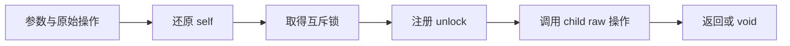

# 同步分配器构造自举

## Intent：最终目标

将 Task 与 RX Parallel 共同使用的同步 allocator 类型完整迁入 RX/ZX：四个
Allocator.VTable 操作、互斥访问、vtable、allocator 方法和最终 container。

## Data：可用证据

起点 `19335bf8`。`zx/allocator.zig` 构造完整普通 Zig 类型，无 fresh。
Task 使用实例 IO 的 mutex 方法；RX Parallel 使用 Threaded 静态 mutex 函数。
原有结构化 AST 原语可表达字段、函数、容器、调用和 defer；带类型常量及三类
包装类型构造需补齐 Source AST 原语，不能用 RawCode 或专用原生回调。

## Edges：边界与限制

- 保留 alloc、resize、remap、free、allocator 的顺序与 VTable ABI。
- 保留 cast self→lock→defer unlock→child raw 操作的应用执行顺序。
- free 发射 expression，其他操作发射 result；返回类型分别按原实现保留。
- 只迁移同步 allocator 的构造，宿主 allocator/IO 及线程行为继续使用 Zig std。
- Source 的字段、语句与函数范围使用各自基址；内部建立顺序可变，引用必须正确。
- 不新增测试用例，复用 Task await 和 RX Parallel。ZX parallel 走 Task，不能
  用它替代 with_io=false 的 RX Parallel 覆盖。既有测试不保证实际调用每个槽。

## Answer：交付格式与成功标准

通过当前源码生成与 memo 对照、自编译不动点、既有两种调用方式回归及受影响
路径性能验收后收口全部变更，提交并推送。生成代码相同不代替完整自举依赖审计。

## 实现与阶段证据

`analysis/allocator/build.rx` 连接根字段、四个操作、vtable 值、allocator 方法和
容器。四个操作的集合遍历保持 ZX 算法；operation/build.rx 显式连接参数、原始
调用、self 转换、锁调用、方法体和函数声明。所有返回的都是已有结构化 AST。

通用 binding 增加可选 type_expr，旧调用缺省仍为 null，用于 `const self: *@This()`。
包装类型以已有 header 原语构造 mutable_slice、many_pointer 和 optional_type；
没有新增 Zig 源码片段、Native 规则回调或运行时解释机制。

根字段、各方法参数、方法体及最终对象各保留连续范围，五个方法声明连续。
方法体都是 typed self、lock、defer unlock、raw 调用四条。普通 raw 操作用 result，
free 用 expression。无 fresh、capture 或 allocator 使用标记变化。

引导和正式 P16 ReleaseSmall 构建均 21/21；两版二进制 SHA-256 相同：
`a69de2cc5a61919d0af4f666e14347f05b8ee90bb86a432f4873e707d1d0fe5b`。
当前源码 main / collections / growth 的 3046 / 65 / 357 文件，旧版对引导版
仅 `.zxc-inputs` 不同，引导对正式版全部一致。三组 memo 分别为
10632/3024/2503/0、67/45/27/27、1126/311/266/0，逐键逐内容一致。

### 固定输入性能及累计变化

沿用同一 141 入口冻结输入及固定基线工具。三版交替八轮，每次使用新生成目录
与缓存，排除首轮；没有其他构建并行干扰，中位数如下：

| 指标     | 固定累计基线 |    上一阶段 |      本阶段 |
| -------- | -----------: | ----------: | ----------: |
| CPU      |       5.33 s |      5.30 s |      5.33 s |
| 耗时     |       1.16 s |      1.12 s |      1.13 s |
| 最大 RSS |  494878720 B | 491503616 B | 490602496 B |

CPU 单阶段 +0.03 s、累计持平；耗时单阶段 +0.01 s、累计 −0.03 s。
累计容差不重置；CPU 已接近固定基线，后续需要继续关注增长趋势。RSS 不用于
宣称稳定内存收益。冻结输入的 2268 文件仅 `.zxc-inputs` 不同，12612 条 memo 一致。

### 应用行为回归

test-zx-await-runtime 与 test-rx-parallel-runtime 合并执行，130/130 步、
121/121 个用例通过。Task 的公开 execute 实际在线程 IO 上运行；RX Parallel
覆盖非实例 IO 的静态 mutex 分支。之后单独执行 test-rx-parallel-library，
237/237 步、206/206 个用例通过，覆盖归档重放及两种导出顺序。

直接执行和归档回归是不同目标，未以 runtime 目标冒充 library/import 的通过。
本轮没有运行单独的 RX/ZX consumer 重新发布目标，没有修改序列化或联结规则。
现有运行用例不保证 rawResize/rawRemap 四槽全部被实际调用；四个槽均被编译，
生成文本与原实现逐字节一致，ABI 及源码复核补足此边界，未宣称穷举运行覆盖。

### 受影响的生成路径

复用八个 await 场景和二十二个 RX Parallel 场景；两个正式生成工具均确认
generated_analysis=true。基线副本只把 allocator 选择器切回原始 seed，其余生成
模块、工具链及配置相同。每组三十次调用、60 文件，八组前后产物全部一致。
代表性的 Task 产物含四次实例 lockUncancelable，Parallel 产物含四次静态
mutexLockUncancelable；两者均有四个带类型 self 转换，确实生成了本轮迁移的职责。

交替八组、排除首组，高精度计量中位数如下：

| 指标           |     原实现 | Source 实现 |        差值 |
| -------------- | ---------: | ----------: | ----------: |
| 三十次调用 CPU | 0.140040 s |  0.141479 s | +0.001439 s |
| 三十次调用耗时 | 0.134935 s |  0.137071 s | +0.002136 s |
| 最大 RSS       | 12402688 B |  12386304 B |    −16384 B |

CPU 使用高精度子进程资源累计差并包括 time 包装器；耗时包括启动，RSS 是最大
子进程，不是进程树。微小差值没有证明稳定收益或显著退化，不将其外推到完整
冷构建。没有在性能测量期间并行运行构建。

证据位于忽略目录 `.zig-cache/cold-build-analysis/ownership-research/synchronized-allocator`：
bootstrap.log、production.log、fixedpoint.json、production-fixedpoint.json、
memo-results.json、regressions.log、library-regressions.log、generated-path.json、
driver-identity.json、affected-comparison.json、final-runtime-comparison.json，
以及每轮输出、响应文件、命令和隔离源码副本。

### 自我复核与剩余边界

同步 allocator 的五个方法和容器均由 Source 构造，Native 只读取基址和导入列，
不存在重放 Source 操作码或回调旧 allocator 规则。生成应用文本相同，没有因
迁移引入运行库、额外互斥、应用值复制或动态分派。

Source 构造仍使用现有 Native AST 存储和通用导入器，这些是待迁移状态边界。
Task/Parallel 调度、线程宿主及其他函数体职责没有因此全部自举；编译器仍需后续
传递依赖审计和约定的三代自编译。保留固定基线及趋势数据，不把局部职责完成
或测试通过改写为整个自举完成。
