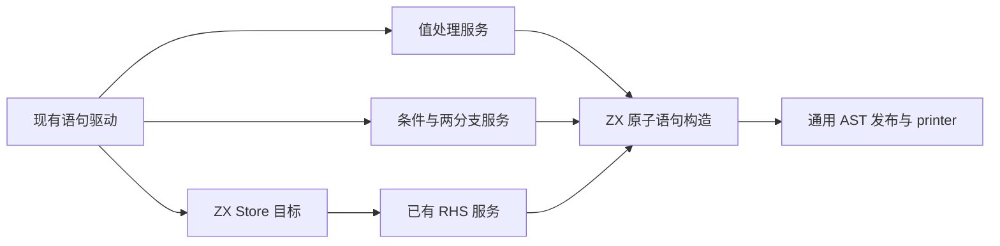
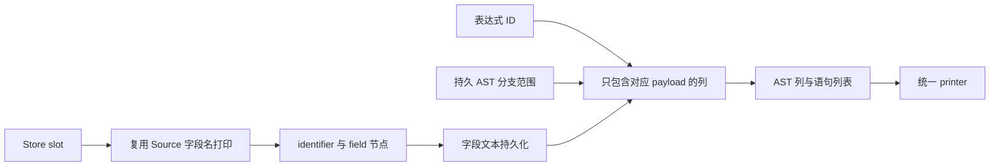

# 基础语句构造自举

## Intent：最终目标

将剩余表达式丢弃、普通条件分支与 Store 写入的结构化 AST 构造迁入 ZX，使
语句分派不再直接拼装这三类节点。保留现有求值、递归 lowering、缓存和流程
顺序，随后集中验收；整体语句驱动与服务仍需继续迁移。

## Data：可用证据

起点 8cf6c53f，工作区干净。普通绑定、解构、返回和 Switch 构造已有 Source
实现，statements.lower 仍直接创建 discard、branch、assignment 及 Store 目标。
既有 AST 列导入、Store 语义常量和十进制字段名打印可复用，不需要新运行库。

## Edges：边界与限制

- discard 先执行现有 iteration.discard 服务，再构造语句；不把未使用值处理
  改为普通 expr，也不消除副作用或错误。
- branch 保持 condition、yes lowering/存储、no lowering/存储的编译期顺序；
  Runtime 仍只执行选中分支。只传持久 AST 范围，不复制分支底层数据。
- Store 先构造 pending.store_<slot> 目标，再求 RHS，最后发射 assignment。
  Store 字段名沿用现有职责 const，不在 Native 新增语义裸值或格式规则。
- 每个 Source 函数只创建一个原子 AST 值，无跨职责流程可隐藏；不机械增加
  RX 入口包装，现有 Native 语句编排依赖明确保留，不宣称完整职责已经自举。
- 新建 Store 数字字段名在 scratch 释放前提升到持久 allocator；pending 文本
  是静态常量，范围及表达式 ID 只做必要描述符传递。不引入 Source opcode
  计划、动态解释层、运行库或全局 inline/所有权规则放宽。
- 不新增用例。复用 if 求值顺序、未使用表达式、loop discard、Store 事务和
  分支运行回归；只测受影响路径及固定累计基线，不重复无关的全冷构建。

## Answer：交付格式与成功标准

完整贯通后验收非空产物、两阶段自编译、实际行为、memo 与性能，再统一收口
所有未提交内容，英文提交推送并核对工作区干净、无未推送提交。此 IDEA 记录
明确 Source 构造已迁移和仍有 Native 依赖的区别，不以字节一致代替闭包审计。

## 执行与验收

四个 ZX 文件通过 fmt --check 和 lint，共八项检查；Native 通过仓库 spacer
格式检查。引导与正式两轮各 21/21 步，二进制 SHA-256 均为
93291d49ad5f226cbf51462f31b252753cec3e2947a8e84a7b80f6d2fbf24c8d。
当前 main/collections/growth 分别生成 3213/65/357 个非空文件，上阶段与本轮
只 .zxc-inputs 不同；本轮两阶段的完整产物逐字节一致。

### 顺序、寿命与生成成本

已核对 evaluate 仍先执行 iteration.discard，branch 显式保留 condition→yes→no，
Store 保留目标→RHS→assignment。Store 两节点 ID 是 base、base+1，guard
排除溢出；数字字段名取得 Lower allocator 寿命，pending 来自静态字符串。
导入器复制必要列描述符，不依赖栈上 names 数组或 scratch 内容。

实际四个生成闭包均没有宽 Context、完整表装箱或数据深复制。discard、branch、
assignment 只有固定单行列的 dupe，不含循环；Store 目标只额外调用既有十进制
打印循环，fromText 包装直接返回原切片，不复制 pending 字节。不能将这些
固定 AST 申请描述为编译器完全不分配，也不能将其等同于应用运行库。

### 既有行为与性能

test-if-evaluation-order、test-loop-columns、test-stores、test-rx-io-runtime
通过 153/153 步、542/542 个既有用例。覆盖短路/早期错误、未使用初始化值、
loop 消费与回退、Store 暂存/提交及 IO 的 discarded result 和错误路径。
没有新增测试用例。

全部构建终止后，从实际回归参数编译原始对照工具。忽略副本只让 basic 构造
选择原始 Native 实现，其他服务和配置相同；9 次既有 evaluation-order/Store
工具调用，八轮交替并排除首轮，每轮 17 个文件非空且逐字节一致：

| 指标（9 次生成合计）      | 原始 Native 构造 | Source 构造 |
| ------------------------- | ---------------: | ----------: |
| CPU（高精度子进程资源差） |       0.023484 s |  0.023106 s |
| 墙钟（含进程启动）        |       0.032754 s |  0.032660 s |
| 最大单次子进程 RSS        |        7258112 B |   7274496 B |

没有可辨别的时间退化，也不以小样本证明所有程序提速。固定 141 入口输入继续
使用同一累计基线工具，三版交替八轮并排除首轮：

| 指标 | 固定累计基线 |      上阶段 |      本阶段 |
| ---- | -----------: | ----------: | ----------: |
| CPU  |       5.34 s |      5.32 s |      5.31 s |
| 墙钟 |       1.17 s |      1.13 s |      1.13 s |
| RSS  |  494764032 B | 474791936 B | 487342080 B |

CPU 单阶段 −0.01 s、累计 −0.03 s；墙钟单阶段不变、累计 −0.04 s。前阶段的
微升没有继续扩大，保留固定工具和趋势记录，不逐阶段重复领取容差。RSS 两侧
样本范围有重叠，且前阶段本次中位数偏低；当前数据不足以将约 12.6 MB 的中位
差归因成稳定增长。保留每轮数据，不把它包装成内存改善或完整冷构建的结论。

冻结输入 2268 个文件只 .zxc-inputs 不同。memo 四类记录逐键逐内容相同：
main 为 11012/3116/2594/0，collections 为 67/45/27/27，growth 为
1126/311/266/0，冻结输入为 8248/2419/1945/0。缓存与失效规则未改，不重复
无关编辑恢复、全仓库回归或冷构建。

证据位于忽略目录 ownership-research/basic-statements：bootstrap.log、
production.log、regressions.log、source-checks.json、fixedpoint.json、
production-fixedpoint.json、driver-scope.json、affected-comparison.json、
final-runtime-comparison.json、memo-results.json，以及两个原始工具的编译日志。

### 自我复核

本阶段迁移剩余三种基础语句与 Store 目标的原子 AST 构造。语句调度、递归
lowering、iteration discard 服务、局部状态注册和 AST 物理存储仍为 Native
过渡依赖，不能以 statements.lower 不再直接拼装这些节点宣称整个职责自举。

这四个构造分别只有一个原子操作，因此不增加 RX 包装；本阶段没有把复杂
总控藏入一个 ZX 函数，也没有改变既有真实 RX 编排。输入只包含 ID/范围，
没有复制分支底层数据来迁移。保留生成代码与消费路径证据，不把行为用例通过
替代成本模型检查或传递依赖审计。
