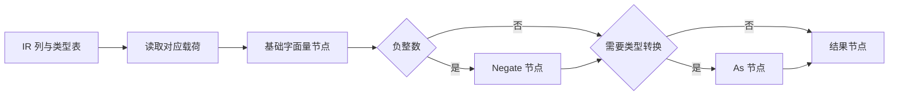

# 字面量表达式生成自举

## Intent：最终目标

将正式 Lower 中九类字面量的语义与 AST 生成迁入 RX/ZX，保留类型转换、负号、
浮点位模式与文本借用，不改变缓存命中、求值上下文或应用运行时成本。

## Data：可用证据

- 原入口位于 `packages/genz/src/zx/lower.zig` 的 regular 分派；命中缓存后直接返回，
  未命中才获取类型表达式并生成字面量。外围 expr 保留 iteration、normalize 和 renew。
- 九类为 integer、negative_integer、float、string、boolean、unit、none、enum_value、
  error_value。除 boolean、unit 外均生成 As；负整数先生成 Integer，再生成 Negate。
- AST 存储将 f64 作为 u64 位模式保存，Source 使用既有 `std:float.bits` 对齐。
- 字符串、枚举名和错误名来自 Program 的稳定存储；不应复制到短寿命 scratch 后借用。
- 上阶段正式生成器保存在 `ownership-research/static-list/production/bin/zxc-bootstrap`；
  固定累计基线仍为 `inbound-conversion/production-bootstrap/bin/zxc-bootstrap`。

## Edges：边界与限制

- 原生 regular 继续承担缓存与表达式总分派；本阶段只替换这九类的语义与节点生成，
  不将递归表达式调度或 Lower 状态计为完成。
- 只有 seed 路径保留旧九类实现；正式路径统一调用生成的 literal_emit。
- RX 编排载荷解码和 AST 构造；ZX 内的种类分派是同一原子职责的内部算法。
- Native 层只借用输入、提供全局节点基址、提升新建的 As 参数并导入节点。
  文本借用必须从实际生成体证明，不能仅依据源码表面判断。
- 先贯通功能，再测实际影响；出现退化时保留迁移并定位优化，不撤回自举实现。

## Answer：交付格式与成功标准

完成格式与 lint、seed/正式构建、相关既有回归、全部生成代码和 memo 对照、增量与
干净生成验证；隔离记录阶段和固定累计基线的 CPU、耗时、RSS。验收后统一提交
推送全部变更，确认工作区干净且无未推送提交。

### 执行与自我复核

实现与验收完成：

- regular 的九类分派进入同一 Source 入口，缓存命中和 typeExpr 顺序保持原样。
  RX 连接 decode → emit；种类、载荷、类型成员名称、负号和 As 决策均来自 ZX。
- Native 仅保留输入借用、基址、节点导入和新建 As 参数提升；没有复制文本字节。
  已核对本轮真实生成体：decode 从 Program strings/names 取得切片，fromText 原样
  返回；emit 仅复制外层 slice 描述符，value facade 仅剥 `.items`。原始证据保存
  在 `decode-lifetime-proof.zig.txt` 与 `emit-lifetime-proof.zig.txt`。
- 浮点已沿实际目标存储确认：`stored.Value(f64)` 为 u64，不依据原始 union 的
  f64 字段推断导入布局。Source 使用 bits，不做 f64→u64 数值转换。
- 4 个新 RX/ZX 文件与修正的十进制样例共 10 项格式、lint 检查通过；Zig 格式和
  diff 空白检查通过。生成器的 `--check` 确认产物与源头一致。
- seed 引导 39/39 步、正式构建 21/21 步通过。
- function-analysis、number-special-values、strings、null-inequality、switch-scalars、
  typed-try-native-abi 六组原有回归共 3272 项通过；decimal-original 补验 403 项
  通过，合计 3675 项。没有将首次失败的整体构建报告为全绿。
- 当前 main、collections、growth 三组生成文件为 2821、64、356 个；迁移前、
  引导版、正式版仅 `.zxc-inputs` 不同，全部代码一致。三组四类 memo 的键和值
  逐项一致，冻结输入 12612 项 memo 同样一致。
- 忽略目录复制七个既有样例，涵盖字符串、浮点、负整数、可空布尔和可空枚举；
  修改一个浮点值再恢复。三个阶段各 24 个代码文件，前后相同且增量等于干净
  生成；四类 memo 各 7 项，前后键和值一致。没有新增用例。

### 十进制回归的旧风格阻断

首次 decimal-original 在生成器输出的主文件第 28 行被既有 condition 规则拒绝：
三个以上条件仍直接放在 if 中。本次未修改该规则，问题来自旧样例生成源头。

修正 `packages/test/src/generate_decimal_literals.ts`：单区间保留简单 if；多区间
生成具名 condition，每行不超过 30 列、每项至多两个子条件，关系显式写 or，
再由 if 引用变量，保留原区间与短路顺序。403 个样例及期望值没有增删。

移除该生成器陈旧的 120 行上限，复用通用 writeOutput；行数交给现有 lint。
新的主文件 156 行，处于建议 180 行和硬上限 240 行之内，格式、lint、生成器
`--check` 与 403 项既有运行结果均通过。仅重跑原失败项，复用其余有效证据。

### 性能与累计变化

构建、回归结束后，以同一冻结输入、工具链和配置隔离计量；8 轮交替运行，
排除首轮取中位数：

| 指标     | 固定累计基线 | 本阶段前    | 本阶段后    |
| -------- | ------------ | ----------- | ----------- |
| CPU      | 5.33 s       | 5.22 s      | 5.23 s      |
| 耗时     | 1.16 s       | 1.11 s      | 1.12 s      |
| 峰值 RSS | 490848256 B  | 486588416 B | 490962944 B |

本阶段 CPU、耗时各 +0.01 s，处于容差内；相对固定基线 CPU −0.10 s、耗时
−0.04 s。近期阶段约 5.2 s，没有持续上升趋势；累计基线不重置。

首组 RSS 中位数高约 4 MB，故追加 12 轮交替复测，排除首轮后，前后 CPU 为
5.22→5.23 s、耗时 1.11→1.12 s、峰值 RSS 487161856→485539840 B。没有
复现峰值内存增长，不将本次差异解释为确定的内存收益。

冻结输入 2268 个文件仅 `.zxc-inputs` 不同；代码与 memo 一致。此测量覆盖正式
生成器，不是完整冷构建或 LLVM 内存峰值的新测量。样例 condition 修正只对齐
等价区间判断，不另做性能对比。

### 自我批判与剩余职责

- 真实生成体、有限回归及全代码对照共同支持本次等价，不能仅凭编译成功或
  `.zx` 扩展名宣称整体完成。
- 导入时借用文本依赖明确的 Program 生命周期；未来若 decode 引入文本变换，
  必须重审提升责任，不能继续假设字节来自稳定输入。
- 缓存、递归表达式调度、Lower 自有状态及 AST 存储仍有原生实现；它们不属于
  本阶段已迁移范围，最终仍需传递依赖审计和 stage 1→2→3 验收。

脚本、报告和日志均位于忽略目录
`.zig-cache/cold-build-analysis/ownership-research/literals/`：
`source-validation.json`、`bootstrap.log`、`production.log`、`regressions.log`、
`decimal-regression.log`、两份 lifetime-proof、`known-shared-fixedpoint-result.json`、
`current-manifest-memo-comparison.json`、`memo-comparison.json`、
`literal-edits-comparison.json`、`literal-memo-comparison.json`、
`final-runtime-comparison.json` 与 `rss-focused-comparison.json`。
