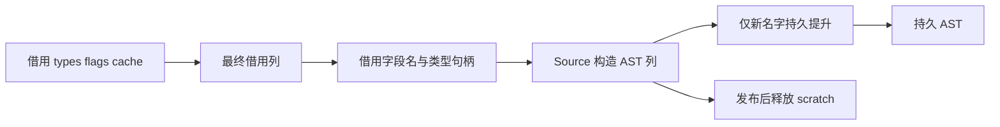

# 循环借用字段布局自举

## Intent：最终目标

将 loop-fields 的候选选择、最终借用资格与专用布局声明迁入 RX/ZX，复用已有
graph/proof/capacity 分析，保持算法、短路顺序、字段顺序和借用成本。

## Data：可用证据

起点 3cba58e1，工作区干净。Native fields/prepare 仍执行 worthwhile、缓存及
normalize/renew 后验证，并构造 pointer/optional/struct 声明。已有 Source
类型表、整数 map lookup、flags 常量、origin 描述和 AST 原语能表达此职责。

## Edges：边界与限制

- 入口上下文限制、字段类型句柄获取和 Context 持久发布仍是过渡边界。
- 无候选时不执行图分析；无有效图时不执行借用后验证；命中否决立即停止。
- 仅借用类型表、flags 与 cache 列，不复制全表，不增加分析遍历。
- 类型句柄按原字段顺序获取；pointer 节点只改变 AST 构造时机，不改变类型服务
  调用次序或新名字顺序。origin 与 loop_fields 名按原顺序生成。
- 本轮不迁移 maskBorrowed/qualify，它们仍需交错调用所有权服务。
- 复用既有循环回归、两阶段自编译、完整产物与固定累计性能对照，不新增测试。

## Answer：交付格式与成功标准

验收必须覆盖资格拒绝、借用字段布局、origin 避重名与真实 Source 执行配置。
只声明本职责完成，不以布局声明迁移替代完整循环驱动或最终自举验收。

## 实现与生成形态复核

Source prepare/plan.rx 先构造候选，存在候选才进入原 graph/proof/capacity；
有效证明之后计算 borrowed 并执行 cache 与 normalize/renew 后验证。flags 缺项
默认零，保持原 Plan.get 行为；失效或无 changed 时短路跳过末尾 some 扫描。
layout/build.rx 明确按 initialize、fields、origin、finish 组装类型声明。

Native 借用 cache/type/flags，按原字段顺序取得类型句柄，然后发布新布局和
持久 Context。新 loop_fields 名只提升一次，identifier 和常量共用；静态 origin
借用，动态 origin 在 scratch 释放前单次提升。postcondition 的容量提示过滤
仍在 Context 发布处；完整 lowerMode、maskBorrowed 和 qualify 尚未迁移。

实际生成目录为 final-build/local-cache/o/5376024c97d34e0dbaa4ac90ae2b65f7/main。
fields 的 6b1c9082…循环逐轮保留各列 items/storage；field 的 a9477ef0…和
其 append helper f29345c1…直接 reserve(true)。candidates ce97b49d…、
borrowed 3b6c68d4…同样保留增长元数据；validate 942b9c02…原地修改借用列，
先判断 valid/changed 才执行最终扫描。没有发现逐旧前缀复制。

field 的互斥分支仍各有一次 Fields 描述符 create，每字段发生一次描述符装箱；
不是底层列深拷贝，也不是零分配。局部性能对照必须计入这一实际线性成本，
不能仅靠 reserve 文本计数宣称无开销。original 与分区内对应生成文件一致。

## 正确性验收

两阶段自编译均 21/21 步通过；bootstrap 与 production 二进制 SHA-256 相同：
5925b1e99ecbf336c84ac3f0c7b2a03b49937740de8c266bf173de36af63be6d。
当前 main/collections/growth/ordered 完整产物各 3284/65/358/24 文件，上一工具
与 bootstrap 仅 .zxc-inputs 不同，bootstrap 与 production 四组全部相同。
既有 test-loop-columns、test-aggregate-loop 通过 136/136 步、226/226 用例；
没有新增测试。14 份 Source 的最终格式检查及对应 lint 通过。

首次生成因新建空列表未标明元素类型而失败，已将 candidates/borrowed 的空
列表标为 bool[]；格式与 lint 不承担类型检查。独立复核随后发现多余 some 扫描，
修复短路后重新完成上述两阶段构建。没有用格式通过替代实际编译与运行验收。

## 局部对照的隔离边界

对照使用实际回归的两个生成驱动及相同 17 项调用。忽略目录 Native 副本将
prepare 选择切回原 prepare_seed，保留 generated_analysis=true 及相同工具链、
优化和生成目录。新内部调用使旧 loop_fields 的 executeValue 参数变为值 ABI，
原指针调用因此编译失败；只在对照副本中使用既有 columns.invoke 适配该 ABI。
它借用相同描述符并同步调用原入口，不改候选、图证明或后验证算法。两份差异
都会在测量时核对，不能声称副本只改了选择 guard。失败日志保留，未算性能样本。

正式 Native seed 在 generated_analysis=false 时继续使用原 Native 图证明；
正式 Source-enabled 路径由新的 prepare/layout 入口执行。对照副本的 ABI 适配
不进入产品源码，不为性能比较关闭已有 Source 分析。

## 性能与 memo 验收

所有构建结束后执行两组交替八轮测量，均排除首轮；不重置固定累计基线。
局部生成驱动每轮 17 项调用、68 份文件，八轮全部逐字节相同。旧版/新版
中位 CPU 为 0.552341/0.552342 s，墙钟 0.571400/0.571493 s。差异不可辨，
没有证据表明逐字段描述符装箱造成可测退化；此结论只覆盖现有样例规模。
最大子进程 RSS 为 14106624/14204928 B，不是整树峰值。

固定 141 入口、2220 模块、2268 文件的正式生成器：

| 指标            | 固定累计基线 |      上阶段 |      本阶段 |
| --------------- | -----------: | ----------: | ----------: |
| CPU             |       5.33 s |      5.32 s |      5.33 s |
| 墙钟            |       1.16 s |      1.13 s |      1.13 s |
| 最大 RSS 中位数 |  493387776 B | 491798528 B | 483688448 B |

CPU 单阶段 +0.01 s，累计不变；墙钟单阶段不变、累计 −0.03 s。基线仍是原
inbound-conversion 工具。此前数阶段约 5.3 s，本轮未出现持续增长或累计超限。
RSS 上阶段 478904320～494551040 B，本阶段 480460800～495501312 B，
明显重叠，不以中位数少约 8 MB 宣称稳定收益。未测最新完整冷构建，不能用
生成器运行 RSS 代表 Zig/LLVM 后端峰值。

四组当前源码及冻结输入的 memo 逐键逐内容相同，四类数量依次为：main
11252/3167/2645/0；collections 67/45/27/27；growth 1130/312/267/0；
ordered 27/14/14/14；冻结输入 8248/2419/1945/0。固定输入完整生成产物除
.zxc-inputs 外全部相同。正式工具与两个回归驱动的 generated、generated_analysis、
partition_groups 均为 true，没有用 Native 全量路径替代正式验收。

## 自我复核与交接

本轮完成候选、借用资格后验证和专用布局声明的 Source 迁移，保留原有图证明、
拒绝顺序、字段顺序、名字和借用寿命。没有新增语言语法、运行库、解释层或
用户数据复制。描述符装箱作为实际成本保留记录，不夸大零成本或内存收益。

上下文可用性检查、类型服务、Context 发布及容量提示过滤仍是 Native 过渡
依赖；maskBorrowed/qualify 和整体循环编排尚未完成。二进制相同不代替最终
依赖闭包与阶段自举审计，目标保持进行中。本记录遵循 IDEA：目标、证据、
边界与成功标准均单独明确。

证据位于忽略目录 .zig-cache/cold-build-analysis/ownership-research/loop-fields-layout：
bootstrap.log、production.log、regressions.log、fixedpoint.json、
production-fixedpoint.json、memo-results.json、driver-scope.json、
affected-comparison.json、final-runtime-comparison.json、各轮产物与命令。
对照副本的两处差异已与正式文件精确核对；失败的 ABI 日志单独保存，未纳入
性能样本。没有为文档和格式再次运行相同构建。
