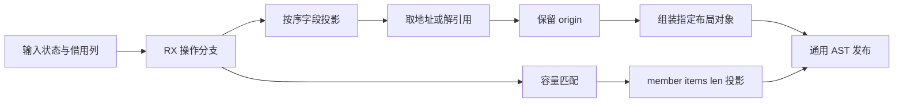
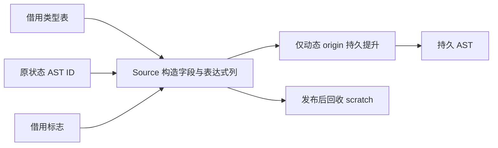

# 循环借用状态投影与还原自举

## Intent：最终目标

迁移 loop-fields 的初始化、退出还原与容量源长度投影，保持字段声明顺序、
借用地址与解引用语义，以及 origin 的来源寿命。

## Data：可用证据

起点 1b8bf69b，工作区干净。fields/root.zig 的 initial/restore/minimum 尚在
Native；既有 AST header、字段列追加、origin.describe 和 state/list.selected
可表达同一算法。三个操作没有 fresh、用户值求值或局部语句发布。

## Edges：边界与限制

- 初始值和退出值只传 AST ID，不重新求值，不复制应用数据。
- 按类型字段顺序投影，借用字段分别取地址或解引用，origin 最后原样传递。
- minimum 在容量记录为空或 operation 不匹配时立即返回，不读字段或类型。
  命中后按 member、可选 items、len 构造；member 是刚创建的 Field，不能误用
  list query 针对 Object 字面量的消除路径。
- restore 的静态 layout 类型句柄可预备后再读取 bases；它只更新类型 AST/缓存，
  不消耗 fresh 或发布局部语句，不改变用户求值与所有权服务顺序。
- 静态/输入字段名借用，动态 origin 单次提升后供投影和对象字段共同引用。
- maskBorrowed/qualify 及 Context 查询/发布仍是明确过渡依赖，不在本轮绕接
  专用 callback、操作计划或运行库。

## Answer：交付格式与成功标准

完成标准为两阶段自编译、完整四组产物及 memo 对照、既有循环回归和受影响
路径/固定累计基线联合验收。记录遵循 IDEA，不以二进制一致代替最终自举。

## 实现与实际生成审计

RX 在 Minimum 分支先判断 capacity 存在及 operation 匹配，不满足直接返回
null；满足后才 initialize 并执行长度投影。其他模式按 initialize、fields、
origin、finish 构造对象。Output 是可空结果，Native 解包 null 后立即返回。

最初的完整空 DTO 会让拒绝路径经过初始化与空列导入，已在性能计时前移除。
RX 只在显式非空分支内访问 capacity；当前能力不根据前一个提前 Return 自动
收窄后续路径，采用已有的正向分支能力表达。首轮 Native 枚举反射转换需要
comptime 值，已直接复用 Source Input.mode 类型，未另加枚举协议或动态映射。

Native 仅准备静态布局句柄、借用类型表与标志，并导入列。动态 origin 的最后
field_name 和 fields.name 共用一次持久提升；普通名字借输入类型表，items/len
借静态文本。新模式没有 fresh，不改变源状态 AST 的求值次数。

实际生成目录为 final-build/local-cache/o/c0a828deb503fcc28d530423f61e655e/main。
part_4/ac5892d2…的 Minimum 拒绝分支不调用 initialize，wrapper 只有非空结果
才分配输出 DTO。fields 的 df0f0aa0…逐轮保留各列 items/storage；field
93a1fd95…、wrap 50e2f8a7…和四列 append f29345c1…直接 reserve(true)，
未发现逐轮复制旧前缀。part 与 original 对应文件逐字相同。

成功路径每字段仍有一次 Fields 描述符装箱，不是底层列深拷贝；局部成本必须
以实测验收，不能据静态生成检查宣称零分配或稳定内存收益。

## 正确性验收

两阶段自编译均 21/21 步通过，bootstrap 与 production 的 SHA-256 相同：
377ea26e0bc0b57dcfa53ab2b0e48ed8ddd56b375482dcceeef641d295ed0436。
正式配置 generated、generated_analysis、partition_groups 均为 true。
当前 Source 的 main/collections/growth/ordered 各 3294/65/358/24 文件，
上一工具与 bootstrap 仅 .zxc-inputs 不同，bootstrap 与 production 四组完全一致。
9 份 Source 的最终格式检查和对应 lint 通过，四份 Native 格式检查通过。

既有 test-loop-columns 和 test-aggregate-loop 通过 136/136 步、226/226 用例，
没有新增测试。三个 seed 函数体已与上一 HEAD 精确核对，未改原算法。

## 局部性能与固定累计基线

对照副本只将 root 中 minimum/initial/restore 的三个选择 guard 改为 true，
其余源码与配置相同；已逐字核对这三处差异。两份驱动均启用 generated、
generated_analysis、partition_groups，没有关闭已有 Source 语义来充当基线。
每轮执行真实回归的 17 项调用、68 份产物，交替八轮，排除首轮后中位数：

| 指标           | 原 Native 投影 | Source 投影 |
| -------------- | -------------: | ----------: |
| CPU            |     0.553235 s |  0.550694 s |
| 墙钟           |     0.571583 s |  0.569406 s |
| 最大子进程 RSS |     14172160 B |  14057472 B |

八轮 68 份产物逐字节相同。CPU 少约 0.00254 s、墙钟少约 0.00218 s，仅
代表现有样例规模；墙钟含逐次启动，RSS 为单项子进程最大值，不是整树峰值。
不把这一小幅差异推广为所有循环或完整构建的稳定加速。

固定 141 入口、2220 模块、2268 文件的三版正式生成器同样交替八轮、排除
首轮，基线仍是 inbound-conversion 原工具，没有随提交重置：

| 指标            | 固定累计基线 |      上阶段 |      本阶段 |
| --------------- | -----------: | ----------: | ----------: |
| CPU             |       5.36 s |      5.31 s |      5.34 s |
| 墙钟            |       1.17 s |      1.13 s |      1.14 s |
| 最大 RSS 中位数 |  494714880 B | 487096320 B | 492077056 B |

CPU 单阶段 +0.03 s，累计 −0.02 s；墙钟单阶段 +0.01 s，累计 −0.03 s。
单阶段增量如实保留，没有给阶段重新分配容差。近期各阶段在约 5.3 s，本轮
没有累计超限证据；下一阶段继续沿固定工具观察增长，不把小增量视为永久免费。
RSS 上阶段范围 474677248～496254976 B，本阶段 474038272～496943104 B，
明显重叠，不宣称稳定内存收益。固定工具自身本轮较前轮也有波动，不从单轮
差值强行归因。本节不是最新完整冷构建的内存测量。

## memo、自我复核与交接

四组当前源码和冻结输入的四类 memo 逐键逐内容相同，记录数量依次为：
main 11287/3175/2653/0；collections 67/45/27/27；growth 1130/312/267/0；
ordered 27/14/14/14；冻结输入 8248/2419/1945/0。固定输入完整产物仅
.zxc-inputs 不同，未出现缓存事实或生成内容差异。

本阶段完成借用状态的投影、还原及容量长度构造。RX 真实表达拒绝/接受与
构造顺序，ZX 负责字段遍历与表达式构造；没有引入 callback 运行层、额外用户
数据复制或专用操作计划。保留已知的描述符装箱成本，并通过实际路径验收。

maskBorrowed/qualify、Context 查询与整个循环 lowerMode 仍是 Native 过渡
依赖。静态类型句柄与通用列发布也尚未最终迁移。本阶段不等于完整循环或
最终编译器自举，不以阶段二进制相同替代最终依赖闭包验收。冷编译峰值和
完整所有权生命周期分析继续按研究文档推进，不能由本阶段生成器 RSS 推断。

证据位于忽略目录 .zig-cache/cold-build-analysis/ownership-research/loop-fields-projection：
bootstrap.log、production.log、regressions.log、fixedpoint.json、
production-fixedpoint.json、memo-results.json、driver-scope.json、
affected-comparison.json、final-runtime-comparison.json，及每轮命令和完整产物。
本记录遵循 IDEA，按最终目标、可用证据、边界与交付标准明确报告。
