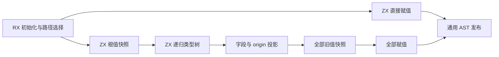
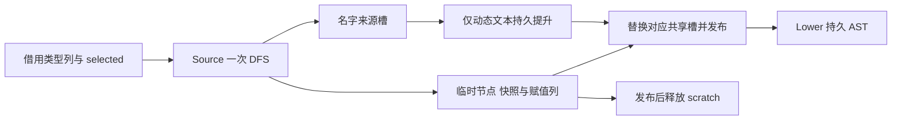

# 循环状态赋值协议自举

## Intent：最终目标

将循环状态更新的递归拆分、旧值快照与最终字段赋值协议迁入 RX/ZX，保持所有
旧值在任何写入之前求值，避免字段交换和共享视图被提前覆盖。

## Data：可用证据

起点 397ce109，工作区干净。iteration/assignment.zig 仍负责按 selected 类型
递归对象、tuple、list，最后一次性追加所有赋值。已有 ZX 支持同算法递归，
无需改为额外堆栈或建立预扫描计划；fresh、origin 与结构化 AST 头可复用。

## Edges：边界与限制

- 非 active/selected 根保持单次赋值，不引入快照或类型访问。
- 根值先 bind；对象与 tuple 按原顺序递归，origin 最后；list 依次处理
  items、storage。optional、未选中聚合和其他叶子整体快照，不扩大拆分范围。
- target 字段节点先于 value；每个叶子快照一次，全部快照完成后才写入。
- 输入字段名、静态 items/storage/default origin 借用；新 tuple 索引、避重名
  origin 和 operand 名才提升。每对 target/value 共享同一次名字提升。
- origin 的动态性由生产者返回 suffix 事实，不由 Native 猜测文本或指针归属。
- 保留一次深度优先类型树遍历，不复制类型表，不增加用户数据复制或运行库。
- 不新增用例，复用循环列、聚合循环和原生引用运行回归；同输入完整产物、
  memo、受影响路径及固定累计基线共同验收，完成后统一提交推送。

## Answer：交付格式与成功标准

实际生成的递归实现必须保留增长元数据，不因 Source 迁移发生逐步复制旧前缀。
若出现退化，保留迁移并定位优化；不以撤回功能替代验收。阶段只声明本协议
完成，整体循环驱动和原生状态边界仍须继续迁移。

## 实现与实际边界

RX 负责初始化、直接赋值与拆分路径选择；ZX 按原算法进行一次深度优先递归，
分别构造快照和赋值列。Native 仅借用输入类型表、分配 scratch、提升新文本并
发布通用 AST 行。旧实现保留为 seed；完整循环驱动、Lower 状态与 AST 发布
适配器仍是过渡依赖，不声明整体循环或完整编译器自举完成。

origin 的生产者显式返回 name/owned，避免消费处猜测名字归属。原 name 接口
保留 Input 与字节列表 Output；现有直接消费者取 name，新增递归消费归属事实。
动态字段名由第一个槽提升一次，第二个槽共享；输入及静态字段名继续借用。

核对实际生成的 collect、fields、snapshot、save：递归返回逐列恢复增长元数据，
追加保留 reserve(true)，没有将宽 State 装箱或逐步复制已有列前缀。静态核对只
证明生成方式，实际成本另由下列受影响样例和固定输入验证。

## 验收结果

- 两阶段构建各 21/21 步成功，正式配置 generated、generated_analysis 与
  partition_groups 均启用。两版工具 SHA-256 相同：
  d4de8240907ecbda4fd93c7e0ac5f779f248ca21641ab2b983e08ded8ce2f994。
- 当前 Source 的 main/collections/growth/ordered 分别 3269/65/358/24
  文件；上一工具与 bootstrap 仅 .zxc-inputs 不同，bootstrap 与 production
  四组完整产物逐字节相同。
- 14 份 Source 文件共 28 项 fmt/lint 检查通过；三份 Native 文件格式检查通过。
  既有 loop-columns、aggregate-loop、native-references-runtime 回归
  195/195 步、226/226 用例通过，没有新增测试。
- memo 四类记录逐键逐内容相同：main 11220/3156/2634/0，collections
  67/45/27/27，growth 1130/312/267/0，ordered 27/14/14/14；冻结输入
  8248/2419/1945/0 保持一致。

## 性能、累计基线与限制

循环专用对照复用真实回归驱动，启用相同 Source 配置，仅在忽略目录副本中
将 assignment 选择改为原 Native 算法；已验证副本只改这一 guard。每轮 17 项
现有输入，输出 68 文件，八轮全部相同；交替顺序并排除首轮后，中位 CPU
0.550374→0.553720 s，墙钟 0.569288→0.573589 s。CPU 增量约 0.00335 s，
墙钟约 0.00430 s。墙钟包含逐次启动，RSS 为单项最大进程值，非整树峰值。

正式生成器固定 141 入口、2220 模块、2268 文件，同样交替八轮并排除首轮：

| 指标            | 固定累计基线 |      上阶段 |      本阶段 |
| --------------- | -----------: | ----------: | ----------: |
| CPU             |       5.33 s |      5.32 s |      5.31 s |
| 墙钟            |       1.16 s |      1.13 s |      1.13 s |
| 最大 RSS 中位数 |  495779840 B | 493518848 B | 491405312 B |

CPU 单阶段 −0.01 s、累计 −0.02 s；墙钟单阶段不变、累计 −0.03 s。固定基线
仍是 inbound-conversion 的原工具，没有随提交重置。RSS 上阶段样本范围
472973312～495190016 B，本阶段 473284608～494829568 B，明显重叠，
不声称稳定内存收益；过去数阶段 CPU 约 5.3 s，没有持续增长证据。完整产物仅
.zxc-inputs 不同，memo 完全一致。以上是生成器执行，不能替代最新冷构建峰值。

## 自我复核与交接

本阶段完成赋值协议的语义迁移与可运行验收；保留旧值快照、字段顺序、借用和
增长契约，没有通过额外复制或新运行库换取迁移。小幅局部增量在现有容差内，
固定累计路径未退化；内存修复与完整所有权分析仍须按研究文档继续归因。

证据位于忽略目录 .zig-cache/cold-build-analysis/ownership-research/iteration-assignment：
bootstrap.log、production.log、regressions.log、fixedpoint.json、
production-fixedpoint.json、memo-results.json、affected-comparison.json、
driver-scope.json、final-runtime-comparison.json 及各轮完整产物和日志。
本记录遵循 IDEA，按目标、证据、边界及成功标准报告；不以二进制相同或局部
迁移替代最终自举依赖闭包验收。
