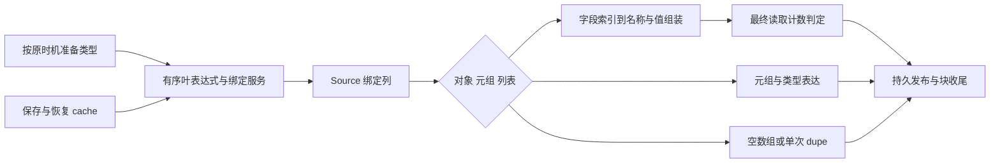
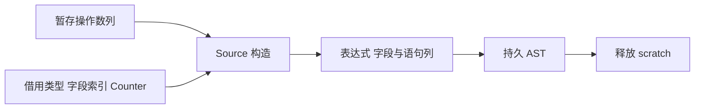

# 循环聚合字面量构造自举

## Intent：最终目标

将 iteration-value 的对象、元组及列表字面量构造协议迁入 RX/ZX，保持所有
操作数求值、cache 暂存恢复、读取次数与空/非空列表分配语义。

## Data：可用证据

起点 d2035523，工作区干净。aggregate.zig/list.zig 尚在 Native。已有 Operand
传输、Source Counter 查询、AST array/tuple/object、fallible call 和字段列原语
可表达同一构造；上一阶段已补齐通用 discard 列。

## Edges：边界与限制

- object/tuple 根类型先准备；list 元素类型在元素前、列表结果类型在元素后准备。
  types.get 可能消耗 fresh 并声明类型，不能统一前移。
- object 先保存全部 evaluation 的旧 cache，再按原顺序 lower、bind、记录当时
  计数、写 cache；字段按原记录顺序 lower；重复 ExprId 不去重。
- Source 借最终 Counter 的 Index/values，逐 evaluation 查询，保持查询次数；
  不新增 current-count 数组，也不返回含指向局部 Index 的悬空 view。
- 每元素仍有独立绑定；空列表不调用 dupe，非空仅调用一次；最终块 fresh 最后。
- 输入字段/名字借用，准备数组使用短寿命工作区；结果 AST 载荷取得持久存储。
- 绑定列直接增长，不在 unbounded 元素循环中反复包装完整 Statements 上下文。
- Native cache 与叶表达式驱动仍为过渡依赖，不以新 DTO 或入口包装宣称全部自举。

## Answer：交付格式与成功标准

以三类完整协议为阶段边界，集中执行两阶段自编译、完整产物与 memo、既有
循环/求值顺序回归、受影响路径及固定累计性能验收。记录遵循 IDEA，实际
生成体必须证明随元素增长时没有逐旧前缀复制，再用动态数据判断实际成本。

## 实现与缺陷修复过程

Source RX 连接绑定、对象/元组/列表分支及最终发布。Native 保持全量 cache
预保存、逐 evaluation 的 lower/bind/count/cache 写入、按记录顺序 lowering
字段，以及最后的 cache 恢复。未去重 ExprId，未新增一次 Counter 全表扫描。
读取 Counter 的 Index 与 State header 在同一个同步调用栈帧中存活。
共享 Operand 仅提取上一阶段原有单常量传输服务，mutation 保持同一绑定语义。
类型 getter 仍遵守 object/tuple 根类型先准备、list 元素前/列表结果后的顺序。
Source 为非空列表回传 uses_allocator，保留旧 Native invocation 的效果标记。
字段索引直接借 core/expression_table/read 已切片的局部视图，名字借 TypeTable
与 Lower，tuple/array/call 的嵌套非文本 AST 载荷在发布时取得持久存储。
初轮装载发现 Counter model/get 未登记跨包依赖，已补齐 source_packages；
没有复制查询实现或放宽依赖校验。初版已通过两阶段构建和 211/211 步、
278/278 既有用例，但生成审计发现成本错误，因此这些不是最终交付证据。
初版绑定 6868c78…与弃值 b58fa828…每轮把 tags/offsets 包装成 plain 后
调用 header 9a6cbcfd…，后者明确 reserve(false)，会形成随 evaluation 数量
增长的二次前缀复制。保留迁移，平铺循环内的 tags/offsets 与所有增长载荷列，
只在 return 重组 Statements；随后重新检查实际生成体并补验收。初轮日志
另存 initial-*，最终对照使用独立 final-aligned 输出/缓存，不混用旧证据。

## 修正版生成审计与阶段构建

实际目录为 final-build/local-cache/o/9a7cc65eb83d98cff3197f15d0abaacb/main。
修正版 bindings 6868c78…第 56～64 行直接传状态 tags/offsets，第 205～243 行
回写 items/storage；discard b58fa828…第 90～91 行直接传状态列，第 168～190 行
保留 storage。循环内 Statements 装箱已消失，最终 return 分别构造一次描述符。

original 与实际 part_2 对应文件逐字相同。
每个阶段入口仍各包装一次 plain；discard 首次追加可能复制原有 bindings 头
前缀一次，这是阶段边界的线性成本，不声称完全无复制。constant 四列、discard
载荷及对象 Fields 四列直接 reserve(true)。对象每字段的描述符装箱仍是线性
成本，动态测量需覆盖它，不能由增长元数据正确推导整轮加速。
最终两阶段自编译均 21/21 步通过，工具 SHA-256 相同：
2395d83250f5fe9408f561abef42f1105ba8cab4b4c93e47edbce8287eeffef3。
generated、generated_analysis、partition_groups 均启用。最终 main/collections/
growth/ordered 各 3326/65/358/24 文件；上一工具与 bootstrap 仅 .zxc-inputs
不同，bootstrap 与 production 四组完全相同。aggregate_seed/list_seed 与起点
文件逐字相同。12 份 Source 最终格式与对应 lint、10 份 Native 格式检查通过。

## 最终行为与性能验收

修正版既有 iterate-buffer、nested-buffer、aggregate-loop、对象与数组求值顺序
回归共 211/211 步、278/278 用例通过。未新增测试用例。与前工具比较的四组
memo 不只比较数量，全部 key 对应的记录内容均相等：main 11456/3203/2681/0，
collections 67/45/27/27，growth 1130/312/267/0，ordered 27/14/14/14。
受影响路径使用同一源码、配置及真实 nested-buffer/aggregate-loop 驱动；仅将
对照副本的 aggregate/list 两处 generated_analysis 分支切回逐字保留的 seed。
13 项输入每轮生成 52 个文件，8 轮全部相等；交错执行并剔除首轮后取中位数：

| 指标               |     原实现 | Source 实现 |
| ------------------ | ---------: | ----------: |
| CPU                | 0.424743 s |  0.424109 s |
| 墙钟（含进程启动） | 0.438632 s |  0.438468 s |

| 最大子进程 RSS | 14,073,856 B | 14,221,312 B |
局部耗时无可辨退化，RSS 增加 147,456 B；这是小驱动的最大子进程数据，不是

完整生成器或冷构建进程树。不能将它包装成内存优化收益。

固定累计输入仍为既有 141-entry manifest，未重置基线；每次使用新输出与缓存，
关闭 resident generator，8 轮交错执行、剔除首轮后取中位数：

| 指标 | 固定累计基线 | 上一阶段 | 本阶段 |
| ---- | -----------: | -------: | -----: |
| CPU  |       5.34 s |   5.32 s | 5.32 s |
| 墙钟 |       1.17 s |   1.13 s | 1.13 s |

| RSS | 495,239,168 B | 491,814,912 B | 492,371,968 B |

上一阶段 RSS 范围 478,953,472～496,058,368 B，本阶段
479,805,440～498,581,504 B，明显重叠。没有持续的时间增长证据，也没有可确认
的整轮内存下降。2268 个文件仅 .zxc-inputs 不同；冻结 memo 8248/2419/1945/0
的全部记录相等。固定工具 SHA 8f1e7cee…，上一阶段 bc8afe81…，本阶段
2395d832…，路径和完整 hash 保存在 final-runtime-comparison.json。
证据位于 .zig-cache/cold-build-analysis/ownership-research/iteration-literals：
regressions.log、affected-comparison.json、driver-scope.json、
final-runtime-comparison.json、memo-results.json，以及 final-aligned-*。

缓存与临时日志不提交。

## 科学依据、取舍与自我复核

沿用[冷编译内存研究](冷编译内存归因与错误清理优化.md)的论文与进程归因，
本轮重新核对 [ThinLTO（CGO 2017）](https://storage.googleapis.com/gweb-research2023-media/pubtools/4743.pdf)、
[编译框架成本分析（CGO 2024）](https://home.cit.tum.de/~engelke/pubs/2403-cgo.pdf)
及 [LLVM New Pass Manager 文档](https://llvm.org/docs/NewPassManager.html)。
分别借鉴摘要与局部工作集、避免重复中间表示、避免内层反复触发外层全量工作。
第三项是工程资料，不另算论文；也不将论文中的收益外推到 zxc。
本次消除逐项前缀复制有实际生成体作为依据，代价由受影响路径与固定输入验证。
未改 Zig/LLVM 优化等级，未整体替换 arena，未把所有描述符赋值都视为深拷贝。
阶段交界仍可能有一次线性复制，持久 AST 的非文本载荷仍需取得拥有权。
自我复核：初版虽然通过行为回归，仍有二次复制，说明单靠正确性测试不足；本次
补查实际生成体并重新验收。当前有效结论是构造协议已迁移且未见耗时退化，不能
据此宣称约 2 GB 的后端冷编译峰值已解决。剩余冷编译内存、完整 NLL，以及
Native Lower/cache/类型服务与状态桥仍未完成，整体自举目标继续。
