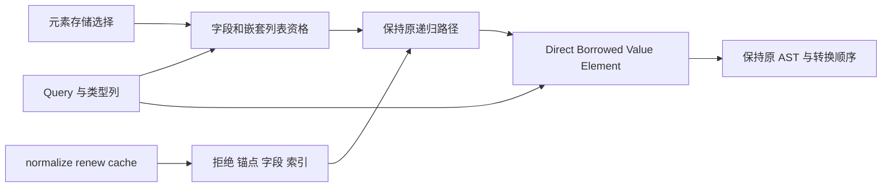
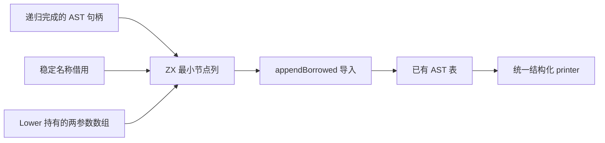

# 投影读取规则自举

## Intent：最终目标

将字段、元组字段、索引与长度读取共用的 raw 资格、ABI 链路由、值调用锚点及
结果表示规则迁入 ZX。迁移的是完整的读取决策职责；递归取得子表达式、AST
存储和既有 bind/conversion/elements 服务仍是过渡适配，不宣称整个 Lower 完成。

## Data：可用证据

- Lower.regular 先处理外层 cache，再 typeExpr，再分派。TupleField 的 removed-only
  投影优先，失败后才分配数字字段名。
- 字段路径仅 represented Object、无 iteration/loop_fields 时尝试 raw；嵌套列表
  还要求 List<List> 且元素采用 inline storage。
- ABI 链先拒绝 normalize/renew，未 represented 的节点成为锚点；随后才拒绝
  represented cache 节点，再只允许 Field/Index。Object index 可回退 managed parent。
- Scope/Iteration/ListOperation，以及 value-function Call，锚点必须走 value_call。
- 字段先发射 field、必要时解引用，再选择直接返回、借用列表或 bind/convert。
  索引先取得 source，再计算 index 和 checked-index，再选择 value 或 element 转换。
- state/queries/read 与 state/locals/inline_stored 已有 Source 规则。共享 inline
  storage 计算时提取仅依赖 kinds/first/selected/element_storage 的纯函数，原接口保留。

## Edges：边界与限制

- 仅使用现有语言、结构化 AST 和静态模块；不新增运行库、解释器或 Native 语义桥。
- 每次决策只读借用所需列和标量，不复制 Program、完整类型表或构造访问路径数组。
- 保留原类型查询、短路、cache 读取和子表达式求值顺序；不扩大 Optional/Tuple
  或迭代字段的 raw 资格。符号名称与原始数组继续由已有 owner 管理。
- 不新增用例。复用既有函数生成、复合引用、值返回、loop 列和 CLI 运行检查。
- Source 纯决策与 Native 递归适配是本阶段边界，不以新增 RX 包装代替真实编排。

## Answer：交付格式与成功标准

验收 Source fmt/lint、引导与正式构建、相关既有回归；同输入代码和所有权 memo
一致，编辑恢复的增量等于干净生成。性能仅测受影响的生成器路径，同时对照
上阶段与固定累计基线；出现开销增长保留迁移、定位生成质量并优化，不撤回自举。
阶段完整后统一收口所有变更，英文提交并推送，确认干净且无未推送提交。

## 执行结果

- 7 个新增/调整 ZX 文件的 14 项 fmt/lint 通过。引导与正式构建各 21/21，seed
  路径的规则使用同一原谓词，生成模式使用四个 Source 入口。没有新增语言能力。
- 将 seed 分派统一到适配器中，Lower 直接消费策略，避免在每个调用点重复展开
  配置判断。Native 仍有递归、AST 发射及现有服务分派，这是本阶段的明确过渡边界。
- 四入口实际生成闭包共 8 个函数文件，没有 alloc/create/dupe、reserve/renew
  或数组增长。raw/anchor 返回 bool，result 返回 enum；route.executeValue 按值
  返回 Plan，仅含两个语义字段和默认空 origin，不保留 Input/Storage 地址。
  其公共 executeIn 有 ABI 装箱，但适配器使用 executeValue，零容量 allocator 的
  实际全量生成也通过。没有复制完整类型表或底层列。
- 上阶段工具与本阶段引导工具，对当前完整三组输入生成 2898/65/357 文件，仅
  .zxc-inputs 不同。引导与正式工具的三组文件连元数据也完全相同；两个工具的
  SHA-256 都是 73a573ca6d9b8970d5efc1624a2b5939364406084952053017ea49e4d845cd7a。
  这是本阶段可复核的固定点，不代表全部自举已完成。
- 三组 memo 分别为 10406/2930/2409/0、67/45/27/27、1126/311/266/0，逐键
  逐内容一致。9 份既有样例的初始、合法编辑、恢复，前后版本输出相同，各阶段
  增量等于干净生成；四类 memo 各 9 条一致。
- 8 组既有回归共 333/333 步、592/592 受管用例通过；另有 15 组外部回归 86 个
  用例通过。目标为 function-analysis、value-return、stores、rx-store-runtime、
  store-alias-lifetime、loop-columns、compound-references、module-generation。
  没有新增测试用例。

性能：冻结 141 个入口，三版交替 8 轮、排除首轮；无其他并行构建。正式工具与
已测引导工具二进制相同，复用测量而不重复执行。

| 指标     |      上阶段 |      本阶段 | 固定累计基线 |
| -------- | ----------: | ----------: | -----------: |
| CPU      |      5.26 s |      5.27 s |       5.33 s |
| 墙钟     |      1.11 s |      1.12 s |       1.16 s |
| 最大 RSS | 485867520 B | 490143744 B |  492371968 B |

单阶段 CPU +0.01 s、墙钟 +0.01 s；相对相同的 inbound-conversion 基线工具累计
CPU −0.06 s、墙钟 −0.04 s。基线没有随本阶段重置。RSS 样本波动大，中位数
单阶段 +4276224 B、累计 −2228224 B，不能宣称稳定内存收益；没有把每阶段容差
重新领取或作为长期上升预算。冻结输出 2268 个文件仅 .zxc-inputs 不同，memo
8248/2419/1945/0 共 12612 条完全一致。

本阶段按实际影响验证读取规则的生成器路径，没有重跑不相关的整轮冷构建，也
不将之前分区函数指针修复的 2 GB 数字作为本提交新的测量。

自我复核：Source 决策顺序保留有意义的短路与错误边界。Native 为同步调用准备
只读事实时会提前读取 queries/type_kind/cache.contains，这些是完整类型域内的
纯读取，不增加 cache_reads，不改变子表达式求值；State 创建时填满整个类型域，
contracts 也不替换类型表。未扩大 raw 支持集合，索引 Value/Element 与字段
Direct/Borrowed/Value 分流保持。没有将决策迁移等同于 AST 存储或递归已自举；
剩余职责仍按规则继续迁移。

证据：忽略目录 .zig-cache/cold-build-analysis/ownership-research/projection 中的
source-validation.json、bootstrap.log、production.log、fixedpoint.json、
production-fixedpoint.json、memo-results.json、cleanup-edits-comparison.json、
final-runtime-comparison.json 与 regressions.log。

## 后续阶段：读取 AST 发射

本阶段沿用前述 IDEA 验收边界，迁移通用 field（约 225 个静态调用点）、投影
loop-field 的 dereference，以及 length 的 field→builtin As 节点发射。递归驱动
仍保留，不扩大布局和 raw 资格。

复用最小 delta 列与 appendBorrowed，不构造完整 AST Context。字段名继续借用
原 owner；Source 输出外层数组只在同步 scratch 内，导入器复制描述符。length
两参数数组由 Lower allocator 持有，仍只有一次持久复制；两个节点 payload
offset 均为 0，builtin 参数为 [value_type, expression_base]，root 为 base+1。
先检查两节点余量，才计算 ID；保留 typeExpr、source 和 index 的原顺序。

先实现并核对节点/所有权，再集中构建、产物和性能验收。通用 field 的影响范围
不限投影，若开销增长则保留迁移、优化通用生成质量或导入器，不按函数名特判。

### AST 阶段验收记录

3 个新增 ZX 入口的 6 项 fmt/lint 通过，引导与正式构建各 21/21。正式版与
引导版 SHA-256 均为 a10142924c1463fdfc5a07855d2b4ddf571518b057ce2e9363e6f5b39b18a1e0，
故复用已测引导版的性能，不为相同二进制重复计时。

实际生成体：field 的 in.name 直接成为 items，仅构造外层描述符；length 的
in.arguments 同样借用 Lower 唯一持久两元素数组；len 经 fromText 原样引用
静态字面量，没有复制字符。executeValue 只剥离 items；Native 在 FBA 退出前
导入列，没有保存 scratch 外层数组或 origin。单节点容量由 importer 检查；
两节点显式检查后才计算 base+1，Source 两个 payload offset 均为 0。

上阶段与本阶段对当前完整输入生成 2907/65/357 个文件，仅 .zxc-inputs 不同；
引导与正式工具的三组文件连元数据也一致。memo 为 10409/2933/2412/0、
67/45/27/27、1126/311/266/0，逐键逐内容一致。九份既有样例的合法编辑与恢复，
新旧输出一致，增量等于干净生成，四类 memo 各 9 条一致。

冻结 141 个入口，三版交替 8 轮、排除首轮，无其他并行构建：

| 指标     |      上阶段 |      本阶段 | 同一固定基线工具 |
| -------- | ----------: | ----------: | ---------------: |
| CPU      |      5.27 s |      5.28 s |           5.35 s |
| 墙钟     |      1.12 s |      1.12 s |           1.16 s |
| 最大 RSS | 490848256 B | 480378880 B |      495337472 B |

单阶段 CPU +0.01 s，墙钟不变；累计 CPU −0.07 s、墙钟 −0.04 s。两次迁移的
局部 CPU 中位数均有 +0.01 s，但相同固定工具的相对差值没有持续恶化；不能将
每次容差作为新预算。RSS 有波动，不声称稳定节省内存。冻结 2268 个文件仅
.zxc-inputs 不同，12612 条 memo 逐键逐内容一致。

证据保存在忽略目录 .zig-cache/cold-build-analysis/ownership-research/access-emission，
包括 source-validation.json、bootstrap/production.log、fixedpoint.json、
production-fixedpoint.json、memo-results.json、cleanup-edits-comparison.json、
final-runtime-comparison.json 与 regressions.log。八组既有回归 333/333 步、592/592
受管用例和 15 组外部回归 86 个用例全部通过，未新增用例。

自我复核：此次不是整个读取链或 Lower 的最终自举。Source 接管三项节点发射，
Native 仍负责递归取得句柄、容量和持久存储，其他尚未迁移的节点构造继续保留
在原职责内。大范围通用 field 消费未改变 ABI、名称所有权、节点序或输出字节。
不把生成器 RSS 波动视为冷构建峰值改善，也不以局部等价代替最终传递依赖审计。
