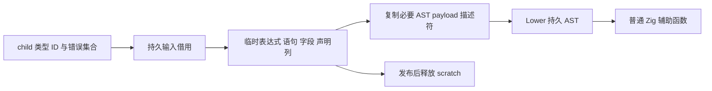

# 排序执行协议构造自举

## Intent：最终目标

将 comparator sort 的 Ordering.less 与 sort 辅助函数构造迁入 RX/ZX，保留
比较错误锁存、独占复用或复制、仅释放副本及最终传播错误的完整协议。

## Data：可用证据

起点 7cc0124c，工作区干净。普通 map/reduce/filter 已在前端降为 loop，
不迁移其旧 transform 分支。comparator sort 仍经 Transform.Sort 到
sorting/root.zig，调用 sorting/functions.zig 的两个原生构造函数；生产
ordered/normalized 与 ordered/renewed 是实际消费者。

## Edges：边界与限制

- 继续使用 std.mem.sortUnstable，不换排序算法，不取消比较错误后的短路。
- reuse 为真借用原缓冲；为假才 dupe，失败时仅 free 副本。
- Native 保留 child 类型句柄、错误集合与比较 worker 的 lowering；本阶段
  迁移辅助函数的完整 AST 构造，不宣称排序模块整体或编译器已完成自举。
- 只生成结构化 AST，静态编译为普通 Zig；不增加运行库或 opcode 解释层。
- 文本仅来自持久输入或 Source 静态常量；动态 AST 参数数组在 scratch 释放
  前由通用 importer 发布到持久 owner。保留所有权检查。
- 不新增用例；复用既有函数分析、运行回归、真实 ordered 消费者及自编译。
  比较完整产物与 memo，并测受影响路径和固定累计基线。

## Answer：交付格式与成功标准

功能贯通后集中验收两阶段自编译、完整产物、已有行为与成本；统一提交所有
变更并推送，确认工作区干净及无未推送提交。对未覆盖的比较错误运行路径
明确记录证据边界，不以普通 sort 成功替代完整错误协议验收。

## 执行与验收

### 实现与成本模型

RX 已串联 guard、compare、less、Ordering、storage、cleanup、execute、返回
类型及 sort 声明构造，ZX 各阶段只构造对应的结构化 AST。新增通用 catch_scope
表达式原语，并为既有 branch 原语补充可选 capture；未扩大 RX 表达式边界。

Native functions.build 仅调用 Source、发布表达式/语句/字段/声明列，再将已
存储函数的参数字段描述符物化为现有 Declaration 接口。函数名、参数类型、
范围、清理和错误传播均来自 Source；该接口转换仍是待消除的原生适配边界。
Source 的参数、调用和控制流结构规模固定，没有按用户数据构造新的分析循环。
新 AST 的嵌套非文本 payload 由通用 importer 持有；名称是 Source 静态常量，
错误文本来自持久输入，借用它们不保留 scratch 中的临时列描述符。

首次构建暴露 catch_scope capture 的可空列表示和 stored Function 参数范围
不能直接作为未存储 Declaration 的两个适配问题，均在完成前修正；没有放宽
通用 AST 表示校验，也没有用原始字节转换绕过列类型检查。

### 正确性与实际执行路径

16 个本次涉及的 RX/ZX 文件通过 fmt --check 与 lint，共 32 项检查。Native
文件通过仓库 formatter；没有新增用例。

两阶段自编译均为 21/21 步，SHA-256 均为
4db675220dfc4ae981f4e08ae56ce6530c845b7c91fd193e9955836fe7435590。
正式响应文件确认 generated 和 generated_analysis 均为 true；工具自身由
Source 再生成，未将初始 seed 的产物用于性能对照。

上阶段工具与本轮工具使用同一当前源码，main/collections/growth/ordered
分别生成 3228/65/357/24 个非空文件，各组仅 .zxc-inputs 不同；本轮两阶段
这四组完整产物逐字节一致。ordered 的 normalized、renewed 包含真实数值
comparator sort，因此这些对照实际经过本次替换的构造路径。

既有 test-function-analysis（包含其 runtime 目标）和
test-if-evaluation-order 通过 91/91 步、177/177 个测试。独立只读复核确认
guard 子段、catch 子段、函数主体、错误返回子段以及函数参数/声明范围正确；
dupe 及 free 均仍在惰性副本分支。

没有找到既有 comparator-sort 抛错或捕获环境副作用的专用夹具；本轮不新增
用例，也不宣称这两类情况取得专门运行覆盖。错误锁存与传播的证据为 Source
和原实现的协议核对、真实比较器生成产物一致；这与专用错误执行回归不同。

### 受影响路径及固定累计基线

所有构建终止后才计时。ordered 使用同一 manifest、同一工具链，每次独立
输出/缓存，交替八轮并排除首轮；工具分别是上一阶段与本轮正式 Source 工具。
CPU 中位数 0.032751→0.032917 s，墙钟 0.014384→0.014136 s，24 个文件
仅 .zxc-inputs 不同；没有可辨的性能退化。

冻结输入固定为 141 entries、2220 modules，三版交替八轮并排除首轮：

| 指标       | 固定累计基线 |      上阶段 |        本轮 |
| ---------- | -----------: | ----------: | ----------: |
| user + sys |       5.33 s |      5.31 s |      5.32 s |
| 墙钟       |       1.16 s |      1.13 s |      1.13 s |
| 最大 RSS   |  494665728 B | 480247808 B | 492437504 B |

本轮 CPU 相对上阶段 +0.01 s、相对固定基线 −0.01 s；墙钟不变，累计没有
增长越过容差。上阶段 RSS 样本为 473841664～496222208 B，本轮为
472989696～495779840 B，明显重叠；不把中位数差解释为稳定膨胀或收益，
也不把生成器 RSS 当作完整冷构建峰值。冻结 2268 文件仍仅 .zxc-inputs 不同。

memo 逐键、逐内容一致，四组计数及冻结输入如下：

| 输入        | 四类记录数              |
| ----------- | ----------------------- |
| main        | 11089 / 3129 / 2607 / 0 |
| collections | 67 / 45 / 27 / 27       |
| growth      | 1127 / 311 / 266 / 0    |
| ordered     | 27 / 14 / 14 / 14       |
| 冻结输入    | 8248 / 2419 / 1945 / 0  |

证据保存在忽略目录
.zig-cache/cold-build-analysis/ownership-research/sorting-functions：
bootstrap.log、production.log、regressions.log、fixedpoint.json、
production-fixedpoint.json、ordered-comparison.json、
final-runtime-comparison.json、memo-results.json、validation-scope.json。
每轮输出、缓存、日志和复用的测量脚本同目录保存，固定累计工具未重置。

### 自我复核与剩余边界

本阶段交付的是排序辅助函数的执行协议构造自举，真实消费者和成本证据均已
贯通；没有迁移失效的 map/reduce/filter 旧分支来制造进度。sorting/root 的
worker 组织、比较 callback lowering 及整体作用域驱动仍含原生职责，不能以
二进制一致宣称排序模块或编译器整体已完成自举。冷构建剩余峰值也没有因本
阶段被证明改善；上轮被否定的 growth 分区原型没有进入正式实现。
