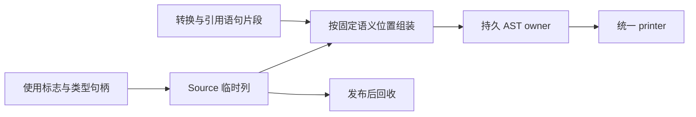

# 排序比较函数构造自举

## Intent：最终目标

将排序比较 worker 的参数命名、原始元素标识符、context 按需解包、局部绑定或
丢弃、返回类型和 compare 函数声明构造迁入 RX/ZX。保留 callback lowering
和元素转换服务，后续继续迁移原生作用域状态与排序入口组织。

## Data：可用证据

起点 0900ec50，工作区干净。排序执行协议已 Source 化，sorting/worker.zig
仍直接拼装比较函数。现有 AST 发布、函数声明和错误联合类型原语可复用。
ordered 的 normalized、renewed 是实际比较器消费者。

## Edges：边界与限制

- callback 先 lower，再仅对使用的元素执行现有 read；context 的实际使用
  标志在元素服务完成后读取，不能提前忽略转换新增的依赖。
- Runtime 函数体仍按 context 解包、引用存储、左元素转换与绑定、右元素
  转换与绑定、返回 callback 结果的顺序执行。
- 原始元素 identifier 是纯 AST 数据，可先于 callback 构造；不提前执行
  元素读取或用户表达式。完整生成文件对照必须验证该调整不影响最终代码。
- worker.names、used、cache_reads 与状态集合的原生作用域管理仍需迁移；
  本阶段不以构造迁移宣称整个 worker 或排序模块完成自举。
- 不增加运行库、动态派发或数据副本；保留 Source 静态文本借用和 AST payload
  持久发布，scratch 释放后不得留下临时描述符。
- 不新增用例；复用既有回归、真实消费者、自编译、memo 与固定累计基线。

## Answer：交付格式与成功标准

集中完成两阶段自编译、完整产物、已有行为和性能检查后，统一提交推送所有
变更，并确认无未提交、未推送内容。未取得的错误及环境副作用运行覆盖明确
记录，不以普通比较器成功替代。

## 执行与验收

### 实现与所有权

prepare 由 ZX 提供三个参数名称和两个原始 identifier；原始节点前移不执行
用户表达式，也不消耗 fresh serial。Native 继续建立独立 worker 作用域、
lower callback，并根据实际使用事实调用已有元素转换服务。

RX 明确串联 context、bindings、method 三项构造职责：按转换完成后的标志
解包 allocator/io/process/environment，生成左/右绑定或 discard，最后构造
返回类型与 compare 声明。Native 按既有服务片段的位置物理发布，body_count
由 Source 根据相同片段行数计算，不重复实现绑定或 context 选择规则。

materializeFunction 现在是 AST 存储的通用方法，两个排序构造消费者共用，
保持所有函数元数据及原有参数描述符分配成本；没有新增函数执行层。Source
临时列与嵌套 AST payload 在 scratch 释放前发布到 Lower allocator。

独立只读复核确认实际生成的 prepare 模块
zxc_module_e0a478a1dbf92853f420c47d2172c4d87743840eae6f641e894d88e912cda275.zig
直接调用 bytes.fromText，包装返回原切片；公开适配器只提取 items，不把字符
复制进 scratch。故 Prepared 返回的名字引用静态字节，临时外层列描述符则
没有逃出发布过程。错误集合及非文本嵌套 payload 沿用持久 importer 所有权。

### 正确性与范围

八个 RX/ZX 文件通过 fmt --check 与 lint，共 16 项检查；Native 通过仓库
formatter。未新增用例，未扩大 RX 属性表达式边界。

引导与正式两阶段各 21/21 步，二进制 SHA-256 均为
d729fedf595fc111eb3ab3e263886bc60b867fc17cb355b28598095c5805b682。
实际正式响应文件的 generated、generated_analysis 均为 true，工具自身已
由 Source 再生成，不使用初始 seed 的执行成本作比较。

上阶段与本轮工具对同一当前源码生成 main/collections/growth/ordered 四组
3238/65/357/24 个非空文件，均只 .zxc-inputs 不同；本轮两阶段的完整产物
逐字节一致。真实 ordered 数值比较器经过本次替换的 worker 构造路径。

既有 test-function-analysis（包括 runtime 目标）、test-if-evaluation-order
通过 91/91 步、177/177 测试。独立复核同时确认 context 标志在 read 后取值，
prefix、reference_storage、helper0、binding0、helper1、binding1、ending
顺序，以及连续三个参数的字段范围和声明 body_count。

仍没有 comparator-sort 抛错或捕获环境副作用的专门既有运行夹具；本轮没有
新增这类覆盖，也不把生成文件一致扩张为这些场景的专门运行证明。相应协议
继续依靠已有执行协议、自身源码与原实现的核对，并明确保留该覆盖边界。

### 受影响路径及固定累计成本

所有构建结束后计时，同 manifest、工具链与模式，每次独立输出/缓存。ordered
交替八轮并排除首轮，CPU 中位数 0.033329→0.033515 s，墙钟
0.014250→0.014300 s；24 文件只 .zxc-inputs 不同，没有可辨的性能退化。

冻结输入仍为 141 entries、2220 modules，三版交替八轮并排除首轮：

| 指标       | 固定累计基线 |  上阶段工具 |    本轮工具 |
| ---------- | -----------: | ----------: | ----------: |
| user + sys |       5.34 s |      5.33 s |      5.33 s |
| 墙钟       |       1.17 s |      1.13 s |      1.13 s |
| 最大 RSS   |  496205824 B | 487309312 B | 489390080 B |

同轮对照中，本轮相对上阶段时间未变，相对固定工具 CPU −0.01 s、墙钟
−0.04 s，累计未越界。上一阶段记录中的 5.32 s 与本轮重测其同一二进制的
5.33 s 属于跨轮波动，不将不同时刻的中位数拼接为算法增长或提速。

上阶段 RSS 样本 474480640～492535808 B，本轮 481705984～495419392 B，
存在明显重叠；不将约 2 MB 的中位数差宣称为稳定内存变化，更不将其作为完整
冷构建峰值的证据。冻结 2268 文件只 .zxc-inputs 不同。

memo 所有键及内容一致，记录数如下：

| 输入        | 四类记录数              |
| ----------- | ----------------------- |
| main        | 11111 / 3135 / 2613 / 0 |
| collections | 67 / 45 / 27 / 27       |
| growth      | 1127 / 311 / 266 / 0    |
| ordered     | 27 / 14 / 14 / 14       |
| 冻结输入    | 8248 / 2419 / 1945 / 0  |

证据位于忽略目录
.zig-cache/cold-build-analysis/ownership-research/sorting-worker：
bootstrap.log、production.log、regressions.log、fixedpoint.json、
production-fixedpoint.json、ordered-comparison.json、
final-runtime-comparison.json、memo-results.json、validation-scope.json。
复用的验证脚本和各轮缓存、完整输出与日志同目录保存，固定累计工具未更换。

### 自我复核与剩余职责

本阶段迁移了真实比较 worker 的构造规则，保留原有作用域与元素读取服务，
不是为使用新语法改造失效路径。原生作用域状态初始化、符号注册、callback
lowering 及排序入口仍未完成迁移，不能据此宣称整个 worker 或完整自举完成。
完整冷构建的剩余峰值问题仍需独立归因，本阶段没有提供新的冷构建内存收益。
