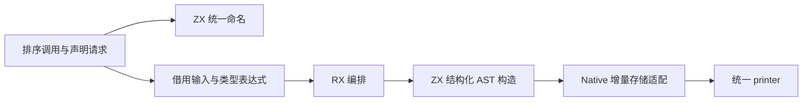

# 排序比较器生成自举

## Intent：最终目标

将正式 genz 排序比较器及其命名规则迁入 RX/ZX，保留原有字符串、标量和 NaN
排序语义，维持零运行库约束与固定累计性能标准。

## Data：可用证据

- 迁移前正式入口位于 `packages/genz/src/zx/comparison.zig`，由 lower 与 modules
  生成排序声明；collections 调用相同的比较器命名函数。
- 函数参数为 context:void、left:T、right:T，返回 bool；先丢弃 context。
  浮点先判断左 NaN 返回 false，再判断右 NaN 返回 true；其余执行 less，字符串
  使用 `std.mem.lessThan(u8, left, right)`。
- 类型表达式生成已经有独立职责，本阶段复用其结果，不重复实现类型布局。
- 上阶段正式生成器保存在 `ownership-research/equality/production/bin/zxc-bootstrap`；
  固定累计基线仍为 `inbound-conversion/production-bootstrap/bin/zxc-bootstrap`。

## Edges：边界与限制

- RX 显式表达浮点 guard 阶段是否执行；ZX 承担 guard 集合算法和 AST 原子构造。
- Native 层暂留类型表达式请求、输入借用及 AST 存储适配，不允许继续承载比较规则。
  原生 seed 只用于引导阶段，不能作为正式自举完成证据。
- 类型表达式在适配器中先请求一次。类型缓存的首用节点可能提前建立；需验证输出、
  导入与类型命名行为，不要求内部表达式编号完全不变。
- NaN 分支顺序、双 NaN 结果、字符串字节顺序、命名稳定性和静态链接保持不变。
- 不新增测试用例，复用相关既有回归与同输入前后产物、缓存及增量核对。

## Answer：交付格式与成功标准

完成格式与 lint、seed/正式构建、受影响既有回归及全部产物对照；计量实际正式路径，
报告本阶段和固定累计基线的 CPU、耗时、RSS。验收后收口全部变更、英文规范提交
并推送，确认工作区干净且无未推送提交。

### 执行与自我复核

实现与验收完成：

- `build.rx` 连接 initialize → guard 子模块 → compare → finish。`guard.rx`
  使用 If 显式选择是否生成 NaN 分支；两个 guard 的顺序保留在 ZX 集合算法中。
- 比较器名称由同一 ZX 函数提供给声明生成和排序调用；参数名、类型映射和函数体
  均通过结构化 AST 表达，不生成 Zig 语句字符串，不增加应用专用运行库。
- 10 个新增 RX/ZX 文件通过 20 项格式与 lint 检查；Zig 格式和 diff 空白检查通过。
- seed 引导构建 39/39 步、正式构建 21/21 步通过。
- 复用 function-analysis、immutable-list、owned-collections、strings 四组既有
  回归，417/417 步、13349/13349 项通过，包含源码和已编译库路径。分配扫查的
  原有 stderr 诊断仍出现；构建进程退出 0，总结没有失败项，旧记录也有相同提示。
- 当前 main、collections、growth 三组生成文件分别为 2810、64、356 个；
  迁移前、引导版和正式版仅 `.zxc-inputs` 不同，全部代码产物一致。
- 当前三组缓存的四类 memo 共 17407 项，前后键和值逐项一致；冻结输入 12612 项
  同样一致。没有仅检查缓存文件存在或记录数量。
- 忽略目录中复制既有 immutable/sort，替换成九种支持排序的标量类型，另保留
  既有字符串字面量排序样例；生产测试目录没有新增用例。诊断产物中的 f32/f64
  均保留先左 NaN→false、再右 NaN→true，与迁移前全部代码逐文件一致。
- 将该诊断中的 f64 从 sort 改为 reverse，再恢复；三阶段各 33 个代码文件，
  前后相同且增量等于干净生成。四类 memo 分别 19、19、10、10 项，键和值一致。

### 性能与累计变化

待构建、回归和语义诊断结束后，使用相同冻结输入、工具链和配置隔离计量；
8 轮交替运行，排除首轮，取中位数：

| 指标     | 固定累计基线 | 本阶段前    | 本阶段后    |
| -------- | ------------ | ----------- | ----------- |
| CPU      | 5.36 s       | 5.25 s      | 5.23 s      |
| 耗时     | 1.17 s       | 1.12 s      | 1.12 s      |
| 峰值 RSS | 487604224 B  | 487260160 B | 474136576 B |

本阶段 CPU −0.02 s、耗时不变；相对固定基线 CPU −0.13 s、耗时 −0.05 s。
观察到的微小 CPU 差异不能直接归因于迁移带来优化。RSS 本轮较低，未做分配归因，
因此不把约 13 MB 差异宣称为确定的内存收益；没有观察到本阶段的峰值内存增长。
固定基线不重置，后续继续跟踪累计变化和趋势。

冻结输入 2268 个文件仅 `.zxc-inputs` 不同，代码全部一致。此结果覆盖生成器路径，
不是完整冷构建或 LLVM 后端峰值的测量，也不能据此宣称解决后端数 GB 内存问题。

### 自我批判与剩余职责

- 原先将 If/Return 放入 Task 的表达被当前终止路径检查拒绝，最终按独立 RX
  子模块汇合；没有将跨阶段条件移回 ZX 隐藏，也没有借本任务放宽校验。
- 等值表达式、排序比较器及共同命名规则已走正式 RX/ZX 路径。原生适配器仍负责
  请求类型表达式、字段和声明存储；它们是后续需要移除的过渡边界。
- 类型首次使用的内部 AST 编号可以变化，代码产物与缓存逐项一致支持本次迁移
  等价；静态审查和有限行为回归不能替代最终传递依赖审计与 stage 1→2→3 验收。
- AST 深复制仍存在于适配导入，生命周期安全；本阶段没有为减少源文件中的原生
  行数而改动语言所有权语义，也没有把新增桥声明为完整状态自举。

脚本、报告及日志保存在忽略目录
`.zig-cache/cold-build-analysis/ownership-research/ordering/`：
`source-validation.json`、`bootstrap.log`、`production.log`、`regressions.log`、
`known-shared-fixedpoint-result.json`、`current-manifest-memo-comparison.json`、
`memo-comparison.json`、`sort-edits-comparison.json`、`sort-memo-comparison.json`
及 `final-runtime-comparison.json`。
