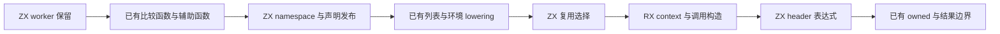
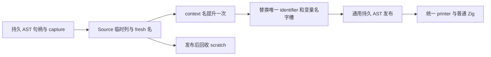

# 排序表达式构造自举

## Intent：最终目标

将排序入口剩余的 worker 保留与发布、复用策略、context 类型和值、排序调用
及 header 表达式构造迁入 RX/ZX，保持排序执行协议与求值顺序。

## Data：可用证据

起点 ea9d1374，工作区干净。辅助函数与比较函数构造已 Source 化，
sorting/root.zig 仍直接构造上述节点；通用 AST、fresh、字段与声明发布可复用。

## Edges：边界与限制

- 保留 source、clip、items、reuse、environment 的现有服务顺序；只有纯
  header AST 服务可在调用构造前准备句柄，不提前执行运行时访问。
- in_place 优先复用，其次由所选列表的 writable 决定，否则复制；header
  标记仍是 reuse && source.headered，保持惰性与所有权。
- Source 调用构造必须传递现有 capture，错误行为不能退化成无条件 try。
- 动态 worker 名由持久声明拥有；context 名仅提升一次，变量声明与对应
  identifier 共用持久字节，其余静态文本或输入文本按现有协议借用。
- Native 暂时保留类型、递归 lowering、worker 作用域与列表表示服务的调用
  和 AST 物理发布，不以本阶段宣称排序模块或整体自举已经完成。
- 不新增用例；复用真实 ordered 消费者、已有回归、自编译、完整产物与 memo，
  按受影响路径和固定累计基线验收，完成后统一提交推送所有改动。

## Answer：交付格式与成功标准

阶段必须同时通过 Source 再生成、既有行为、完整产物与性能验收；IDEA 记录
保留平台边界、未覆盖项和自我复核，不把局部通过当作整体完成。

## 执行与验收

### 构造、捕获与寿命

reserve、publish、reuse 三项规则已迁入 ZX；expression/build.rx 明确串联
错误类型、failure 初值、context 字段、类型和值、调用、header 与最终结果。
Native sorting/root 不再直接构造这些 AST，也没有新增运行库或动态解释层。

复用顺序保持 in_place 优先，其次 selected 时读取 writable，其余为 false。
headered 服务只构造现有权限查询 AST，不 lowering 用户表达式，不读写 fresh
serial；它的前移不改变 Runtime 的 reuse && source.headered 短路。
调用构造复用原有 fallible/catch 原语，并传递完整 capture；sorting 原本已
标记 uses_allocator，未因绕过 Native 调用包装丢失该标志。

context 字段顺序仍为 allocator/environment/failure/io/process。值字段放在
前半段，typeof 字段在后半段，StructType 与 Object 分别引用正确范围；
物理列顺序变化未改变统一 printer 输出。

worker 名由拥有型声明导入取得持久字节，publish 借用同一个名称。context
名由 Source fresh 产生一次，Native 根据明确 name_slot 替换 identifier
及唯一 variable_name，两者共用一次持久提升；不用内容猜测或重复复制名称。
错误文本、静态字段名和 capture 文本来自持久输入或常量，其他嵌套 payload
在 scratch 释放前通过通用 importer 发布。

独立只读复核未发现语义或寿命偏差，但指出 serial 的 Source u64 到宿主
usize 必须显式窄化。本轮按既有适配方式补齐 @intCast，并用最终源码重新
完成两阶段验收；没有据原生 64 位结果声称已执行 32 位平台回归。

### 正确性

14 个 RX/ZX 文件通过 fmt --check 与 lint，共 28 项检查。Native 通过仓库
formatter；未新增用例，也未放宽 AST 列表示、所有权或 RX 表达式规则。

最终源码的两阶段自编译均为 21/21 步，二进制 SHA-256 均为
5aa353af18fbd682aa62312ea8274f3ca79bc599c029463f7793bf3ebd6ca483。
实际正式响应文件的 generated 与 generated_analysis 均为 true，工具本体
已由 Source 再生成，不用初始 seed 的成本代替正式工具。

上阶段与本轮工具使用同一当前源码，main/collections/growth/ordered 分别
产生 3258/65/357/24 个非空文件，均仅 .zxc-inputs 不同。本轮两阶段这四组
完整产物逐字节一致。ordered 中的真实比较器经过本阶段替换的入口构造。

既有 test-function-analysis（包含 runtime 目标）、test-if-evaluation-order
通过 91/91 步、177/177 测试。数值比较器和已有流程取得运行证据；仍没有
专门的 comparator-sort 抛错、环境副作用或排序嵌套 capture 夹具。本轮未
新增用例，不把产物一致扩张为这些情况的专门运行覆盖；capture 的证据是
原始服务、复用原语与本轮 Source 传参的静态协议核对。

### 受影响路径与固定累计成本

所有构建结束后计时，同一 manifest、工具链、模式，每次独立输出与缓存。
ordered 交替八轮并排除首轮，CPU 中位数 0.033936→0.033350 s，墙钟
0.014473→0.014347 s，24 文件仅 .zxc-inputs 不同，没有可辨的性能退化。

冻结输入仍为 141 entries、2220 modules，三版交替八轮并排除首轮：

| 指标       | 固定累计基线 |  上阶段工具 |    本轮工具 |
| ---------- | -----------: | ----------: | ----------: |
| user + sys |       5.31 s |      5.33 s |      5.32 s |
| 墙钟       |       1.16 s |      1.14 s |      1.13 s |
| 最大 RSS   |  491470848 B | 492011520 B | 489832448 B |

本轮相对上阶段 CPU/墙钟均 −0.01 s；相对同一个固定累计工具 CPU +0.01 s、
墙钟 −0.03 s，仍在累计容差内，没有持续增长证据。固定工具及输入未重置；
不同阶段在不同时刻测出的绝对中位数不能直接拼接为算法趋势。

上阶段 RSS 样本范围 474038272～496680960 B，本轮为
477528064～494665728 B，明显重叠；不以约 2 MB 中位数差声称稳定内存
收益。冻结 2268 文件仅 .zxc-inputs 不同，memo 所有键与内容一致：

| 输入        | 四类记录数              |
| ----------- | ----------------------- |
| main        | 11179 / 3147 / 2625 / 0 |
| collections | 67 / 45 / 27 / 27       |
| growth      | 1127 / 311 / 266 / 0    |
| ordered     | 27 / 14 / 14 / 14       |
| 冻结输入    | 8248 / 2419 / 1945 / 0  |

证据位于忽略目录
.zig-cache/cold-build-analysis/ownership-research/sorting-expression：
bootstrap.log、production.log、regressions.log、fixedpoint.json、
production-fixedpoint.json、ordered-comparison.json、
final-runtime-comparison.json、memo-results.json、validation-scope.json。
各轮输出、缓存、日志及复用的验证脚本同目录保存。

### 自我复核与未完成项

本阶段完成排序入口剩余的直接 AST 构造迁移；与前两阶段组合后，比较函数、
排序辅助函数、context 和排序调用的生成规则均在 Source。入口的服务顺序
以及 worker 作用域状态、类型/列表表示与递归 lowering 仍有 Native 依赖，
专用适配器也是过渡边界，因此不宣称整个排序模块或完整自举已经完成。
本阶段未测完整冷构建，也没有新的冷构建峰值改善结论。
