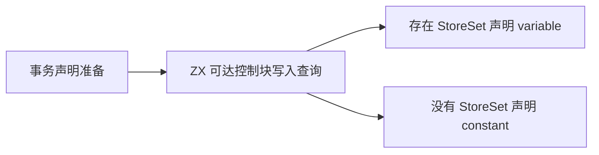
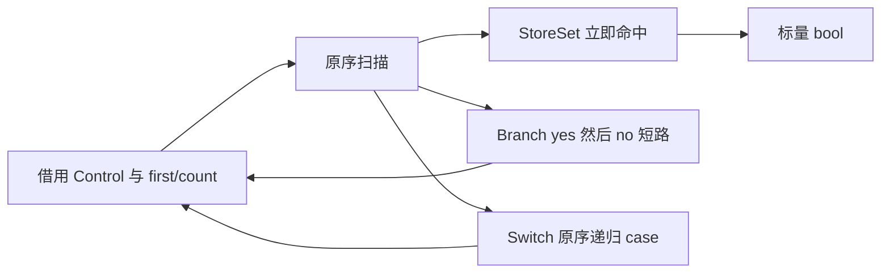

# 控制流写入查询自举

## Intent：最终目标

将 Store 事务 pending 声明所用的 writes 查询迁入 ZX。完整迁移顺序扫描、分支
短路和 Switch 子块递归，不复制控制表，不增加遍历堆栈或临时分配。

## Data：可用证据

原 statements.writes 只在 lower 的事务分支调用，用来选择 pending 的 variable
或 constant 声明。它扫描块中语句，StoreSet 立即返回 true；Branch 先 yes 后 no
短路，Switch 按 case 顺序递归，其余语句忽略，不因 Result 提前结束。

已有 Source 的 identity/content/block 和 state/ownership/needed 支持静态递归。
复用相同语言能力，输入只借用 Control 和当前 first/count，无需新原生算法接口。

## Edges：边界与限制

- 保留旧递归算法、扫描顺序和短路，不用扫描整个 control 表代替可达块。
- 递归只传共享表引用和标量范围；空 FBA 验证无堆申请，适配器不持有结果来源。
- seed 仅供初始引导，正式 generated_analysis 路径必须调用 Source 查询。
- 此阶段只迁移一个内聚集合谓词，允许直接 ZX 入口；事务与 Statements 的整体
  lowering、AST 模型、原生借用适配器仍是后续自举内容。
- 不新增用例，复用既有 Store、嵌套控制流、模块生成和自编译验证。

## Answer：交付格式与成功标准

验收 Source fmt/lint、引导与正式构建、同输入代码和 memo、已有运行回归，并对
受影响的生成器路径与固定累计基线比较。保留阶段身份与证据路径；完成后统一
提交推送所有变更，确认工作区干净。完整自举目标继续保持 active。

## 执行记录

Source fmt/lint 和 Native fmt 检查通过；引导与正式构建各 21/21 步，工具均为
34561999b59173ac9339d460f13ffd3372cb128c2594483f9595c82b35e94d4d。
本体由上阶段 Source 正式工具生成引导版，再由引导版生成正式版；运行时启用
generated_analysis，不将 seed 工具与 Source 自编译工具的成本混为一谈。

当前完整 main/collections/growth 输入在上阶段工具与本阶段引导版下分别生成
2931/65/357 文件，只有 .zxc-inputs 元数据不同；引导与正式版连元数据也相同。
四类 memo 分别为 10418/2941/2420/0、67/45/27/27、1126/311/266/0，逐键逐内容
一致。本轮不改缓存键、失效或分析事实，未重复此前合法编辑/恢复实验。

实际生成函数借用 *const Control；递归只重建指针与 first/count，回调环境为
同步栈局部，返回 bool。传递闭包只有本函数和 integer.widen，未发现堆申请、
列表扩容、整份 Control 复制或可保存闭包。正式适配器使用零容量 FBA，不能靠
隐式临时堆分配完成调用。递归栈深度仍与原算法一样取决于嵌套控制块深度。

冻结 141 入口三版交替 8 轮，排除首轮，其他构建未并行运行：

| 指标     |      上阶段 |      本阶段 | 同一固定累计基线工具 |
| -------- | ----------: | ----------: | -------------------: |
| CPU      |      5.29 s |      5.27 s |               5.33 s |
| 墙钟     |      1.12 s |      1.12 s |               1.17 s |
| 最大 RSS | 480083968 B | 478150656 B |          491945984 B |

CPU 单阶段 −0.02 s、累计 −0.06 s；墙钟单阶段不变、累计 −0.05 s。2268 个输出
仅 .zxc-inputs 不同，memo 8248/2419/1945/0 共 12612 条完全一致。RSS 几 MB
波动不作为收益承诺。这是工具整体生成路径对照，不是 Store 查询微基准，更不是
最新完整冷构建内存测量；查询本身的成本依据是保留的算法、借用与无分配生成。

证据位于忽略目录 .zig-cache/cold-build-analysis/ownership-research/control-writes：
bootstrap.log、production.log、fixedpoint.json、production-fixedpoint.json、
memo-results.json、final-runtime-comparison.json 及对应完整产物。

已有 test-stores、test-rx-store-runtime、test-switch-evaluation-order、
test-module-generation 集中通过 98/98 构建步骤、334/334 受管用例；日志另有
脚本与子进程结果，不混入受管用例总数。没有新增用例。regressions.log 保留
完整运行结果，Store 事务及内存状态路径实际执行了零容量 FBA 的 Source 查询。

自我复核：代码审查支持 StoreSet、Branch、Switch 的扫描顺序与原递归一致，
已有运行检查支持事务行为；未声称现有用例穷尽每一种控制图、嵌套深度或程序。
算法迁移与生成指针借用已完成，Control 原生状态、通用列适配、Statements/
事务的完整 lowering 仍是过渡依赖，不能据此宣称整体自举完成。
