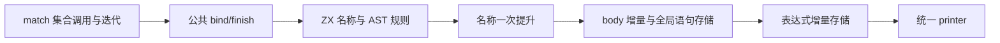
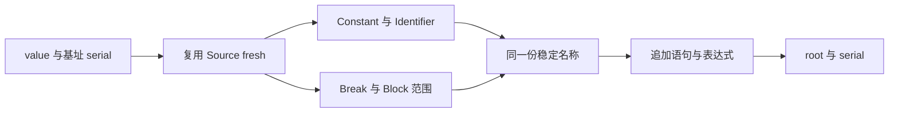

# 操作数绑定与结果块构造自举

## Intent：最终目标

将公共 aggregate.bind/finish 的名称与 AST 规则迁入 ZX，让 match、集合、调用、
迭代等调用方使用同一 Source 构造契约，保持 body 追加、全局语句范围、fresh 序号
和名称分配成本，维持累计性能标准。

## Data：可用证据

- 原实现位于 `packages/genz/src/zx/aggregate.zig`，被大量正式生成路径调用。
- bind：fresh operand 名，向传入 body 追加 constant，再构造同名 identifier。
- finish：fresh block 名，向 body 追加 break，再将完整 body 存入全局语句表，
  最后构造 block。body 的追加本身也是原契约，不能只生成等价表达式而漏掉它。
- 复用已有 `ast/fresh`、operand_prefix 和 block_prefix，不新建同值常量。
- 上阶段正式生成器保存在 `ownership-research/match/production/bin/zxc-bootstrap`；
  固定累计基线仍为 `inbound-conversion/production-bootstrap/bin/zxc-bootstrap`。

## Edges：边界与限制

- 两个 ZX 入口各是一项原子构造，不增加无意义 RX 转发层。
- Native 暂留 body 容器、名称提升、语句和节点存储适配；它不再决定名称前缀、
  节点种类、字段值及 block 范围。缓存与完整递归调度仍需迁移。
- Source fresh 名位于 scratch，必须提升到 Lower 生命周期；每个名字只提升一次，
  identifier/constant 或 block/break 共享同一份字节。
- 先导入 body 增量，再提交全体 body，最后导入表达式；保持原语句顺序。
- 包装 block 前后不得插入其他全局语句，基址与 Source 提供的范围必须一致。
- 先贯通实现，再计量；出现退化时保留迁移并优化，不撤回自举实现。

## Answer：交付格式与成功标准

完成格式、lint、seed/正式构建、相关既有回归、全代码与 memo 对照、增量等于
干净生成验证；记录本阶段和固定基线 CPU、耗时、RSS。验收后收口全部变更，
英文规范提交并推送，确认工作区干净且无未推送提交。

### 执行与自我复核

实现与验收完成：

- 正式 aggregate.bind/finish 分派到 Source，前缀、serial 递增和 AST 字段均由
  ZX 提供。Native 适配器按原顺序追加 body、提交全体语句、导入表达式。
- 只有 Source 新建的名称字节需提升，提升一次后复用于两处名称列。已核对实际
  生成体：Source 仅复制外层 slice 描述符，名字字节仍由 scratch 持有；随后由
  Native 一次提升接管，借文本导入和 stored.copy 不再复制名称。
- finish 的 body 嵌套语句已经是全局 range；提交 body 时不会再插入其子段，
  Source 计算的 statement_base、body_count+1 与实际存储对齐。
- 泛型语句导入器补上 assignment 列的 compile-time 存在检查，与其他分支一致。
  缺少此列的精简视图不会再实例化不存在的字段；真实 assignment 仍必须有完整列。
- 3 个新 ZX 文件通过 6 项格式与 lint；Zig 格式、diff 空白检查通过。
- seed 引导构建 39/39 步、正式构建 21/21 步通过。
- 复用 function-analysis、value-return、iterate-buffer、immutable-list、
  object-reduce-effects、switch-evaluation-order 六组既有回归，280/280 步、
  框架摘要 771/771 项通过，另有两组各 18 项外部执行通过。原有分配扫查 stderr
  提示仍出现，最终进程退出 0、总结没有失败项，未为消除提示改动测试。
- 当前 main、collections、growth 三组生成文件为 2865、64、356 个；迁移前、
  引导版、正式版仅 `.zxc-inputs` 不同，所有代码一致。三组四类 memo 键和值
  逐项相同，冻结输入 12612 项 memo 同样一致。
- 复用九个既有样例的忽略目录副本，标签 −1 改为 −2 再恢复；三阶段各 30 个
  代码文件，前后相同且增量等于干净生成，四类 memo 各 9 项相同，没有新增用例。

### 性能与累计变化

构建与回归结束后，同一冻结输入、工具链和配置下隔离计量。8 轮交替运行，
排除首轮取中位数：

| 指标     | 固定累计基线 | 本阶段前    | 本阶段后    |
| -------- | ------------ | ----------- | ----------- |
| CPU      | 5.34 s       | 5.26 s      | 5.28 s      |
| 耗时     | 1.17 s       | 1.12 s      | 1.12 s      |
| 峰值 RSS | 494469120 B  | 490389504 B | 489439232 B |

首组 CPU +0.02 s，达到单次容差边界，因此追加 12 轮交替复测，排除首轮后：
前后 CPU 均 5.26 s、耗时均 1.12 s、RSS 489881600→489144320 B，未复现稳定增量。
两组都未观察到内存增长，不把约 1 MB 的差异解释为确定收益。

相对固定基线，首组 CPU −0.06 s、耗时 −0.05 s。近期微增量与固定基线优势缩小
继续保留在累计记录中，不重置基线，也不以每阶段容差累加预算。当前不足以把
0.02 s 判为稳定退化；后续仍需关注高频适配与临时数据成本。

冻结输入 2268 个文件仅 `.zxc-inputs` 不同；代码和 memo 一致。此测量覆盖生成器，
不是完整冷构建或 LLVM 峰值的新测量。

### 自我批判与剩余职责

- 成功调用的 serial 恰增一次，与 seed 相同；OOM 失败时 seed 可能已递增 serial，
  新实现尚未提交。所有现有调用均向上传播失败，未发现继续使用失败 Lower 的恢复
  路径；原 body/AST 也没有事务回滚契约，因此不把失败后的内部状态称为完全相同。
- 名称字节提升是跨临时内存边界的必要复制，复制次数保持一次；它不是应用值复制。
- body 容器、缓存、递归求值、语句/表达式存储仍在原生层，本阶段只完成公共构造
  规则，最终仍需传递依赖审计与 stage 1→2→3 验收。

脚本、日志和报告在忽略目录
`.zig-cache/cold-build-analysis/ownership-research/binding/`：
`source-validation.json`、`bootstrap.log`、`production.log`、`regressions.log`、
`bind-name-proof.zig.txt`、`finish-name-proof.zig.txt`、
`known-shared-fixedpoint-result.json`、`current-manifest-memo-comparison.json`、
`memo-comparison.json`、`selection-edits-comparison.json`、
`selection-memo-comparison.json`、`final-runtime-comparison.json` 与
`focused-comparison.json`。
