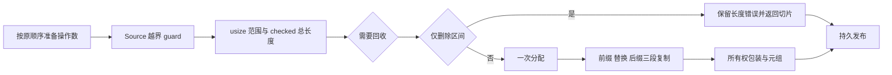

# 数组剪接生成协议自举

## Intent：最终目标

将普通数组 splice 的完整生成协议迁入 RX/ZX，保持求值、错误、所有权和
分配成本。只读删除区间时保留原有零分配路径；正常剪接只分配结果缓冲一次。

## Data：可用证据

起点 fb710a01，工作区干净。collections.zig 的 splice 分支仍由 Native 构造
边界检查、范围转换、回收、三段复制和结果。现有 AST、guard、growth 名称及
list storage 原语可直接表达，不需要专用运行库或新语言语法。

## Edges：边界与限制

- source、ownership clip、绑定、参数和元素类型准备保留现有顺序。
- start/count 越界先报告，再转为 usize；总长度 checked add 的错误不可消失。
- retract 位于范围检查之后、结果分配之前，仅在原列表非空时执行。
- removed-only 仍求值总长度（可能溢出），不分配结果缓冲、不执行三段复制。
- 复制顺序为原前缀、replacement、原后缀，空范围及别名保持原协议。
- Source 输入借用现有表达式 ID；临时 AST 在发布后释放。Native 操作数驱动、
  类型服务、构造/最终转换和 AST 发布仍是过渡职责，不宣称 collections 全部自举。
- 不为已证伪的怀疑改代码：嵌套 projection plan 实际生成体保留 items/storage，
  六列均 reserve(true)，不存在此前怀疑的逐轮前缀复制。

## Answer：交付格式与成功标准

以完整 splice 生成协议验收：Source 格式/lint、现有集合/增长/循环回归、
两阶段自编译与全部产物对照、受影响路径及固定累计生成器性能。生成形态变化
按预期说明；完整冷构建峰值与生成器 RSS 分开，不能互相替代。

## 实现与边界复核

build.rx 连接 bounds、ranges、prepare、只读 project 或 allocate/copies/result，
prepare.rx 显式控制 retract。ZX 分别负责 guard、范围和 checked add、回收
分支、分配、三段复制及所有权结果。Source 输出实际 AST，不返回让 Native
重新执行算法的操作计划；Native 原分支仅用于 seed 对照。
Native 仍按原顺序准备 source、clip、绑定、参数、元素类型、length 和 unit。
进入 Source 前只额外准备选中列表的 state 类型资源，该服务不消耗 fresh；新旧
完整产物对照进一步验证未改变公开生成结果。Source 自己维护 begin、removed、
buffer 三个绑定名的 serial，最终 aggregate.finish 和结果转换保持原位置。
越界 AST 保留 start>length 的左侧短路，length-start 不在 guard 外求值。

removed-only 显式 discard(total)，保持 Overflow 行为；回收仍在运行时的
total 求值之前。新结果缓冲标记 Owned，删除切片按 header&&begin==0 选择
Shared/Plain；复用既有 storage tag/choose 逻辑。动态绑定名、嵌套参数及字段
通过拥有型 importer 在 scratch 释放前发布，不保存输入栈帧或临时 AST 指针。
本阶段源码复核由一名只读 agent 辅助；源码审计与运行证据分开，不以审计代替
回归。18 份 Source 格式与 lint、3 份 Native 格式及 diff 空白检查均通过。

## 最终验收证据

两阶段自编译各 21/21 步通过，工具 SHA-256 相同：
cde07e36c42895db83e59d635e32728900b989ca44fa542ef21d5add9e18228d。
Native 最后仅补齐 else 分支的缩进与既有语义空行，后续回归使用格式化后的源码。
同一当前 manifest 的 main/collections/growth/ordered 各 3344/65/358/24 个文件；
上一工具与 bootstrap 仅 .zxc-inputs 不同，bootstrap 与 production 完全相同。
四组 memo 比较所有 key 对应的记录内容，均相等，数量分别为：
11549/3219/2697/0、67/45/27/27、1130/312/267/0、27/14/14/14。
既有 test-immutable-list、test-list-range、test-borrowed-call-views、
test-owned-collections 共 377/377 步、13853/13853 用例通过。
immutable splice 的 source/library 路径各 152 项，包括原值保留及分配检查。
没有新增测试用例。

## 受影响路径与累计性能

对照克隆当前 genz，仅把 collections.zig 中唯一的 generated_analysis 分支

切为 false，其余配置保持 generated_analysis=true。使用回归实际构建响应文件

生成两个对照驱动；正常 immutable splice 与 detached offset 每轮共输出 8 个
文件，8 轮逐文件 hash 均完全相等。全部构建结束后交错执行，剔除首轮取中位数：

| 指标                    | 原 Native splice | Source splice |
| ----------------------- | ---------------: | ------------: |
| CPU（含 time 包装进程） |       0.048102 s |    0.048832 s |
| 墙钟（含启动）          |       0.050201 s |    0.050899 s |

| 最大子进程 RSS | 11,796,480 B | 11,862,016 B |
局部 CPU 增量约 0.000730 s，RSS 增加 65,536 B；在当前绝对容差内，但如实
保留增量，不将毫秒级结果报告为加速。这里的编译动作是生成应用 Zig，未包含
Zig 后端编译应用的时间。
固定累计工具仍为 inbound-conversion，SHA 8f1e7cee…，未随提交重置。输入
仍为冻结 141-entry manifest，关闭 resident，每轮独立输出及缓存，交错 8 轮、
剔除首轮后中位数：

| 指标 | 固定累计基线 | 上一阶段 | 本阶段 |
| ---- | -----------: | -------: | -----: |
| CPU  |       5.33 s |   5.31 s | 5.32 s |
| 墙钟 |       1.16 s |   1.13 s | 1.13 s |

| RSS | 491,536,384 B | 476,348,416 B | 484,261,888 B |
单阶段 CPU +0.01 s，相对固定基线 -0.01 s；近期结果均在 5.3 s 附近，没有

累积增长到容差的证据。上一阶段 RSS 473,300,992～496,435,200 B，本阶段
478,445,568～492,699,648 B，区间重叠，不能宣称内存改善。2268 文件仅
.zxc-inputs 不同；冻结 memo 8248/2419/1945/0 的全部记录相等。
证据位于 .zig-cache/cold-build-analysis/ownership-research/collection-splice：
bootstrap.log、production.log、regressions.log、fixedpoint.json、
production-fixedpoint.json、memo-results.json、affected-comparison.json、
driver-scope.json、final-runtime-comparison.json 及 final-aligned-*。
完整工具 hash、输入、样本和作用域存于报告；缓存与临时日志不提交。

## 自我复核与剩余工作

本阶段验证完整 splice 构造职责及应用行为，普通 collections 的其他分支、
操作数驱动、类型和持久发布状态仍未全部迁移。两阶段一致不等于整个编译器
已经自举；正式入口的传递 Native 依赖和最终 stage 1/2/3 验收仍未完成。
Source AST 的拥有型发布是临时载荷与持久结果之间的所有权边界，本阶段没有
新增应用数据复制；也不据此宣称编译器内部已完全 zero copy。固定生成器测量
不包含后端冷构建进程树，当前约 GB 级峰值和完整 NLL 仍需沿已有科学归因继续
优化，不以本阶段的生成器 RSS 或历史内存收益替代当前完整冷构建数据。
