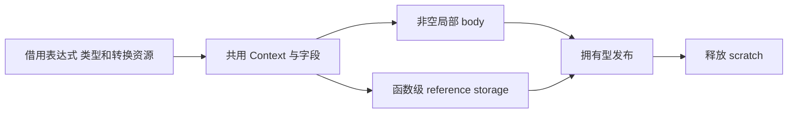

# 数组弹出生成协议自举

## Intent：最终目标

将普通数组 pop 的完整构造迁入 RX/ZX，保持空分支惰性、元素转换、所有权及
frontier 回收，不复制应用数据，不引入专用运行库。

## Data：可用证据

起点 397c9104，工作区干净。collections.zig 的 pop 仍在 Native。元素读取及
ABI/State 转换、tuple origin、storage 权限与 growth 调用已有 Source 实现，但
元素入口默认建立空 Context，尚缺组合现有 Context 的明确边界。

## Edges：边界与限制

- 先保留剩余列表和末元素 AST，再转换元素并构造非空元组；空分支不能读取 last。
- retract 仅在非空且计划允许或动态 exclusive 时执行，原列表和 storage 保留。
- 元素转换复用现有 Source 算法，保留 prefix fields、reference storage、borrow
  storage 与局部 body；原有独立元素入口仍必须保持相同行为。
- 类型和转换资源准备不消耗 fresh 或追加可执行语句；Native 保留这些资源服务
  和拥有型 AST 发布，Source 负责实际分支、构造和状态。
- 不将专用操作计划或逐阶段 Native AST 组装冒充完整迁移。

## Answer：交付格式与成功标准

按 IDEA 验收 Source 格式/lint、既有 pop/不可变/嵌套/所有权/分配回归、两阶段
自编译、全部产物及 memo、受影响路径和固定累计性能。整体自举及冷编译内存
仍未完成，不以本阶段替代最终传递依赖及 stage 1/2/3 验收。

## 实现与边界复核

build.rx 连接 last、权限、剩余列表、末元素 AST、read、非空元组、reclaim 和
结果。read.rx 只在需要元素转换时接入既有 elements/apply，reclaim.rx 控制回收。
Source 产生实际 AST，不向 Native 返回操作计划。Native 保留有序操作数、类型/
转换资源准备与现有 conversion.apply 持久发布。
elements/build 的 bind/stored/convert/finish 流程原样提取为 apply.rx。convert
在已有 Context 中保留前缀 fields、storage、borrow_storage 和 allocator 状态；
stored 生成的字段拼接在前缀后。独立元素入口的初始前缀仍为空。
普通转换使用原全局 field_base，再加累计 fields 长度；stored 的独立 record

使用已加前缀长度的 element.field_base。两个路径各加一次，不能混用。
borrow_storage 在非空 body 前合入，函数级 reference storage 独立发布；空
分支保持原列表与 null，last 索引、转换和非空 block 不会提前求值。
remaining 使用 writable，retract 使用 exclusive；计划 retract 仅要求非空，
动态回收还要求原值 exclusive。fresh、tuple origin、非空局部 block 的顺序与
原构造一致。字段名来自 TypeTable、Native 持久 origin 或静态 items/storage，
tuple 数字字段名只进入拥有型导入的表达式列。
一名只读 agent 对照保留的 Native else 分支核对上述边界，未发现具体问题。
跨 main/growth 分区的同名 Zig 类型不能直接赋值，已使用 columns.view 适配
资源描述符并显式构造 capture；没有按类型名称猜测布局或放宽兼容性校验。
描述符和 capture 同帧存活，不复制底层类型表/转换数组，不新增运行库。
18 份当前 Source 格式与 lint、4 份 Native 格式及 diff 空白检查通过。

## 阶段自编译与全部生成产物

两阶段各 21/21 步通过，工具 SHA-256 相同：
3d101c8223f32d6d4cea98a6c08a66bae93ab33ab6ecf3af1e5b1ba0d8c57fd5。
同一当前 manifest 的 main/collections/growth/ordered 各 3416/65/360/24 文件；
上一工具与 bootstrap 仅 .zxc-inputs 不同，bootstrap 与 production 完全相同。

## 应用行为与成本验收

既有 test-owned-collections、test-array-pop、test-loop-columns、
test-nested-buffer、test-aggregate-loop 共 474/474 步、11568/11568 用例通过。
没有新增测试用例；空 pop、旧值保留、嵌套聚合、循环状态与分配失败由既有
用例覆盖。Context 组合接口也由独立元素消费者和嵌套调用路径覆盖。
受影响对照克隆当前 genz，仅将 collections.zig 的 pop 分支切回原 Native，
保留已迁移的 splice/reorder/append 及当前配置。实际 aggregate-loop 和
loop-columns 两个驱动从回归响应文件构建，17 项输入每轮生成 68 文件，
8 轮逐文件 hash 全部相等。实际生成形态与应用行为同时核对，非只比较退出码。
所有构建结束后交错执行 8 轮、剔除首轮后的中位数：

| 指标                    | 原 Native pop | Source pop |
| ----------------------- | ------------: | ---------: |
| CPU（含 time 包装进程） |    0.559429 s | 0.561222 s |
| 墙钟（含启动）          |    0.578005 s | 0.580124 s |

| 最大子进程 RSS | 14,237,696 B | 14,270,464 B |
局部合计 CPU +0.001793 s、墙钟 +0.002119 s、RSS +32,768 B，如实保留

增量。测量是生成应用 Zig，未包含其后端编译；应用数据复制策略由完全相同的
生成文本和既有分配检查核对。
固定累计工具仍为 inbound-conversion（SHA 8f1e7cee…），不随提交重置。
141-entry manifest 与 input/0～3 源码快照保持不变，关闭 resident，每轮
独立输出与缓存。交错 8 轮、剔除首轮后的中位数：

| 指标 | 固定累计基线 | 上一阶段 | 本阶段 |
| ---- | -----------: | -------: | -----: |
| CPU  |       5.33 s |   5.32 s | 5.35 s |
| 墙钟 |       1.17 s |   1.13 s | 1.14 s |

| RSS | 491,012,096 B | 488,783,872 B | 483,966,976 B |
单阶段 CPU +0.03 s、墙钟 +0.01 s；相对固定基线 CPU +0.02 s，累计仍在

约定容差内。近期约 5.3 s 的非单调变化继续观察，不能将每次小增量当作新的
预算。上一阶段 RSS 范围 474,562,560～496,762,880 B，本阶段
476,053,504～495,239,168 B，区间重叠，不宣称内存下降。
冻结输入 2268 文件仅 .zxc-inputs 不同，memo 8248/2419/1945/0 的全部
key 对应记录相等。当前 main/collections/growth/ordered 四组 memo 全记录
也相等，数量分别为 12007/3285/2763/0、67/45/27/27、1146/314/269/0、
27/14/14/14。
证据目录 .zig-cache/cold-build-analysis/ownership-research/collection-pop 保留
bootstrap.log、production.log、regressions.log、fixedpoint.json、
production-fixedpoint.json、memo-results.json、driver-scope.json、
affected-comparison.json、final-runtime-comparison.json 与 final-aligned-*。
完整工具 hash、响应文件、配置与全部样本在报告中记录；临时缓存和日志不提交。

## 自我复核与剩余工作

本次通过共用元素/转换状态表达完整 pop 构造，没有因接口不适合组合而复制
转换算法或把流程继续留给 Native。分区描述符适配曾触发严格类型校验，最终
使用按字段 view 处理 optional capture，不依赖相同显示名称或绕过兼容性约束。
当前集合分支的核心 AST 构造已逐项迁移，但操作数驱动、类型与转换资源服务、
比较器注册、结果转换及 AST 发布桥仍在 Native，不能据此宣称 collections 或
整个编译器完全自举。后续应收口这些过渡职责及正式入口传递依赖，完成最终
stage 1/2/3 验收。冷编译后端峰值及完整 NLL 仍未完成，本轮生成器数据不能
代替完整冷构建进程树测量，也不将拥有型 AST 发布误称为编译器内部完全零拷贝。
