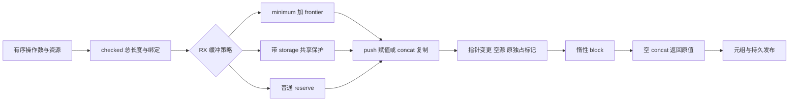

# 数组追加生成协议自举

## Intent：最终目标

将普通数组 push/concat 的计数、缓冲选择、写入、所有权与惰性结果构造迁入
RX/ZX，保持 frontier、容量下界和共享列表保护，不增加应用数据复制或运行库。

## Data：可用证据

起点 63daa1b8，工作区干净。collections.zig 仍有 Native push/concat 构造。
Source 已有增长调用和带 storage 列表 reserve 算法；容量 minimum 也已由 Source
投影实现，只构造字段访问，不推进 fresh 或执行表达式求值。

## Edges：边界与限制

- 操作数及元素转换维持现有顺序，checked 总长度绑定仍在空 concat 判断前。
- 优先使用有效 minimum+frontier，其次 selected&&(lazy||!frontier) 的带 storage
  reserve，其余使用普通 reserve；共享路径不能直接按唯一 frontier 扩展。
- buffer 写入和 block 保持惰性；空 concat 返回原 source_value，不调用 reserve。
- fresh、重分配指针比较及 source exclusive 共同决定新结果的独占性。
- Native 只准备有序操作数、已迁移的 minimum/type 资源和发布 AST；通过断言核对
  资源准备不推进 serial、语句或辅助声明，不用新的操作计划桥代替 Source 逻辑。
- 为共用现有 reserve 算法提取接收 Context 的 Source apply，不复制算法。

## Answer：交付格式与成功标准

按 IDEA 集中验收：Source 格式/lint、既有追加/所有权/容量/循环回归、两阶段
自编译、完整产物与 memo、受影响路径和固定累计性能。完整自举及冷编译内存
仍为整体目标，不以本阶段完成代替最终传递依赖与 stage 1/2/3 验收。

## 实现与源码复核

build.rx 连接 count、memory、write、qualify 和 publish。memory.rx 先判容量
下界，再判带 storage 的共享保护，最后普通 reserve；write.rx 选择 push 赋值或
concat 尾部复制；qualify.rx 只在 selected 列表计算并包装新 storage。
growth/reserve 的原 prepare→copy→extend/select 或 copied 流程提取为 apply.rx，
原 build.rx 与追加路径共用；state.zx 将已有 Growth Context 接入该算法，不重置
表达式、语句基址或 serial。merge 仅重建 growth body 的无类型常量绑定，维持
原名称和值顺序；分支子语句保留在共享 Context，不通过临时操作计划调用 Native。
ast/body/block 将局部 body 的 header 接入全局语句后追加 break，publish 保留
外层 count body，空 concat 的 conditional 仅在非空分支求值该 block。Source
自己推进 fresh、构造 checked add、指针比较、exclusive 与元组，Native 只调用
既有 Source minimum/type 服务，并断言 serial、语句及辅助声明数不变。
一名只读 agent 对照保留的 Native else 分支审查，未发现具体语义或生命周期
偏差；源码复核不代替实际生成体、应用分配和编译器成本证据。Native 发布复用
拥有型 AST importer，在释放 scratch 前取得动态名字和嵌套载荷；AST/capture
描述符在同一个同步调用栈帧中借用。
23 份当前 Source 最终格式检查及对应 lint、3 份 Native 格式与 diff 空白检查
通过。首次 Source 装载发现局部空 body 需要元素类型，已补显式 Body 注解。

## 阶段自编译与完整产物

两阶段各 21/21 步成功，工具 SHA-256 相同：
f67b673aded24d44236ed2d6288212d2f159132aea715b7ebdde78dc4cf69c94。
同一当前 manifest 的 main/collections/growth/ordered 各 3376/65/359/24 文件；
上一工具与 bootstrap 仅 .zxc-inputs 不同，bootstrap 与 production 完全相同。

## 行为、分配与性能验收

既有 test-owned-collections、test-aggregate-loop、test-loop-columns、
test-multiple-append、test-object-append 共 555/555 步、11876/11876 用例通过，
覆盖有序操作数、旧值观察、聚合/列状态、容量与分配失败；没有新增测试用例。
对照克隆当前 genz，仅将 collections.zig 的 push/concat 分支切回 Native，
保留 Source splice/reorder 和其他当前配置。实际 aggregate-loop、loop-columns
两个驱动从回归响应文件构建，每轮 17 项输入生成 68 文件，8 轮全部 hash 相等。
既有应用分配检查及实际生成文本同时证明未改变上述场景的数据复制策略。
所有构建结束后交错运行 8 轮、剔除首轮后的中位数：

| 指标                                                                 | 原 Native push/concat | Source push/concat |
| -------------------------------------------------------------------- | --------------------: | -----------------: |
| CPU（含 time 包装进程）                                              |            0.557633 s |         0.560602 s |
| 墙钟（含启动）                                                       |            0.576437 s |         0.579808 s |
| 最大子进程 RSS                                                       |          14,254,080 B |       14,221,312 B |
| 局部合计 CPU +0.002969 s、墙钟 +0.003371 s；如实记录生成器构造开销， |

不以小幅 RSS 下降声称内存改善。这些时间不含生成应用的 Zig 后端编译。
固定累计基线仍为 inbound-conversion 工具（SHA 8f1e7cee…），未随提交重置；
141-entry manifest 及 input/0～3 快照不变。关闭 resident，每轮独立输出与
缓存，交错 8 轮、剔除首轮后的中位数：

| 指标 | 固定累计基线 | 上一阶段 | 本阶段 |
| ---- | -----------: | -------: | -----: |
| CPU  |       5.34 s |   5.33 s | 5.33 s |
| 墙钟 |       1.17 s |   1.13 s | 1.13 s |

| RSS | 493,371,392 B | 484,671,488 B | 492,011,520 B |
单阶段时间中位数未增长，相对固定基线 CPU -0.01 s；近期仍在约 5.3 s，

继续沿固定基线监控而非重置容差。上一阶段 RSS 477,773,824～495,435,776 B，
本阶段 473,989,120～496,680,960 B，样本范围重叠，不宣称峰值改善。
冻结输入 2268 文件仅 .zxc-inputs 不同，memo 8248/2419/1945/0 的全部 key
对应记录相等。当前四组 main/collections/growth/ordered 的全部 memo 记录也
相等，数量分别为 11756/3247/2725/0、67/45/27/27、1135/313/268/0、
27/14/14/14。
证据目录 .zig-cache/cold-build-analysis/ownership-research/collection-append
保留 bootstrap.log、production.log、regressions.log、fixedpoint.json、
production-fixedpoint.json、memo-results.json、driver-scope.json、
affected-comparison.json、final-runtime-comparison.json 及 final-aligned-*。
完整工具 hash、配置和全部样本保存在报告中；缓存与临时日志不提交。

## 自我复核与剩余工作

本阶段迁移的是 Source 自己执行的追加构造算法及状态，RX 保留真实分支编排；
资源准备依然有 Native 适配边界，不能将其包装成整个 collections/Lower 完成。

本次 merge 依赖 growth body 仅有无类型常量的明确内部契约，将来若改变 growth
body 种类，应同时改该组合边界，不能盲目忽略其他语句。实际完整产物与应用
回归已覆盖当前共用算法，未使用专用硬编码用例路径。
pop、操作数驱动、状态/类型资源和发布桥，以及最终 Native 传递依赖审计和
stage 1/2/3 仍未完成。Source 临时 AST 的拥有型导入不代表编译器内部已完全

zero copy；本轮未重新测完整冷构建进程树，不能以生成器 RSS 或历史 bridge

收益代替当前后端峰值。冷编译内存及完整 NLL 继续依既有科学归因推进。
