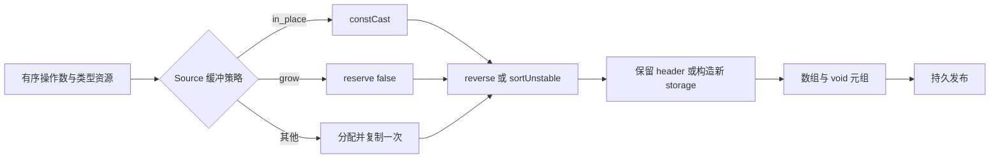

# 数组重排生成协议自举

## Intent：最终目标

将普通数组 reverse/sort 的完整生成协议迁入 RX/ZX，保留原地复用、增长缓冲、
新分配三条路径，不增加应用数据复制或运行库。

## Data：可用证据

起点 537d85c9，工作区干净。collections.zig 的重排分支仍在 Native；已有
splice 的绑定、复制和持久发布协议可复用。Source 已有 growth 调用目标、标准库
调用、constCast 与 list 所有权标记构造。比较函数名称已有 Source 实现。

## Edges：边界与限制

- 保留 source、clip、绑定、元素类型及 length/unit 准备顺序。
- in_place 优先；仅 grow 路径调用 reserve(false)；只有新分配路径额外复制一次。
- reverse 调用 mem.reverse；sort 调用 mem.sortUnstable，比较器登记保持去重及
  顺序，比较器名称和列表类型资源不消耗 fresh，需在适配边界复核。
- 输出仍为不可变协议的 [新数组, void]；原地路径保留 source header，其余路径
  分别按 grow 与普通分配构造所有权标签。不能把所有结果都标为同一 storage。
- Native 操作数驱动、比较器注册表、类型资源及持久 AST 发布仍为过渡依赖。

- 只移动真正复用的 bind/copy 原语，不保留转发微文件；不借此重构其他集合算法。

## Answer：交付格式与成功标准

集中验收 Source 格式/lint、现有所有权/容量/不可变/排序行为回归、两阶段自编译、
完整产物与 memo 对照、受影响路径及固定累计性能。文档按 IDEA 记录；编译器自身
生成开销与生成应用的运行分配分别核对，不以一个替代另一个。

## 实现与职责边界

build.rx 连接初始化、memory.rx、标准库变更、所有权包装和元组发布。
memory.rx 直接表达三路优先级，不让 Native 根据 Source 操作码重建算法。
allocate、grow、in_place 各自产生实际 AST；仅 allocate 后执行 copy。
移动原 splice bind/copy 到 ast/body，删除旧文件并修改真实消费者，没有增加
转发层。growth/target 复用原调用目标选择，callee 与 splice/retract、reorder/grow
共享；集合 Output 和 Native emission.apply 共享现有发布协议，splice 使用相同
拥有型导入，借用 capture 与 AST 描述符在同步调用帧内存活。
比较器注册暂留 Native，沿用原顺序遍历及去重。名称与选中列表类型准备前后
检查 serial 和辅助声明数不变；Source 只在 grow/allocate 绑定结果时推进 fresh。
最终结果转换、origin 元组与 aggregate.finish 保持在原位置。
Source 复用 proven 构造 storage：原地继承 header，grow 使用 true header，
普通新分配使用 false header，unique 始终为 true；未选中的普通列表直接返回
缓冲。uses_allocator 仅在非原地路径置位。没有新增应用运行库或动态派发。

## 已完成验收

24 份当前 Source 格式与 lint、5 份 Native 格式、diff 空白检查通过。
一名只读 agent 复核源码职责、三路内存策略、fresh 与临时数据寿命，未发现
具体语义偏差；源码审查不代替生成产物与行为证据。
两阶段自编译各 21/21 步成功，工具 SHA-256 一致：
af1b2091cc453df7e2ea4e838017e7791efc02e4219201a35fefe6c0cb87d9b7。
同一当前 manifest 的 main/collections/growth/ordered 各 3357/65/359/24 文件，
上一工具与 bootstrap 仅 .zxc-inputs 不同，bootstrap 与 production 完全相同。
既有 test-reverse-ownership、test-immutable-list、test-owned-collections 和
test-list-reverse 共 417/417 步、11892/11892 用例通过，没有新增测试用例。
容量检查中 map→reverse 的 16384 个 i64 元素载荷为 131072 B，累计分配
196704 B，低于两份完整载荷，source/library 两条路径均通过；2048 元素同样
通过。源值保留、共享/借用观察、对象/元组/循环输入和分配失败检查均由既有
用例覆盖。
日志中的测试诊断输出带有 `w` 和 `failed command` 行，但同一次执行最终退出
为 0，汇总全部通过；这些是 stderr 诊断，不把它们误报为行为失败或重跑测试。

## 性能与完整产物对照

受影响对照克隆当前 genz，只将 collections.zig 的 reverse/sort 分支切回原
Native 实现，splice 仍启用 Source，其余配置相同。比较器、类型资源和所有权

分析继续使用同一当前实现；两个驱动均从回归的真实响应文件构建。
reverse-ownership 的十项输入，加 immutable reverse/sort 两项，共 12 项；
每轮 48 个生成文件，8 轮逐文件 hash 全部相等。该证据同时核对了原地、增长、

复制路径实际生成形态，不仅比较执行成功。所有构建结束后交错计时，剔除首轮
取中位数：

| 指标                    | 原 Native reverse/sort | Source reverse/sort |
| ----------------------- | ---------------------: | ------------------: |
| CPU（含 time 包装进程） |             0.112163 s |          0.113243 s |
| 墙钟（含启动）          |             0.125409 s |          0.126307 s |

| 最大子进程 RSS | 9,502,720 B | 9,568,256 B |
局部合计约 +0.001080 s CPU、+0.000898 s 墙钟、+65,536 B RSS。如实保留

小增量，不将它报告为加速；应用数据复制形态未变，生成器自身仍有临时 AST
构造与拥有型发布成本。
固定累计基线仍为 inbound-conversion 工具（SHA 8f1e7cee…），不随提交重置。
141-entry manifest 的全部 roots 指向原来的 input/0～3 源码快照，输入内容未随
本阶段源文件移动而改变；关闭 resident，每轮独立输出与缓存。交错 8 轮、剔除
首轮后的中位数如下：

| 指标 | 固定累计基线 | 上一阶段 | 本阶段 |
| ---- | -----------: | -------: | -----: |
| CPU  |       5.33 s |   5.33 s | 5.34 s |
| 墙钟 |       1.16 s |   1.13 s | 1.13 s |

| RSS | 493,092,864 B | 490,717,184 B | 479,412,224 B |
单阶段及相对固定基线 CPU 均 +0.01 s，累计仍在约定容差内；近期约 5.3 s

的变化没有证明持续增长，但之后仍沿同一基线检查，不能按每次小增量重新领取
容差。上一阶段 RSS 范围 479,838,208～494,698,496 B，本阶段
473,333,760～495,550,464 B，区间重叠，不宣称内存下降。
冻结输入 2268 个文件仅 .zxc-inputs 不同，memo 8248/2419/1945/0 的全部
key 对应记录相等。当前四组 main/collections/growth/ordered 的 memo 记录也
逐项相等，数量分别为 11610/3230/2708/0、67/45/27/27、1135/313/268/0、
27/14/14/14。
证据目录 .zig-cache/cold-build-analysis/ownership-research/collection-reorder
包含 bootstrap.log、production.log、regressions.log、fixedpoint.json、
production-fixedpoint.json、memo-results.json、driver-scope.json、
affected-comparison.json、final-runtime-comparison.json 及 final-aligned-*。
路径、配置、完整 hash 和所有样本在报告中保留；缓存与日志不提交。

## 自我复核与剩余工作

本阶段迁移真实重排构造职责，RX 展示缓冲策略，Source 产生普通 Zig AST。
共享提取由完整当前输入与 splice 行为回归覆盖，没有以只移动文件或新增包装
替代迁移。Native 比较器注册与资源/发布桥仍在，不能宣称 collections 或整个
编译器已经完整自举。pop、push/concat 等其他构造、Lower 状态及最终传递依赖
审计、stage 1/2/3 验收继续。
本轮时间数据测生成器，不包含应用 Zig 后端或完整冷构建进程树。测试构建中
普通 CLI 编译的粗粒度 MaxRSS 与上一阶段同为 4G、约 1m；它不同于分区自举
host，不能与历史约 2 GB 的其他配置直接相减，也不足以证明精确峰值不变。

冷编译内存与完整 NLL 仍未解决，后续依已有科学归因继续优化，不用本阶段
生成器 RSS 或历史 bridge 收益代替当前完整冷构建证据。
