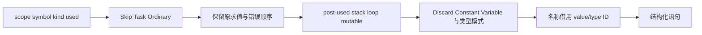

# 普通绑定声明自举

## Intent：最终目标

将 Scope 与 Statements 共用的普通单绑定前置路线、后置声明策略和一条
constant/variable/discard 发射迁入 ZX。保留反向 lowering、used 的读取时点、
Task/reuse/optionalCall 服务与成员恢复，不将完整 Scope/Statements 宣称为已自举。

## Data：可用证据

Scope 先尝试 reuse.append，再允许跳过“未用 Reference”，再处理 Task。普通
初始化先 optionalCall；Scope 提前保存 by_value，Statements 在 optionalCall
未命中后查询 stack。初始化完成后重新检查 used，只有确实声明才请求类型。
Scope 的 LoopLayout 优先于 StackLayout，Statements 没有 LoopLayout。

现有 statement importer 尚不接收普通 discard，虽然结构化列与 printer 已支持。
先补齐通用标量语句导入，再用于此绑定发射，不扩展解释/运行层。

## Edges：边界与限制

- Source 纯规则接收最小标量事实，发射只读最小列；不复制整个 used/control 表。
- 名称继续借用 Lower owner，已 lowering 的 value/type 句柄直接传递。
- 不能将 post-used 判断提前，不能合并 Scope/Statements 不同的 stack 查询时点。
- Task、destructure、result、reuse 的流程和各自原子职责不在本阶段重排。
- 不新增用例，复用现有 Scope/unused/evaluation-order、循环列和生成检查。

## Answer：交付格式与成功标准

集中验收 Source fmt/lint、引导与正式构建、完整代码/memo 对照、合法编辑恢复和
相关既有运行回归。只测受影响生成器路径并保留固定累计基线；出现退化先保留
迁移并定位优化，不为过门禁撤回自举。阶段完成提交推送全部变更并确认干净。

## 执行记录

4 个 ZX 文件的 8 项 fmt/lint 通过，引导与正式构建各 21/21；两个工具 SHA-256
均为 41ba88409e6b6c9b76f1eccaf44520fbcfea34138dedeb087bc499b8634ba6ae，复用
相同二进制的有效性能证据，不重复计时。

前置和后置规则的实际生成体无分配。after 按值返回两个 enum，origin 默认 null，
不持有 Input。emit 直接借用名称，type/value 标量在 FBA 退出前写入原语句。
Discard 保留通用列、tag、offset 和容量校验，只复制表达式 ID；没有文本或额外
生命周期。None 模式不读取绑定名称或类型。

上阶段与本阶段对当前完整三组输入生成 2928/65/357 文件，仅 .zxc-inputs 不同；
引导与正式工具连元数据也相同。memo 为 10417/2940/2419/0、67/45/27/27、
1126/311/266/0，逐键逐内容一致。九份既有样例的初始、合法编辑和恢复，前后
输出一致，增量等于干净生成，四类 memo 各 9 条一致。

冻结 141 个入口，三版交替 8 轮、排除首轮，无其他并行构建：

| 指标     |      上阶段 |      本阶段 | 同一固定累计基线工具 |
| -------- | ----------: | ----------: | -------------------: |
| CPU      |      5.28 s |      5.29 s |               5.31 s |
| 墙钟     |      1.12 s |      1.12 s |               1.15 s |
| 最大 RSS | 488505344 B | 483459072 B |          489635840 B |

CPU 单阶段 +0.01 s、累计 −0.02 s；墙钟单阶段不变、累计 −0.03 s。固定工具
仍为 inbound-conversion，未随提交重置。RSS 有波动，不声称稳定内存收益。
CPU 的固定相对余量已较小，后续不能逐阶段领取容差；若继续增长应先定位
重复小调用/临时列成本。冻结 2268 文件仅 .zxc-inputs 不同，12612 条 memo 完全一致。

Scope 的 by_value 仍在 optionalCall 前保存，Statements 仍在 initializer 路线及
声明时分别查 stack。post-used 未提前；新增的未使用绑定 stack/loop-field 查询
仅为完整符号域内的纯读取，不更新状态。Task、reuse、consumed_previous/last 和
成员恢复保持原顺序。没有把普通单绑定迁移等同于整个作用域或语句 lowering 完成。

证据位于忽略目录 .zig-cache/cold-build-analysis/ownership-research/binding，包括
source-validation.json、bootstrap/production.log、fixedpoint.json、
production-fixedpoint.json、memo-results.json、cleanup-edits-comparison.json、
final-runtime-comparison.json 和 regressions.log。五组既有回归共 444/444 步、
1700/1700 用例全部通过，目标为 evaluation-order、loop-columns、function-updates、
value-return、module-generation。未新增用例。

自我复核：这一阶段补齐通用 discard 导入能力后迁移消费，未以新 Source 入口
接通代替行为证明；完整输出与实际顺序/循环/更新用例相互验证。尚有反向调度、
reuse/Task 服务、解构和返回流程等 Native 职责，不宣称整个模块或全部自举完成。
