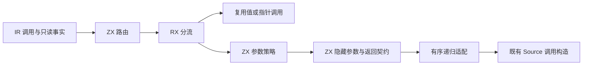
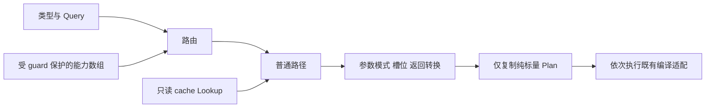

# 普通调用策略与参数契约自举

## Intent：最终目标

将 IR Call 的完整路由、参数策略、隐藏参数槽位和返回转换判定迁入 RX/ZX，
保留所有调用模式、参数求值顺序、缓存语义与成本模型。RX 显式连接路由、
普通参数选择和 ABI 计划；已有值调用策略继续复用，不建立平行实现。

## Data：可用证据

- 原实现位于 Lower.regular 的 Call 分支，先选择 value/pointer 路由，再选择普通
  参数的 external tuple、scalar borrow、state borrow/pointer 或直接表达式。
- scalar 判定已经支持 Optional 解包，复用 core/type_table/scalar。
- state 查询与整数 map 均已有 Source 原语；cache contains 不计入 cache_reads。
- Native 原顺序为 allocator → 参数求值与转换 → Store adapter → IO → process →
  functionReference → call → 返回转换 → 按最终 body 是否为空决定 block。
- 上阶段工具保留在 `ownership-research/invocation/production/bin/zxc-bootstrap`；
  固定累计基线仍为 inbound-conversion。

## Edges：边界与限制

- 原始函数能力数组借用给 Source，不能在 Native 无条件索引原来受分支保护的字段。
  Source 同样保留 guard 与短路；没有该路径需要的事实时，不提前访问数组。
- Query、类型列、函数标记和 cache 都只读借用，不复制底层表。
- ordinary plan 在 Native helper 返回前复制成纯标量，不能保留 scratch 中的可空
  Plan 指针或私有 origin 元数据。
- Native 继续适配递归求值与现有转换入口，保持原节点顺序与错误顺序；本阶段
  不是完整调用驱动自举，不通过入口委托掩盖剩余原生编排。
- RX 计划不是运行时解释器：只在编译器中计算静态 Zig 生成策略，应用 ABI 不变。
- 不新增测试用例，复用既有调用、原生 ABI、typed try、IO 和值返回回归。

## Answer：交付格式与成功标准

集中验证格式/lint、引导与正式构建、相关既有回归、完整代码/memo 对照、合法编辑
与恢复的增量等于干净生成、生成器隔离性能及固定基线累计变化。完成后收口全部
变更，英文规范提交并推送，确认工作区干净且无未推送提交。

### 执行记录

实现与验收完成：

- RX 先执行 route；值/指针路由立即返回，不访问普通调用专属事实。普通路径再
  连接 argument 和 plan，输出参数模式、Store/IO/process 槽位与返回转换要求。
- route 保留三条专门调用规则的优先级；argument 保留 ExternalTuple 优先于
  ScalarBorrow，随后才处理状态转换或普通表达式。
- independent 保留 product、input≠output、value function、fresh output 四项，
  没有将 fresh 替换成 constructed；scalar 继续复用 Optional 解包规则。
- 函数标记数组只读借用，Source 中按原 guard 索引；cache 复用 Lookup，不增加
  cache_reads，也不提前调用参数表达式或改变 scope 中的缓存恢复。
- Native 仅按 Source 模式连接现有递归适配，按原顺序生成节点和设置 uses_io/process。
  最终 body 是否为空仍在递归适配完成后检查，没有提前预测。
- 实际 executeValue.regular 是内联可空值，并非公共 ABI 的可空指针。通过
  columns.view 按字段复制成公共纯标量 Plan，未保留私有来源元数据。
- 6 个 RX/ZX 文件通过 12 项格式/lint；Zig 格式与 diff 空白检查通过。
- 最终引导构建 39/39 步、正式构建 21/21 步通过。
- 八组既有目标：function-analysis、value-return、native-value-boundary、
  typed-try-native-abi、rx-io-runtime、process-entry、modular-loop、evaluation-order，
  合计 462/462 步、1465/1465 项通过；没有新增测试用例。
- 当前 main、collections、growth 三组文件为 2879、64、356 个；迁移前、引导版与
  正式版仅 `.zxc-inputs` 不同，所有代码一致。四类 memo 键与记录值逐项相同：
  main 为 10397/2923/2402/0，collections 为 65/44/26/26，growth 为 1124/310/265/0。
- 九个既有样例的忽略目录副本完成 −1→−2→恢复的合法编辑；三阶段各 30 个代码
  文件，前后相同且增量等于干净生成，四类 memo 各 9 项相同。

### 临时内存与性能

首版同一冻结输入执行 8 轮交替测量，排除首轮：固定基线 CPU 5.34 s、耗时
1.17 s；阶段前后 CPU 5.26→5.28 s、耗时均 1.12 s、RSS 487440384→478527488 B。
CPU 增量达到单阶段容差边界，结合近期增长趋势继续检查新增适配成本。

核对值入口及十二个实际可达模块：route/argument/plan 与其类型、map、query 原语
不分配、不复制数组；两个 allocator.create 位于未使用的 executeIn 对象 ABI 包装，
不在 executeValue 路径。适配器仍保留 4 KB 缓冲，因此改为零容量分配器，消除
无用途的临时缓冲，并让无分配契约在实际调用中受到约束。

修改后重新完成构建与同组回归；产物、编辑恢复和 memo 对照均使用新的缓存目录，
不把旧缓存命中当作已执行新策略的证据。随后隔离执行第二组 8 轮交替测量，
排除首轮取中位数：

| 指标     | 固定累计基线 | 本阶段前    | 最终实现    |
| -------- | ------------ | ----------- | ----------- |
| CPU      | 5.35 s       | 5.26 s      | 5.27 s      |
| 耗时     | 1.17 s       | 1.11 s      | 1.12 s      |
| 峰值 RSS | 495140864 B  | 490520576 B | 481050624 B |

最终本阶段 CPU、耗时均 +0.01 s，按既定容差验收；相对固定基线 CPU −0.08 s、
耗时 −0.05 s。两组均未观察到 RSS 增长，但不将约 9 MB 差异归因于 4 KB 缓冲
修改，也不把两组之间的 0.01 s 变化称为已证明的优化收益。
近期微小增量仍保留在趋势记录中；后续继续关注高频策略调用、查询和适配成本，
不重置固定基线，不累加领取容差预算。

冻结输入 2268 个文件仅 `.zxc-inputs` 不同；12612 项 memo 的键与记录值相同。
测量覆盖生成器，不是完整冷构建或 LLVM 峰值的新测量。

### 自我批判与剩余职责

- 策略计算与真实递归驱动必须区分。本阶段 RX 表达路由和策略依赖，Native 仍
  执行 expr、tupleValue、转换、Store adapter、函数引用及 body 汇合；因此完整
  调用生成职责尚未自举，不能将删除 Lower 分支等同于迁移全部编排。
- 计划只依赖不可变元数据与进入调用时的 cache；参数求值过程中临时改变的
  active/types/layouts 沿用既有 defer 恢复，不消费中途状态预测后续分支。
- 类型和 map 原语已存在，未为迁移引入新语法、专用运行库或并行实现。
- 原 Source ABI 接线错误已修复；忽略目录中 memo 对照脚本的路径复用问题也已
  修正为实际 zero-buffer-selection 缓存，并重新核对非空记录和精确路径。
- 完整自举仍须迁移剩余原生状态/递归编排，完成传递依赖审计与 stage 1→2→3；
  本阶段产物一致不替代这些验收。

原始脚本、日志与报告位于忽略目录
`.zig-cache/cold-build-analysis/ownership-research/regular-call/`：
`source-validation.json`、`bootstrap.log`、`production.log`、`regressions.log`、
`policy-value-proof.zig.txt`、`zero-buffer-fixedpoint-result.json`、
`current-manifest-memo-comparison.json`、`selection-edits-comparison.json`、
`selection-memo-comparison.json`、`initial-runtime-comparison.json`、
`final-runtime-comparison.json` 与 `memo-comparison.json`。
