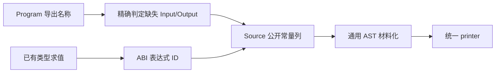

# 模块公开声明构造自举

## Intent：最终目标

将模块的 std 导入、显式类型导出、requires_io/process 元数据和缺省 Input/Output
公开别名的规则与 AST 构造迁入 RX/ZX；保持顺序、类型身份和 type-only 边界。

## Data：可用证据

起点 2de025ed，工作区干净。Lower.declarations 仍直接构造这些声明；其余类型、
shape、Store、入口与函数服务已有各自迁移，不能为拼接声明而改变这些服务。
已有 context/声明列原语、通用材料化和借用适配可复用；补齐常量列的增量 append，
避免先组装另一份 Constant 列表再拆成列。

## Edges：边界与限制

- std 必须先于 imports.lower，后者会识别已有 prelude。类型定义后才公开显式
  exports；requires_io 再 requires_process；type-only 在这里返回。
- shape 之后才补缺省 Input/Output；只按精确名称判断，不比较类型，不改变显式
  exports 的原顺序或去重行为。仍用普通 typeExpr，不能改用 layoutExpr。
- Native 保留类型求值、Lower 状态、已存在服务的调度和物理材料化，明确为过渡。
  不新增 Source 执行计划、专用运行库或原生语义回调。
- 非分配的名称查询只遍历输入，不构造临时列表；AST 构造使用短期工作区，发布后
  所需 payload 取得持久存储，文本借用 Program/静态常量，与原寿命一致。
- 不新增测试用例；复用 type-only、库公开 ABI、IO/Process 元数据和 CLI 回归。

## Answer：交付格式与成功标准

完整职责集中验收非空产物、自编译、既有行为、memo 和固定累计性能后，将全部
变更英文提交并推送，确认工作区干净及没有未推送提交，不宣称整个编译器已自举。

## 执行与验收

standard 构造结构化字符串、import builtin 及私有 std 常量。exports/build.rx
连接显式导出和 IO/Process 元数据；aliases 补齐精确名称查询报告缺失的端口。
append_constant 直接扩展声明列，没有先建立另一份 Constant 列表再拆列。

Native 仍负责现有服务调度、ABI 类型求值、列材料化及 Lower 状态。类型表达式
按原 exports 顺序先求值再批量发射：已核对非 shared 路径的类型缓存已填满；
shared 路径只添加表达式并更新 ABI 缓存，不接收或读取 output ArrayList，
不消耗 fresh，因此不依赖原先交错 append。此物理适配不算最终自举边界。

名称借用 Program 或静态字符串，nested AST payload 在短期工作区释放前复制
到持久 AST 存储。contracts 查询的实际生成闭包共 3 个函数，无直接分配；
两个标准库叶子 bytes.fromText 直接返回原切片，bytes.equals 调用 std.mem.eql，
均不分配。没有用 ReleaseSmall 的 catch unreachable 充当无分配证明。

- 11 个 RX/ZX 文件通过 fmt --check 和 lint；Native 文件通过格式检查。
- 引导及正式工具两轮各 21/21 步，P16 ReleaseSmall、12 核，执行文件
  SHA-256 均为 6ea99d11dcd8c115be2937586e7a67335ba048aa26ca63baca59e0ec16eab4ac。
- 当前 main/collections/growth 的 3163/65/357 个非空文件集合，上阶段与
  本轮仅 .zxc-inputs 不同；本轮两阶段的完整产物逐字节一致。
- 既有 test-library-link、test-library-bundle、test-library-import、
  test-process-context 通过 119/119 步、132/132 个受管用例。bundle/import
  另有 14 组外部 Node 执行，不混入受管用例数。覆盖 type-only 模块生成、
  类型名及 ABI、释放后所有权、库消费和 none/io/process/both 能力组合。
- CLI test-runtime 显式使用 P16，通过 59/59 步、30/30 个用例。
- 额外生成已有 packages/core/src/type_table/model.zx：实际产物保留 Kind、
  Table、Tables、Fields、TypeRow 和两项能力标记，不包含缺省 Input/Output、
  shape 或任何执行入口。没有新建用例；不以此声称专门覆盖 barrel 生成。

### 性能与 memo

全部构建终止后，使用同一冻结 141 个入口、工具链及配置，关闭 resident generator，
三版工具交替八轮并排除首轮。工具本体均为各阶段 Source 自编译产物，运行
使用 Source 分析/生成后端；固定基线执行文件与输入没有重置。

| 指标       | 固定累计基线 |      上阶段 |      本阶段 |
| ---------- | -----------: | ----------: | ----------: |
| CPU        |       5.34 s |      5.30 s |      5.31 s |
| 墙钟       |       1.16 s |      1.13 s |      1.13 s |
| 生成器 RSS |  493879296 B | 488374272 B | 486342656 B |

CPU 单阶段 +0.01 s、相对固定基线累计 −0.03 s；墙钟单阶段不变、累计 −0.03 s。
差异接近计时分辨率，近期各阶段约处于 5.3 s 范围，继续监控增长，不将每阶段
容差重新领取。RSS 的小幅差异不作为确定内存收益，也没有重测完整冷构建。

固定基线 SHA-256 仍为
8f1e7cee1eadb3ea0f6f7150bab951c55672ce294e4fbe7c50d5858723bdd92d；
上阶段为 ebbd5b3fc51c7396fec497957a0c3dc7d4a6b3f7b7404043638365c3e6bf8784。
冻结 2268 文件仅 .zxc-inputs 不同。四类 memo 逐键逐内容一致，非空计数为
main 10903/3088/2566/0、collections 67/45/27/27、growth 1126/311/266/0，
冻结输入 8248/2419/1945/0。

自我复核：真实产物、类型模块及能力组合支持本轮规则/AST 迁移，但不能由此
推断根 lowering 调度与状态已迁移，也不能宣称完整自举或冷构建峰值问题已解决。
没有为缩短迁移引入模板、RawCode、隐式去重、布局替代或专用运行库。

证据在忽略目录 .zig-cache/cold-build-analysis/ownership-research/module-publication：
bootstrap.log、production.log、fixedpoint.json、production-fixedpoint.json、
regressions.log、cli-runtime.log、query-closure.json、type-only-shape.json、
final-runtime-comparison.json、memo-results.json 及各轮完整产物、缓存与日志。
